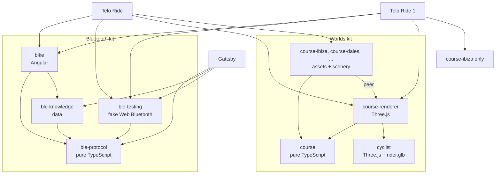

# Code sharing strategy: worlds, cyclists and Bluetooth

- **Status:** Proposed
- **Date:** 2026-11-26
- **Covers:** Telo Ride (`wattzup`), Telo Ride 1 (`ride-one`) and Gattsby (`gattsby`)
- **Kept in:** `wattzup/docs/` until the kit repositories exist; it then moves to them, and each app keeps
  only its own ADR (section 12).

## 1. The strategy in brief

1. **Stop copying. Publish.** The shared code and assets become versioned npm packages, built and tested
   once, in two new repositories: a **Bluetooth kit** (used by all three apps) and a **worlds kit** (used by
   Telo Ride and Telo Ride 1). The apps become consumers.
2. **Worlds are shared as courses.** A course is a package of its own: its `.glb`, its course file, its
   textures and its scenery code. Telo Ride installs every course; Telo Ride 1 installs Ibiza Sunset Strip
   and nothing else, so sharing does not change what Telo Ride 1 is.
3. **One cyclist.** The rider (`rider.glb`, `RiderBody`, `CourseCyclistKit` and the look, lean, stance and
   shadow helpers) is one package. The copy vendored at `wattzup/frontend/projects/world/src/ride-one/` and
   the fork beside it are deleted.
4. **One renderer core, with course plugins.** The 141 KB `course-renderer.ts` in Telo Ride and the 39 KB
   one in Telo Ride 1 are reconciled into a core that knows no course by name. A course's scenery arrives
   through a plugin contract and a dynamic import.
5. **One Blender course factory.** `tools/blender/` lives in the worlds kit. Built files are published in
   the course packages, not committed to either app.
6. **One protocol library.** Echelon frames, FTMS, and the standard characteristic decoders are a pure
   TypeScript package with no Angular and no `navigator.bluetooth`. Gattsby's knowledge base becomes a data
   package that also holds Echelon's vendor entry, which the ride apps read their chooser filters from.
7. **One fake bike.** The three fakes of `navigator.bluetooth` become one testing package of scripted
   devices.
8. **Migration is incremental and behaviour-preserving**, smallest and safest package first (the protocol),
   the renderer last. Each step is a slice whose proof is that the existing acceptance tests still pass
   unweakened.

## 2. What exists today

Measured on 2026-11-26 from the three checkouts.

### 2.1 The worlds and the cyclist

| Fact | Telo Ride (`wattzup`) | Telo Ride 1 (`ride-one`) |
| --- | --- | --- |
| `world` library | 345 source files, 138,905 lines of non-test TypeScript | 58 source files, 5,938 lines |
| of which `main`'s street scenes (`world-*.ts`) | 103 files, 103,131 lines | none (removed by ADR 0047) |
| of which course code | 173 files, 33,259 lines | all of it |
| `course-renderer.ts` | 141 KB, type-imports about 100 course modules | 39 KB; 2,713 lines differ |
| Courses built | 84 `.glb`, 275 MB in `public/courses/` | 1 `.glb`, 2.2 MB |
| `tools/blender/build_course.py` | 2,455 lines | 1,775 lines; 862 lines differ |
| `tools/blender/themes.py` | 1,554 lines | 127 lines |
| `.git` | 4.7 GB | 2.1 GB |

Of Telo Ride 1's 58 `world` files, **26 are byte-identical** to Telo Ride's, **16 have drifted**, and **16
exist only in Telo Ride 1** (the sun's shadow, the flyover and chase cameras, the frame budget, the course
probe, `CourseScene` and its loader).

Three signs that copying has already failed:

- **The cyclist exists three times.** Telo Ride holds its own `course-cyclist.ts` (with a `pursuit` option),
  a second copy vendored under `world/src/ride-one/` with Telo Ride 1's licence (identical to Telo Ride 1's,
  used only by `caribana-cyclists.ts`), and Telo Ride 1 holds the third. `rider.glb` and `rider.py` are
  still identical; the TypeScript is not.
- **The same course builds to two different files.** Both repositories build Ibiza Sunset Strip from the
  same course file (Intervals to the Beat, seed 46, layout 48). The results are 3,144,048 bytes in Telo Ride
  and 2,052,060 bytes in Telo Ride 1, because `build_course.py` drifted.
- **The course file format forked.** Telo Ride's `course.ts` grew a top-level field per course
  (`bankDegrees`, `gliders`, `cableways`, `ligurianCoast`, `headland`); Telo Ride 1's has none of them.

### 2.2 Bluetooth

| Area | Identical | Drifted | Only Telo Ride | Only Telo Ride 1 |
| --- | --- | --- | --- | --- |
| `domain/src/protocol/` | 6 | 2 | 4 (heart rate, packet frame) | 1 (telemetry decoder) |
| `domain/src/bluetooth/` | 11 | 12 | 2 (heart-rate strap) | 3 (`is-blocked`, remembered bike) |

- **The same bug was fixed twice, differently, on the same day.** On 2026-11-23 both repositories taught
  the chooser to find an Echelon by its name: Telo Ride with three `namePrefix` filters (`ECH`, `Ech`,
  `ech`), Telo Ride 1 with one (`ECH`) plus `optionalServices`. One of them is wrong for some bike.
- **Three taps on the same wire.** Telo Ride's `PacketTap` and `PACKET_LOG`, Telo Ride 1's `BIKE_LINK_TAP`
  (the diagnostic recording), and Gattsby's `RawTrafficLog` each record what is read and written.
- **Three fakes of `navigator.bluetooth`.** `e2e/fixtures/fake-bluetooth.ts` in Telo Ride (376 lines) and
  Telo Ride 1 (494 lines), and Gattsby's `src/simulation/` with its scripted devices.
- **Gattsby decodes what the ride apps decode.** It has its own Indoor Bike Data and Heart Rate Measurement
  decoders, FTMS control point and UUID helpers.
- **Gattsby needs what the ride apps know.** Its requirement FR-068 asks for Echelon's known-UUID entry at
  MVP. `src/knowledge-base/vendors/` holds Concept2 and Movesense and no Echelon, while both ride apps hold
  the Echelon service, characteristics, handshake (`A1`, `A3`, `B0`), keepalive (`A0`) and frame checksum,
  with `docs/protocol/echelon-ble-frames.md` as their source.

### 2.3 What makes sharing practical

The three apps already agree on the tools: Angular 22.2 to 22.3, TypeScript ~6.0.2, Vitest 5, Playwright,
ESLint 10 and Prettier 3. Both ride apps pin `three` at exactly 0.187.0. All three repositories are public
and MIT-licensed. The libraries are already addressed by package-style names (`@telo/world`), and courses
and the rider are already loaded by path (`courses/ibiza`, `riders/rider.glb`), so the runtime does not
need to change shape.

## 3. What the strategy must not break

Each rule below is taken from an `AGENTS.md` and is a constraint on every later section.

| Rule | Consequence for sharing |
| --- | --- |
| Lazy loading and memory come first; the initial bundle stays within its budget | Packages are ES modules with `sideEffects: false`. Three.js, the renderer and each course stay behind dynamic imports. Budgets stay in the apps and do not rise. |
| Telo Ride 1 has one course and no other worlds | It installs one course package. Nothing else reaches its build, its repository or its `node_modules`. |
| A ride finishes on the device without a network; the content security policy is static | Assets are copied into each app's build output and served same-origin. Nothing is hot-linked from a CDN or a registry at run time. |
| Nothing outside `bluetooth/` (ride apps) or the BLE layer (Gattsby) touches `navigator.bluetooth` | Shared code never names `navigator.bluetooth`. It is handed a GATT service, a characteristic or a `Bluetooth` object by the app's own boundary. |
| Gattsby: every `write` or `control` call needs approval; limits are data, enforced by code | Shared encoders only build bytes. Approval, limits and the emergency stop stay in Gattsby and wrap every write. |
| Gattsby: the model never decodes bytes | Shared decoders are deterministic code, which is what the rule asks for. |
| CI is green and under 5 minutes | Each kit has its own short pipeline. An app's pipeline gets shorter, not longer, because it stops building and testing shared code. |
| Use the words the specs use | The packages keep "course", "rider", "resistance", "target resistance" and `ble`. |

## 4. The mechanism: versioned npm packages from two kit repositories

### 4.1 Decision

Shared code and assets are published as public npm packages with provenance, from two repositories:

- **The Bluetooth kit** (working name `ble-kit`): protocol, knowledge base, fake devices and the ride apps'
  bike connection. Small, mostly pure TypeScript, three consumers.
- **The worlds kit** (working name `telo-worlds`): the course format, the cyclist, the renderer, every
  course and the Blender factory. Large, Three.js and binary assets, two consumers.

Packages are written below under the placeholder scope `@telo-kit/`. The apps' own workspace libraries keep
their `@telo/*` path aliases, so a published package is never confused with an app-local library.

### 4.2 Why this, and not the alternatives

| Option | Verdict | Reason |
| --- | --- | --- |
| Keep copying files | Rejected | It is what produced section 2. |
| Git submodule or subtree of a shared repository | Rejected | Every app would check out every course (275 MB and growing) and compile the kit's source under its own configuration. A cloud agent session scoped to one app cannot fetch a submodule outside its scope, while public npm packages install anywhere. A pinned commit has no version semantics. |
| One monorepo holding all three apps | Rejected | The three products have separate purposes, `AGENTS.md` files, deployments and 5-minute CI budgets. Gattsby (35 MB) would inherit a 4.7 GB history. |
| GitHub Packages as the registry | Rejected | Installing even a public package needs a token, in every CI job and every agent session. |
| Git or release-tarball dependencies | Rejected | No workspace support, no semver ranges, no automated update pull requests. |
| **Public npm packages, npm workspaces in each kit** | **Chosen** | Immutable versions, lockfile integrity, per-course installs, binaries out of the apps' git history, built and tested once, standard update tooling. |

Two kit repositories instead of one: the consumers differ (three apps against two), the toolchains differ
(`tsc` against Three.js and Blender), and someone changing a decoder for Gattsby should not clone course
assets. One repository would also work, with the same package boundaries; the split is the recommendation,
not a requirement.

## 5. The package map



| Package | Holds | Comes from | Depends on | Used by |
| --- | --- | --- | --- | --- |
| `ble-protocol` | Echelon frames and checksum; FTMS UUIDs, control point, ranges and features; decoders for Indoor Bike Data, Treadmill Data, Heart Rate Measurement, Battery Level and Device Information; UUID and hex helpers | `domain/src/protocol/` in both ride apps; Gattsby's `knowledge-base/decoders/`, `uuid.ts`, `ftms-control-point.ts`, `ble/hex-codec.ts` | nothing | all three |
| `ble-knowledge` | The knowledge base as versioned JSON with its schema, plus a generated typed module per vendor and standard profile | Gattsby's `src/knowledge-base/` and its `kb` script; Echelon's entry written from the ride apps' protocol and `docs/protocol/` | `ble-protocol` (decoder IDs) | all three |
| `ble-testing` | A fake `navigator.bluetooth` that plays scripted devices, records writes and pushes notifications; scripted Echelon and FTMS bikes, treadmill, heart-rate strap | Gattsby's `src/simulation/`; both ride apps' `e2e/fixtures/fake-bluetooth.ts`, `echelon.ts`, `ftms.ts` | `ble-protocol` | all three (tests and `?simulate`) |
| `bike` | `BikeLink`, the Echelon and FTMS links, the GATT write queue, keepalive, reconnection, bike identity and status, the Web Bluetooth and simulated bike connections, one link tap contract | `domain/src/bluetooth/` in both ride apps | `ble-protocol`, `ble-knowledge`, Angular | the two ride apps |
| `course` | The course file format, its version, `parseCourse` and `Course` (a place on the road by time or distance) | `world/src/course.ts` in both ride apps | nothing | renderer, course packages, apps, the Blender factory's checks |
| `cyclist` | `RiderBody`, `CourseCyclistKit`, rider look, shade, turn, lean, stance, finish, batch and shadows; `rider.glb` | `world/src/rider-*.ts` and `course-cyclist.ts`; `public/riders/rider.glb` | Three.js (peer) | renderer; the two ride apps |
| `course-renderer` | The renderer core: WebGPU with the WebGL 2 fallback, frame period, budget and scheduler, the ground, wall, window, water, sky, fence and halo materials, lamps, rain, the sun's shadow, the chase and flyover cameras, riders on the road, and the plugin contract. A secondary entry point, `course-renderer/angular`, holds the host component | `world/src/` in both ride apps | `course`, `cyclist`, Three.js (peer) | the two ride apps |
| `course-<id>` | One course: `.glb`, course file, textures, a still, and its scenery modules | `public/courses/<id>.*` and that course's modules in Telo Ride's `world/src/` | `course`; peer on a `course-renderer` major | Telo Ride (all); Telo Ride 1 (`course-ibiza`) |

Not published, but in the worlds kit: the Blender factory (`blender/`), the course bench and the films.

Gattsby's BLE layer stays Gattsby's own. It is the safety boundary (approvals, the raw traffic log, protected
GATT errors), so it uses the shared protocol and fakes but not the ride apps' connection.

## 6. Worlds and cyclists in detail

### 6.1 What is shared and what is not

- **Shared:** every course, the cyclist, the renderer core and the Blender factory.
- **Stays in Telo Ride:** `main`'s street scenes (`world-*.ts`, `worlds.ts`, the photoreal tiles, world
  music and ambience). They are 103,131 lines that Telo Ride 1 removed, and ADR 0035 moves every catalogue
  map off them; only classes and streamed real places still use them. Sharing them would move a retiring
  renderer into a library. `map-renderer.ts`, which hands the canvas between the two renderers, stays with
  them.
- **Stays in each app:** which courses are offered, the screens around the ride, and the app's own token
  bindings.

### 6.2 A course is a package

A course package exports a small descriptor and nothing heavy at the top level:

```ts
// Illustrative; the detailed design fixes the names.
export interface CoursePackage {
  readonly id: string;
  /** The course file format this build was written in. */
  readonly formatVersion: number;
  /** Paths under the app's asset folder, as the build copies them. */
  readonly files: { readonly glb: string; readonly course: string; readonly textures?: readonly string[] };
  /** The course's own scenery, loaded only when the course is drawn. */
  readonly scenery?: () => Promise<CourseScenery>;
}

export interface CourseScenery {
  build(context: SceneryContext): void | Promise<void>;
  update?(frame: SceneryFrame): void;
  /** Releases every geometry, material and texture the scenery made. */
  dispose(): void;
}
```

- **The renderer core names no course.** Today's `course-renderer.ts` in Telo Ride imports the type of
  about 100 course modules. In the kit each of those modules belongs to its course package and reaches the
  renderer through `CourseScenery`. Adding a course changes no renderer file.
- **An app lists the courses it offers** as dynamic imports, which is also what keeps each one in its own
  chunk:

  ```ts
  // Telo Ride 1: one line. Telo Ride: one line per course, generated from its catalogue.
  export const COURSES = { ibiza: () => import('@telo-kit/course-ibiza') };
  ```

- **Assets are copied at build time** by `angular.json`, so the URL scheme, the service worker
  configuration and the content security policy stay as they are:

  ```json
  { "glob": "**/*", "input": "node_modules/@telo-kit/course-ibiza/assets", "output": "courses" },
  { "glob": "rider.glb", "input": "node_modules/@telo-kit/cyclist/assets", "output": "riders" }
  ```

- **The course file gets a version and one place for a course's own data.** `formatVersion` is checked by
  `parseCourse`; a course's particular data (`gliders`, `cableways`, `headland` and the rest) moves under one
  `extras` map that only that course's scenery reads. The core format stops growing a field per course.

### 6.3 Reconciling the two renderers

Neither file is the base. The base is the contract, and Telo Ride 1's `CourseRenderer` in its `api` library
is the only one written down (`start`, `resize`, `draw`, `setFramePeriod`, `pauseBudget`, `dispose`).

1. Move the 26 identical files first; nothing to reconcile.
2. Reconcile the 16 drifted files one at a time, as a superset with options: an option, not a fork. The
   cyclist's `pursuit` look is the model: one kit, one option.
3. Bring Telo Ride 1's additions into the core (the sun's shadow, both cameras, the frame budget, the course
   probe): Telo Ride gains them.
4. Bring Telo Ride's additions in as core features Telo Ride 1 leaves unused (riders on the road, pacers,
   banked track) or as course scenery (everything named after a place).
5. Write the diff audit of the two `course-renderer.ts` files as the renderer's detailed design before any
   code moves. With 2,713 differing lines, this is the one step that needs study before a plan.

### 6.4 One Blender course factory

- `tools/blender/` moves to the worlds kit: `build_course.py`, `themes.py`, `rider.py`, `sky.py`,
  `pack_glb.py`, `meshopt_glb.mjs`, `render_film.py`, every course file and every per-course script.
- The factory writes into `packages/course-<id>/assets/`. Built files are committed in the kit (Git LFS for
  `.glb`, `.blend` and films) and published. **CI never runs Blender**; it packs and publishes what changed.
- Both apps delete `tools/blender/` and stop committing `.glb` files. From then on a course rebuild grows
  neither app's history.
- The first course through the factory is Ibiza Sunset Strip, built once, and both apps take that one build.
  Whichever of the two current builds is right is decided there, with the reason written down.

### 6.5 One cyclist

`cyclist` is the easiest world package and goes first: it is already vendored across the repositories, its
model and Blender source are still identical, and its drift is 45 lines. The shared kit is the superset
(`pursuit` from Telo Ride; `WHEELS` and the count of riders made from Telo Ride 1). `rider.glb` ships in
the package and `RIDER_BODY_PATH` stays `riders/rider.glb`.

## 7. Bluetooth in detail

### 7.1 `ble-protocol`: bytes and their meaning

Pure functions and constants; no Angular, no RxJS, no DOM beyond typed arrays. One decoder per
characteristic that reads every field the specification defines. Gattsby's table-driven Indoor Bike Data
decoder is the superset and becomes the shared one; the ride apps' `TelemetrySample` (speed, cadence, power)
becomes a three-line projection of it in `bike`. Gattsby keeps its labels and units in its own
`DecodedMetric` mapping. Unused decoders (heart rate in Telo Ride 1) are never imported and so never
bundled.

### 7.2 `ble-knowledge`: one statement of what each machine is

Gattsby owns this format today and keeps owning it. Two changes:

- **Echelon's vendor entry is written once**, from the ride apps' protocol: the service and its two
  characteristics, the name patterns, the handshake and the keepalive, each with its source. This closes
  Gattsby's FR-068.
- **The ride apps read their chooser from it.** `requestDevice`'s filters and `optionalServices`, and
  `SUPPORTED_BIKES`, are derived from the Echelon entry and the FTMS profile through a generated, typed,
  tree-shakeable module (`ble-knowledge/vendors/echelon`). The ride apps do not load the whole knowledge
  base. A name pattern is then fixed in one file, and section 2.2's double fix cannot recur.

This also gives the three products one loop: Gattsby identifies a machine and exports a device profile; the
profile becomes a knowledge-base entry; the next release of the ride apps can talk to that machine.

### 7.3 `ble-testing`: one fake bike

Gattsby's scripted-device model is the most general and becomes the base. The ride apps' Echelon and FTMS
fixtures become scripted devices in it. The rules every app already has stay in each app's fixture: an
unexpected Bluetooth call, an unapproved write or a request off localhost fails the spec. The same scripted
bike backs `?simulate`.

### 7.4 `bike`: the ride apps' connection

`domain/src/bluetooth/` in the two ride apps, reconciled the same way as the renderer: identical files
first, then the 12 drifted ones as options. Two points of design:

- **The app still owns `navigator.bluetooth`.** The connection is given a `Bluetooth` object by a provider
  in the app's `domain/bluetooth/`, which remains the only code that names the global.
- **One tap.** `PacketTap` and `BIKE_LINK_TAP` become one optional contract (`received`, `writing`, `event`).
  Telo Ride binds its packet log to it; Telo Ride 1 binds its diagnostic recording to it, still only with
  `?diagnose`, and still from its own entry point so no rider's chunk holds it (ADR 0048).

## 8. Contracts and each app's `api` library

Today every contract and injection token is in the app's `api` library, and `api` depends on nothing. The
two apps' `api` libraries have themselves drifted, so a shared package cannot import either.

- A kit package owns the contracts of what it implements (`CourseRenderer`, `CourseFrame`, `BikeConnection`,
  `TelemetrySample`). Where the renderer needs a workout type it declares the minimal shape it reads (a
  stage's seconds, level and cadence aim) and the app's `Segment` satisfies it structurally, so no shared
  workout package is needed.
- The app's `api` library re-exports those contracts and their tokens. App code keeps importing from
  `@telo/api`; the rule "components depend on the token in `api`" is unchanged for every screen.
- The dependency rule in each ride app's `AGENTS.md` and ESLint boundaries changes in one way: `api`,
  `domain` and `world` may import the kit packages named for them, and only those. `world` shrinks to the
  app's own glue (Telo Ride keeps `main`'s scenes there), and may later disappear from Telo Ride 1.
- Gattsby is one application with abstract-class contracts and needs no such change: its BLE layer, tools
  and knowledge-base loader import the packages directly.

## 9. Versions, releases and working across repositories

- **Semver, versioned independently per package** (Changesets). A breaking change to the plugin contract or
  the course format is a major of `course-renderer` or `course`.
- **Peers are narrow where the platform churns.** `three` is a peer at `~0.187.0`, as both apps pin it
  today, and a Three.js upgrade is one coordinated kit release. Angular is a peer at `^22.2.0` for the two
  Angular packages only.
- **A course is tied to the renderer by two things only:** the `formatVersion` in its file and its peer
  range on a `course-renderer` major. Rebuilding a course is a patch or minor of that one package.
- **Releases are automatic and signed.** Merging to a kit's main branch publishes changed packages from
  GitHub Actions with npm provenance (OIDC, no long-lived token). Every merge also publishes a `next`
  prerelease, so an app can try unreleased kit work without waiting.
- **Updates arrive as pull requests.** Renovate or Dependabot in each app, grouped per kit, so one kit
  release is one pull request whose CI is the app's own acceptance paths.
- **Working on a kit and an app together.** Each app carries a development-only `tsconfig.kit.json` whose
  `paths` point the kit packages at a sibling checkout's source (`../ble-kit/packages/*/src`). An agent
  session with both repositories attached edits both and sees the app build against kit source; the app's
  committed `package.json` still names a published version.

## 10. Proving it

- **Unit tests move with the code** and run in the kit. They are the kit's highest-value check, so the kit's
  CI runs them: its packages are pure or near-pure and the suites are fast.
- **The worlds kit has one drawn-frame check:** a harness page draws Ibiza Sunset Strip through the public
  contract and reads the course probe, as Telo Ride 1's `course-probe` fixture does today.
- **Acceptance tests stay in the apps** and are the proof of every migration slice: the behaviour does not
  change, so the specs do not change. A slice that needs a spec weakened is wrong.
- **Budgets stay in the apps and do not rise.** `bundle:size` (300 KB gzipped) and the `angular.json`
  budgets run on every kit update. The heap checks for the course are run, when a person asks, after the
  renderer lands in each app.
- **Each kit's CI stays under 5 minutes** by building and testing only the packages a change touches.

## 11. Migration

Ordered so that the pipeline is proven on the smallest package, value arrives early, and the hardest
reconciliation comes last with everything else already settled. Every phase is planned and built with the
`implementing-incrementally` skill, one slice at a time.

| Phase | What moves | Done when |
| --- | --- | --- |
| 0. Decide and scaffold | The open decisions in section 13; the two repositories with workspaces, lint, release pipeline and their own `AGENTS.md`; an ADR in each app | An empty package publishes with provenance and installs in all three apps |
| 1. `ble-protocol` | The 6 identical protocol files, then the 2 drifted; Gattsby's decoders | All three apps import it; their own copies and those copies' unit tests are deleted |
| 2. `ble-knowledge` and `ble-testing` | Gattsby's knowledge base; Echelon's entry; the three fakes | Gattsby's FR-068 passes; both ride apps' choosers read the same filters; each app's e2e runs on the shared fake |
| 3. `cyclist` | The rider and `rider.glb` | `world/src/ride-one/` and both forks are gone; one rider in both apps |
| 4. `course` and the factory | The format with `formatVersion`; the Blender factory; `course-ibiza` | Both apps draw the same Ibiza build from the package; neither holds `tools/blender/` |
| 5. `course-renderer` | The diff audit, then the core; Telo Ride 1 adopts first (one course, small surface), then Telo Ride | Telo Ride 1's `world` library is glue only; Telo Ride draws Ibiza through the core |
| 6. The other courses | Telo Ride's 83 remaining courses, one package each, behind the existing `COURSE_WORLDS` map so old and new run side by side | `public/courses/` in Telo Ride is empty; the old `course-renderer.ts` is deleted |
| 7. `bike` | The connection, links and tap | Both ride apps' `domain/bluetooth/` holds only the provider of `navigator.bluetooth` |

Phases 1 to 2 and 3 to 4 are independent and can run in parallel. Phase 6 is long but mechanical and can be
done a course at a time by separate sessions.

After phase 6 the apps' histories can be rewritten to drop the old binaries (4.7 GB and 2.1 GB). That is
destructive and optional; it is a separate decision for the owner.

## 12. Governance

**Where a change goes.**

| The change | Goes to | Then |
| --- | --- | --- |
| A new course, a rebuilt course, new scenery | worlds kit, that course's package | Telo Ride takes the update; Telo Ride 1 only if it is Ibiza |
| The rider's look or movement | worlds kit, `cyclist` | both ride apps |
| A renderer technique, quality tier or camera | worlds kit, `course-renderer` | both ride apps |
| A new frame, command or decoder | Bluetooth kit, `ble-protocol` | every app that uses it |
| A new machine, name pattern, limit | Bluetooth kit, `ble-knowledge` | Gattsby; the ride apps if they support the machine |
| Which courses a product offers; a screen; a rule of a ride | the app | nothing |

**Rules.**

- **No forks.** If one app needs different behaviour from a shared file, the file gets an option or the
  contract gets a plugin point. A copy of a kit file in an app is a defect.
- **The kit never knows its consumers.** No `if` on a product's name; no import from an app.
- **An app may leave something unused; it may not carry it.** What Telo Ride 1 leaves out must not reach its
  bundle. That is a property of the packages (entry points and dynamic imports) and is checked by its budget.
- **Each kit has its own `AGENTS.md`** with a purpose of its own, the rules of section 3 that apply to it,
  and the same requirement, design and ATDD discipline as the apps.

**Documents to write at adoption.**

- Telo Ride: an ADR that narrows ADR 0030 (the `world` library holds `main`'s scenes and glue) and amends
  ADRs 0034 to 0036 (courses and the rider come from the worlds kit); `AGENTS.md` dependency direction.
- Telo Ride 1: an ADR that narrows ADRs 0045 and 0047 the same way and states that it installs one course;
  `AGENTS.md` "Carried over from Telo Ride" and dependency direction.
- Gattsby: an ADR that the protocol, knowledge base and simulation come from the Bluetooth kit;
  `AGENTS.md` folder structure.
- Each kit: its ADR 0001 (this strategy's section 4), and the detailed designs of the plugin contract, the
  course format and the link tap.

## 13. Risks and open decisions

**Risks.**

| Risk | Mitigation |
| --- | --- |
| The renderer reconciliation is larger than it looks | It is last, behind a written audit, and both renderers run side by side in Telo Ride until the old one is empty |
| A kit release breaks an app | Updates arrive as pull requests that run the app's acceptance paths; versions are pinned by the lockfile |
| Cross-repository changes slow down course building, Telo Ride's busiest work | Course work moves wholly into the worlds kit and needs no app change; `next` prereleases and the `tsconfig.kit.json` override cover the rest |
| A Three.js upgrade has to land everywhere at once | One peer range, one coordinated release; the apps already pin the same version |
| Git LFS may not work in every cloud session | Verify in phase 0; the fallback is plain git, confined to the worlds kit |
| Something in a course package may not be redistributable | Audit every texture and model source before a course is published; the music stays in the apps |

**Decisions for the owner.**

1. **The npm scope and the repository names.** `@telo-kit`, `ble-kit` and `telo-worlds` are placeholders;
   the scope must be one the owner controls on npm, which has not been checked.
2. **Two kit repositories or one.** Two is recommended (section 4.2).
3. **Whether Telo Ride 1 will ever offer another course.** The strategy assumes not; if it will, that is a
   change to its purpose and needs its own requirement and ADR, though no change to the packages.
4. **Which Ibiza build is the course**: Telo Ride's (3.1 MB) or Telo Ride 1's (2.1 MB).
5. **Whether the Bluetooth packages carry a Telo name**, since Gattsby is not a Telo product.
6. **Whether to rewrite the apps' histories** after the binaries leave.
