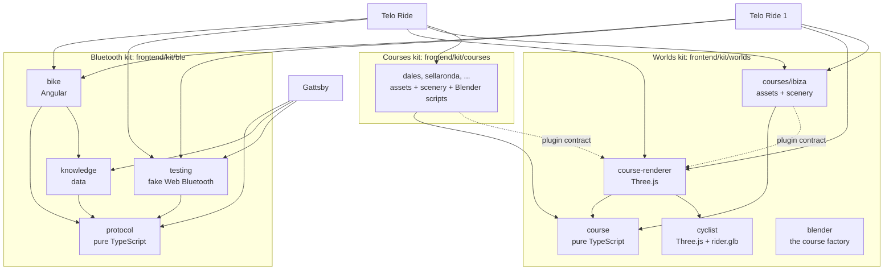

# Code sharing strategy: worlds, cyclists and Bluetooth

- **Status:** Proposed
- **Date:** 2026-11-26
- **Covers:** Telo Ride (`wattzup`), Telo Ride 1 (`ride-one`) and Gattsby (`gattsby`)
- **Kept in:** `wattzup/docs/` until the kit repositories exist; it then moves to them, and each app keeps
  only its own ADR (section 12).
- **Decided by the owner:** the kits are mounted as git submodules, with no npm packages; Telo Ride 1's
  build of Ibiza Sunset Strip is the course.

## 1. The strategy in brief

1. **Stop copying. Mount.** The shared code and assets move to three kit repositories, and each app mounts
   the ones it needs as git submodules under `frontend/kit/`. Kit source is compiled by the app through
   path aliases, exactly as the app's own libraries are today. Nothing is published and there is no registry.
2. **Three kits, split by who uses them.** A **Bluetooth kit** (all three apps), a **worlds kit** (the two
   ride apps: the renderer, the cyclist, the course format, the Blender factory and Ibiza Sunset Strip), and
   a **courses kit** (every other course; Telo Ride only, today).
3. **Worlds are shared as courses.** A course is a folder of its own: its `.glb`, its course file, its
   textures and its scenery code. Telo Ride 1 mounts the worlds kit and not the courses kit, so it holds
   Ibiza Sunset Strip and nothing else, and sharing does not change what Telo Ride 1 is.
4. **One cyclist.** The rider (`rider.glb`, `RiderBody`, `CourseCyclistKit` and the look, lean, stance and
   shadow helpers) is one library. The copy vendored at `wattzup/frontend/projects/world/src/ride-one/` and
   the fork beside it are deleted.
5. **One renderer core, with course plugins.** The 141 KB `course-renderer.ts` in Telo Ride and the 39 KB
   one in Telo Ride 1 are reconciled into a core that knows no course by name. A course's scenery arrives
   through a plugin contract and a dynamic import.
6. **One Blender course factory**, in the worlds kit. Built files are committed in the kits and never again
   in an app. Ibiza Sunset Strip is Telo Ride 1's build.
7. **One protocol library.** Echelon frames, FTMS, and the standard characteristic decoders are pure
   TypeScript with no Angular and no `navigator.bluetooth`. Gattsby's knowledge base moves beside it and
   gains Echelon's vendor entry, which the ride apps read their chooser filters from.
8. **One fake bike.** The three fakes of `navigator.bluetooth` become one library of scripted devices.
9. **Migration is incremental and behaviour-preserving**, smallest and safest library first (the protocol),
   the renderer last. Each step is a slice whose proof is that the existing acceptance tests still pass
   unweakened.

## 2. What exists today

Measured on 2026-11-26 from the three checkouts.

### 2.1 The worlds and the cyclist

| Fact | Telo Ride (`wattzup`) | Telo Ride 1 (`ride-one`) |
| --- | --- | --- |
| `world` library | 345 source files, 138,905 lines of non-test TypeScript | 58 source files, 5,938 lines |
| of which `main`'s street scenes (`world-*.ts`) | 103 files, 103,131 lines | none (removed by ADR 0047) |
| of which course code | 173 files, 33,259 lines | all of it |
| `course-renderer.ts` | 141 KB, type-imports about 100 course modules | 39 KB; 2,713 lines differ |
| Courses built | 84 `.glb`, 275 MB in `public/courses/` | 1 `.glb`, 2.2 MB |
| `tools/blender/build_course.py` | 2,455 lines | 1,775 lines; 862 lines differ |
| `tools/blender/themes.py` | 1,554 lines | 127 lines |
| `.git` | 4.7 GB | 2.1 GB |

Of Telo Ride 1's 58 `world` files, **26 are byte-identical** to Telo Ride's, **16 have drifted**, and **16
exist only in Telo Ride 1** (the sun's shadow, the flyover and chase cameras, the frame budget, the course
probe, `CourseScene` and its loader).

Three signs that copying has already failed:

- **The cyclist exists three times.** Telo Ride holds its own `course-cyclist.ts` (with a `pursuit` option),
  a second copy vendored under `world/src/ride-one/` with Telo Ride 1's licence (identical to Telo Ride 1's,
  used only by `caribana-cyclists.ts`), and Telo Ride 1 holds the third. `rider.glb` and `rider.py` are
  still identical; the TypeScript is not.
- **The same course builds to two different files.** Both repositories build Ibiza Sunset Strip from the
  same course file (Intervals to the Beat, seed 46, layout 48). The results are 3,144,048 bytes in Telo Ride
  and 2,052,060 bytes in Telo Ride 1, because `build_course.py` drifted.
- **The course file format forked.** Telo Ride's `course.ts` grew a top-level field per course
  (`bankDegrees`, `gliders`, `cableways`, `ligurianCoast`, `headland`); Telo Ride 1's has none of them.

### 2.2 Bluetooth

| Area | Identical | Drifted | Only Telo Ride | Only Telo Ride 1 |
| --- | --- | --- | --- | --- |
| `domain/src/protocol/` | 6 | 2 | 4 (heart rate, packet frame) | 1 (telemetry decoder) |
| `domain/src/bluetooth/` | 11 | 12 | 2 (heart-rate strap) | 3 (`is-blocked`, remembered bike) |

- **The same bug was fixed twice, differently, on the same day.** On 2026-11-23 both repositories taught
  the chooser to find an Echelon by its name: Telo Ride with three `namePrefix` filters (`ECH`, `Ech`,
  `ech`), Telo Ride 1 with one (`ECH`) plus `optionalServices`. One of them is wrong for some bike.
- **Three taps on the same wire.** Telo Ride's `PacketTap` and `PACKET_LOG`, Telo Ride 1's `BIKE_LINK_TAP`
  (the diagnostic recording), and Gattsby's `RawTrafficLog` each record what is read and written.
- **Three fakes of `navigator.bluetooth`.** `e2e/fixtures/fake-bluetooth.ts` in Telo Ride (376 lines) and
  Telo Ride 1 (494 lines), and Gattsby's `src/simulation/` with its scripted devices.
- **Gattsby decodes what the ride apps decode.** It has its own Indoor Bike Data and Heart Rate Measurement
  decoders, FTMS control point and UUID helpers.
- **Gattsby needs what the ride apps know.** Its requirement FR-068 asks for Echelon's known-UUID entry at
  MVP. `src/knowledge-base/vendors/` holds Concept2 and Movesense and no Echelon, while both ride apps hold
  the Echelon service, characteristics, handshake (`A1`, `A3`, `B0`), keepalive (`A0`) and frame checksum,
  with `docs/protocol/echelon-ble-frames.md` as their source.

### 2.3 What makes sharing practical

The three apps already agree on the tools: Angular 22.2 to 22.3, TypeScript ~6.0.2, Vitest 5, Playwright,
ESLint 10 and Prettier 3. Both ride apps pin `three` at exactly 0.187.0. All three repositories are public
and MIT-licensed. The libraries are already source, compiled by the app through `tsconfig.json` path
aliases (`@telo/world`), and courses and the rider are already loaded by path (`courses/ibiza`,
`riders/rider.glb`). A submodule changes where the source sits, not how it is built or loaded.

## 3. What the strategy must not break

Each rule below is taken from an `AGENTS.md` and is a constraint on every later section.

| Rule | Consequence for sharing |
| --- | --- |
| Lazy loading and memory come first; the initial bundle stays within its budget | Kit libraries are side-effect-free ES modules. Three.js, the renderer and each course stay behind dynamic imports. Budgets stay in the apps and do not rise. |
| Telo Ride 1 has one course and no other worlds | It does not mount the courses kit. No other course reaches its checkout, its build or its history. |
| A ride finishes on the device without a network; the content security policy is static | Assets are copied from the mounted kit into each app's build output and served same-origin. |
| Nothing outside `bluetooth/` (ride apps) or the BLE layer (Gattsby) touches `navigator.bluetooth` | Kit code never names `navigator.bluetooth`. It is handed a GATT service, a characteristic or a `Bluetooth` object by the app's own boundary. |
| Gattsby: every `write` or `control` call needs approval; limits are data, enforced by code | Shared encoders only build bytes. Approval, limits and the emergency stop stay in Gattsby and wrap every write. |
| Gattsby: the model never decodes bytes | Shared decoders are deterministic code, which is what the rule asks for. |
| CI is green and under 5 minutes | Each kit has its own short pipeline and runs its own unit tests. An app's pipeline checks out its kits shallowly and does not lint or test them again. |
| Use the words the specs use | The kits keep "course", "rider", "resistance", "target resistance" and `ble`. |

## 4. The mechanism: git submodules of three kit repositories

### 4.1 Decision

| Kit (working name) | Holds | Mounted at | Telo Ride | Telo Ride 1 | Gattsby |
| --- | --- | --- | --- | --- | --- |
| Bluetooth kit (`ble-kit`) | protocol, knowledge base, fake devices, the ride apps' bike connection | `frontend/kit/ble` | yes | yes | yes |
| Worlds kit (`telo-worlds`) | course format, cyclist, renderer, Blender factory, Ibiza Sunset Strip | `frontend/kit/worlds` | yes | yes | no |
| Courses kit (`telo-courses`) | every other course: assets, scenery, its Blender scripts | `frontend/kit/courses` | yes | no | no |

- **Source, not builds.** Each kit library has a `src/public-api.ts`, and the app's `tsconfig.json` maps an
  alias to it (`"@telo-kit/cyclist": ["./kit/worlds/cyclist/src/public-api.ts"]`). The app's own build
  compiles it, splits it and tree-shakes it, as it does `projects/world` today. No library is packaged.
- **Mounted inside `frontend/`**, so kit source resolves `three` and Angular from the app's `node_modules`
  and `angular.json` can copy kit assets from inside the workspace.
- **Shallow.** `.gitmodules` sets `shallow = true` for every kit, so a checkout fetches one commit, not a
  history.
- **Aliases are `@telo-kit/*`.** The apps' own libraries keep `@telo/*`, so a kit library is never confused
  with an app-local one, and the ESLint boundaries can name each.

### 4.2 Why three repositories

A submodule is all or nothing: an app that mounts a repository checks out all of it. So the kits are split
along the line of who uses what. Telo Ride 1 needs the renderer and one course, and must not check out 275 MB
of the others; Gattsby needs the protocol and must not check out a renderer. Ibiza Sunset Strip lives in the
worlds kit because both ride apps ride it and the renderer's own check draws it.

### 4.3 What submodules cost, and how each cost is met

| Cost | How it is met |
| --- | --- |
| A pin is a commit, not a version | A kit's main branch is always releasable. Releases are tagged and listed in the kit's `CHANGELOG.md`; an app's pin moves only to a tagged commit, in a pull request of its own that says which tag. |
| A change is two steps: the kit, then each app's pin | Dependabot's `gitsubmodule` updates open the pin pull request in each app. Its CI is the app's own acceptance paths. |
| A pin can point at a commit nobody pushed | `push.recurseSubmodules=check` is set by each app's setup, so git refuses the push. Kit work is merged in the kit before any app pins it. |
| The app compiles kit source under its own configuration | The three apps already share strict TypeScript settings. Each kit's CI compiles under those same settings, and the apps exclude `kit/` from their own ESLint, Prettier and unit-test runs. |
| Nothing checks that the app's `three` or Angular suits the kit | Each kit states the versions it needs in a small `requires.json`; each app's `tools/verify/verify.mjs` and its lint job fail on a mismatch. |
| Kit history holds the binaries | It does, but in the kits only. The apps' histories stop growing, and shallow mounts keep every checkout small. |
| CI and cloud sessions must fetch the kits | `actions/checkout` takes `submodules: true` in every job, the deploy job included. A cloud session needs the kit repository attached to push to it. Both are verified in phase 0. |

### 4.4 Alternatives considered

| Option | Verdict | Reason |
| --- | --- | --- |
| Keep copying files | Rejected | It is what produced section 2. |
| Published npm packages | Not chosen | They give semver, per-course installs and provenance, at the cost of a registry, a scope, a publish pipeline and a prerelease loop for every cross-repository change. For one owner and three apps on the same toolchain, submodules give the same single source with less machinery, and an edit to kit code compiles in the app at once. Revisit if someone outside these apps needs to consume a kit. |
| One monorepo holding all three apps | Rejected | The three products have separate purposes, `AGENTS.md` files, deployments and 5-minute CI budgets. Gattsby (35 MB) would inherit a 4.7 GB history. |
| Git subtree | Rejected | It copies the kit's files and history into every app, which keeps the binaries in the apps and makes sending a fix back upstream a manual step. |

## 5. The library map



| Library (alias `@telo-kit/…`) | Holds | Comes from | Depends on | Used by |
| --- | --- | --- | --- | --- |
| `ble-protocol` | Echelon frames and checksum; FTMS UUIDs, control point, ranges and features; decoders for Indoor Bike Data, Treadmill Data, Heart Rate Measurement, Battery Level and Device Information; UUID and hex helpers | `domain/src/protocol/` in both ride apps; Gattsby's `knowledge-base/decoders/`, `uuid.ts`, `ftms-control-point.ts`, `ble/hex-codec.ts` | nothing | all three |
| `ble-knowledge` | The knowledge base as versioned JSON with its schema, plus a generated typed module per vendor and standard profile | Gattsby's `src/knowledge-base/` and its `kb` script; Echelon's entry written from the ride apps' protocol and `docs/protocol/` | `ble-protocol` (decoder IDs) | all three |
| `ble-testing` | A fake `navigator.bluetooth` that plays scripted devices, records writes and pushes notifications; scripted Echelon and FTMS bikes, treadmill, heart-rate strap | Gattsby's `src/simulation/`; both ride apps' `e2e/fixtures/fake-bluetooth.ts`, `echelon.ts`, `ftms.ts` | `ble-protocol` | all three (tests and `?simulate`) |
| `bike` | `BikeLink`, the Echelon and FTMS links, the GATT write queue, keepalive, reconnection, bike identity and status, the Web Bluetooth and simulated bike connections, one link tap contract | `domain/src/bluetooth/` in both ride apps | `ble-protocol`, `ble-knowledge`, Angular | the two ride apps |
| `course` | The course file format, its version, `parseCourse` and `Course` (a place on the road by time or distance) | `world/src/course.ts` in both ride apps | nothing | renderer, courses, apps, the Blender factory's checks |
| `cyclist` | `RiderBody`, `CourseCyclistKit`, rider look, shade, turn, lean, stance, finish, batch and shadows; `rider.glb` | `world/src/rider-*.ts` and `course-cyclist.ts`; `public/riders/rider.glb` | Three.js | renderer; the two ride apps |
| `course-renderer` | The renderer core: WebGPU with the WebGL 2 fallback, frame period, budget and scheduler, the ground, wall, window, water, sky, fence and halo materials, lamps, rain, the sun's shadow, the chase and flyover cameras, riders on the road, the plugin contract, and the Angular host component | `world/src/` in both ride apps | `course`, `cyclist`, Three.js | the two ride apps |
| `course-ibiza` | Ibiza Sunset Strip: `.glb`, course file, still, scenery | Telo Ride 1's `public/courses/` and `sunset-strip` scenery | `course` | the two ride apps |
| `courses/<id>` (courses kit) | One course each: `.glb`, course file, textures, scenery modules, Blender script | `public/courses/<id>.*`, that course's modules in Telo Ride's `world/src/`, `tools/blender/<id>.py` | `course` | Telo Ride |

Gattsby's BLE layer stays Gattsby's own. It is the safety boundary (approvals, the raw traffic log, protected
GATT errors), so it uses the shared protocol and fakes but not the ride apps' connection.

## 6. Worlds and cyclists in detail

### 6.1 What is shared and what is not

- **Shared:** every course, the cyclist, the renderer core and the Blender factory.
- **Stays in Telo Ride:** `main`'s street scenes (`world-*.ts`, `worlds.ts`, the photoreal tiles, world
  music and ambience). They are 103,131 lines that Telo Ride 1 removed, and ADR 0035 moves every catalogue
  map off them; only classes and streamed real places still use them. Sharing them would move a retiring
  renderer into a library. `map-renderer.ts`, which hands the canvas between the two renderers, stays with
  them.
- **Stays in each app:** which courses are offered, the screens around the ride, and the app's own token
  bindings.

### 6.2 A course is a folder with one entry point

A course exports a small descriptor and nothing heavy at the top level:

```ts
// Illustrative; the detailed design fixes the names.
export interface CourseEntry {
  readonly id: string;
  /** The course file format this build was written in. */
  readonly formatVersion: number;
  /** Paths under the app's asset folder, as the build copies them. */
  readonly files: { readonly glb: string; readonly course: string; readonly textures?: readonly string[] };
  /** The course's own scenery, loaded only when the course is drawn. */
  readonly scenery?: () => Promise<CourseScenery>;
}

export interface CourseScenery {
  build(context: SceneryContext): void | Promise<void>;
  update?(frame: SceneryFrame): void;
  /** Releases every geometry, material and texture the scenery made. */
  dispose(): void;
}
```

- **The renderer core names no course.** Today's `course-renderer.ts` in Telo Ride imports the type of
  about 100 course modules. In the kits each of those modules belongs to its course's folder and reaches
  the renderer through `CourseScenery`. Adding a course changes no renderer file.
- **An app lists the courses it offers** as dynamic imports, which is also what keeps each one in its own
  chunk:

  ```ts
  // Telo Ride 1: one line. Telo Ride: one line per course, generated from its catalogue.
  export const COURSES = { ibiza: () => import('@telo-kit/course-ibiza') };
  ```

- **Assets are copied at build time** by `angular.json`, so the URL scheme, the service worker
  configuration and the content security policy stay as they are:

  ```json
  { "glob": "**/*", "input": "kit/worlds/courses/ibiza/assets", "output": "courses" },
  { "glob": "rider.glb", "input": "kit/worlds/cyclist/assets", "output": "riders" }
  ```

  Telo Ride adds one glob over `kit/courses/*/assets`.

- **The course file gets a version and one place for a course's own data.** `formatVersion` is checked by
  `parseCourse`; a course's particular data (`gliders`, `cableways`, `headland` and the rest) moves under one
  `extras` map that only that course's scenery reads. The core format stops growing a field per course.

### 6.3 Reconciling the two renderers

Neither file is the base. The base is the contract, and Telo Ride 1's `CourseRenderer` in its `api` library
is the only one written down (`start`, `resize`, `draw`, `setFramePeriod`, `pauseBudget`, `dispose`).

1. Move the 26 identical files first; nothing to reconcile.
2. Reconcile the 16 drifted files one at a time, as a superset with options: an option, not a fork. The
   cyclist's `pursuit` look is the model: one kit, one option.
3. Bring Telo Ride 1's additions into the core (the sun's shadow, both cameras, the frame budget, the course
   probe): Telo Ride gains them.
4. Bring Telo Ride's additions in as core features Telo Ride 1 leaves unused (riders on the road, pacers,
   banked track) or as course scenery (everything named after a place).
5. Write the diff audit of the two `course-renderer.ts` files as the renderer's detailed design before any
   code moves. With 2,713 differing lines, this is the one step that needs study before a plan.

### 6.4 One Blender course factory, and Ibiza as Telo Ride 1 built it

- The factory (`build_course.py`, `themes.py`, `rider.py`, `sky.py`, `pack_glb.py`, `meshopt_glb.mjs`,
  `render_film.py`) moves to the worlds kit's `blender/`. A course's own script, course file and scene move
  with the course: Ibiza's to the worlds kit, the others' to the courses kit.
- The factory writes into the course's `assets/` folder in its kit. Built files are committed there.
  **CI never runs Blender.**
- Both apps delete `tools/blender/` and `public/courses/*.glb`. From then on a course rebuild grows neither
  app's history.
- **Ibiza Sunset Strip is Telo Ride 1's build.** Its `ibiza.glb` (2,052,060 bytes), `ibiza.course.json` and
  still are moved to the worlds kit as they are, not rebuilt, and Telo Ride's 3.1 MB build is deleted.
  Telo Ride 1's `build_course.py` is the factory's starting point; what Telo Ride's adds for the other
  courses (themes, listed distance and climbing) is brought in afterwards, and each addition is accepted
  only if building Ibiza still gives the same road: the same course file and the same triangle count.
- Telo Ride draws that build from phase 4. Its Ibiza will then look as Telo Ride 1's does; the slice that
  switches it checks the course in Telo Ride's own renderer before the old file goes.

### 6.5 One cyclist

`cyclist` is the easiest world library and goes first: it is already vendored across the repositories, its
model and Blender source are still identical, and its drift is 45 lines. The shared kit is the superset
(`pursuit` from Telo Ride; `WHEELS` and the count of riders made from Telo Ride 1). `rider.glb` sits in
the library's `assets/` and `RIDER_BODY_PATH` stays `riders/rider.glb`.

## 7. Bluetooth in detail

### 7.1 `ble-protocol`: bytes and their meaning

Pure functions and constants; no Angular, no RxJS, no DOM beyond typed arrays. One decoder per
characteristic that reads every field the specification defines. Gattsby's table-driven Indoor Bike Data
decoder is the superset and becomes the shared one; the ride apps' `TelemetrySample` (speed, cadence, power)
becomes a three-line projection of it in `bike`. Gattsby keeps its labels and units in its own
`DecodedMetric` mapping. Unused decoders (heart rate in Telo Ride 1) are never imported and so never
bundled.

### 7.2 `ble-knowledge`: one statement of what each machine is

Gattsby owns this format today and keeps owning it. Two changes:

- **Echelon's vendor entry is written once**, from the ride apps' protocol: the service and its two
  characteristics, the name patterns, the handshake and the keepalive, each with its source. This closes
  Gattsby's FR-068.
- **The ride apps read their chooser from it.** `requestDevice`'s filters and `optionalServices`, and
  `SUPPORTED_BIKES`, are derived from the Echelon entry and the FTMS profile through a generated, typed,
  tree-shakeable module per vendor, committed in the kit. The ride apps do not load the whole knowledge
  base. A name pattern is then fixed in one file, and section 2.2's double fix cannot recur.

This also gives the three products one loop: Gattsby identifies a machine and exports a device profile; the
profile becomes a knowledge-base entry; the next pin of the ride apps can talk to that machine.

### 7.3 `ble-testing`: one fake bike

Gattsby's scripted-device model is the most general and becomes the base. The ride apps' Echelon and FTMS
fixtures become scripted devices in it. The rules every app already has stay in each app's fixture: an
unexpected Bluetooth call, an unapproved write or a request off localhost fails the spec. The same scripted
bike backs `?simulate`.

### 7.4 `bike`: the ride apps' connection

`domain/src/bluetooth/` in the two ride apps, reconciled the same way as the renderer: identical files
first, then the 12 drifted ones as options. Two points of design:

- **The app still owns `navigator.bluetooth`.** The connection is given a `Bluetooth` object by a provider
  in the app's `domain/bluetooth/`, which remains the only code that names the global.
- **One tap.** `PacketTap` and `BIKE_LINK_TAP` become one optional contract (`received`, `writing`, `event`).
  Telo Ride binds its packet log to it; Telo Ride 1 binds its diagnostic recording to it, still only with
  `?diagnose`, and still from its own entry point so no rider's chunk holds it (ADR 0048).

## 8. Contracts and each app's `api` library

Today every contract and injection token is in the app's `api` library, and `api` depends on nothing. The
two apps' `api` libraries have themselves drifted, so a kit library cannot import either.

- A kit library owns the contracts of what it implements (`CourseRenderer`, `CourseFrame`, `BikeConnection`,
  `TelemetrySample`). Where the renderer needs a workout type it declares the minimal shape it reads (a
  stage's seconds, level and cadence aim) and the app's `Segment` satisfies it structurally, so no shared
  workout library is needed.
- The app's `api` library re-exports those contracts and their tokens. App code keeps importing from
  `@telo/api`; the rule "components depend on the token in `api`" is unchanged for every screen.
- The dependency rule in each ride app's `AGENTS.md` and ESLint boundaries changes in one way: `api`,
  `domain` and `world` may import the kit libraries named for them, and only those; no kit library imports
  an `@telo/*` alias. `world` shrinks to the app's own glue (Telo Ride keeps `main`'s scenes there), and may
  later disappear from Telo Ride 1.
- Gattsby is one application with abstract-class contracts and needs no such change: its BLE layer, tools
  and knowledge-base loader import the kit libraries directly.

## 9. Pins, releases and working across repositories

- **A kit's main branch is always releasable.** Every merge passes the kit's CI. A release is a tag
  (`v1.4.0`) and a `CHANGELOG.md` entry that says what changed and whether an app must change with it.
- **An app pins a tag.** The pin moves in a pull request of its own, opened by Dependabot or by hand, whose
  description names the tag. Its CI is the app's own lint, build, budget and acceptance paths.
- **Breaking changes are marked, not hidden.** A change to the plugin contract, the course file's
  `formatVersion`, the link tap or a decoder's result is a major tag, and the pull request that pins it
  carries the app's own change.
- **The courses kit follows the worlds kit.** Each course states the `formatVersion` it was built in, and
  the courses kit's `requires.json` names the worlds kit tag it was checked against. Telo Ride pins the two
  together.
- **Platform versions are stated once.** Each kit's `requires.json` gives its `three`, Angular and
  TypeScript; `three` stays exactly as both apps pin it today (0.187.0), and a Three.js upgrade is one
  worlds kit release that every app pins with its own `package.json` change.
- **Working on a kit and an app together needs nothing extra.** The submodule is a full working copy: edit
  kit source under `frontend/kit/…`, and the app builds against it at once. The work is committed and merged
  in the kit first, and the app's pin follows. An agent session doing this has the kit repository attached
  as well as the app.

## 10. Proving it

- **Unit tests move with the code** and run in the kit. They are the kit's highest-value check, so the kit's
  CI runs them: its libraries are pure or near-pure and the suites are fast. The apps do not run them again.
- **The worlds kit has one drawn-frame check:** a harness page draws Ibiza Sunset Strip through the public
  contract and reads the course probe, as Telo Ride 1's `course-probe` fixture does today.
- **Acceptance tests stay in the apps** and are the proof of every migration slice: the behaviour does not
  change, so the specs do not change. A slice that needs a spec weakened is wrong.
- **Budgets stay in the apps and do not rise.** `bundle:size` (300 KB gzipped) and the `angular.json`
  budgets run on every pin. The heap checks for the course are run, when a person asks, after the renderer
  lands in each app.
- **Each kit's CI stays under 5 minutes.** The courses kit's checks are static: every course file parses,
  its `formatVersion` is current, and every file it names exists.

## 11. Migration

Ordered so that the mechanism is proven on the smallest library, value arrives early, and the hardest
reconciliation comes last with everything else already settled. Every phase is planned and built with the
`implementing-incrementally` skill, one slice at a time.

| Phase | What moves | Done when |
| --- | --- | --- |
| 0. Scaffold and verify | The three repositories with lint, CI and their own `AGENTS.md`; an ADR in each app; `.gitmodules`, aliases, ignores and `submodules: true` in each app | A one-file library is mounted, compiled and deployed by all three apps, from CI and from a cloud session |
| 1. `ble-protocol` | The 6 identical protocol files, then the 2 drifted; Gattsby's decoders | All three apps import it; their own copies and those copies' unit tests are deleted |
| 2. `ble-knowledge` and `ble-testing` | Gattsby's knowledge base; Echelon's entry; the three fakes | Gattsby's FR-068 passes; both ride apps' choosers read the same filters; each app's e2e runs on the shared fake |
| 3. `cyclist` | The rider and `rider.glb` | `world/src/ride-one/` and both forks are gone; one rider in both apps |
| 4. `course`, the factory and Ibiza | The format with `formatVersion`; the Blender factory; Telo Ride 1's Ibiza build | Both apps draw Telo Ride 1's Ibiza from the worlds kit; neither holds `tools/blender/` |
| 5. `course-renderer` | The diff audit, then the core; Telo Ride 1 adopts first (one course, small surface), then Telo Ride | Telo Ride 1's `world` library is glue only; Telo Ride draws Ibiza through the core |
| 6. The other courses | Telo Ride's 83 remaining courses into the courses kit, one at a time, behind the existing `COURSE_WORLDS` map so old and new run side by side | `public/courses/` in Telo Ride is empty; the old `course-renderer.ts` is deleted |
| 7. `bike` | The connection, links and tap | Both ride apps' `domain/bluetooth/` holds only the provider of `navigator.bluetooth` |

Phases 1 to 2 and 3 to 4 are independent and can run in parallel. Phase 6 is long but mechanical and can be
done a course at a time by separate sessions.

After phase 6 the apps' histories can be rewritten to drop the old binaries (4.7 GB and 2.1 GB). That is
destructive and optional; it is a separate decision for the owner.

## 12. Governance

**Where a change goes.**

| The change | Goes to | Then |
| --- | --- | --- |
| A new course, a rebuilt course, new scenery | courses kit (worlds kit for Ibiza) | Telo Ride pins it; Telo Ride 1 only if it is Ibiza |
| The rider's look or movement | worlds kit, `cyclist` | both ride apps |
| A renderer technique, quality tier or camera | worlds kit, `course-renderer` | both ride apps |
| A new frame, command or decoder | Bluetooth kit, `ble-protocol` | every app that uses it |
| A new machine, name pattern, limit | Bluetooth kit, `ble-knowledge` | Gattsby; the ride apps if they support the machine |
| Which courses a product offers; a screen; a rule of a ride | the app | nothing |

**Rules.**

- **No forks.** If one app needs different behaviour from a shared file, the file gets an option or the
  contract gets a plugin point. A copy of a kit file in an app is a defect.
- **No local edits left in a mount.** A change under `frontend/kit/` is committed in the kit and merged there
  before the app's pin moves. An app's pin never points at a branch.
- **The kit never knows its consumers.** No `if` on a product's name; no import from an app.
- **An app may leave something unused; it may not carry it.** What Telo Ride 1 leaves out must not reach its
  bundle. That is a property of the entry points and dynamic imports, and is checked by its budget.
- **Each kit has its own `AGENTS.md`** with a purpose of its own, the rules of section 3 that apply to it,
  and the same requirement, design and ATDD discipline as the apps.

**Documents to write at adoption.**

- Telo Ride: an ADR that narrows ADR 0030 (the `world` library holds `main`'s scenes and glue) and amends
  ADRs 0034 to 0036 (courses and the rider come from the kits); `AGENTS.md` dependency direction.
- Telo Ride 1: an ADR that narrows ADRs 0045 and 0047 the same way and states that it mounts no courses
  kit; `AGENTS.md` "Carried over from Telo Ride" and dependency direction.
- Gattsby: an ADR that the protocol, knowledge base and simulation come from the Bluetooth kit;
  `AGENTS.md` folder structure.
- Each kit: its ADR 0001 (this strategy's section 4), and the detailed designs of the plugin contract, the
  course format and the link tap.

## 13. Risks and open decisions

**Risks.**

| Risk | Mitigation |
| --- | --- |
| The renderer reconciliation is larger than it looks | It is last, behind a written audit, and both renderers run side by side in Telo Ride until the old one is empty |
| A kit change breaks an app | An app's pin moves only in a pull request that runs its acceptance paths |
| A pin, a detached HEAD or an unpushed kit commit goes wrong in an agent session | The rules of section 4.3 and 12; `push.recurseSubmodules=check`; each app's `AGENTS.md` says how to change kit code |
| Cloud sessions or the deploy job cannot fetch a kit | Verified in phase 0, before anything depends on it |
| Cross-repository changes slow down course building, Telo Ride's busiest work | Course work happens wholly in the courses kit and needs no app change beyond a pin |
| A Three.js upgrade has to land everywhere at once | One stated version per kit; the apps already pin the same one |
| A future edition wants one course and gets all of them | Accepted for now. If it happens, that course moves to the worlds kit beside Ibiza, or the courses kit is split |

**Decided.**

- The kits are git submodules; nothing is published to npm.
- Ibiza Sunset Strip is Telo Ride 1's build.

**Decisions for the owner.**

1. **The repository names.** `ble-kit`, `telo-worlds` and `telo-courses` are placeholders, and the Bluetooth
   kit need not carry a Telo name, since Gattsby is not a Telo product.
2. **Whether Telo Ride 1 will ever offer another course.** The strategy assumes not; if it will, that is a
   change to its purpose and needs its own requirement and ADR.
3. **Whether to rewrite the apps' histories** after the binaries leave.
