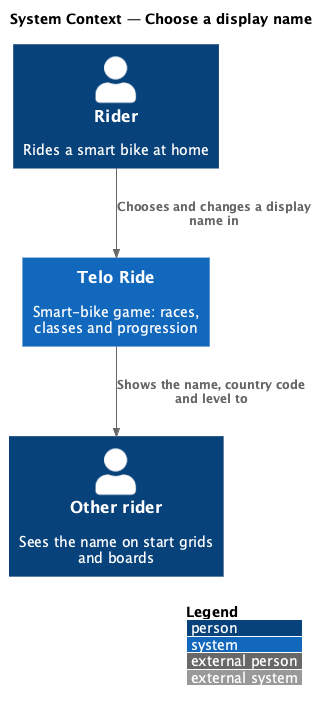
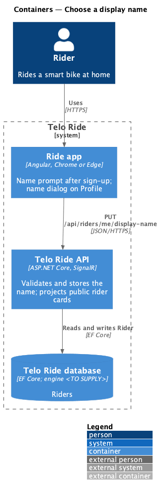
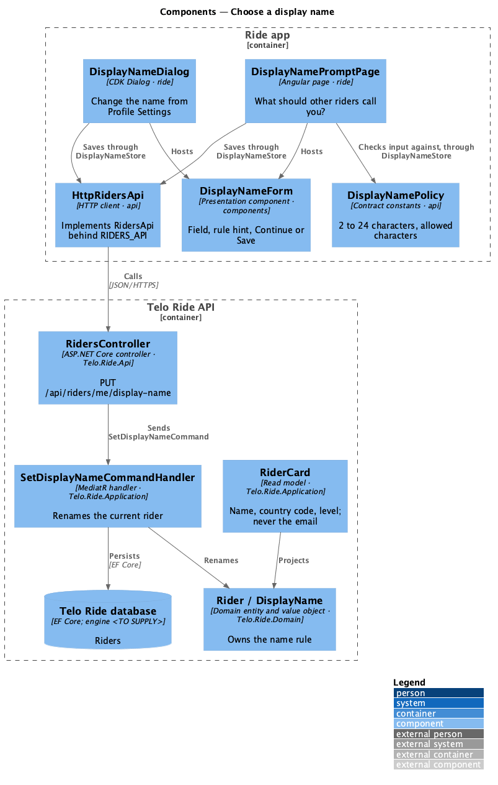
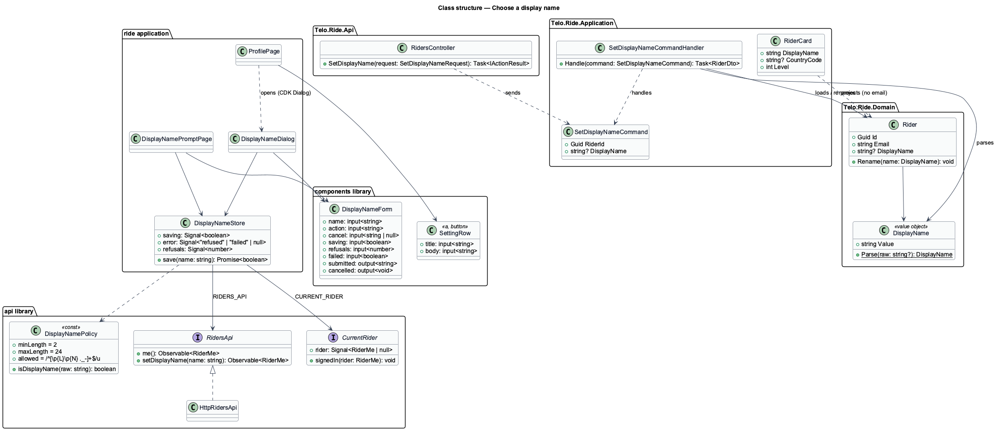
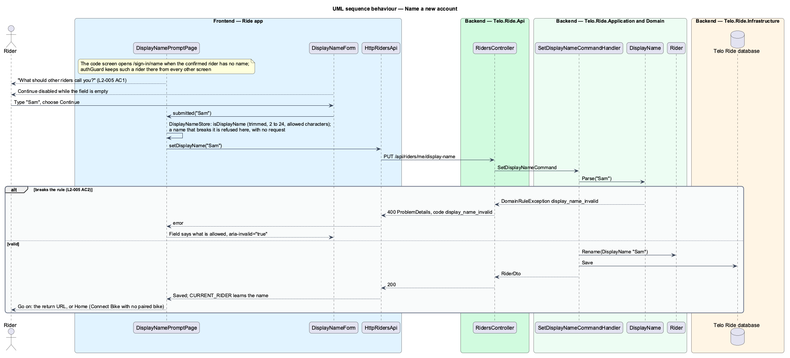
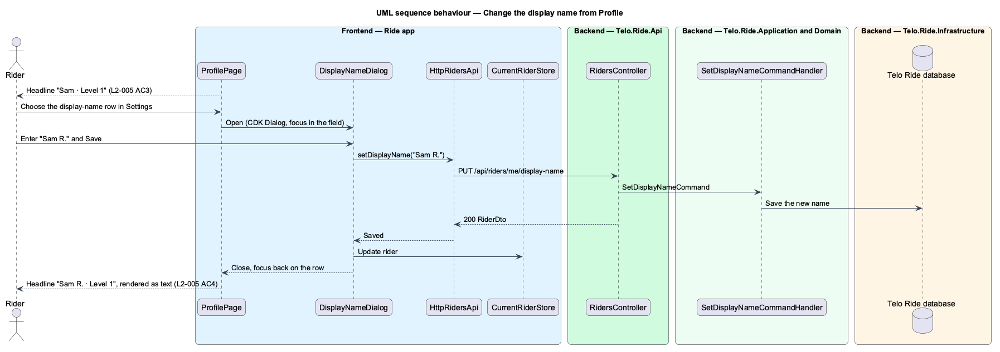

# Choose a display name

## Overview

Telo Ride puts riders side by side: start grids in the race lobby, live standings in a race and
output boards in a group class. Each rider appears there under a name they choose. This feature
lets a rider set that name when the account is created and change it later from Profile.

- **display name** — name of 2 to 24 characters, after trimming, made of letters, digits, spaces,
  `.`, `_` and `-`, that other riders see
- **rider card** — public view of a rider made of the display name, the country code and the rider
  level, and never the email address

A new account has no display name. Straight after the first code is confirmed ([Sign in with an
email code](../sign-in-with-an-email-code/README.md)), the rider is asked "What should other
riders call you?" and cannot go on until a name is entered. Afterwards, the Profile headline uses
the name ("Sam · Level 7"), and the Settings section on Profile offers a row to change it.

A display name is rider-supplied text. Every screen renders it as text, never as HTML, as
[Validate input and encode output](../../security/validate-input-and-encode-output/README.md)
requires for all such text.

The prompt is mocked at `docs/mocks/pages/sign-in-name/`, the dialog at
`docs/mocks/dialogs/display-name/`, and the Settings row on every Profile mock.

## Description

### Ride app (frontend)

- **`DisplayNamePromptPage`** (`wz-display-name-prompt-page`, route `/sign-in/name`) — page shown
  when the confirmed rider has no display name. It hosts `DisplayNameForm` with the action
  "Continue". After saving, it goes on to the screen the rider asked for, or Home (which sends a
  rider with no paired bike to Connect Bike). The `authGuard` sends a signed-in rider with no
  display name here from every other screen, keeping the screen asked for as `returnUrl`; a
  visitor with no session who opens it goes to sign-in.
- **`DisplayNameDialog`** — CDK Dialog in the `ride` application, opened from the display-name row
  of Profile Settings. It hosts `DisplayNameForm` with the current name and the actions "Cancel"
  and "Save". On success it closes, and the CDK returns focus to the row. Escape and the close
  button cancel. Editing never happens inline on Profile.
- **`DisplayNameStore`** (`ride`, provided by the prompt route and by the dialog) — refuses a
  name that breaks `isDisplayName` at once, without a request, and otherwise saves through
  `RIDERS_API`; it keeps `saving`, the last `error` (`refused` for either refusal, `failed` for
  anything else) and a count of `refusals`, and tells `CURRENT_RIDER` the new name.
- **`DisplayNameForm`** (`wz-display-name-form`, `components` library) — presentation component
  with one field, the rule as a hint and its actions: "Continue" as a block button on the prompt,
  "Cancel" and "Save" in the dialog. The primary button stays `disabled` while the trimmed value is
  empty, and it emits the trimmed name as `submitted`. Each new refusal (`refusals`) marks the
  field `aria-invalid="true"` and puts "Use 2 to 24 characters: letters, digits, spaces, . _ and
  -." under it as an alert, until the name is changed. A failed save shows "We couldn't save your
  name. Check your connection and try again." It holds no rule itself: `components` takes only
  types from `api`.
- **`SettingRow`** (`a[wz-setting-row]`, `button[wz-setting-row]`, `components` library) — one row
  of Profile's Settings: an icon, a title, a line under it and a chevron.
- **`ProfilePage`** (`/profile`) — in this slice, the headline "Sam · Level 1" and the Settings
  section with the display-name row. Every rider is level 1 until XP lands (journey 10); slice
  13.3 adds the XP bar, maps, recent rides and the other Settings rows.
- **`isDisplayName`** and **`DISPLAY_NAME_MIN_LENGTH`** / **`DISPLAY_NAME_MAX_LENGTH`** (`api`
  library) — the rule: 2 to 24 characters after trimming, allowed characters `^[\p{L}\p{N} ._-]+$`.
  The frontend uses it for immediate feedback; the backend's rule is authoritative.
- **`RidersApi`** / **`RIDERS_API`** / **`HttpRidersApi`** (`api` library) —
  `setDisplayName(name)` sends `PUT /api/riders/me/display-name`; `me()` reads the current rider.

### Telo Ride API (backend)

- **`RidersController`** (`Telo.Ride.Api`) — `PUT /api/riders/me/display-name` with
  `{ "displayName": "…" }` sends one `SetDisplayNameCommand` for the signed-in rider and answers
  200 with the rider (`RiderDto`).
- **`SetDisplayNameCommandHandler`** (`Telo.Ride.Application`) — parses the name with
  `DisplayName.Parse`, loads the rider through `IAppDbContext`, calls `Rider.Rename`, and saves.
- **`DisplayName`** (`Telo.Ride.Domain`) — value object that trims the input and enforces the
  rule in `Parse`, so no invalid name can reach an entity. A name that breaks it is refused with
  `DomainRuleException("display_name_invalid")`, which answers 400 with that `code`, as
  `EmailAddress` refuses an address (no FluentValidation rule: the domain type is the one rule).
- **`Rider.Rename(DisplayName)`** — replaces the rider's display name.
- **`RiderCard`** (`Telo.Ride.Application`) — read model used wherever another rider is shown
  (rosters, standings). It carries `DisplayName`, `CountryCode` and `Level` and has no email
  field, so no query that builds it can leak one. Where `CountryCode` comes from (rider input,
  browser locale or none) is `<TO SUPPLY>`. Not built in slice 9.3: no screen shows another
  rider yet; the first roster (the race lobby or a group class) adds it.

## Requirements

The feature realizes the following level-2 (L2) requirements. Each L2 requirement refines a
level-1 (L1) requirement, cited by identifier.

| L2 ID | Refines (L1) | Requirement |
|-------|--------------|-------------|
| `L2-005` | `L1-001` | When a new account's code is confirmed, the rider shall be asked "What should other riders call you?" before going on, with Continue disabled until a name is entered. A saved display name shall be 2 to 24 characters after trimming, made of letters, digits, spaces, `.`, `_` and `-`; anything else shall be refused with 400 and the field shall say what is allowed. Profile's headline shall use the name ("Sam · Level 7") and the rider shall be able to change it there. A display name shall be rendered as text, never as HTML. Another rider shall see only the name, country code and level, never the email. |

## Diagrams

### System context

The rider chooses a name in Telo Ride; other riders see it, with the country code and level, on
grids and boards.

### Containers

The Ride app sends the name to the Telo Ride API, which validates it and stores it on the rider in
the Telo Ride database.

### Components

Both the prompt page and the Profile dialog host the same `DisplayNameForm` and save through
`HttpRidersApi`. On the backend, `SetDisplayNameCommandHandler` parses the name with the
`DisplayName` value object, the one rule, and renames the `Rider`; `RiderCard` is the only public
projection of a rider.

### Class structure

`DisplayNameForm` checks input against `DisplayNamePolicy`; the backend's `DisplayName` value
object holds the authoritative rule, and `RiderCard` projects a `Rider` without its email.

### Behaviour — name a new account

The prompt keeps Continue disabled until a name is typed (`L2-005` AC1). A name that breaks the
rule returns 400 with the field and code, and the form marks the field invalid (`L2-005` AC2).

### Behaviour — change the display name from Profile

The Settings row opens a dialog; a saved name updates the current rider, and the headline shows it
as text (`L2-005` AC3, AC4).

## Open questions

- **Level on the headline.** No rider earns XP until journey 10, so every rider is level 1 and the
  headline reads "Sam · Level 1" from a constant; journey 10 brings the level from progress.
- **What another rider sees (`L2-005` AC5).** `RiderCard` waits for the first screen that shows
  another rider. Until then the only rider the API returns is the signed-in one (`GET
  /api/riders/me`), which carries no email.
- **Initial bundle.** The dialog is the first CDK Dialog in the app. Its own code loads with
  Profile, but the parts of Angular's core and of RxJS it first uses (the overlay's scroll
  scheduling: `auditTime`, the async scheduler) are placed in the shared core chunk, which is
  initial: 292.60 kB became 300.29 kB. The warning budget rises from 296 kB to 304 kB and the
  error budget from 300 kB to 310 kB for it. A screen in place of the dialog would have saved it
  for now, but `AGENTS.md` asks for a CDK Dialog and slice 9.4's delete-account confirmation needs
  one.
- **Rendered as text (`L2-005` AC4).** Angular interpolation escapes text, and no template binds a
  name to `innerHTML`; the rule's characters cannot form markup either.
