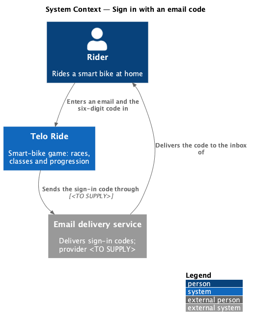
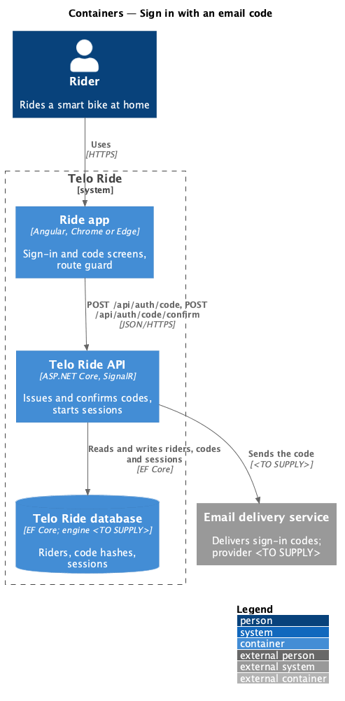
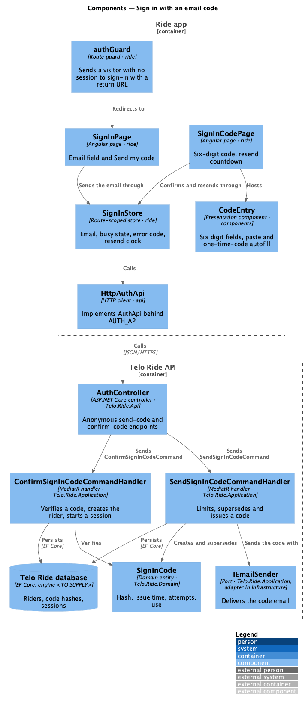
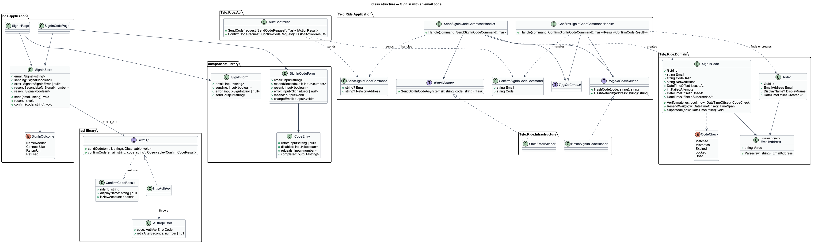
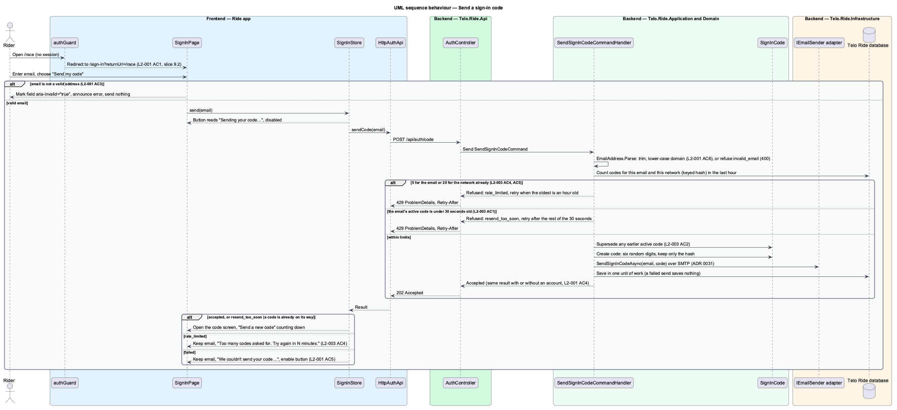
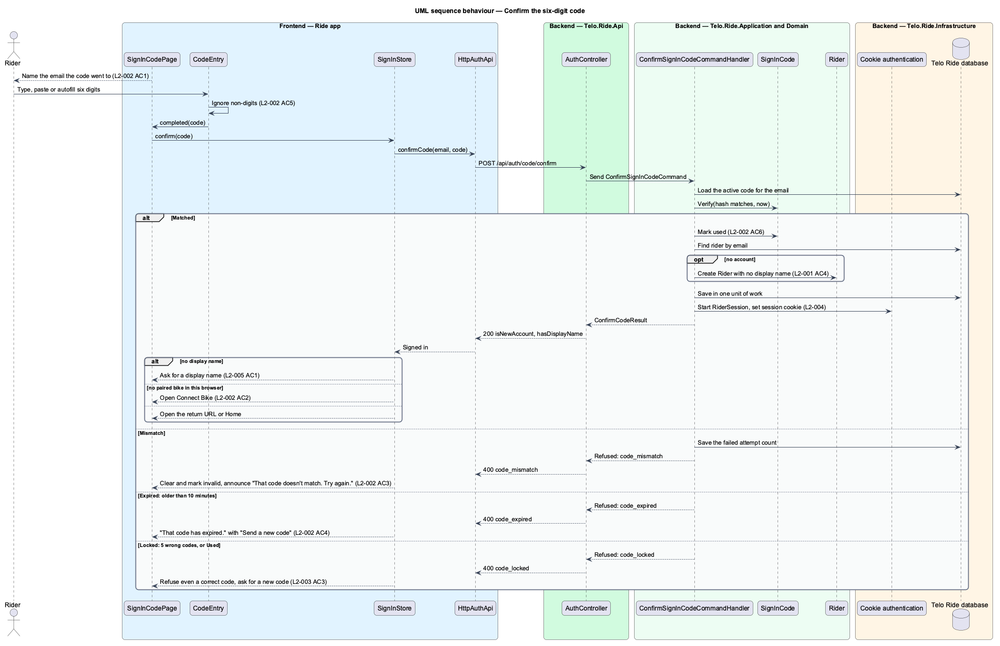
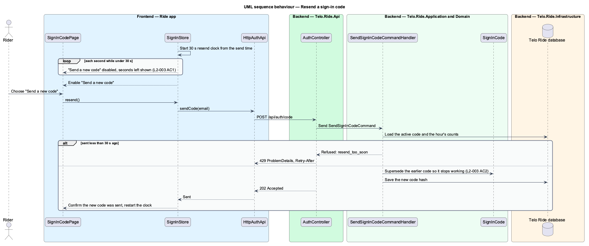

# Sign in with an email code

## Overview

Telo Ride turns a smart bike at home into a game. The progress a rider earns (XP, rider levels,
stars, map unlocks and ride history) lives on the Telo Ride backend, so the rider needs an account
that follows them from device to device. This feature is the only way into that account.

A rider signs up and signs in through one flow. The rider types an email address, the backend
sends a six-digit code to that address, and the rider types the code back. A matching code proves
that the rider owns the address. Telo Ride never asks for or stores a password.

The flow has two screens and one rule set:

- **sign-in screen** — screen with one email field and the action "Send my code"
- **code screen** — screen that names the email the code went to and takes six digits
- **sign-in code** — six random digits, valid for 10 minutes and for one use, stored only as a hash
- **superseded code** — earlier code that stops working once a newer code is sent

The same screens serve new and returning riders, so nobody learns from them whether an address
already has an account. The account is created only when a code for an unknown address is
confirmed. A rider with no session who opens any other screen (except the code screen and
not-found) is sent to the sign-in screen first, and returns to the screen they asked for.

The feature sits at the front of the accounts subsystem. The session it starts is described in
[Stay signed in](../stay-signed-in/README.md), and the display-name prompt for a new account in
[Choose a display name](../choose-a-display-name/README.md). The rate limits it applies are
enforced by the mechanisms in [Limit abuse](../../security/limit-abuse/README.md).

The sign-in and code screens are drawn in `docs/mocks/pages/sign-in/` (default, sending, invalid,
failed, rate-limited) and `docs/mocks/pages/sign-in-code/` (default, ready, resent); both use the
design system's `sign-in` block, and the code screen its `code-entry` block, with the refusals
mismatch, expired and locked. The display-name screen is still a mock gap.

Slice 9.1 built sending a code: the sign-in screen, the code screen naming the email with "Send
a new code", and `POST /api/auth/code`. Slice 9.2 adds `authGuard`, `CodeEntry`, confirming the
code and the session ([Stay signed in](../stay-signed-in/README.md)); the display-name prompt
comes with 9.3.

## Description

The slice runs from two routed screens in the Ride app through one controller to the database.

### Ride app (frontend)

- **`authGuard`** — functional `canActivateChild` guard in the `ride` application, on the parent
  of every screen; it lets `/sign-in`, `/sign-in/code` and not-found through. It waits for
  `CURRENT_RIDER` to know the rider, and when the session has ended (see [Stay signed
  in](../stay-signed-in/README.md)) it redirects to `/sign-in?returnUrl=<requested path>`. When
  the backend cannot be reached, the screen opens (L2-004 AC5).
- **`SignInPage`** (`wz-sign-in-page`, route `/sign-in`) — page that renders `SignInForm` from
  the store. **`SignInForm`** (`wz-sign-in-form`, `components` library) is the screen's
  presentation: the lockup, a `field` for the email and a primary `button` reading "Send my code".
  The store checks the address's shape (one `@`, no space, a dot in the domain, as the backend's
  `EmailAddress` does) before calling anything. An invalid address sets `aria-invalid="true"` on
  the field and shows "Enter an email address like name@example.com." under it as an alert; no
  request is made. While the request runs, the button reads "Sending your code…" and is
  `disabled`.
- **`SignInCodePage`** (`wz-sign-in-code-page`, route `/sign-in/code`) — page that renders
  **`SignInCodeForm`** (`wz-sign-in-code-form`, `components`): "Check your email", the email the
  code went to, "Send a new code" with the time left until it is enabled ("Send a new code in
  0:28"), and "Use a different email", which goes back to sign-in with the email kept. A resend
  shows "We sent a new code. Only the newest one works." The route opens only while the store
  holds an email; otherwise it goes to sign-in. It hosts `CodeEntry`; six digits confirm the code
  at once, and a confirmed rider goes to the return URL, or Home, whose own guard sends a rider
  with no paired bike to Connect Bike (L2-002 AC2).
- **`SignInStore`** — signal store provided on the sign-in routes. It holds the email, the busy
  flag, the last error (`SignInError`: its `code` and, for 429, the seconds to wait) and the resend
  clock, which counts down on `TICKER`'s beat, and decides where a confirmed rider goes next
  (`SignInOutcome`): the display-name prompt for an account with no name, Connect Bike when no bike
  is paired in this browser, or else the return URL or Home. Its cases are covered by unit tests
  that advance a fake clock.
- **`CodeEntry`** (`wz-code-entry`, `components` library) — presentation component for six digits.
  It uses `inputmode="numeric"` and `autocomplete="one-time-code"`, drops every character that is
  not a digit, accepts a pasted or autofilled code, and emits `completed` once six digits are
  present. It takes `error` (the refusal's words, drawn under the cells as an alert and marking
  the field invalid), `disabled` and `refusals` (a count; each new refusal clears the field), and
  injects no service.
- **`AuthApi`** / **`AUTH_API`** / **`HttpAuthApi`** — contract, injection token and HTTP
  implementation in the `api` library, bound on the sign-in routes. `sendCode(email)` posts to
  `/api/auth/code`; `confirmCode(email, code)` posts to `/api/auth/code/confirm` and returns
  `ConfirmCodeResult` (`riderId`, `displayName`, `isNewAccount`). A refusal becomes an `AuthApiError`
  carrying its `code` and, for 429, `retryAfterSeconds` from `Retry-After`; a failure with no code
  of Telo Ride's is `send_failed`.

The screens branch on these error codes: `invalid_email`, `rate_limited`, `resend_too_soon`,
`send_failed`, and from 9.2 `code_mismatch`, `code_expired` and `code_locked`. The rider sees:

| Code | Copy |
|------|------|
| `invalid_email` | "Enter an email address like name@example.com." under the field |
| `send_failed` | "We couldn't send your code. Check your connection and try again." |
| `rate_limited` | "Too many codes asked for. Try again in N minutes.", N rounded up from `Retry-After` |
| `resend_too_soon` | none on sign-in: the code screen opens, since a code is on its way; on the code screen, the countdown |
| `code_mismatch` | "That code doesn't match. Try again." |
| `code_expired` | "That code has expired." with "Send a new code" |
| `code_locked` | "Too many wrong codes. Send a new code to try again." |

### Telo Ride API (backend)

- **`AuthController`** (`Telo.Ride.Api`) — exposes `POST /api/auth/code` and
  `POST /api/auth/code/confirm`, both marked `[AllowAnonymous]` against the fallback policy of
  [Authenticate every request](../../security/authenticate-every-request/README.md). Each action
  sends one MediatR request and maps the result to a response or ProblemDetails.
- **`SendSignInCodeCommand`** — carries the raw email and the client's network address
  (`Connection.RemoteIpAddress`, which `ForwardedHeaders` sets from the rightmost
  `X-Forwarded-For` entry App Service appends; see [Limit abuse](../../security/limit-abuse/README.md)).
- **`SendSignInCodeCommandHandler`** — normalises the address with `EmailAddress.Parse`, which
  refuses a malformed one with 400 and code `invalid_email`. It counts codes for that address and
  for that network (by keyed hash) issued in the last hour, and refuses with 429 `rate_limited`
  once there are 5 for the address or 20 for the network, with `Retry-After` the time until the
  oldest counted code is an hour old. It refuses with 429 `resend_too_soon` and the rest of the 30
  seconds when the active code is younger than that. Otherwise it supersedes the active code, creates a new
  `SignInCode`, hands the plain code to `IEmailSender`, and then saves, so a send that fails
  saves nothing and the rider can ask again at once (L2-001 AC5). The handler does the same
  work whether or not an account exists for the address, so the response body, status and timing
  class match in both cases.
- **`ConfirmSignInCodeCommandHandler`** — loads the active (newest, not superseded) code for the
  address and calls `SignInCode.Verify`. On `Matched` it marks the code used, finds or creates the
  `Rider`, saves, and returns the rider; `AuthController` then signs the rider in, which starts a
  `RiderSession` (Stay signed in). Every other outcome is 400 with its code: `Mismatch` saves the
  incremented attempt count first and answers `code_mismatch`; `Locked` answers `code_locked`;
  `Expired`, `Used` and an address with no active code answer `code_expired`. The code is compared
  with `CryptographicOperations.FixedTimeEquals` over the keyed hashes.
- **`EmailAddress`** (`Telo.Ride.Domain`) — value object holding the trimmed address with a
  lower-cased domain and the local part as typed. It is the only form the backend stores.
- **`SignInCode`** (`Telo.Ride.Domain`) — entity holding `Email`, `CodeHash`, `NetworkHash`,
  `IssuedAt` and `SupersededAt`, with `FailedAttempts` and `UsedAt` from 9.2.
  `ResendWait(now)` gives what is left of the 30 seconds. `Verify(matches, now)` returns `Expired` past
  10 minutes, `Locked` after 5 failed attempts (even when the sixth code is correct), `Used` after
  one use, and otherwise `Matched` or `Mismatch`.
- **`Rider`** (`Telo.Ride.Domain`) — the account: `Id`, `Email`, an optional `DisplayName` and
  `CreatedAt`. It has no password field.
- **`ISignInCodeHasher`** — port whose Infrastructure adapter, `HmacSignInCodeHasher`, hashes the
  code and the network address with HMAC-SHA256 keyed by `Auth:CodeHashKey`, under different
  labels; see [Protect rider data](../../security/protect-rider-data/README.md).
- **`IEmailSender`** — port whose Infrastructure adapter, `SmtpEmailSender`, delivers the code
  email over SMTP with MailKit ([ADR 0031](../../../adr/0031-sign-in-code-email-over-smtp.md)),
  from `Email:From` through `Email:Smtp:*` (docs/deployment.md). The message is plain text:
  "123456 is your Telo Ride code", the code, that it works for 10 minutes, and that it can be
  ignored if it was not asked for.

Times come from an injected `TimeProvider`, so the 10-minute expiry, the 30-second resend gap and
the one-hour windows are tested by advancing `FakeTimeProvider`.

## Requirements

The feature realizes the following level-2 (L2) requirements. Each L2 requirement refines a
level-1 (L1) requirement, cited by identifier.

| L2 ID | Refines (L1) | Requirement |
|-------|--------------|-------------|
| `L2-001` | `L1-001` | A rider shall sign up or sign in with an email address alone, on one screen that does both. A visitor with no session who opens any screen other than sign-in, the code screen or not-found shall be sent to sign-in and returned to the requested screen afterwards. "Send my code" shall read "Sending your code…" and be disabled while the request runs. An invalid address shall send nothing and be marked `aria-invalid="true"` with an announced error. An unknown address shall get the same API response, timing class and screen as an account. A failed send shall keep the email and re-enable the button. The backend shall store the email normalised and shall never store or ask for a password. |
| `L2-002` | `L1-001` | The code screen shall name the email the code went to. Six correct digits shall sign the rider in without a further tap, going to Connect Bike when no bike is paired in this browser and otherwise to Home. Wrong digits shall clear the field, mark it invalid and announce "That code doesn't match. Try again." A code older than 10 minutes shall be refused with "That code has expired." and a "Send a new code" action. A pasted or offered code shall be submitted as typed, ignoring any non-digit. A used code shall not work again. |
| `L2-003` | `L1-001` | "Send a new code" shall be disabled with the seconds left for 30 seconds after a send. A new code shall stop the earlier one working and its sending shall be confirmed. After five wrong codes for one email a sixth shall be refused even if correct. A sixth code request for one email within an hour shall be refused with 429 and a message that says when to try again. More than 20 code requests from one IP address within an hour shall be refused with 429. |

## Diagrams

### System context

The rider uses Telo Ride to request and confirm a code; Telo Ride hands the code to an email
delivery service, which delivers it to the rider's inbox.

### Containers

The Ride app calls two anonymous endpoints on the Telo Ride API, which keeps code hashes,
riders and sessions in the Telo Ride database and sends the code through the email delivery
service.

### Components

In the Ride app, `authGuard` routes a visitor to `SignInPage`; both pages work through the
route-scoped `SignInStore` and `HttpAuthApi`. In the Telo Ride API, `AuthController` sends one
command per endpoint to a handler that works on `SignInCode` and persists through EF Core.

### Class structure

The frontend contract `AuthApi` returns a `ConfirmCodeResult` or throws an `ApiError`. On the
backend, each handler handles one command; `SignInCode.Verify` returns a `CodeCheck` that decides
the response, and `Rider` and `SignInCode` both hold an `EmailAddress`.

### Behaviour — send a sign-in code

The guard sends a visitor with no session to sign-in. A valid address goes to the backend, which
normalises it, applies the per-address and per-IP limits of `L2-003`, supersedes any earlier code
and sends a new one, answering 202 whether or not an account exists (`L2-001` AC4).

### Behaviour — confirm the six-digit code

`CodeEntry` submits as soon as six digits are present. A matched code is marked used, the rider is
found or created, and a session starts; the store then routes to the display-name prompt, Connect
Bike, or the return URL. Mismatched, expired and locked codes each return their own error `code`.

### Behaviour — resend a sign-in code

The store counts down 30 seconds before enabling "Send a new code". A resend supersedes the
earlier code, so only the newest code works (`L2-003` AC2); the backend refuses a resend inside 30
seconds with `resend_too_soon`.

## Open questions

- The limits count codes that were sent; a refused request is not stored, so it does not count
  towards the network's 20. Counting refusals too would need a row per request.
- The local part of an address keeps its case (L2-001 AC6), so `Ada@example.com` and
  `ada@example.com` are two addresses with their own limits and, from 9.2, their own accounts.
  Most providers treat them as one; lower-casing the whole address would change L2-001 AC6.
