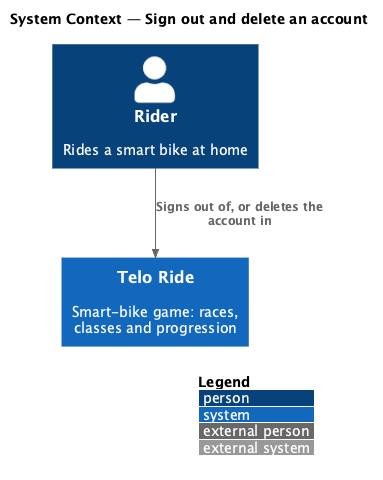
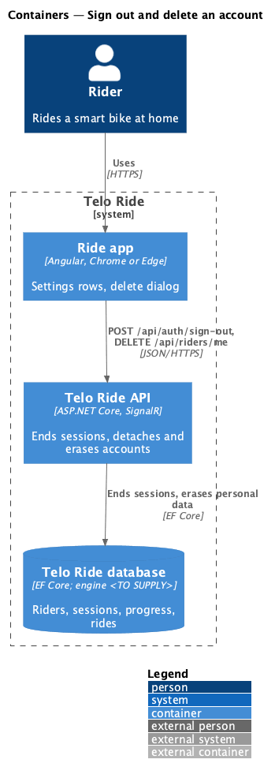
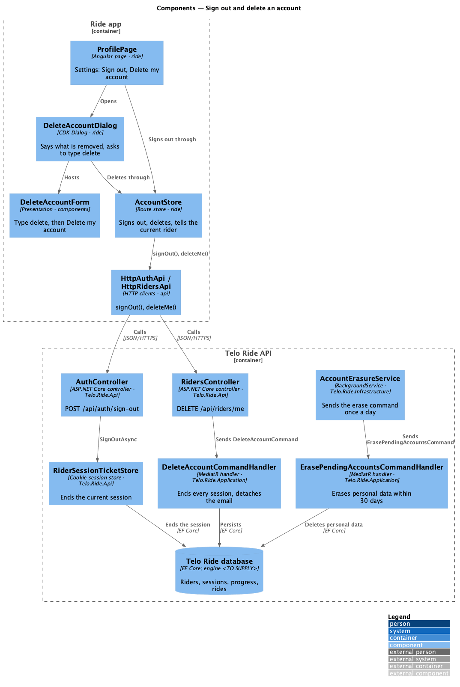
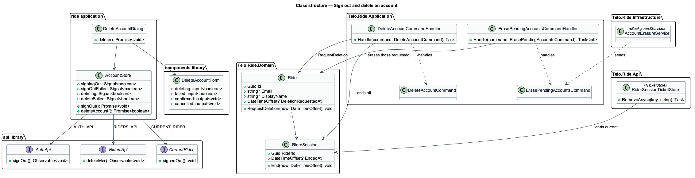
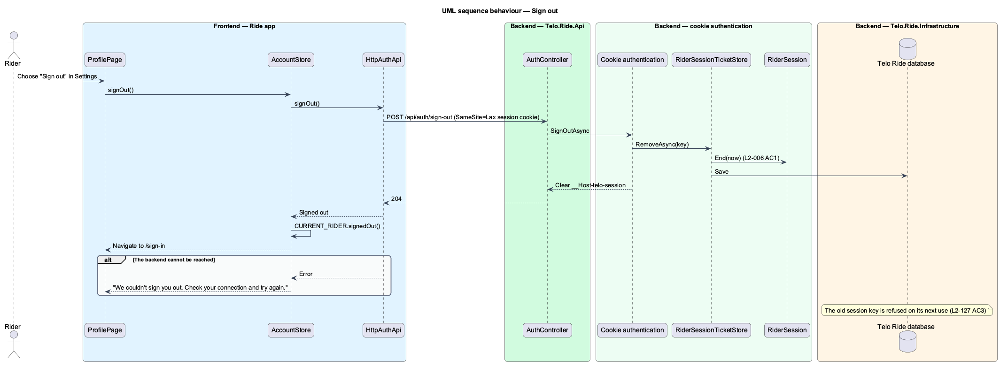
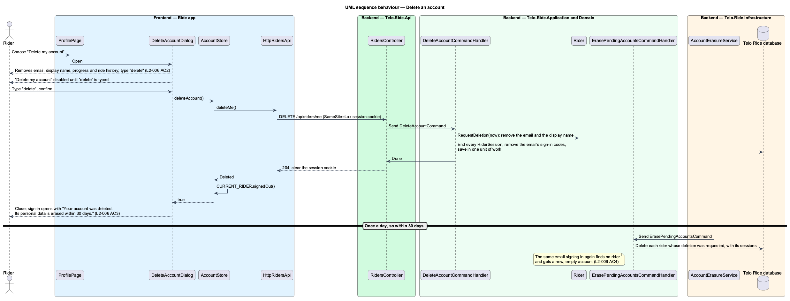

# Sign out and delete an account

## Overview

A Telo Ride account holds an email address, a display name, progress and ride history. A rider
controls that account in two ways from the Settings section of Profile: signing out of the current
device, and deleting the account altogether.

- **sign-out** — action that ends the current device's session on the backend and clears its
  cookie, leaving the account and its progress intact
- **account deletion** — action that ends every session of the account at once and erases its
  personal data (email, display name, progress and ride history) within 30 days
- **detached email** — state of a deleted account whose email is removed at once, so the address
  can start a new, empty account straight away

Sign-out takes effect on the backend immediately: the old session is refused on its next use, as
[Stay signed in](../stay-signed-in/README.md) keeps every session in the database. Deletion is
guarded by a dialog that says what is removed and asks the rider to type "delete". The rows, the
dialog and the account-deleted message are drawn in `docs/mocks/pages/profile/`,
`docs/mocks/dialogs/delete-account/` and `docs/mocks/pages/sign-in/account-deleted.html`.

## Description

### Ride app (frontend)

- **`ProfilePage`** (`wz-profile-page`) — its Settings list holds "Sign out" ("On this device")
  and "Delete my account" ("Email, name, progress and rides", the `setting-row--danger` row) as
  `button wz-setting-row` entries, each reachable by touch and keyboard. "Sign out" is disabled
  while it runs; when it fails, "We couldn't sign you out. Check your connection and try again."
  shows under the list as an alert (`settings__message`) and the rider stays signed in.
- **`AccountStore`** (`ride`, provided by the Profile route) — `signOut()` sends
  `AuthApi.signOut()`, tells `CURRENT_RIDER` the rider signed out and opens `/sign-in`.
  `deleteAccount()` sends `RidersApi.deleteMe()` and tells `CURRENT_RIDER` the rider signed out.
  It keeps `signingOut`, `signOutFailed`, `deleting` and `deleteFailed`. It lives on the Profile
  route, not in the root `CurrentRiderStore`, so sign-in's client stays out of the initial
  bundle (lazy loading first).
- **`DeleteAccountDialog`** — CDK Dialog in `ride`, opened from the row with the focus on the
  field. It says "This removes your email, display name, progress and ride history, and signs
  you out everywhere. It can't be undone." (`aria-describedby`) and hosts
  `DeleteAccountForm`. On success it closes and opens `/sign-in` with the navigation state
  `accountDeleted`. Escape, the close button and Cancel close it, but not while it is deleting.
- **`DeleteAccountForm`** (`wz-delete-account-form`, `components`) — the field "Type “delete” to
  confirm" and "Cancel" and "Delete my account" (`btn--danger`). The button stays `disabled`
  until the trimmed value equals "delete" in any case; while deleting it reads "Deleting…" and
  the form is disabled. `failed` shows "We couldn't delete your account. Check your connection
  and try again." as an alert and keeps the typed word.
- **`SignInPage`** — when the navigation that opened it carries `accountDeleted`, the sign-in
  form shows "Your account was deleted. Its personal data is erased within 30 days." under the
  lead as a status message.
- **`AuthApi.signOut()`** and **`RidersApi.deleteMe()`** (`api` library) — send
  `POST /api/auth/sign-out` and `DELETE /api/riders/me`. No anti-forgery header: the API shares
  the app's origin (ADR 0026), and `SameOriginRequests` refuses a change the browser marks as
  coming from another origin (ADR 0033); the session cookie is also `SameSite=Lax`.
- The device's waiting rides (`RideOutbox`) do not exist yet; journey 10 builds them, and
  `AccountStore.deleteAccount()` clears them from then on.

### Telo Ride API (backend)

- **`AuthController.SignOut`** — `POST /api/auth/sign-out`, anonymous so it answers 204 with or
  without a session. It calls cookie authentication's `SignOutAsync`, which hands the cookie's key
  to `RiderSessionTicketStore.RemoveAsync`: the session's `EndedAt` is set and the cookie is
  cleared. It sends no MediatR request: the session key is known only to cookie authentication,
  as `ConfirmCode` starts a session through `SignInAsync` (Stay signed in).
- **`RidersController.DeleteMe`** — `DELETE /api/riders/me` sends `DeleteAccountCommand` and then
  clears the cookie with `SignOutAsync`. It answers 204.
- **`DeleteAccountCommandHandler`** — calls `Rider.RequestDeletion(now)`, ends every
  `RiderSession` of the rider, removes the sign-in codes sent to its email, and saves all of it in
  one unit of work.
- **`Rider.RequestDeletion(now)`** (`Telo.Ride.Domain`) — sets `DeletionRequestedAt`, removes the
  email (`Email` becomes `null`) and the display name. With no email on the record, a later
  sign-in with the same address finds no rider and creates a new, empty account (`L2-006` AC4).
  `Rider.Email` is nullable and its unique index skips `null`s (migration `AddAccountDeletion`).
- **`ErasePendingAccountsCommandHandler`** — deletes each rider whose deletion was requested,
  with its sessions (and, from journey 10, its progress and rides), and returns the count. It is
  idempotent: a repeated run finds nothing more to erase.
- **`AccountErasureService`** (`Telo.Ride.Infrastructure`) — `BackgroundService` that sends
  `ErasePendingAccountsCommand` once a day on the injected `TimeProvider`, so a deleted account is
  erased within a day, well inside the 30 days. A failed run is logged (without any rider's
  data) and the next day's run tries again.

## Requirements

The feature realizes the following level-2 (L2) requirements. Each L2 requirement refines a
level-1 (L1) requirement, cited by identifier.

| L2 ID | Refines (L1) | Requirement |
|-------|--------------|-------------|
| `L2-006` | `L1-001` | When a signed-in rider chooses "Sign out" on Profile, the session shall end on the backend at once, its cookie shall be cleared and the sign-in screen shall open. "Delete my account" shall open a dialog that says what is removed (email, display name, progress and ride history) and asks the rider to type "delete", with "Delete my account" disabled until they do. On confirmed deletion, every session shall end, the sign-in screen shall open with a message that the account was deleted, and the rider's personal data shall be erased within 30 days. When a deleted account's email signs in again, a new, empty account shall be created. |

## Diagrams

### System context

Signing out and deleting an account involve only the rider and Telo Ride.

### Containers

The Ride app calls the Telo Ride API to end sessions or delete the account; the API changes the
Telo Ride database.

### Components

`ProfilePage` signs out through `AccountStore` and opens `DeleteAccountDialog` for deletion.
On the backend, deletion sends one command; sign-out ends the session through cookie
authentication's session store; `AccountErasureService` sends the erase command once a day.

### Class structure

`DeleteAccountCommandHandler` marks the `Rider` for deletion and ends each of its
`RiderSession` records; `ErasePendingAccountsCommandHandler` erases riders whose deletion was
requested.

### Behaviour — sign out

Sign-out ends the current session in the database and clears the cookie before the sign-in
screen opens, so the old session key is refused at once (`L2-006` AC1).

### Behaviour — delete an account

The dialog enables deletion only once "delete" is typed. The handler detaches the email and ends
every session in one unit of work; the background service erases the rider within a day, and
the email is free for a new account at once (`L2-006` AC2 to AC4).

## Open questions

- **Backups.** Erasure from database backups follows the backup retention period, which is
  `<TO SUPPLY>` with the first deployment.
- **Other riders' results.** How a deleted rider's past results appear in other riders' stored
  session results (removed or anonymised) is `<TO SUPPLY>`; nothing of the kind is stored until
  journeys 10 and 11.
- **Waiting rides.** `RideOutbox` arrives with journey 10; deletion clears it from then on.
