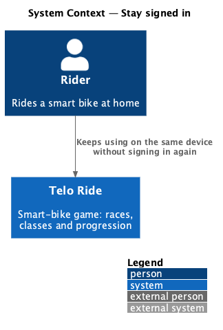
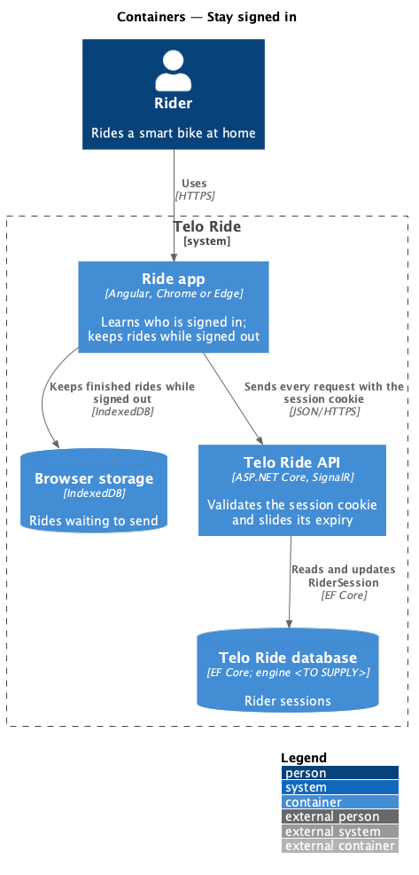
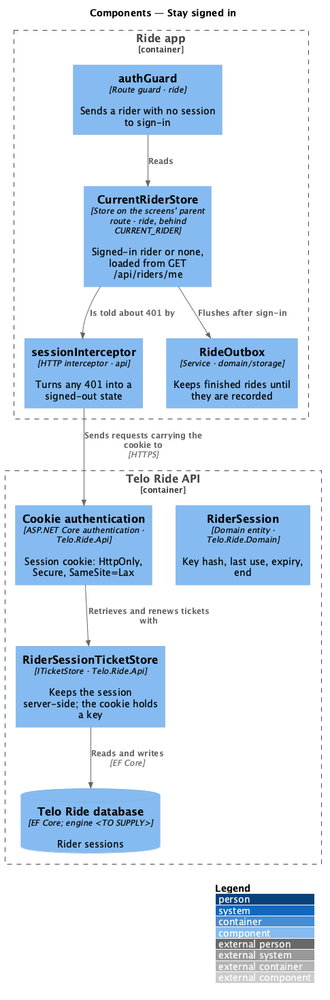
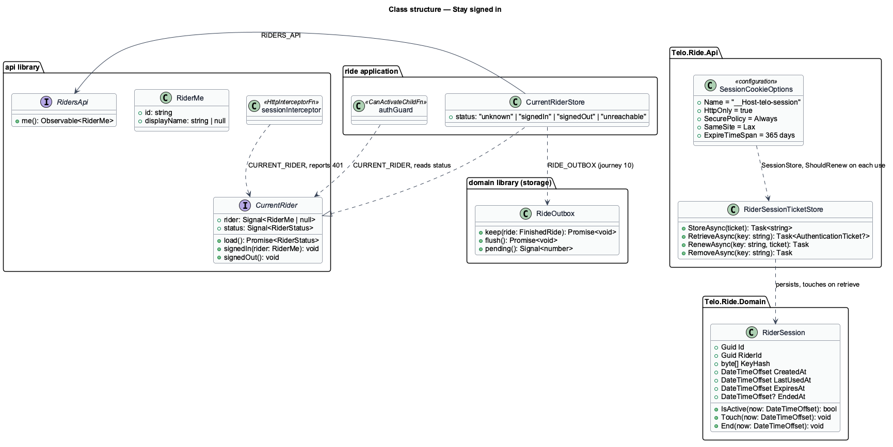
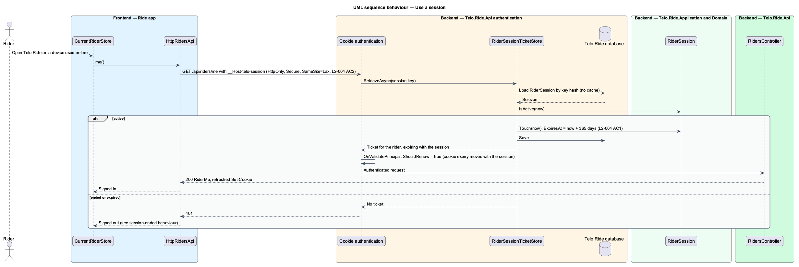
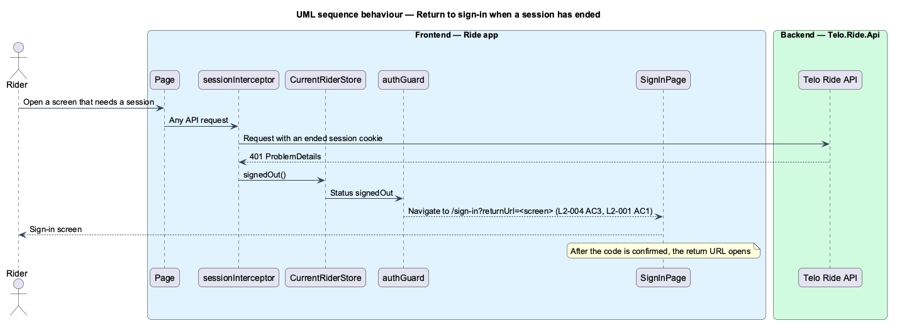
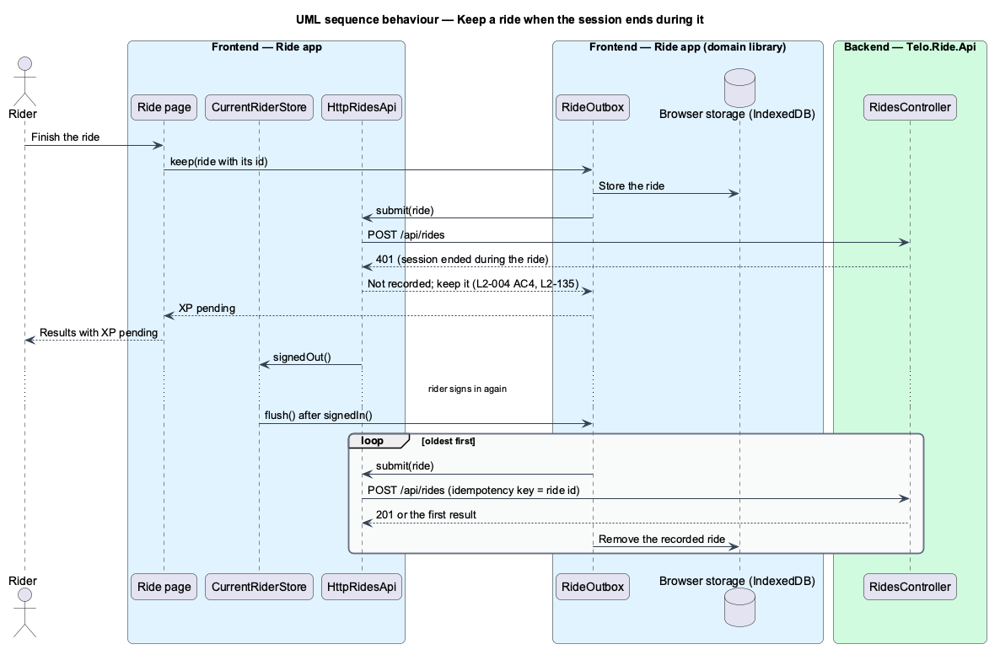

# Stay signed in

## Overview

A Telo Ride rider rides beside the bike on a tablet or laptop they keep using. Asking for an email
code every time the app opens would put a sign-in step between the rider and the ride. This
feature keeps a rider signed in on a device for as long as they keep using it there, and ends the
session cleanly when it lapses or is ended.

- **session** — server-side record that a rider signed in on one device, identified by a random
  key the browser holds in a cookie
- **session cookie** — cookie named `__Host-telo-session` that scripts cannot read, sent only over
  HTTPS and not sent with requests from other sites
- **sliding expiry** — expiry that moves forward to 365 days after each use

A session starts when a sign-in code is confirmed ([Sign in with an email
code](../sign-in-with-an-email-code/README.md)) and ends on sign-out or account deletion ([Sign
out and delete an account](../sign-out-and-delete-an-account/README.md)), or when the device
goes unused for 365 days. Because the session is held on the server, ending it takes effect on the
next request, which [Authenticate every
request](../../security/authenticate-every-request/README.md) relies on.

The Ride app cannot read the cookie. It learns whether a rider is signed in by asking the backend
who the current rider is. A ride never depends on the session: when the session ends during a
ride, the finished ride stays on the device and is sent after the rider signs in again.

## Description

### Telo Ride API (backend)

- **Cookie authentication** — ASP.NET Core cookie authentication registered by
  `Telo.Ride.Api` (`AuthenticationSetup`) as the default scheme, reading time from `TimeProvider`. The cookie is `__Host-telo-session`, with
  `HttpOnly`, `SecurePolicy = Always`, `SameSite = Lax`, `Path = /` and `ExpireTimeSpan` of 365
  days. The `__Host-` prefix pins it to the backend's host. A request that needs a session and has
  none gets 401 instead of a redirect.
- **`RiderSessionTicketStore`** (`Telo.Ride.Api`) — `ITicketStore` implementation that keeps each
  session in the database as a `RiderSession`. The cookie carries only a random 256-bit key; the
  database stores the key's SHA-256 hash, so a database read alone cannot replay a session. It
  rebuilds the ticket from the session's rider, so no serialized ticket is stored. On every
  authenticated request `RetrieveAsync` loads the session without caching, refuses it when it has
  ended or expired, and otherwise calls `Touch(now)` and saves.
- **Cookie events** — `OnValidatePrincipal` sets `ShouldRenew = true`, so the cookie is reissued
  with the session's new expiry on each use. `RemoveAsync` ends the session (sign-out, 9.4).
- **`RiderSession`** (`Telo.Ride.Domain`) — entity with `RiderId`, `KeyHash`, `CreatedAt`,
  `LastUsedAt`, `ExpiresAt` and `EndedAt`. `Touch(now)` sets `LastUsedAt = now` and
  `ExpiresAt = now + 365 days`. `End(now)` sets `EndedAt`. `IsActive(now)` is true when the
  session has not ended and `now < ExpiresAt`.
- **`RidersController`** — `GET /api/riders/me` returns the signed-in rider's id and display name
  and is the probe the Ride app uses at start-up.

Each authenticated request writes the session's new expiry. Whether writes are coalesced (for
example at most once per minute per session) is `<TO SUPPLY>`; coalescing within a minute does not
change any 365-day outcome. Slice 9.2 writes on every request.

### Ride app (frontend)

- **`CurrentRiderStore`** — signal store in the `ride` application behind the `CurrentRider`
  contract and `CURRENT_RIDER` token of the `api` library, provided on the lazy parent of every
  screen (so the whole app shares one, out of the initial bundle). `load()` calls
  `RidersApi.me()` (`GET /api/riders/me`) once; `status` is `unknown`, `signedIn`, `signedOut` or
  `unreachable` (no answer, or one that is neither 200 nor 401: the backend cannot be reached,
  and screens open, L2-004 AC5). `signedIn(rider)` records the rider a confirmed code returned.
- **`sessionInterceptor`** — `HttpInterceptorFn` in the `api` library, on the one `HttpClient`
  the parent route provides. It reports a 401 from any endpoint other than `/api/auth/` to
  `CURRENT_RIDER`, which sets `signedOut`. The app and the API share an origin (ADR 0026), so the
  cookie goes with every request without `withCredentials`.
- **`authGuard`** — the guard of [Sign in with an email
  code](../sign-in-with-an-email-code/README.md). It waits while `status` is `unknown` and
  redirects to `/sign-in?returnUrl=…` when it is `signedOut`.
- **Initial bundle** — every screen now asks for the rider before it opens, so Angular's
  `HttpClient` is needed at start-up and the build places it in the initial chunk: 288.47 kB
  became 292.60 kB. The warning budget rises from 292 kB to 296 kB for it; the error budget stays
  at 300 kB. The session's own code stays in the screens' lazy parent chunk.
- **`RideOutbox`** (`domain` library, `storage/`), from the journey that first submits rides to
  the backend (journey 10; until then a ride never leaves the device) — keeps each finished ride
  in IndexedDB by its id until the backend records it (see [Ride without a
  network](../../performance/ride-without-a-network/README.md)). A 401 on submission leaves the
  ride in the outbox; it is submitted again after sign-in.

## Requirements

The feature realizes the following level-2 (L2) requirements. Each L2 requirement refines a
level-1 (L1) requirement, cited by identifier.

| L2 ID | Refines (L1) | Requirement |
|-------|--------------|-------------|
| `L2-004` | `L1-001` | A session shall last 365 days from the rider's last use of Telo Ride on that device, and each use shall move the expiry forward. The session shall be stored in a cookie that scripts cannot read (`HttpOnly`), sent only over HTTPS (`Secure`) and not sent with requests from other sites (`SameSite=Lax` or stricter). When a session has ended and the rider opens a screen that needs one, the sign-in screen shall open and then return to that screen (`L2-001` AC1). When a session ends during a ride, the finished ride shall be kept on the device (`L2-135`) and sent after the rider signs in again. |

## Diagrams

### System context

The context is the rider and Telo Ride alone: keeping a session involves no external system.

### Containers

The Ride app sends every request with the session cookie; the Telo Ride API validates and slides
the session in the Telo Ride database. Rides finished while signed out wait in browser storage.

### Components

On the backend, cookie authentication retrieves the ticket from `RiderSessionTicketStore`, which
touches or refuses the `RiderSession`. On the frontend, `sessionInterceptor` reports a 401 to
`CurrentRiderStore`, which `authGuard` reads and which, from journey 10, flushes `RideOutbox`
after sign-in.

### Class structure

`RiderSession` owns the expiry rules. The ticket store persists it, the validator touches it and
renews the cookie configured by `SessionCookieOptions`, and `CurrentRiderStore` depends on the
`RidersApi` contract and the `RideOutbox`.

### Behaviour — use a session

Each request carries the cookie. An active session is touched to 365 days from now and the cookie
is reissued with the same expiry (`L2-004` AC1); an ended or expired one is rejected with 401.

### Behaviour — return to sign-in when a session has ended

Any 401 sets the store to signed out, and the guard sends the rider to sign-in with the screen
they asked for as the return URL (`L2-004` AC3).

### Behaviour — keep a ride when the session ends during it

The ride is stored in the outbox before it is submitted, so a 401 leaves it on the device with its
XP pending. After the rider signs in again, the outbox submits waiting rides oldest first, and the
ride id as idempotency key makes a repeat submission safe (`L2-004` AC4).

