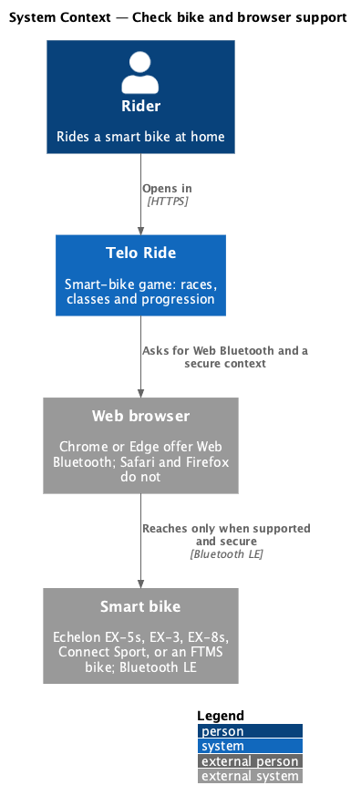
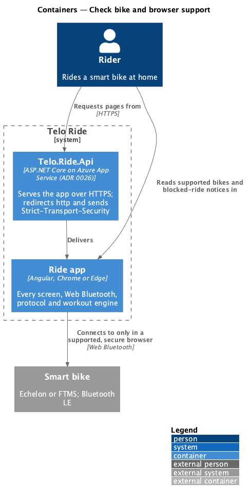
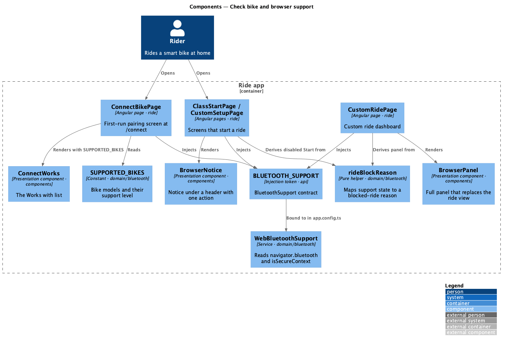
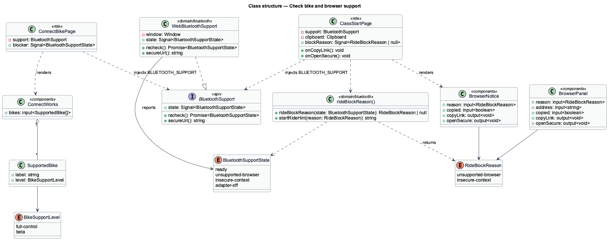
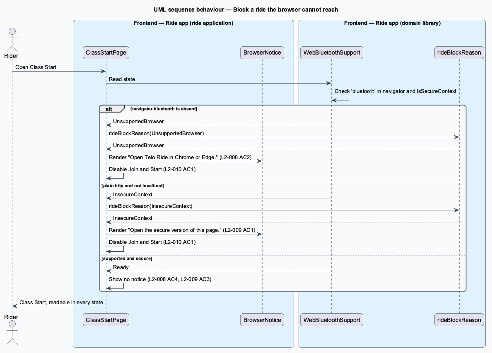
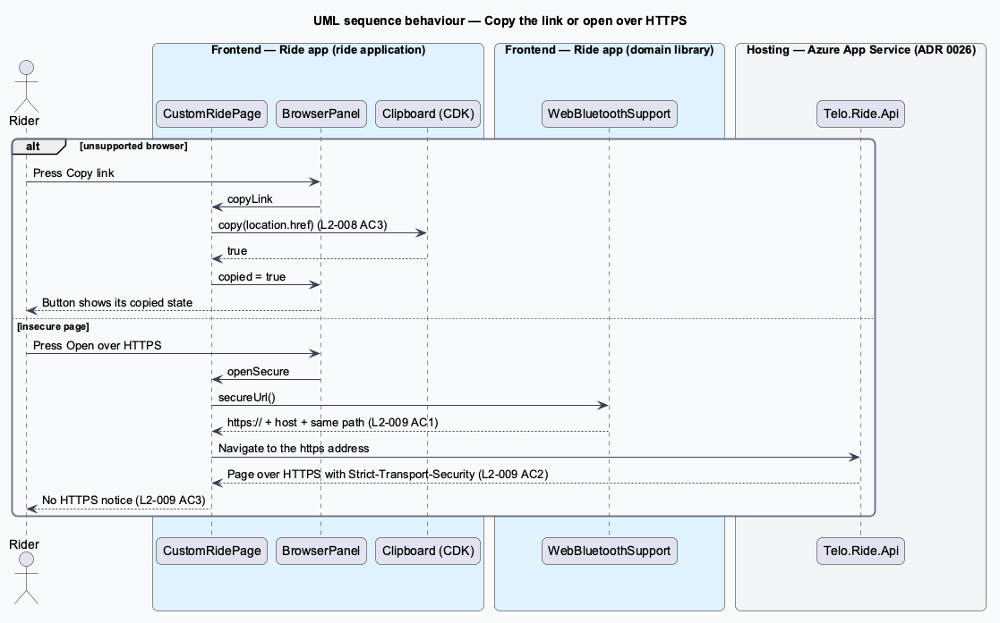

# Check bike and browser support

## Overview

Telo Ride turns a smart bike at home into a game. The Ride app reaches the bike directly from the browser through Web Bluetooth, so the browser and the page address decide whether a ride can happen at all. This feature is the first slice of the bike subsystem: it states which bikes Telo Ride works with and how well, and it stops a ride from starting where the bike cannot be reached.

The following terms are used in this design:

- **Web Bluetooth** — browser API (`navigator.bluetooth`) through which a page reaches a Bluetooth Low Energy device; present only in Chromium browsers (Chrome and Edge on Windows, macOS, Linux, ChromeOS and Android)
- **secure context** — page served over HTTPS or from `localhost`, the only kind of page on which a browser exposes Web Bluetooth
- **full control** — support level at which the app reads a bike's telemetry and sets its resistance
- **beta** — support level for other bikes that speak the Bluetooth Fitness Machine Service (FTMS, service `0x1826`); the app reads Indoor Bike Data and sets resistance only if the bike grants control
- **blocked ride** — state of a ride-starting screen whose bike cannot be reached, shown with a reason and a disabled start action

Four Echelon models have full control: EX-5s, EX-3, EX-8s and Connect Sport. Any other FTMS bike is beta. The browser check has two outcomes that block a ride: an unsupported browser (no `navigator.bluetooth`) and an insecure page (plain `http` other than `localhost`). A blocked state never hides what can still be read. Home, Map Select, the Class Library, Profile and Results work normally in every blocked state. Bluetooth switched off on a supported browser is a separate state, covered by [keep-the-bike-connected](../keep-the-bike-connected/README.md).

## Description

The slice lives in the Ride app, with one hosting rule at the API that serves it (ADR 0026).

- **`SUPPORTED_BIKES`** — constant in `domain`'s `bluetooth/` folder. It lists, in order, "Echelon EX-5s", "Echelon EX-3", "Echelon EX-8s" and "Echelon Connect Sport" at `FullControl`, then "Other FTMS smart bikes" at `Beta`. Each entry is a `SupportedBike` (`api`, a type) with a `label` and a `BikeSupportLevel`, `'full-control'` or `'beta'`.
- **`ConnectWorks`** — presentation component in `components` (block `connect-works`, selector `wz-connect-works`). It renders the "Works with" list from its `bikes` input, with "Full control" or "Beta" in each row's `connect-works__status` element. The list is one column on a phone and two columns at sm (≥ 640 px) and wider.
- **`BluetoothSupport`** — contract in `api` with token `BLUETOOTH_SUPPORT`. It exposes `state` as a signal of `BluetoothSupportState` (`'ready'`, `'unsupported-browser'`, `'insecure-context'`, and `'adapter-off'` from [keep-the-bike-connected](../keep-the-bike-connected/README.md)), `recheck()` and `secureUrl()`.
- **`WebBluetoothSupport`** — implementation in `domain`'s `bluetooth/` folder, reading the window through Angular's `DOCUMENT`. It is bound with the bike connection by `provideBikeConnection()`, on the lazily loaded parent route of every screen (`ride.routes.ts`). It reports `'insecure-context'` when `isSecureContext` is false, checked first because a Chromium browser on a plain `http` page has no `navigator.bluetooth` either; otherwise `'unsupported-browser'` when `'bluetooth' in navigator` is false; otherwise `'ready'`. `recheck()` reads both again. `secureUrl()` returns `https://` followed by the current host, path, query and fragment. `'adapter-off'` comes from `getAvailability()` and belongs to [keep-the-bike-connected](../keep-the-bike-connected/README.md). The simulated bike (`?simulate`, [ride-a-simulated-bike](../ride-a-simulated-bike/README.md)) needs no Bluetooth, so `provideBikeConnection()` binds `SimulatedBluetoothSupport`, always `'ready'`, beside it.
- **`rideBlockReason()`** — pure helper in `domain`'s `bluetooth/` folder, with its unit tests. It maps a `BluetoothSupportState` to a `RideBlockReason` (`UnsupportedBrowser`, `InsecureContext`) or `null`. `startRideHint()` returns the hint that describes a disabled **Start ride**: "Needs Chrome or Edge to reach the bike." or "Needs the HTTPS page to reach the bike.".
- **`BrowserNotice`** — presentation component (block `browser-notice`). Class Start and Custom workout render it under the header. For `UnsupportedBrowser` it reads "Open Telo Ride in Chrome or Edge." with "Bluetooth to the bike only works there — you can look around, but not ride." and **Copy link**. For `InsecureContext` it reads "Open the secure version of this page." with "Bluetooth is blocked on plain http, so the bike can’t connect." and **Open over HTTPS**.
- **`BrowserPanel`** — presentation component (block `browser-panel`, `role="alert"`). Custom ride renders it in place of the ride view. For `UnsupportedBrowser` it reads "Open Telo Ride in Chrome or Edge" with an explanation and **Copy link**; for `InsecureContext` it reads "Open the secure version of this page" with "Browsers only allow Bluetooth on pages served over HTTPS. You’re on {address}." and **Open over HTTPS**. The address is rendered as text in `browser-panel__url`.
- **`ConnectBikePage`** — page at `/connect`. It renders `ConnectWorks` below the pairing area in every state. In an unsupported browser it replaces the device card and pair button with an alert (`role="alert"`, block `connect-blocker`): "This browser can't reach the bike", "Open Telo Ride in Chrome or Edge on a laptop or Android tablet. Safari and Firefox don't support Web Bluetooth yet.", and "Try again", which calls `recheck()`. On an insecure page the alert reads "Open the secure version of this page" and "Bluetooth is blocked on plain http, so the bike can’t connect.", with **Open over HTTPS**, a link to `secureUrl()` (mock state `needs-https`).
- **`ClassStartPage`, `CustomSetupPage`, `CustomRidePage`** — pages that start a ride. Each derives `blockReason` from `BLUETOOTH_SUPPORT` through `rideBlockReason()`. Class Start disables its Join or Start button. Custom workout disables **Start ride** and links it to the hint with `aria-describedby`. Custom ride shows `BrowserPanel` and the bike status "Bluetooth unavailable in this browser". **Copy link** writes `location.href` through the CDK `Clipboard` service, and the button shows its copied state. **Open over HTTPS** navigates to `secureUrl()`.
- **`TransportSecurity`** — hosting extension in `Telo.Ride.Api`'s `Hosting/` folder, for the production host, the API on Azure App Service (ADR 0026). App Service ends TLS at its front end and forwards the request with `X-Forwarded-Proto`, so the API reads the scheme from that header first (`UseForwardedHeaders`, the proxy list cleared because the front end's addresses are not fixed). Outside Development it redirects every `http` request to the same address on `https` with 308 Permanent Redirect (`UseHttpsRedirection`, port 443), and adds `Strict-Transport-Security: max-age=31536000` (one year) to every `https` response (`UseHsts`). It names neither `includeSubDomains` nor `preload`: the other subdomains of the address are not Telo Ride's to commit. `UseHsts` leaves out `localhost`. The full header set belongs to [platform/host-and-deliver](../../platform/host-and-deliver/README.md).

No screen in this slice calls `navigator.bluetooth.requestDevice`; pairing belongs to [connect-a-bike](../connect-a-bike/README.md).

Slice 2.2 built `SUPPORTED_BIKES`, `ConnectWorks`, `BluetoothSupport` with `WebBluetoothSupport` and `SimulatedBluetoothSupport`, Connect Bike's two alerts and `TransportSecurity`. `BrowserNotice`, `BrowserPanel` and `rideBlockReason()` are built with the first page that renders them: Class Start (slice 6.3), Custom workout (21.1) and Custom ride (21.3); each of those slices proves its own `needs-chromium` and `needs-https` states.

## Requirements

The feature realizes the following level-2 (L2) requirements. Each L2 requirement refines a level-1 (L1) requirement, cited by identifier.

| L2 ID | Refines (L1) | Requirement |
|-------|--------------|-------------|
| `L2-007` | `L1-002` | Connect Bike shall show a "Works with" section listing, in order, "Echelon EX-5s", "Echelon EX-3", "Echelon EX-8s" and "Echelon Connect Sport", each "Full control", and "Other FTMS smart bikes", "Beta". The app shall read telemetry from and set resistance on an Echelon bike (L2-013). For a non-Echelon bike advertising FTMS (`0x1826`) the app shall read Indoor Bike Data and, if the bike grants control, set its resistance (L2-014). The list shall be two columns at sm or wider and one column on a phone. |
| `L2-008` | `L1-002` | In a browser without `navigator.bluetooth`, Connect Bike shall replace the device card with an alert (`role="alert"`) reading "This browser can't reach the bike" and "Open Telo Ride in Chrome or Edge on a laptop or Android tablet. Safari and Firefox don't support Web Bluetooth yet.", with "Try again". Class Start and Custom workout shall show a notice reading "Open Telo Ride in Chrome or Edge." with "Bluetooth to the bike only works there — you can look around, but not ride." and **Copy link**, and the page shall stay readable. **Copy link** shall copy the page address and show its copied state. A supported browser shall show no unsupported-browser message. |
| `L2-009` | `L1-002` | On a page served over plain `http` other than `localhost`, Class Start and Custom workout shall show a notice reading "Open the secure version of this page." with "Bluetooth is blocked on plain http, so the bike can’t connect." and **Open over HTTPS**, which goes to the same path on `https://`; Connect Bike shall replace its device card with an alert reading the same, with **Open over HTTPS**. A production deployment shall redirect `http` requests to `https`, and responses shall carry `Strict-Transport-Security`. A secure context shall show no HTTPS notice. |
| `L2-010` | `L1-002` | In an unsupported browser or on an insecure page, Class Start shall disable its Join or Start button. Custom workout shall disable **Start ride** and describe it by "Needs Chrome or Edge to reach the bike." or, on an insecure page, "Needs the HTTPS page to reach the bike.". Custom ride shall show a full panel (`role="alert"`) reading "Open Telo Ride in Chrome or Edge" with an explanation and **Copy link**, and the bike status "Bluetooth unavailable in this browser"; on an insecure page the panel shall read "Open the secure version of this page" with "Browsers only allow Bluetooth on pages served over HTTPS. You’re on {address}." and **Open over HTTPS**. Home, Map Select, the Class Library, Profile and Results shall work normally in any blocked state. |

## Diagrams

### System context

The rider opens Telo Ride in a web browser. Only a Chromium browser on a secure page passes the request on to the smart bike over Bluetooth LE.

### Containers

The API (`Telo.Ride.Api` on Azure App Service, ADR 0026) delivers the Ride app over HTTPS and redirects plain `http`. The Ride app decides, on the device, whether it can reach the bike.

### Components

The pages inject `BLUETOOTH_SUPPORT`, bound to `WebBluetoothSupport`, and derive a blocked-ride reason through `rideBlockReason()`. The presentation components `ConnectWorks`, `BrowserNotice` and `BrowserPanel` render the result.

### Class structure

`WebBluetoothSupport` realizes the `BluetoothSupport` contract and reports a `BluetoothSupportState`. The pure `rideBlockReason()` helper narrows that state to the two `RideBlockReason` values the presentation components accept.

### Behaviour — block a ride the browser cannot reach

On opening, Class Start reads the support state and shows either the unsupported-browser notice, the HTTPS notice, or nothing. In both blocked branches the Join and Start buttons are disabled (`L2-010`).

### Behaviour — copy the link or open over HTTPS

In an unsupported browser, **Copy link** puts the page address on the clipboard. On an insecure page, **Open over HTTPS** navigates to the same path on `https://`, where the host adds `Strict-Transport-Security` (`L2-009`).

