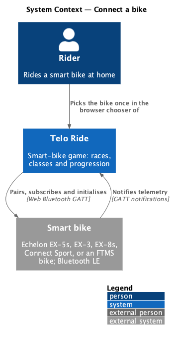
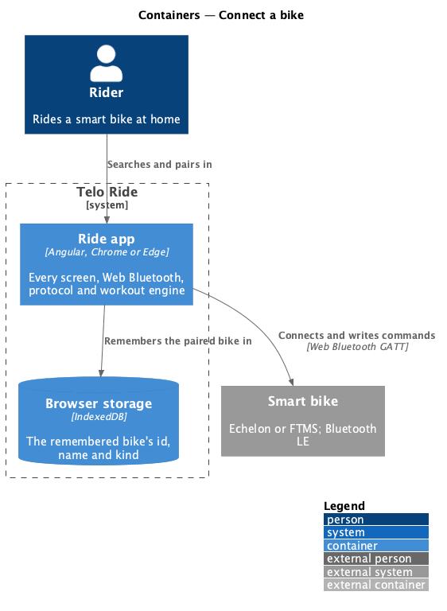
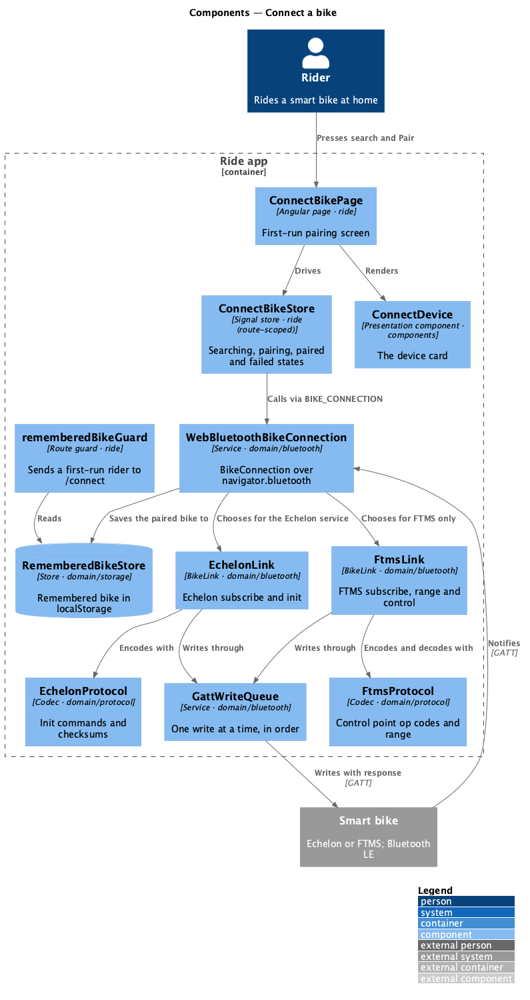
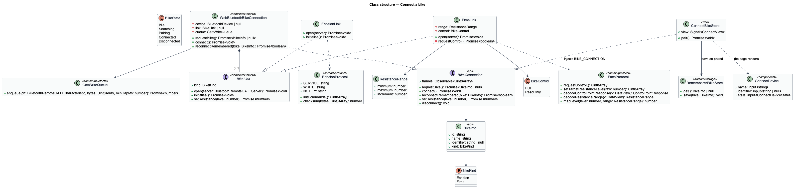
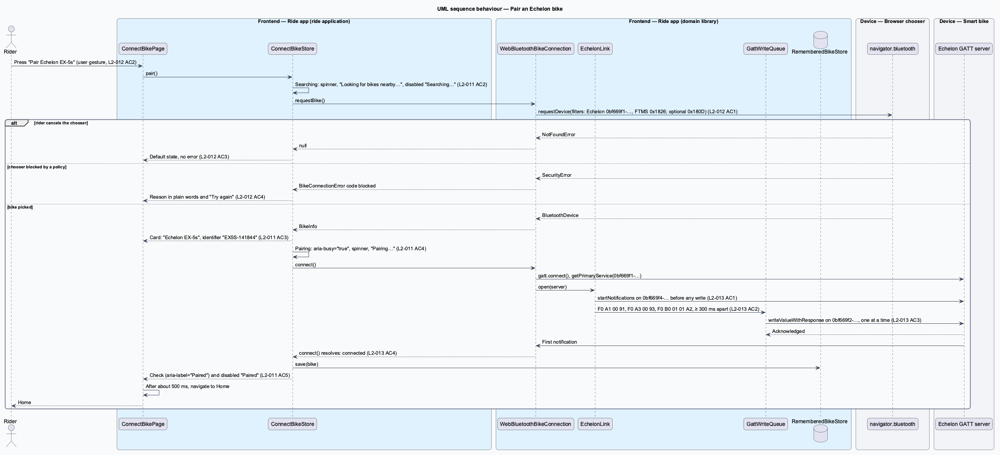
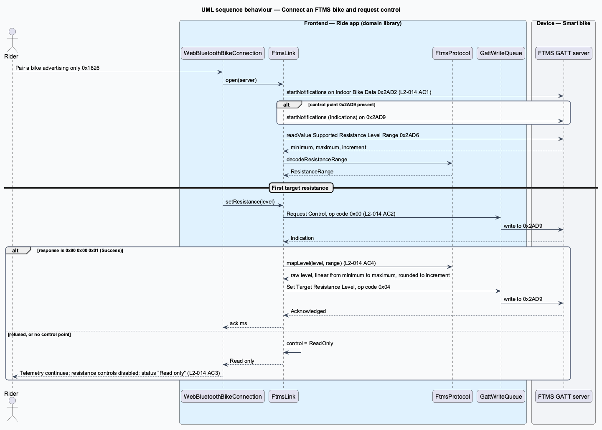
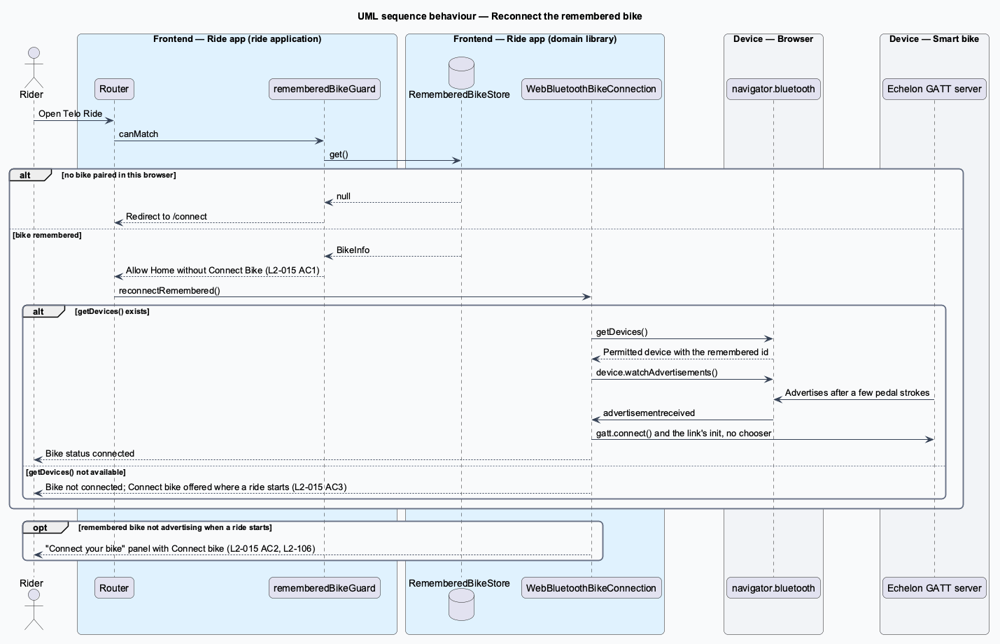

# Connect a bike

## Overview

Telo Ride reads the rider's power and sets resistance through a Bluetooth link from the browser to the bike. Before any race, class or custom workout, the Ride app needs that link. This feature finds, pairs and connects a supported bike, initialises it, and remembers it so the rider does not pair it again on every visit.

The following terms are used in this design:

- **Connect Bike** — first-run pairing screen at `/connect`, also shown when the remembered bike cannot be found; it has no app navigation
- **browser chooser** — device list the browser itself shows in answer to `navigator.bluetooth.requestDevice`; a page cannot scan in the background, so the chooser opens only on a tap or click
- **GATT** — Generic Attribute Profile, the Bluetooth LE model of services and characteristics the app reads, writes and subscribes to
- **initialisation** — fixed sequence of commands an Echelon bike needs before it streams workout data
- **FTMS** — Bluetooth SIG Fitness Machine Service (`0x1826`), spoken by other smart bikes, supported in beta
- **control point** — FTMS characteristic Fitness Machine Control Point (`0x2AD9`), through which the app requests control and sets target resistance
- **remembered bike** — bike paired earlier in this browser, whose identity the app keeps so it can reconnect without the chooser

The slice covers the Connect Bike screen and its states (default, searching, found, pairing, paired), the chooser call and its failures, the Echelon and FTMS connection paths, and the return of a remembered bike. Keeping the link alive after it connects belongs to [keep-the-bike-connected](../keep-the-bike-connected/README.md). Decoding the data that flows belongs to [read-bike-telemetry](../read-bike-telemetry/README.md). The browser and secure-context checks that run first belong to [check-bike-and-browser-support](../check-bike-and-browser-support/README.md). Bytes and UUIDs are specified in `docs/protocol/echelon-ble-frames.md`.

## Description

The slice lives entirely in the Ride app. No backend takes part.

- **`ConnectBikePage`** — page at `/connect` (`loadComponent`). It shows the bike photo, "Connect your bike" and "Pedal once to wake it up. Telo Ride reads your power and sets resistance for every hill and interval.", with no app navigation. At lg (≥ 1024 px) and wider it is two columns with the photo on the left. Below lg the photo follows the content, square, at up to 28 rem. Under the pair button, while the rider chooses (default and searching), it shows the hint "Not in the list? Close the Echelon app on your phone — the bike talks to one device at a time." (`connect__hint`).
- **`ConnectBikeStore`** — signal store provided on the `/connect` route. It holds a `ConnectView` (`default`, `searching`, `pairing`, `paired`, `failed` with a reason, `blocked` or `failed`) and exposes `pair()`. One press of the pair button opens the chooser (the user gesture it needs) and, once the rider picks the bike, connects to it: there is no separate found step, so the mock's default card is the bike Telo Ride offers. A cancelled chooser returns to `default` with no error. On `paired` it remembers the bike (`RememberedBikeStore`), waits about 500 ms and navigates to Home. The new-rider Home belongs to [choose-the-next-ride](../../home/README.md) and arrives with slice 13.2.
- **`ConnectDevice`** — presentation component (block `connect-device`). It renders the device card from its `name`, `identifier` and `state` inputs; the page renders the pair button (`connect__pair-btn`) beside it and calls the store. Slice 2.1 built the minimum: the card offers "Echelon EX-5s" until the rider presses "Pair Echelon EX-5s", which searches from that click (the browser opens its chooser only for a user gesture). Searching shows a spinner with "Looking for bikes nearby…" (`role="status"`) and a disabled "Searching…" button. Once the rider has picked the bike, the card shows its name ("Echelon EX-5s") and identifier ("EX5S-141844"). Pairing disables the button with `aria-busy="true"`, a spinner and "Pairing…". Paired shows a check (`aria-label="Paired"`) and a disabled "Paired" button. `bikeIdentity()` (`domain`, `bluetooth/`, with unit tests) turns the device into name and identifier: an Echelon advertises `ECH-<model>-<serial>`, so `ECH-EX5S-141844` is "Echelon EX-5s" with identifier `EX5S-141844` (model codes `EX5S`, `EX3`, `EX8S` and `SPORT` name the four supported models; another code reads "Echelon <code>"); any other device is its advertised name with no identifier, or its browser id when it has no name. The mock's "Strong signal" needs `watchAdvertisements()`, which Chrome ships behind a flag; the card shows the identifier alone until it ships.
- **`BikeConnection`** — contract in `api` with token `BIKE_CONNECTION`. It exposes a `frames` stream and the operations `requestBike()` (a `BikeInfo` with `id`, `name`, `identifier` and `kind`, or `null` when the chooser is cancelled), `connect()` (resolves once initialisation is done and the first notification has arrived), `reconnectRemembered(bike)`, `setResistance(level)` and `disconnect()`. A refusal is a `BikeConnectionError` whose `code` (`blocked`, `failed`) a screen branches on. The link `state` signal and `control` arrive with [keep-the-bike-connected](../keep-the-bike-connected/README.md).
- **`WebBluetoothBikeConnection`** — implementation in `domain`'s `bluetooth/` folder, the only code that touches `navigator.bluetooth`. `requestBike()` calls `requestDevice` with filters for a name that starts with `ECH` (spelled `ECH`, `Ech` and `ech`, as `namePrefix` is case-sensitive), for the Echelon service (`0bf669f1-45f2-11e7-9598-0800200c9a66`) and for FTMS (`0x1826`), and lists Heart Rate (`0x180D`) as an optional service. The name filters keep an Echelon that advertises its name without its service in the list; the services named in any filter stay readable once the rider picks the bike. It is called only from a click handler, so nothing reaches Bluetooth before the rider acts. A `NotFoundError` (chooser cancelled) returns `null` and leaves Connect Bike in its default state. A `SecurityError` (a policy blocks the chooser) rejects with code `blocked`, any other failure with `failed`; Connect Bike names the reason in plain words with "Try again" (mock state `chooser-blocked`). `connect()` opens GATT and picks a `BikeLink` by the services the device offers: the Echelon service selects `EchelonLink`; FTMS alone selects `FtmsLink`.
- **`EchelonLink`** — `BikeLink` for Echelon bikes. It subscribes to the notify characteristic `0bf669f4-…` before writing anything. It then writes `F0 A1 00 91`, `F0 A3 00 93` and `F0 B0 01 01 A2`, in that order, each to `0bf669f2-…` with response and at least 300 ms after the previous one. When the first notification arrives after initialisation, the bike state is `Connected` and its name is the device name, or its identifier when the device has no name.
- **`FtmsLink`** — `BikeLink` for FTMS bikes. It subscribes to Indoor Bike Data (`0x2AD2`) and to control point (`0x2AD9`) indications, and reads Supported Resistance Level Range (`0x2AD6`). Before the first target resistance it writes Request Control (op code `0x00`) and sends Set Target Resistance Level (op code `0x04`) only after a Success response (`0x80 0x00 0x01`). A refusal, or a bike with no control point, sets `control` to `ReadOnly`: telemetry continues, the resistance controls are disabled, and the bike status reads "Read only" with an explanation in Diagnostics. Request Control unanswered within 3 s (`CONTROL_TIMEOUT_MS`) counts as a refusal, and control is asked for once per connection. A read-only link refuses each target with `BikeConnectionError` code `read-only`. The "Read only" status has no mock yet (L2.md, Mock gaps), so slice 2.3 builds the link's `control` and the bike status shows it once its mock exists. `connect()` asks the device for its primary services and picks the link from them, so it never asks an FTMS bike for the Echelon service.
- **`GattWriteQueue`** — serialises every write to the bike. A write waits while another is pending, writes run in the order requested, and each resolves with its acknowledgement time in milliseconds.
- **`EchelonProtocol`** and **`FtmsProtocol`** — codecs in `domain`'s `protocol/` folder. `EchelonProtocol` holds the UUIDs, the init commands and the checksum `(sum of bytes) mod 256`. `FtmsProtocol` holds the SIG UUIDs in their full 128-bit form, builds control point commands (Set Target Resistance Level carries the level as a little-endian sint16 in units of 0.1, the encoding of the Supported Resistance Level Range it is chosen from), decodes control point responses and the resistance range, and maps levels 1 to 32 onto the bike's range: level 1 is the minimum, level 32 the maximum, and levels between are spaced linearly and rounded to the bike's increment.
- **`RememberedBikeStore`** — store in `domain`'s `storage/` folder, behind the `REMEMBERED_BIKE` contract in `api`. It keeps the paired bike's id, name, identifier, kind and paired time as one JSON record in `localStorage` (`telo-ride.bike`): one small record the guard reads synchronously at start-up, with no asynchronous open to race. A record it cannot parse counts as none.
- **`rememberedBikeGuard`** — route guard on Home in `ride`. A rider whose browser has a remembered bike goes to Home without Connect Bike. A rider with none goes to `/connect` when `BLUETOOTH_SUPPORT` reads `ready`; a browser that cannot reach a bike stays on Home, which works with no bike (L2-010 AC5). `REMEMBERED_BIKE` is bound with the bike connection in the lazy parent route, so neither is in the initial bundle. Other screens are not guarded, so browsing works with no bike (L2-010 AC5). With a remembered bike the guard starts `reconnectRemembered()` without waiting for it: where `navigator.bluetooth.getDevices()` exists, it finds the permitted device by id and connects without the chooser. Watching advertisements until a switched-off bike wakes, and retrying, belong to [keep-the-bike-connected](../keep-the-bike-connected/README.md). When `getDevices()` is absent, the bike shows as not connected and **Connect bike** is offered where a ride starts. When the remembered bike does not advertise as a ride starts, the ride screen shows "Connect your bike" with "Wake the Echelon EX-5s with a few pedal strokes, then pick it from the list your browser shows. We’ll remember it next time." and **Connect bike** (owned by `L2-106` in custom-workout).

The sign-in flow also routes here: a rider with no paired bike in this browser goes to Connect Bike after confirming the code (accounts subsystem, `L2-002`).

## Requirements

The feature realizes the following level-2 (L2) requirements. Each L2 requirement refines a level-1 (L1) requirement, cited by identifier.

| L2 ID | Refines (L1) | Requirement |
|-------|--------------|-------------|
| `L2-011` | `L1-003` | Connect Bike (`/connect`) shall show the bike photo, "Connect your bike" and "Pedal once to wake it up. Telo Ride reads your power and sets resistance for every hill and interval.", with no app navigation. While searching, the card shall show a spinner with "Looking for bikes nearby…" (`role="status"`) and a disabled "Searching…" button. A found bike shall show its name, signal and identifier ("Strong signal · EX5S-0bf669f1") with "Pair Echelon EX-5s". While pairing, the button shall be disabled with `aria-busy="true"`, a spinner and "Pairing…". On success the card shall show a check (`aria-label="Paired"`) and a disabled "Paired" button, and about half a second later Home shall open; a rider with no rides shall land on the new-rider Home. At lg or wider the screen shall be two columns with the photo on the left; below lg the photo shall follow the content at up to 28 rem, square. |
| `L2-012` | `L1-003` | The search or pair action shall call `navigator.bluetooth.requestDevice` with filters for a name that starts with `ECH` (spelled `ECH`, `Ech` and `ech`), for the Echelon service (`0bf669f1-45f2-11e7-9598-0800200c9a66`) and for FTMS (`0x1826`), with Heart Rate (`0x180D`) as an optional service. Without a user gesture the app shall not open the chooser. A cancelled chooser shall return Connect Bike to its default state with no error. A chooser that cannot open shall produce the reason in plain words and "Try again". The hint "Not in the list? Close the Echelon app on your phone — the bike talks to one device at a time." shall be shown. |
| `L2-013` | `L1-003` | On connecting an Echelon bike, the app shall open GATT, get service `0bf669f1-…` and subscribe to `0bf669f4-…` before writing anything. Initialisation shall write `F0 A1 00 91`, `F0 A3 00 93` and `F0 B0 01 01 A2`, in that order, each to `0bf669f2-…` with response, at least 300 ms after the previous one. Writes shall go one at a time in the order requested. When the first notification arrives after initialisation, the bike state shall be `connected` and its name the device name (or its identifier if it has none). |
| `L2-014` | `L1-003` | On connecting an FTMS bike, the app shall subscribe to Indoor Bike Data (`0x2AD2`) and to control point (`0x2AD9`) indications, and read Supported Resistance Level Range (`0x2AD6`). Before setting resistance it shall write Request Control (op code `0x00`) and send Set Target Resistance Level (op code `0x04`) only on a Success response (`0x80 0x00 0x01`). A bike that refuses control or has no control point shall still give telemetry, with the resistance controls disabled and the status "Read only" explained in Diagnostics. Levels 1 to 32 shall map onto the supported range with level 1 the minimum, level 32 the maximum, and levels between spaced linearly and rounded to the bike's increment. |
| `L2-015` | `L1-003` | With a bike paired in this browser, Telo Ride shall open on Home without Connect Bike, and where `navigator.bluetooth.getDevices()` exists it shall reconnect without the chooser as soon as the bike advertises. When the remembered bike does not advertise as a ride starts, the ride screen shall show "Connect your bike" with "Wake the Echelon EX-5s with a few pedal strokes, then pick it from the list your browser shows. We’ll remember it next time." and **Connect bike** (L2-106). Without `getDevices()`, the bike shall show as not connected and **Connect bike** shall be offered where a ride starts. |

## Diagrams

### System context

The rider picks the bike once in the browser chooser. Telo Ride then pairs it, subscribes to its notifications and initialises it over Web Bluetooth GATT.

### Containers

The Ride app talks to the bike directly and keeps the remembered bike in browser storage. No backend container takes part in this slice.

### Components

`ConnectBikePage` drives `ConnectBikeStore`, which calls `WebBluetoothBikeConnection` through `BIKE_CONNECTION`. The connection selects `EchelonLink` or `FtmsLink`, both of which write through `GattWriteQueue` and encode with the codecs in `domain/protocol`. `rememberedBikeGuard` reads `RememberedBikeStore` to choose between Home and Connect Bike.

### Class structure

`WebBluetoothBikeConnection` realizes `BikeConnection` and owns at most one `BikeLink`. `EchelonLink` and `FtmsLink` realize `BikeLink`; `FtmsLink` keeps the bike's `ResistanceRange` and its `BikeControl`.

### Behaviour — pair an Echelon bike

The rider's tap opens the browser chooser. A cancelled chooser returns to the default state, a blocked chooser shows its reason, and a picked bike moves through found, pairing and paired. Initialisation subscribes first, then writes the three init commands at least 300 ms apart through the write queue (`L2-013`).

### Behaviour — connect an FTMS bike and request control

`FtmsLink` subscribes to Indoor Bike Data and the control point and reads the resistance range. The first target resistance requests control; a Success response unlocks Set Target Resistance Level, and anything else leaves the bike read only (`L2-014`).

### Behaviour — reconnect the remembered bike

On opening, `rememberedBikeGuard` sends a rider with a remembered bike to Home. Where `getDevices()` exists, the connection watches for the bike's advertisement and reconnects without the chooser (`L2-015`).

