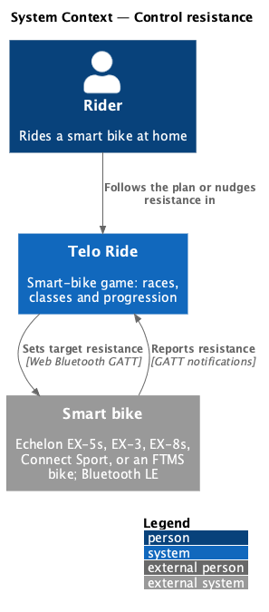
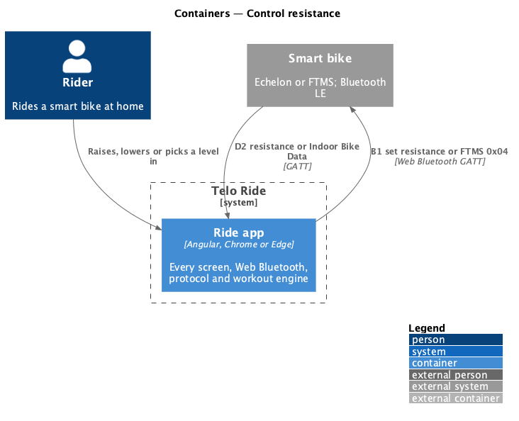
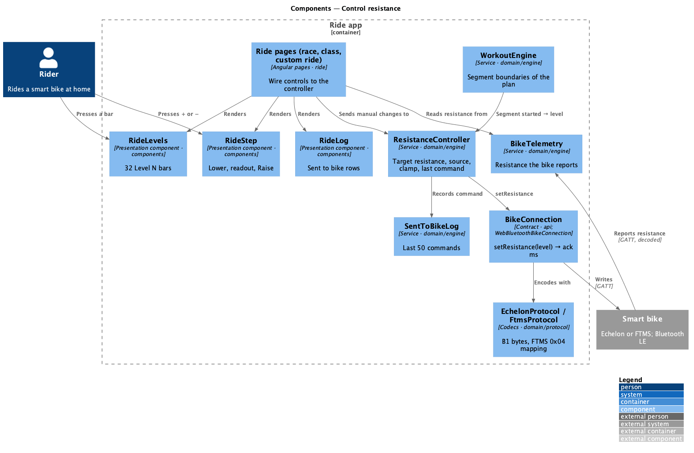
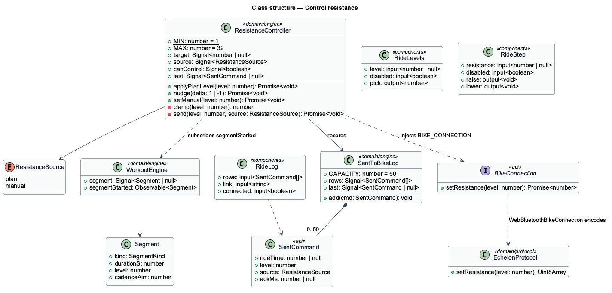
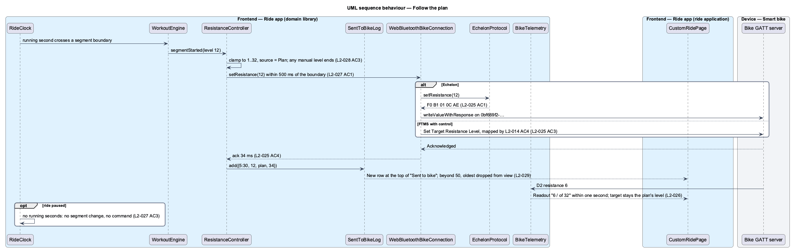
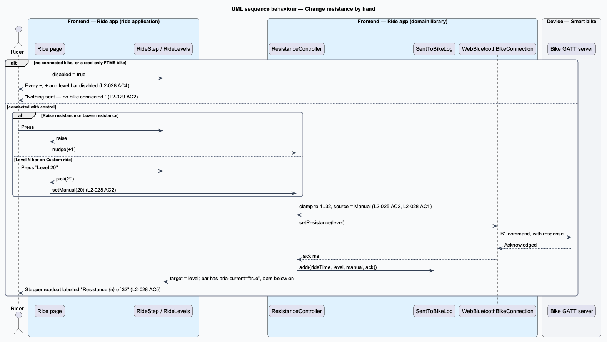

# Control resistance

## Overview

Telo Ride sets the bike's resistance for every hill and interval. A class, a race and a custom workout each follow a plan, and the rider may nudge the resistance by hand at any time. This feature sends those levels to the bike, keeps the requested level apart from the level the bike reports, and shows the rider what was sent.

The following terms are used in this design:

- **resistance** — level the bike reports, from 1 to 32
- **target resistance** — level the app asks the bike for
- **plan** — timed segments a ride follows; each **segment** has a kind (warm-up, work, recover, steady, cool-down), a duration, a level and a cadence aim
- **segment boundary** — instant of ride time at which one segment ends and the next begins
- **source** — origin of a target resistance: `plan` when a segment starts, `manual` when the rider changes it
- **acknowledgement time** — milliseconds from writing a command to the bike's acknowledgement of the write
- **Sent to bike** — log on Custom ride that lists recent target resistances with their ride time, level, source and acknowledgement time

The target resistance and the resistance differ in practice: an Echelon may settle on a different level from the one requested, and the rider may turn the bike's own knob. Both are kept, and each is shown where the specs say. The command bytes are specified in `docs/protocol/echelon-ble-frames.md`; FTMS control is set up by [connect-a-bike](../connect-a-bike/README.md); resending after a reconnect is triggered by [keep-the-bike-connected](../keep-the-bike-connected/README.md).

## Description

The slice lives in the Ride app. No backend takes part.

- **`ResistanceController`** — service in `domain`'s `engine/` folder, provided at each ride route and released when the rider leaves it. It holds `target` (the target resistance), `source` (`plan` or `manual`), `canControl`, which is false with no connected bike or once an FTMS bike has refused control (`read-only`), and `last`, the last command with its acknowledgement time. `applyPlanLevel(level)` sets the source to `plan`. `nudge(±1)` and `setManual(level)` set it to `manual`: a nudge moves one level from the target, or from the bike's reported resistance (`BikeTelemetry`) before any target, and neither sends anything while `canControl` is false. Each clamps the level to 1 to 32 before sending. Each send calls `BikeConnection.setResistance(level)`, which resolves with the acknowledgement time, and records a `SentCommand`. A target asked for while the bike is away is kept by the connection, which sends its last target again first after a reconnect ([keep-the-bike-connected](../keep-the-bike-connected/README.md)), so the controller has no resend of its own.
- **`WorkoutEngine`** — service in `domain`'s `engine/` folder that steps the plan on the running seconds of `RideClock`. Its `segmentStarted` stream drives `applyPlanLevel()`, so a segment's level goes out within 500 ms of the boundary and replaces any manual level set during the previous segment. A paused ride has no running seconds, so no segment changes and no command is sent.
- **`BikeConnection.setResistance(level)`** — contract operation realized by `WebBluetoothBikeConnection`. For an Echelon it writes `EchelonProtocol.setResistance(level)` with response: level 12 is `F0 B1 01 0C AE` and level 32 is `F0 B1 01 20 C2`, with checksum `(0xA2 + level) mod 256`. For an FTMS bike with control it sends Set Target Resistance Level, mapped by `FtmsProtocol.mapLevel()`. Every write goes through `GattWriteQueue`, which measures the acknowledgement time.
- **`SentToBikeLog`** — service in `domain`'s `engine/` folder, built with Custom ride's log (slice 21.3), the only screen that shows it, since each row carries the ride time. It keeps the last 50 `SentCommand` rows, newest first, in a fixed-size buffer; older rows drop from view and remain in the packet log ([diagnostics/record-the-packet-log](../../diagnostics/record-the-packet-log/README.md)). `last` feeds the "Last command" fact in Diagnostics.
- **`BikeTelemetry`** — the telemetry service from [read-bike-telemetry](../read-bike-telemetry/README.md). It supplies the resistance the bike reports, which every readout shows within one second of a new report. Before any report the readout reads "—".
- **`RideStep`** — presentation component (design-system block `number-stepper`, used as `ride-step` on ride screens). It shows "Lower resistance", the resistance readout ("6 / of 32", `aria-label` "Resistance {n} of 32" on race and class rides) and "Raise resistance". Both buttons are disabled when the input `disabled` is true.
- **`RideLevels`** — presentation component (block `ride-levels`) on Custom ride. It renders 32 "Level N" bars; the bar for the current target carries `aria-current="true"` and bars below it show as on. Every bar is disabled with no connected bike.
- **`RideControl`** — presentation component (block `ride-control`) holding the resistance panel note: "Following the plan — levels change with each interval." or, in flat mode, "Holding a flat level for the whole ride."
- **`RideLog`** — presentation component (block `ride-log`). It renders "Sent to bike" with the link in its heading ("BLE · 0bf669f1") and one row per command ("5:30 RES 6 · plan · ack 34ms"). With no connected bike it reads "Nothing sent — no bike connected."

The clamp, the source rules and the 50-row buffer have unit tests with a fake clock. Slice 4.1 builds `ResistanceController`'s plan path (`applyPlanLevel`, `target`, `source`, `canControl`, `last`) on the existing `setResistance`, proved by unit tests and end to end on the simulated bike; slice 4.2 adds `nudge` and `setManual`, proved the same way; `WorkoutEngine` comes with slice 5.1, and the steppers, level bars and log with the ride screens (5.2, 7.3, 21.3), which bring the Playwright proof.

## Requirements

The feature realizes the following level-2 (L2) requirements. Each L2 requirement refines a level-1 (L1) requirement, cited by identifier.

| L2 ID | Refines (L1) | Requirement |
|-------|--------------|-------------|
| `L2-025` | `L1-005` | For an Echelon and a target resistance of 12, the app shall write `F0 B1 01 0C AE` with response, and `F0 B1 01 20 C2` for 32. A target outside 1 to 32 shall be clamped to that range before it is sent. For an FTMS bike with control, a target shall go as Set Target Resistance Level, mapped by L2-014 AC4. The time from write to acknowledgement shall be recorded in milliseconds. |
| `L2-026` | `L1-005` | When the bike reports a resistance different from the target sent, the readout shall show the bike's resistance ("6 / of 32") while the target remains the plan's level. A new reported resistance shall appear within one second. With no resistance reported, the readout shall read "—". |
| `L2-027` | `L1-005` | When a segment of a running plan starts, its level shall be sent as the target resistance within 500 ms of the boundary. On Custom ride, the resistance panel shall read "Following the plan — levels change with each interval." or, in flat mode, "Holding a flat level for the whole ride.". A paused ride shall change no segment and send no command. On a reconnect mid-segment, the current segment's level shall be sent again. |
| `L2-028` | `L1-005` | With a connected bike, "Raise resistance" and "Lower resistance" shall move the target resistance by one level, clamped to 1 to 32, and send it. On Custom ride, pressing one of the 32 "Level N" bars shall set the target to N; the current level's bar shall carry `aria-current="true"` and bars below it shall show as on. A manual level shall give way to the plan's level when the next segment starts. With no connected bike, every −, + and level bar shall be disabled. The race and class ride steppers shall carry `aria-label` "Resistance {n} of 32" on the readout. |
| `L2-029` | `L1-005` | On Custom ride, each target resistance sent shall add a row at the top of "Sent to bike" ("5:30 RES 6 · plan · ack 34ms") holding the ride time, the level, the source (plan or manual) and the acknowledgement time. With no bike connected, the log shall read "Nothing sent — no bike connected.". Beyond 50 rows, the oldest shall drop from view and stay in the packet log (L2-114). The log heading shall name the link ("BLE · 0bf669f1"). |

## Diagrams

### System context

The rider follows the plan or changes the level by hand. Telo Ride sets the target resistance on the bike, and the bike reports the resistance it holds.

### Containers

Commands travel from the Ride app to the bike as Echelon `B1` frames or FTMS op code `0x04`. Reported resistance travels back in `D2` frames or Indoor Bike Data.

### Components

`WorkoutEngine` and the ride pages both drive `ResistanceController`. The controller sends through `BikeConnection` and records each command in `SentToBikeLog`. The presentation components `RideStep`, `RideLevels` and `RideLog` render the target, the reported resistance and the log.

### Class structure

`ResistanceController` depends on `BikeConnection` through `BIKE_CONNECTION` and subscribes to the `WorkoutEngine` segment stream. `SentToBikeLog` composes at most 50 `SentCommand` rows, each with a `ResistanceSource`.

### Behaviour — follow the plan

A segment boundary sends the segment's level within 500 ms (`L2-027`). The controller encodes the `B1` command or the FTMS equivalent, records the acknowledgement time (`L2-025`), and adds a "Sent to bike" row (`L2-029`). The readout then shows the resistance the bike reports (`L2-026`).

### Behaviour — change resistance by hand

With a connected bike, + and − nudge the target by one level and a level bar sets it outright, each clamped and sent as a manual command (`L2-028`). With no connected bike, every control is disabled and the log says nothing was sent.

