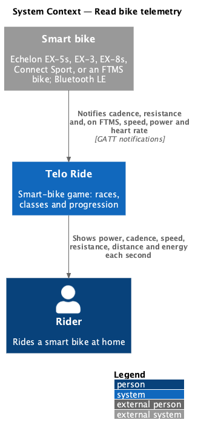
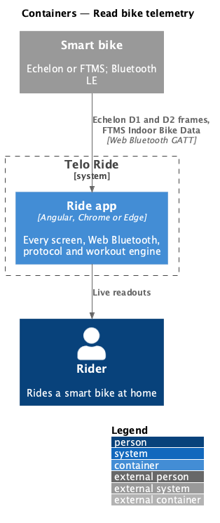
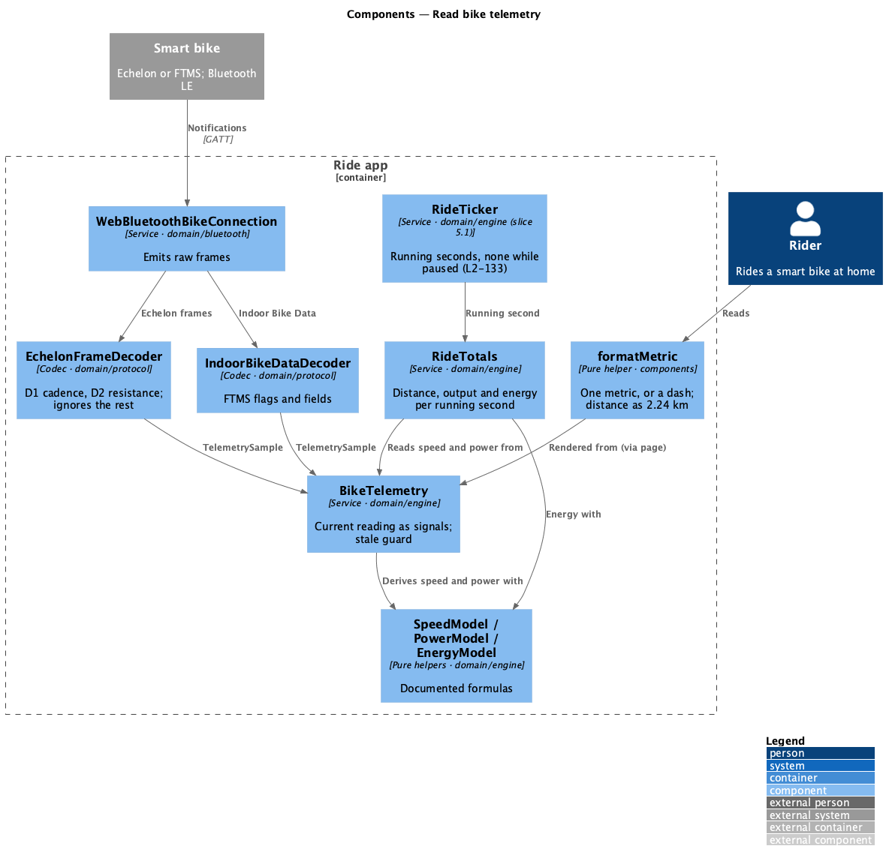
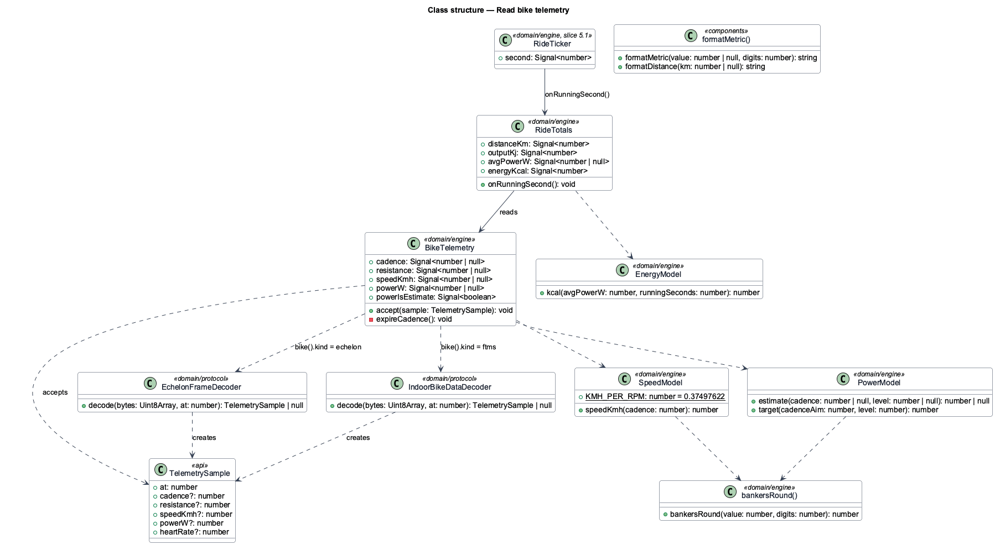
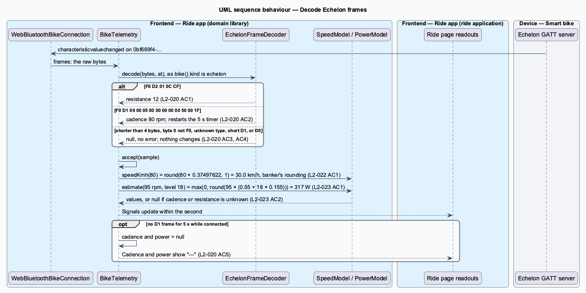
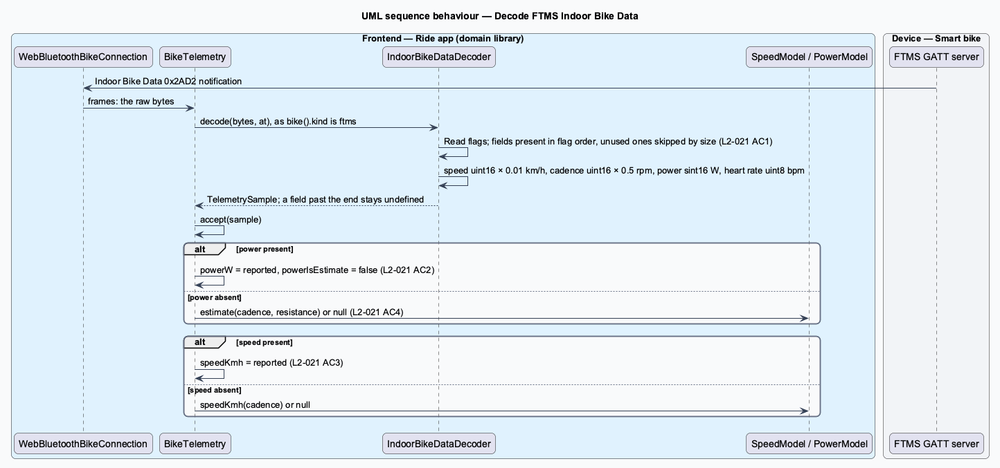
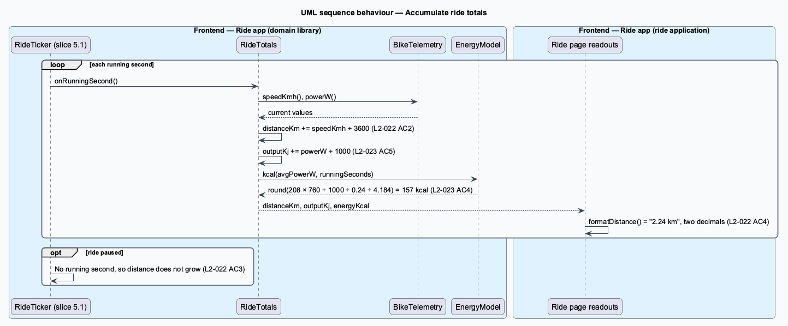

# Read bike telemetry

## Overview

Every Telo Ride screen that runs a ride leads with the rider's power and shows cadence, speed, resistance, distance and energy alongside it. Races rank riders by distance, classes by output, and XP rewards riding well, so these numbers carry the whole game. This feature turns what the bike sends into those live metrics, updated about once a second.

The following terms are used in this design:

- **telemetry** — stream of readings the bike sends: cadence and resistance from an Echelon; speed, cadence, power and heart rate from an FTMS bike, as its flags allow
- **frame** — one Echelon message: marker `F0`, a type byte, a length byte, a payload and a checksum, as specified in `docs/protocol/echelon-ble-frames.md`
- **`D1` frame** — Echelon workout data frame, 13 bytes, sent about once a second, whose bytes 9–10 hold cadence in rpm
- **`D2` frame** — Echelon resistance frame, 5 bytes, whose byte 3 holds the resistance level
- **Indoor Bike Data** — FTMS characteristic `0x2AD2`, whose leading flags field decides which fields follow
- **estimate** — metric computed by a fixed, documented formula when the bike does not report it; an Echelon reports no power and no speed
- **output** — work done in a ride in kJ, the sum of each running second's power ÷ 1000
- **running second** — second of ride time while the ride is not paused

ADR 0003 fixes the estimated power formula and labels the figure as an estimate in the UI. Connecting the bike belongs to [connect-a-bike](../connect-a-bike/README.md); heart rate belongs to [show-heart-rate](../show-heart-rate/README.md); the ride clock belongs to [performance/keep-the-ride-clock-true](../../performance/keep-the-ride-clock-true/README.md).

## Description

The slice lives in the Ride app's `domain` library, with one presentation component. No backend takes part.

- **`EchelonFrameDecoder`** — codec in `domain`'s `protocol/` folder. `decode(bytes)` returns a `TelemetrySample` or `null`. `F0 D2 01 0C CF` yields resistance 12. `F0 D1 09 00 05 00 00 00 00 00 50 00 1F` yields cadence 80 rpm, read big-endian from bytes 9–10. It returns `null`, without an error, for a frame shorter than 4 bytes, a byte 0 other than `F0`, an unknown type, a `D1` shorter than 13 bytes, and every `D0` frame. Every frame carries a checksum, which `EchelonProtocol` computes for each command; incoming checksums are not checked, as `docs/protocol/echelon-ble-frames.md` records (all 5,686 captured frames carry a correct one).
- **`IndoorBikeDataDecoder`** — codec in `domain`'s `protocol/` folder. It reads the flags and then each present field in specification order: speed as uint16 in 0.01 km/h, cadence as uint16 in 0.5 rpm, power as sint16 in W and heart rate as uint8 in bpm. It skips the fields it does not use (average speed and cadence, total distance, resistance level, average power, expended energy) by their sizes, so the fields after them are read at the right offset. Fields the flags mark absent, and a field that would run past the end of the notification, are left undefined, without an error.
- **`TelemetrySample`** — type in `api`: a timestamp and the optional `cadence`, `resistance`, `speedKmh`, `powerW` and `heartRate`.
- **`BikeTelemetry`** — service in `domain`'s `engine/` folder, provided by the ride screens that show readouts (slice 3.2 on). It reads the `BIKE_CONNECTION`'s `frames`, decodes each with the decoder for `bike().kind` (`echelon` or `ftms`), and merges the samples into signals for cadence, resistance, speed and power, plus `powerIsEstimate`. A reported FTMS power or speed is used as it is. A missing metric falls back to its estimate or, when the estimate's inputs are unknown, to `null`. With no `D1` frame for 5 seconds while connected, cadence and power become `null`, so the readouts show "—" rather than stale values: each sample that carries cadence restarts a 5-second timer, and the timer and the subscription are released when the service is destroyed.
- **`SpeedModel`** — pure helper: `speedKmh(cadence) = round(cadence × 0.37497622, 1)` with banker's rounding, so 80 rpm gives 30.0 km/h.
- **`PowerModel`** — pure helper: `estimate(cadence, level) = max(0, round(cadence × (0.55 + level × 0.155)))`, so cadence 95 at resistance 18 gives 317 W; an unknown input gives `null`. `target(cadenceAim, level)` uses the same formula with a segment's cadence aim, so aim 100 at level 18 gives 334 W.
- **`EnergyModel`** — pure helper: `kcal(avg, t) = round(avg × t ÷ 1000 ÷ 0.24 ÷ 4.184)`, so 208 W over 760 running seconds gives 157 kcal.
- **`bankersRound()`** — pure helper that rounds half to even, shared by the models.
- **`RideTotals`** — service in `domain`'s `engine/` folder. On each running second (`onRunningSecond()`, called by the ride screen's `RideTicker` from slice 5.1, see [keep-the-ride-clock-true](../../performance/keep-the-ride-clock-true/README.md)) it adds speed in km/h ÷ 3600 to `distanceKm` and that second's power ÷ 1000 to `outputKj`, and recomputes average power and energy. A paused ride produces no running seconds, so distance does not grow. A second with unknown speed or power adds nothing; average power is output over running seconds. Totals are scalars, so they stay a fixed size for the length of the ride. The ride clock's `DistanceIntegrator` may later integrate over notification timestamps instead of seconds, so throttled ticks cannot lose distance; `RideTotals` keeps L2-022 AC2's per-second rule until it does.
- **`formatMetric()` and `formatDistance()`** — pure helpers in `components`, shared by every readout: a value to a fixed number of decimals, or "—" when it is `null`; distance in km with two decimals ("2.24 km"). The readouts themselves are drawn by the screen that hosts them, in the design system's three families of `ride-readout`: the class ride's stat tiles (slice 5.2), the race power panel (7.3) and the custom ride's dashboard readouts (21.3), each with its plan's target beside the value.

The formulas have unit tests, one case per acceptance example. Slice 3.1 builds the decoders, the speed and power models and `BikeTelemetry`; no screen shows telemetry yet, so its acceptance tests are those tables, run against the decoders and `BikeTelemetry` with the bytes a bike sends. Slice 3.2 adds `RideTotals`, `EnergyModel` and the formatting helpers, proved the same way, since the screens that host readouts and the ride clock that ticks the totals come with journeys 5, 7 and 21; slice 5.2's Class Ride screen is the first to mount them, and proves the path from bike to readout with Playwright. The 1-second update cadence of the readouts is specified in [performance/keep-the-ride-clock-true](../../performance/keep-the-ride-clock-true/README.md) (`L2-134`).

## Requirements

The feature realizes the following level-2 (L2) requirements. Each L2 requirement refines a level-1 (L1) requirement, cited by identifier.

| L2 ID | Refines (L1) | Requirement |
|-------|--------------|-------------|
| `L2-020` | `L1-004` | The app shall decode `F0 D2 01 0C CF` as resistance 12 and `F0 D1 09 00 05 00 00 00 00 00 50 00 1F` as cadence 80 rpm. It shall ignore, without an error, a frame shorter than 4 bytes, with byte 0 other than `F0`, of an unknown type, a `D1` shorter than 13 bytes, and a `D0` frame. With no `D1` frame for 5 seconds while connected, cadence and power shall show "—" rather than their last values. |
| `L2-021` | `L1-004` | The app shall decode Indoor Bike Data by its flags, reading speed as uint16 in 0.01 km/h, cadence as uint16 in 0.5 rpm, power as sint16 in W and heart rate as uint8 in bpm. A reported power shall be shown as reported, not estimated, and a reported speed shall be shown as reported. A field the flags mark absent shall fall back to its estimate (L2-022, L2-023) or "—". |
| `L2-022` | `L1-004` | An Echelon cadence of 80 rpm shall give a speed of round(80 × 0.37497622, 1) = 30.0 km/h, with banker's rounding. Each second of a running ride shall add speed in km/h ÷ 3600 to distance. Distance shall not grow while the ride is paused. Distance shall be shown with two decimals in km ("2.24 km"). |
| `L2-023` | `L1-004` | For an Echelon at cadence 95 and resistance 18, estimated power shall be max(0, round(95 × (0.55 + 18 × 0.155))) = 317 W. With cadence or resistance unknown, power shall be unknown and shown as "—". A segment with cadence aim 100 and level 18 shall have a target power of 334 W by the same formula. Average power 208 W after 760 running seconds shall show as round(208 × 760 ÷ 1000 ÷ 0.24 ÷ 4.184) = 157 kcal. Each running second shall add its power ÷ 1000 to the ride's output in kJ. |

## Diagrams

### System context

The smart bike notifies its readings to Telo Ride, which shows the rider six live metrics each second.

### Containers

Telemetry flows from the bike into the Ride app over Web Bluetooth GATT and never leaves the device during a ride.

### Components

The connection hands raw frames to `EchelonFrameDecoder` or `IndoorBikeDataDecoder`. `BikeTelemetry` merges the samples and derives missing metrics with the models. `RideTotals` accumulates distance, output and energy on each running second the ride screen's `RideTicker` reports, and the screen shows the values through `formatMetric()`.

### Class structure

Both decoders create `TelemetrySample` values that `BikeTelemetry` accepts. The pure models share `bankersRound()`. `RideTotals` reads `BikeTelemetry` and is ticked by `RideTicker`; the screens format values with `formatMetric()`.

### Behaviour — decode Echelon frames

A `D2` frame updates resistance and a `D1` frame updates cadence; malformed and unknown frames return `null` without an error (`L2-020`). Speed and estimated power derive from cadence and resistance, and a 5-second gap in `D1` frames blanks cadence and power.

### Behaviour — decode FTMS Indoor Bike Data

The decoder reads only the fields the flags mark present. Reported power and speed are used as they are; absent fields fall back to their estimates (`L2-021`).

### Behaviour — accumulate ride totals

Each running second adds to distance and output and recomputes energy. A paused ride produces no running seconds, so its totals hold (`L2-022`, `L2-023`).

