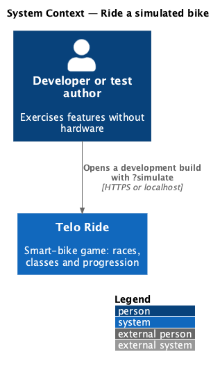
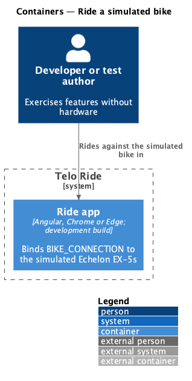
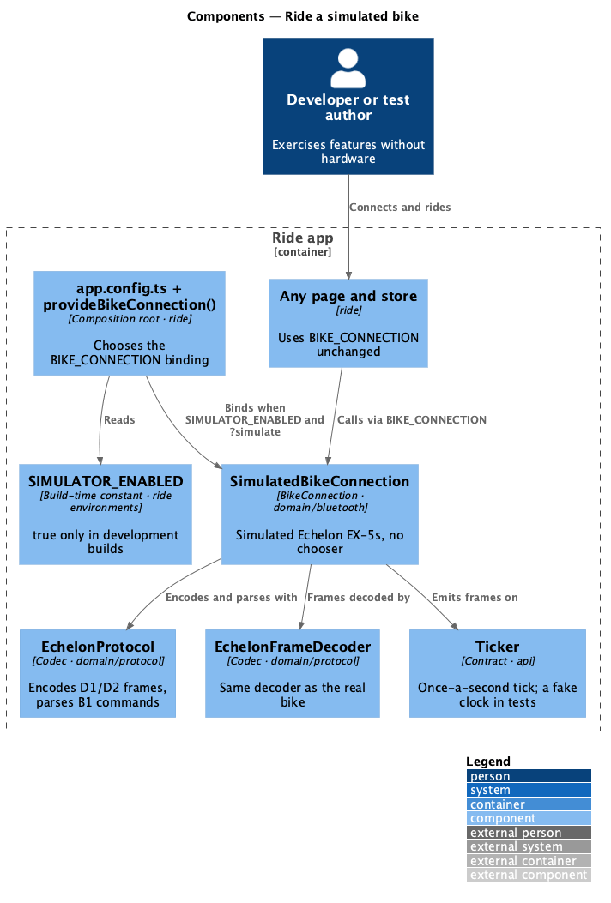
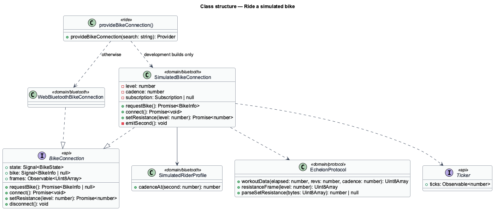
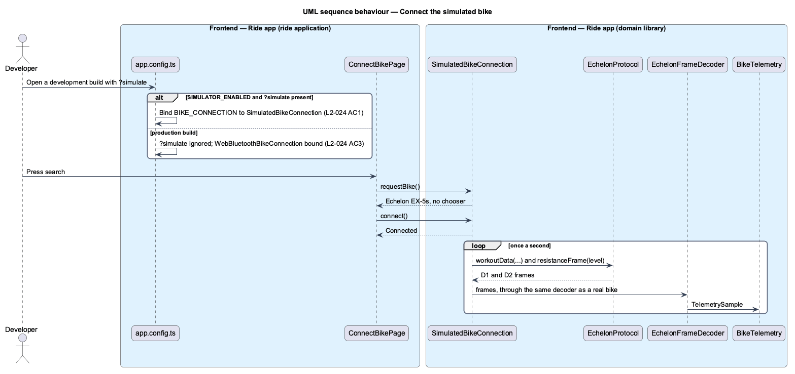
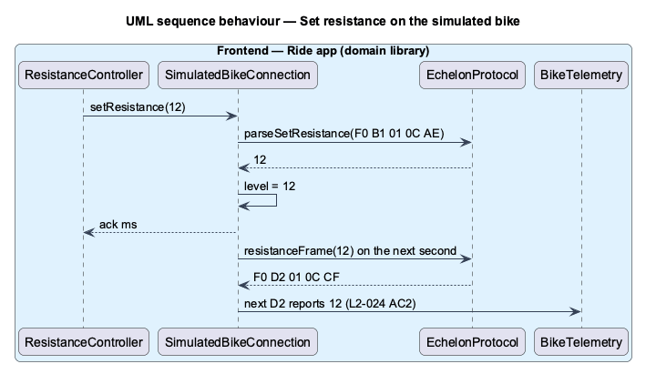

# Ride a simulated bike

## Overview

Telo Ride is built and checked without a bike on the desk. Developers, and anyone reviewing a change, need every screen and every ride type to run end to end with nothing but a browser. This feature supplies a simulated Echelon EX-5s that connects without the browser chooser and behaves like the real bike at the frame level.

The following terms are used in this design:

- **simulated bike** — in-app stand-in for an Echelon EX-5s that emits `D1` and `D2` frames once a second and answers set-resistance commands
- **development build** — build of the Ride app made with the development configuration in `angular.json`, as served by `npm start`
- **`?simulate`** — query parameter that asks a development build to bind the simulated bike in place of Web Bluetooth
- **composition root** — `ride`'s `app.config.ts`, where every injection token is bound

The simulated bike is a development aid inside the product. It differs from the fake `navigator.bluetooth` that the Playwright fixture installs for acceptance tests, which belongs to [platform/test-without-hardware-or-databases](../../platform/test-without-hardware-or-databases/README.md) (`L2-148`). The simulator feeds the same decoder and engine as a real bike, so a feature that works against it exercises the same code path past the GATT boundary.

## Description

The slice lives in the Ride app. No backend takes part.

- **`SIMULATOR_ENABLED`** — build-time constant exported by `ride`'s `app/bike/simulated-bike.provider.ts`: `true` there, for the development configuration. The production configuration replaces that file with `simulated-bike.provider.production.ts` through `fileReplacements`, where it is `false` and `simulatedBike()` provides nothing, so the simulator code never reaches the production bundle.
- **`provideBikeConnection()`** — provider function in `ride`. It binds `TICKER` to `SecondTicker`, and `BIKE_CONNECTION` to `SimulatedBikeConnection` when `SIMULATOR_ENABLED` is `true` and `location.search` contains `simulate`; otherwise to `WebBluetoothBikeConnection`. In a production build `?simulate` is ignored. It is called from `ride.routes.ts`, as the providers of the lazily loaded parent route every screen sits under, so one instance serves every screen while the bike code stays out of the initial bundle (lazy loading outranks binding every token in `app.config.ts`, AGENTS.md). The query is read once, when that route loads.
- **`SimulatedBikeConnection`** — implementation of the `BikeConnection` contract in `domain`'s `bluetooth/` folder. `requestBike()` resolves an Echelon EX-5s at once, with no chooser and no call to `navigator.bluetooth`. After `connect()`, it subscribes to the `Ticker` contract's `seconds` (`api`, token `TICKER`) and, once a second, encodes a `D1` frame (elapsed time, revolutions, cadence) and a `D2` frame (current level) with `EchelonProtocol`. It pushes both through its `frames` stream to `EchelonFrameDecoder`, exactly as a real bike's notifications arrive. `setResistance(level)` encodes the `B1` command, parses it back with `EchelonProtocol.parseSetResistance()`, stores the level, and resolves with an acknowledgement time of 0 ms; the next `D2` frame reports the new level. `disconnect()` and destruction release the tick subscription.
- **`SimulatedRiderProfile`** — helper that gives the simulated cadence for each second of the ride: a warm-up from 60 to 85 rpm over the first 30 seconds, then 85 rpm rising and falling by 5 every 20 seconds. The simulated bike starts at resistance 8.
- **`EchelonProtocol`** — codec in `domain`'s `protocol/` folder. Besides the commands the real bike needs, it encodes `D1` and `D2` frames and parses `B1` commands for the simulator; the encoders and decoders share one frame definition, so a round trip is testable.

Unit tests drive the simulator with a fake ticker and never sleep. Every feature's end-to-end path is runnable against the simulated bike. Playwright's `development` project serves the development build on the port after the production one and runs `*.development.spec.ts`, the only specs that can open `?simulate`; the `chromium` project proves the production build ignores it.

## Requirements

The feature realizes the following level-2 (L2) requirements. Each L2 requirement refines a level-1 (L1) requirement, cited by identifier.

| L2 ID | Refines (L1) | Requirement |
|-------|--------------|-------------|
| `L2-024` | `L1-004` | A development build opened with `?simulate` shall connect a simulated Echelon EX-5s without the chooser, sending `D1` and `D2` frames once a second. After a set-resistance command, the simulated bike's next `D2` shall report the new level. A production build shall ignore `?simulate`. Every feature shall be able to run end to end against the simulated bike. |

## Diagrams

### System context

A developer or test author opens a development build with `?simulate`; no smart bike takes part.

### Containers

The development build of the Ride app holds the simulator. The production build contains no simulator code.

### Components

The composition root reads `SIMULATOR_ENABLED` and the query string and binds `BIKE_CONNECTION`. Every page and store uses that token unchanged. `SimulatedBikeConnection` emits frames on the `Ticker` and encodes them with `EchelonProtocol` for the shared `EchelonFrameDecoder`.

### Class structure

`SimulatedBikeConnection` and `WebBluetoothBikeConnection` both realize `BikeConnection`. `provideBikeConnection()` selects one of them. The simulator takes its cadence from `SimulatedRiderProfile` and its frames from `EchelonProtocol`.

### Behaviour — connect the simulated bike

In a development build with `?simulate`, the composition root binds the simulator, and the search resolves an Echelon EX-5s without the chooser. Each second the simulator sends `D1` and `D2` frames through the real decoder (`L2-024`).

### Behaviour — set resistance on the simulated bike

A set-resistance command is encoded and parsed back by `EchelonProtocol`. The simulator stores the level and reports it in its next `D2` frame (`L2-024`).

