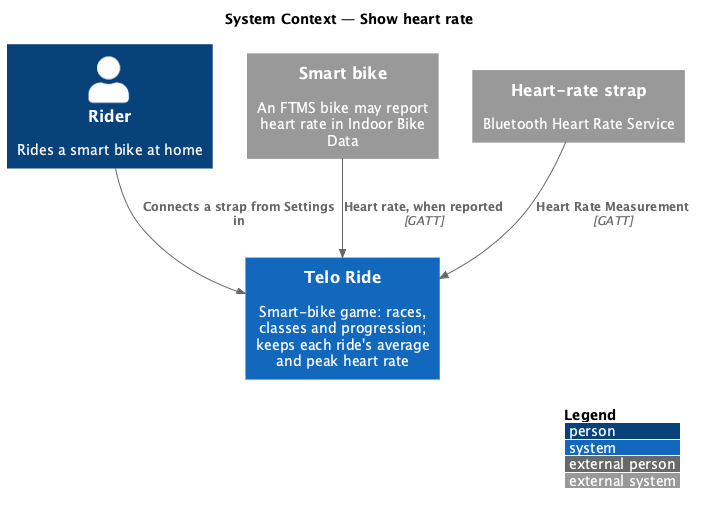
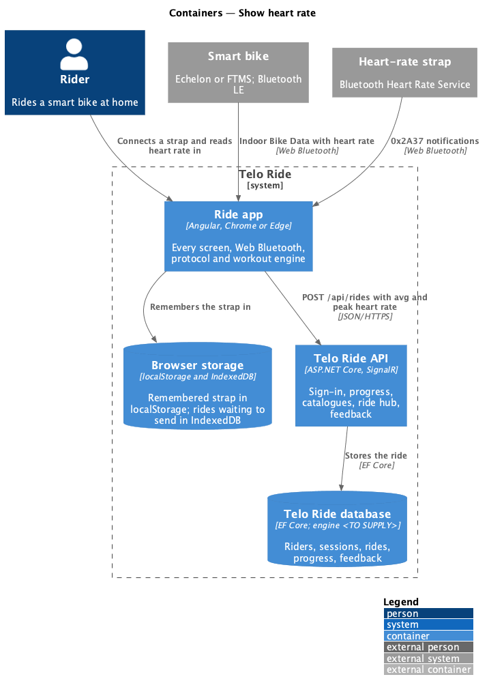
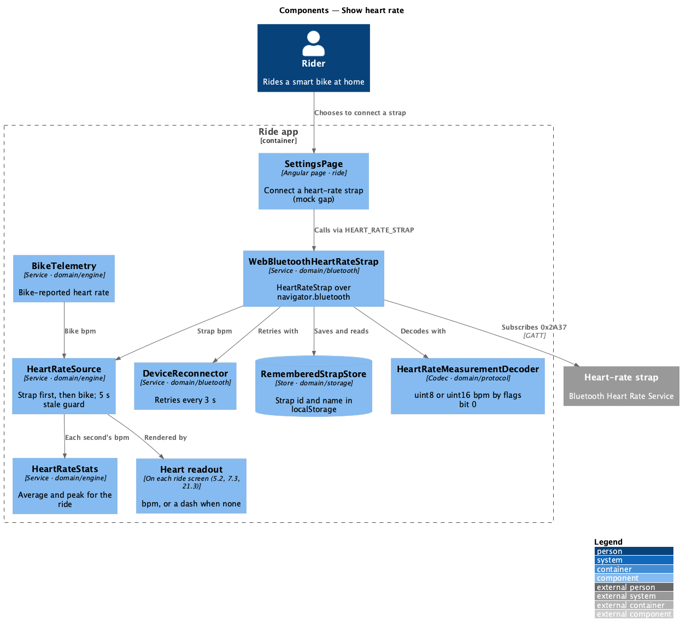
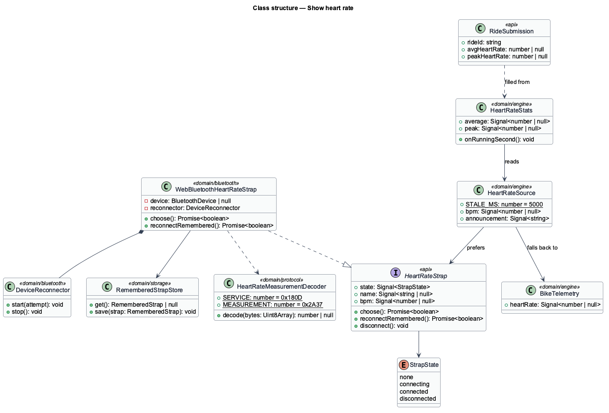
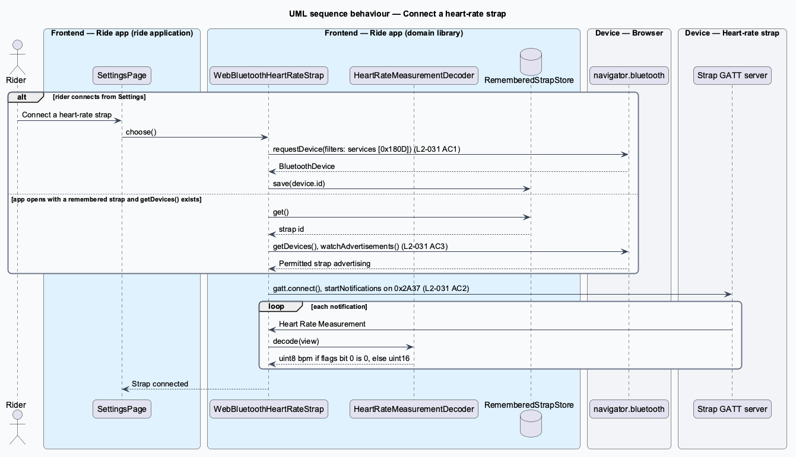
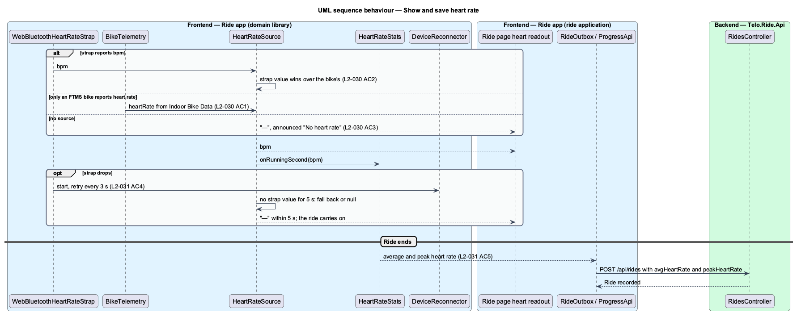

# Show heart rate

## Overview

Telo Ride shows heart rate beside power whenever a reading is available. An Echelon reports no heart rate, some FTMS bikes include it in their data, and many riders wear a Bluetooth chest strap. This feature shows heart rate from the best available source, connects and remembers a strap, and keeps each ride's average and peak heart rate with the ride.

The following terms are used in this design:

- **heart-rate strap** — wearable Bluetooth sensor that offers the Heart Rate service (`0x180D`)
- **Heart Rate Measurement** — strap characteristic `0x2A37`, whose flags bit 0 says whether the value is a uint8 or a uint16 in bpm
- **heart-rate source** — origin of the reading shown: the strap when one reports, otherwise the bike when it reports, otherwise none
- **remembered strap** — strap connected earlier in this browser, which the app reconnects to without the browser chooser where `navigator.bluetooth.getDevices()` exists

ADR 0003 records that the app reads no heart-rate sensor and shows heart rate as `null`. `L2-030` and `L2-031` reverse that decision, so ADR 0003 is due to be superseded by a new ADR before this feature is built. Connecting a strap has no mock yet; the mock comes before implementation.

## Description

The slice lives mostly in the Ride app; the backend receives the two figures with each submitted ride.

- **`HeartRateStrap`** — contract in `api` with token `HEART_RATE_STRAP`. It exposes `state` (`none`, `connecting`, `connected`, `disconnected`), `name` (rendered as text), `bpm`, `choose()`, `reconnectRemembered()` and `disconnect()`.
- **`WebBluetoothHeartRateStrap`** — implementation in `domain`'s `bluetooth/` folder. `choose()` runs from a click on Profile's Settings and calls `requestDevice` filtered to the Heart Rate service (`0x180D`). After connecting, it subscribes to Heart Rate Measurement (`0x2A37`). On a drop it starts a `DeviceReconnector` that retries every 3 seconds. When Telo Ride opens with a remembered strap and `getDevices()` exists, `reconnectRemembered()` finds the permitted device and reconnects as soon as it advertises. Five seconds without a measurement blank `bpm`, and so does a drop. Errors go to the console as `name: message`. Listeners, the timer and the reconnector are released with the service.
- **`HeartRateMeasurementDecoder`** — codec in `domain`'s `protocol/` folder. It reads flags bit 0 and returns the bpm from a uint8 (bit 0 clear) or a little-endian uint16 (bit 0 set), or `null`, never an error, for a notification too short for its value.
- **`RememberedStrapStore`** — store in `domain`'s `storage/` folder that keeps the strap's device id and name as one JSON record in localStorage (`telo-ride.strap`), read synchronously like the remembered bike's. A record it cannot parse, or storage the browser refuses, counts as no strap.
- **`BikeTelemetry`** — the telemetry service from [read-bike-telemetry](../read-bike-telemetry/README.md). It supplies heart rate when an FTMS bike's Indoor Bike Data carries it, `null` once it has carried none for 5 seconds.
- **`HeartRateSource`** — service in `domain`'s `engine/` folder. Its `bpm` signal uses the strap's value when the strap reports one, otherwise the bike's, otherwise `null`. Each source blanks its own value after 5 seconds without a reading, so a dropped strap gives way to the bike, or shows "—", within 5 seconds while the ride carries on. `announcement` reads "Heart rate 142 bpm", or "No heart rate" when `bpm` is `null`.
- **`HeartRateStats`** — service in `domain`'s `engine/` folder. On each running second (`onRunningSecond()`, from the ride screen's ticker) it takes in `HeartRateSource.bpm`, skipping seconds without one, and keeps the ride's average (rounded to a whole bpm) and peak, holding a sum, a count and a peak rather than a trace.
- **`RideReadout`** — presentation component that renders the heart readout in bpm, or "—" announced as "No heart rate".
- **Ride submission** — the finished ride carries `avgHeartRate` and `peakHeartRate` in its `RideSubmission`. It reaches `POST /api/rides` directly or later through the outbox (`L2-135`), and the backend stores both on the `Ride`. Submission belongs to [progression/keep-progress-on-the-backend](../../progression/keep-progress-on-the-backend/README.md).
- **`SettingsPage`** — page in `ride` under Profile ([profile/change-settings](../../profile/change-settings/README.md)) that offers the action to connect a heart-rate strap. The strap's name and errors are rendered as text.

Slice 3.3 builds the decoder, `BikeTelemetry`'s heart rate, the strap, its store, `HeartRateSource` and `HeartRateStats`, proved by one unit test per acceptance row with a fake strap. Connecting a strap needs Profile's Settings, which slice 20.1 builds (its mock is a recorded gap in `L2-031`): that slice adds the action and its mock, binds `HEART_RATE_STRAP` with `reconnectRemembered()` at start-up, and proves the path with Playwright through the fake Bluetooth. The heart readout comes with the ride screens (5.2, 7.3, 21.3), and the submission with journey 10.

## Requirements

The feature realizes the following level-2 (L2) requirements. Each L2 requirement refines a level-1 (L1) requirement, cited by identifier.

| L2 ID | Refines (L1) | Requirement |
|-------|--------------|-------------|
| `L2-030` | `L1-006` | When an FTMS bike's Indoor Bike Data carries heart rate, the heart readout shall show it in bpm. When both the bike and a strap report heart rate, the strap's value shall be used. With no source of heart rate, the heart readout shall read "—" and be announced as "No heart rate". |
| `L2-031` | `L1-006` | Choosing to connect a heart-rate strap in Profile's Settings shall open the browser chooser filtered to the Heart Rate service (`0x180D`). A chosen strap shall be subscribed to Heart Rate Measurement (`0x2A37`), read as uint8 or uint16 bpm as flags bit 0 says. A strap connected before in this browser shall reconnect without the chooser where `getDevices()` exists. When the strap drops, the heart readout shall show "—" within 5 seconds, the ride shall carry on, and the app shall retry every 3 seconds. A saved ride shall keep its average and peak heart rate. |

## Diagrams

### System context

The rider connects a strap in Telo Ride. Heart rate arrives from the strap or, on some FTMS bikes, from the bike itself.

### Containers

The Ride app reads both Bluetooth sources and remembers the strap in browser storage. The finished ride's average and peak heart rate reach the Telo Ride API with the ride submission.

### Components

`SettingsPage` connects the strap through `HEART_RATE_STRAP`. `WebBluetoothHeartRateStrap` decodes each measurement and retries after a drop. `HeartRateSource` picks the strap or the bike, feeds `HeartRateStats`, and drives the heart readout.

### Class structure

`WebBluetoothHeartRateStrap` realizes `HeartRateStrap` and composes a `DeviceReconnector`. `HeartRateSource` prefers the strap and falls back to `BikeTelemetry`. `HeartRateStats` supplies the two figures carried by `RideSubmission`.

### Behaviour — connect a heart-rate strap

From Settings, the chooser opens filtered to `0x180D`; on a later visit a remembered strap reconnects without it. Either path subscribes to `0x2A37` and decodes uint8 or uint16 bpm by flags bit 0 (`L2-031`).

### Behaviour — show and save heart rate

The strap's reading wins over the bike's, and with neither the readout shows "—" (`L2-030`). A dropped strap blanks the readout within 5 seconds and retries every 3 seconds. At the end of the ride, the average and peak go with the ride submission (`L2-031`).

