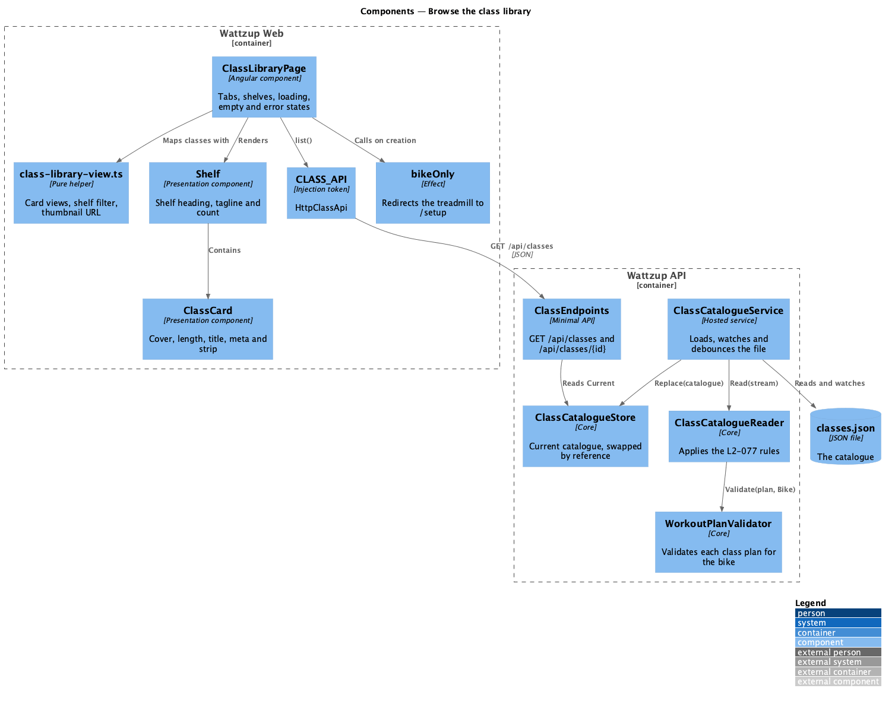
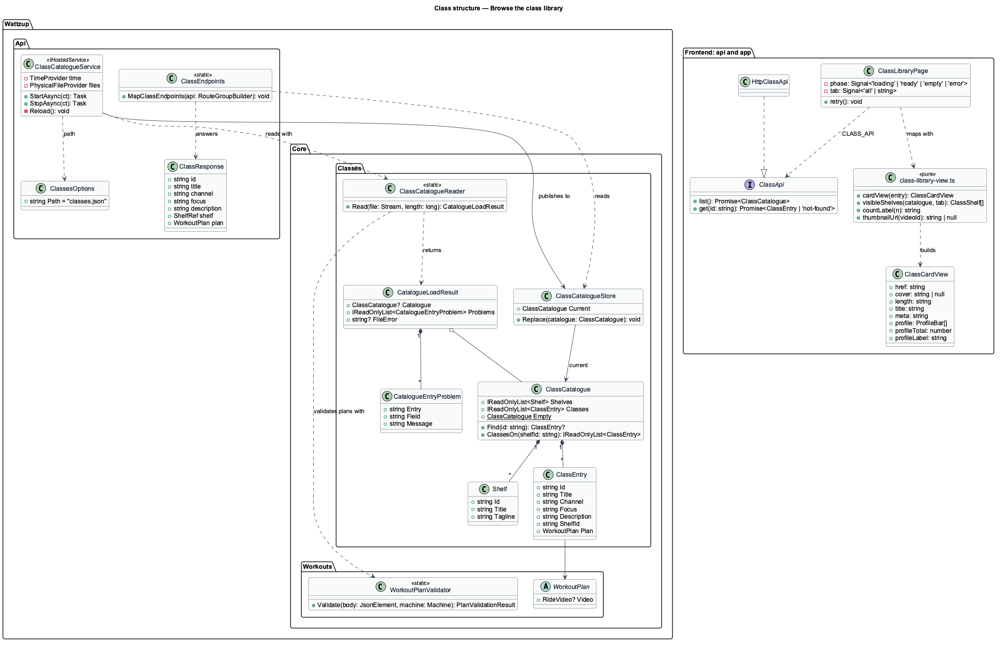

# Browse the class library

## Overview

Riders follow YouTube bike classes, and each class pairs with a ride: a warm-up, intervals or a steady level, a cool-down, levels and cadence aims, and the point in the video where the ride starts. This feature keeps those classes as data and shows them to the rider as shelves of video covers (L1-014, ADR 0014). The owner adds, changes or removes a class by editing one JSON file, with no rebuild and no restart. On the bike, the library is where the rider lands after choosing the machine and after ending a ride (L2-073, L2-051, L2-058), and the Ride Dashboard links to it from its app bar at any time, a ride in progress included (L2-079 criterion 15).

**class** — catalogue entry that pairs a bike plan with the YouTube video it follows, filed on one shelf

**catalogue** — JSON file of shelves and classes that the backend reads, named by `Wattzup:Classes:Path`

**shelf** — group of classes that the catalogue defines, with an id, a title and a tagline, shown in file order

**class library** — page at `/classes` that shows the shelves as tabs and cards

**cover** — image on a class card: the YouTube thumbnail built from the class's `video_id`, or the bundled poster when the class has no video or the thumbnail fails

The catalogue is read-only. No screen writes it, and a ride never depends on it: riding a class posts the ordinary `POST /api/workout` (`classes/ride-a-class`). One malformed class cannot take the library down. The reader skips it with a warning and serves the rest (L2-077 criteria 3 to 6).

The feature extends three existing designs:
- `platform/secure-api` gains `img-src https://i.ytimg.com` for covers (L2-036 criterion 4, ADR 0014) and puts the 2 new endpoints behind the API key.
- `treadmill/choose-machine` and `dashboard/dialogs-and-notifications` send the bike to `/classes` instead of `/setup`.
- `platform/host-and-structure` gains the route, the components and the `Classes/` folder.
- `dashboard/responsive-accessible-layout` gains the `Library` link in the ride app bar (`AppBar`), the dashboard's entry point to the library, and its place in the Tab order.

The class page at `/classes/:id` belongs to `classes/ride-a-class`.

## Description

### Core (`Wattzup.Core/Classes/`, new)

- **`Shelf(string Id, string Title, string Tagline)`** and **`ClassEntry(string Id, string Title, string Channel, string Focus, string Description, string ShelfId, WorkoutPlan Plan)`** — the validated records. `Plan` is the bike plan as `WorkoutPlanValidator` returns it, with `RideVideo? Video` (`workouts/ride-along-video`).
- **`ClassCatalogue`** — the immutable catalogue: `IReadOnlyList<Shelf> Shelves`, `IReadOnlyList<ClassEntry> Classes`, `ClassEntry? Find(string id)` and `ClassesOn(string shelfId)`. `ClassCatalogue.Empty` stands for a missing or unreadable file.
- **`ClassCatalogueReader.Read(Stream file, long length)`** (pure apart from the stream) — returns `CatalogueLoadResult(ClassCatalogue? Catalogue, IReadOnlyList<CatalogueEntryProblem> Problems, string? FileError)`. It applies the rules of L2-077 in this order:
  1. A file over 1 MB, or one that is not valid JSON, gives `Catalogue` = `null` with `FileError` naming the reason (criterion 5).
  2. Each shelf whose `id` breaks the id rule (`^[a-z0-9-]{1,64}$`) or repeats an earlier id is dropped with a problem naming the shelf. Its classes go with it (criterion 4).
  3. Each class is checked against the L2-077 table: the id rule and uniqueness, `title` 1 to 80 characters, `channel` and `focus` 1 to 40, `description` 0 to 280, and `shelf` naming a kept shelf. Its `plan` is passed to `WorkoutPlanValidator.Validate(plan, Machine.Bike)`, so a treadmill plan or an invalid bike plan is rejected by the same rules as `POST /api/workout` (criterion 3).
  4. After 20 shelves and 200 valid classes, the rest are dropped with one problem stating the counts (criterion 6).

  Each `CatalogueEntryProblem(string Entry, string Field, string Message)` names the class id, or `classes[<i>]` when the id is missing.
- **`ClassCatalogueStore`** — the single holder of the current `ClassCatalogue`. `Current` is read without a lock. `Replace(catalogue)` publishes by reference swap, the same pattern as `BikeStateStore`.

### API (`Wattzup.Api`)

- **`ClassesOptions`** (`WattzupOptions.cs`, new) — `Path` (default `classes.json`), bound from `Wattzup:Classes` (environment `WATTZUP__CLASSES__PATH`). A relative path resolves against the content root (L2-077 criterion 2). The README documents the setting in the same change as the code.
- **`ClassCatalogueService`** (`Classes/ClassCatalogueService.cs`, new, hosted service):
  - On start, it reads the file through `ClassCatalogueReader`, logs each problem as a warning, and calls `ClassCatalogueStore.Replace`. A `FileError` logs one error naming the path and the reason, and leaves `ClassCatalogue.Empty`. The backend starts either way (criterion 5).
  - It watches the file through a `PhysicalFileProvider` change token. A change starts a 500 ms debounce on the injected `TimeProvider`, then the file is read again. A good result replaces the catalogue within 2 s of the save. A `FileError` keeps the last valid catalogue and logs the error (criterion 7).
  - A ride in progress is not touched, because the engine never reads the catalogue (criterion 7).
  - It stops within the 5 s shutdown timeout by disposing the provider.
- **`ClassEndpoints`** (`Endpoints/ClassEndpoints.cs`, new), mapped on the `/api` group, so `RequireAuthorization` applies the API key when one is set (L2-078 criterion 6). These are reads, not control endpoints, so no rate limit applies.
  - `GET /api/classes` → `ClassCatalogueResponse { shelves: [ClassShelfResponse { id, title, tagline, classes: [ClassResponse] }] }`. Shelves and classes come in file order, and a shelf with no class is left out (criteria 1 and 2).
  - `GET /api/classes/{id}` → `ClassResponse` (criterion 3). An unknown id, or one that breaks the id rule, answers `Problems.WithCode(404, "class_not_found", …)` (criterion 4). The route takes `{id}` as a string, so `../x` never reaches the file system.
  - `ClassResponse { id, title, channel, focus, description, shelf: { id, title, tagline }, plan }`, where `plan` is the accepted plan as `workout.plan` serialises it (L2-014): bike fields set, treadmill fields `null`, `video` `{video_id, start_seconds}` or `null`.
  - Each endpoint declares `.Produces<…>()` and `.ProducesProblem(404)`, so the OpenAPI document carries both shapes (criterion 7). Only `GET` is mapped, so any other method answers 405 (criterion 5).
- **`classes.json`** (content root, new) — the default catalogue: 9 shelves by length (`15-min`, `20-min`, `25-min`, `30-min`, `35-min`, `40-min`, `45-min`, `60-min`, `60-min-endurance`), the 6 classes of `docs/mocks/README.md` (only *30 Minute HIIT Cardio* has a video, `QUoToFsMNig`, start 3), and one class per indoor training session in the GCN Training channel's workout playlists (185 videos, the *with music* version where a session has two), each with its video and the point where the session's 0:00 starts. Each plan follows the session's breakdown from the video description or, where there is none, its spoken cues; effort *e*/10 is level 8 + 1.6 × *e*, rounded. A session with more changes than an `intervals` plan holds (10 sets, 30 efforts) has its closest neighbouring steps merged, time-weighted. With 191 classes the `GET /api/classes` body is about 250 KB, close to the 256 KB of L2-078 criterion 8.
- **`SecurityHeaders`** — `img-src 'self' data: https://i.ytimg.com` (L2-036 criterion 4, `platform/secure-api`).

### Frontend

**API library (`frontend/projects/api/`).**
- `ClassCatalogue`, `ClassShelf` and `ClassEntry` are generated from `/openapi/v1.json` into `src/generated/`.
- **`ClassApi`** (`src/lib/class-api.ts`, new) — `list(): Promise<ClassCatalogue>` and `get(id): Promise<ClassEntry | 'not-found'>`, behind the token `CLASS_API`. `HttpClassApi` in `http-api.ts` implements both. `app.config.ts` binds the token.

**Presentation components (`frontend/projects/components/`).** These follow `docs/mocks/pages/class-library/*` and keep the mocks' BEM blocks.
- **`Shelf`** (`shelf/`, `wz-shelf`, new) — a `section` labelled by its heading. It shows the title, the tagline and the count, with the cards in a list. Inputs: `title`, `tagline`, `count`.
- **`ClassCard`** (`class-card/`, `wz-class-card`, new) — one link (`<a class="class-card">`) to `/classes/<id>`. It contains:
  - `class-card__cover`: a 16:9 box sized before the image loads, holding `` or the `class-card__poster` with the channel;
  - `class-card__length`;
  - `class-card__strip`, the plan's profile bars;
  - `class-card__title` (an `h3`);
  - `class-card__meta`;
  - `class-card__note` `Video link not set` when there is no video.

  Inputs: `view: ClassCardView`. Output: `coverFailed`, which the parent turns into the poster. The card injects nothing (AGENTS.md).

**App (`frontend/projects/wattzup/src/app/`).**
- **`class-library-view.ts`** (`core/`, new, pure, with `class-library-view.spec.ts`):
  - `cardView(entry)` returns `ClassCardView`:
    - `href` `/classes/<id>`;
    - `length` from `formatDuration` of the total of `expandPlan(plan)` (`m:ss`, `h:mm:ss` from one hour);
    - `meta` `<channel> · <focus> · Peak L<n>`, with n the highest segment level;
    - `cover` `https://i.ytimg.com/vi/<video_id>/mqdefault.jpg` or `null`;
    - `profile`, `profileTotal` and `profileLabel` from `previewOf` (`core/ride-preview.ts`), the bars the setup preview draws, so a card and its class page show the same shape.
  - `visibleShelves(catalogue, tab)` returns every shelf for `all`, else the one shelf.
  - `countLabel(n)` returns `1 class` or `<n> classes`.
  - `thumbnailUrl(videoId)` builds the URL only from an 11-character id that matches `[A-Za-z0-9_-]`, else `null`.
- **`ClassLibraryPage`** (`dashboard/class-library-page/`, new, route `classes`, title `Ride a class · Wattzup`):
  - It reads `CLASS_API.list()` once on entry.
  - It holds `phase` (`loading`, `ready`, `empty`, `error`) and `tab` (`all` or a shelf id) in signals. The tab is never stored, so it resets on each visit (L2-079 criterion 3).
  - The heading block reads `Ride a class`, the lead copy and the bike's name, with `Build your own ride` linking to `/setup` (criterion 1).
  - The tab list reuses the `view-switch` pattern of `MainViewTabs`, with `All` and one tab per shelf, a roving `tabindex`, the arrow keys and `aria-selected` (criterion 2). The tabs are disabled while loading.
  - The states are skeletons (criterion 8), `No classes yet` (criterion 9), and `Couldn't load the classes` with `Try again` (criterion 10). The status line of L2-018 shows from the app bar, as on every page (criterion 11).
  - `bikeOnly()` (`core/machine-guards.ts`, new), called in the page's constructor, is an effect that redirects to `/setup` (replacing the history entry) once `LiveStateService.state().machine` reads `treadmill` (criterion 12). It is an effect, not a route guard, because the machine is known only after the first state message arrives, as on Choose machine.
- **Entry from the Ride Dashboard** (L2-079 criterion 15):
  - `RidePage` (`dashboard/ride-page/ride-page.html`) renders `<wz-app-bar [workout] [machine] [view]>`, with `machine` from `LiveStateService.state().machine` (`bike` until the first state message).
  - `AppBar` (`dashboard/app-bar/`, app layer, already imports `RouterLink`) renders, when `machine()` is `bike`, `<a class="btn btn--quiet btn--sm app-bar__library" routerLink="/classes"><wz-icon name="grid" size="sm" />Library</a>` right after the lockup and before the divider, so the Tab order is lockup, Library, workout link, then the end group (L2-041). The link has no `aria-label`: its text is its accessible name. `.btn` floors at `--target-comfortable` (44 × 44 px) and the global focus ring applies, so no new style is needed; `.app-bar__library` is a BEM hook with no rule of its own. On the treadmill the link is not rendered (the Run Dashboard frame has none).
  - `Icon` (`components/icon/`) gains the decorative `grid` icon, the frame's `LayoutGrid`.
  - Following the link is plain router navigation to the existing `classes` route. Nothing is posted: the workout keeps running in `WorkoutEngine` on the backend, `LiveStateService` (root-provided) keeps its event stream open, and `RidePage` shows the same workout again when the rider returns to `/`.
- **Grid** — `.shelf__grid` uses one column under 576 px, two from 576 px, three from 992 px and four from 1200 px, with no horizontal scroll. Each card and tab is at least 44 × 44 px with a visible focus ring (criterion 13).

### Screen states

| Mock | State |
|---|---|
| `pages/class-library/default` | 3 shelves with 2 classes each. The GCN card shows its thumbnail; the other five show the poster and `Video link not set` |
| `pages/class-library/filtered` | The `30 min` tab is selected, so only that shelf is shown |
| `pages/class-library/loading` | Skeletons in the default layout, with the tabs disabled |
| `pages/class-library/empty` | `No classes yet`, with `Build your own ride` |
| `pages/class-library/error` | `Couldn't load the classes`, with `Try again` and `Build your own ride` |
| `pages/class-library/disconnected` | The cards with the connection status line of L2-018 |
| `pages/ride/*` except `treadmill*` | The ride app bar with `Library` after the lockup (L2-079 criterion 15) |
| `pages/ride/treadmill*` | No `Library` link |

### Acceptance tests

`Wattzup.Api.AcceptanceTests` run the host through `WebApplicationFactory` with `SimulatedBikeTransport`. Each test writes its catalogue to a per-test temporary directory and sets `Wattzup:Classes:Path` to it. `ClassCatalogueTests`:
- `Given_a_valid_catalogue_then_GET_classes_serves_its_shelves_and_classes_in_file_order` (L2-077 AC1, L2-078 AC1)
- `Given_no_setting_then_the_default_classes_json_is_served` (L2-077 AC2)
- `Given_a_class_with_an_invalid_plan_then_it_is_left_out_and_the_others_are_served` (L2-077 AC3)
- `Given_a_missing_file_then_the_catalogue_is_empty_and_the_backend_starts` (L2-077 AC5, L2-078 AC2)
- `Given_the_file_is_saved_then_the_new_catalogue_is_served_and_an_invalid_one_keeps_the_last` (L2-077 AC7), driven by `FakeTimeProvider` past the debounce
- `Given_an_unknown_id_then_GET_class_answers_404_class_not_found` (L2-078 AC4)
- `Given_POST_on_classes_then_the_answer_is_405` (L2-078 AC5)
- `Given_an_API_key_then_GET_classes_without_it_answers_401` (L2-078 AC6)
- `SecurityTests.Every_response_allows_only_the_YouTube_player_origins_beyond_self` is renamed to `Every_response_allows_only_the_YouTube_origins_beyond_self`, and it also reads `img-src https://i.ytimg.com` (L2-036 AC4)

`Wattzup.Core.Tests`, one case per row:
- `ClassCatalogueReaderTests`: each field rule of the L2-077 table at and beyond its limits; a repeated class id; an unknown shelf; a treadmill plan; a repeated shelf id; 21 shelves and 201 classes; a file of 1 MB + 1 byte; malformed JSON.

Playwright (`frontend/e2e/`, Chromium only) answers `/api/classes` from a recording (`e2e/fixtures/recorded/classes.json`) and `https://i.ytimg.com/**` from a fixture image. Page object `e2e/pages/class-library.page.ts`; spec `e2e/class-library.spec.ts`:
- `shows Ride a class with a tab per shelf and every shelf under All` (L2-079 AC1, AC2, AC4)
- `filters to one shelf from its tab and moves between tabs with the arrow keys` (L2-079 AC2, AC3)
- `shows each card's length, title, meta and strip, and opens its class page` (L2-079 AC5)
- `uses the YouTube thumbnail when the class has a video and the poster otherwise` (L2-079 AC6, AC7)
- `falls back to the poster when a thumbnail fails` (L2-079 AC6)
- `shows skeletons, then No classes yet for an empty catalogue` (L2-079 AC8, AC9)
- `shows Couldn't load the classes and retries with Try again` (L2-079 AC10)
- `redirects the treadmill to setup` (L2-079 AC12)

Page object `e2e/pages/ride.page.ts` owns the `Library` link's locator; `e2e/class-library.spec.ts` covers the entry point:
- `opens the class library from the dashboard's Library link by keyboard, leaving the ride untouched` (L2-079 AC15): with a running workout in the stubbed event stream, Tab reaches `Library` straight after the lockup, Enter opens `/classes` with `Ride a class`, and no `POST` to `/api/workout…` was sent; browser Back shows the same workout on the dashboard.
- `opens the class library from the dashboard's Library link by touch` (L2-079 AC15), with a touch-enabled context.

Unit tests: `class-library-view.spec.ts` covers `cardView` for `hiit`, `intervals` and `flat` plans, `h:mm:ss` from one hour, `countLabel` for 1 and 2, and `thumbnailUrl` for a valid id and a malformed one. The responsive criterion (L2-079 AC13) is covered by the responsive sweep, which runs only when a person asks.

### Open questions

- **Debounce length.** 500 ms is chosen to fit the 2 s bound of L2-077 criterion 7 after editors that save in 2 writes. <TO SUPPLY> if an owner's editor needs a longer debounce.
- **Default catalogue updates.** A new Wattzup release can change the shipped `classes.json`. An owner who edited it keeps the edited file only when the setting points outside the content root. The README should say so.
- **Leaving a ride for the library.** The updated Ride Dashboard frame pauses the ride after 30 s and asks to save or discard it before opening the library. L2-079 criterion 15 keeps the link a plain navigation instead (mocks open question 19). The frame's flow needs a requirement for saving a ride that has not ended.
- **Way back to the ride.** The library's lockup links to `/classes`, so during a ride the rider returns to the dashboard with browser Back. A `Back to your ride` link on the library is <TO SUPPLY> by the design.
- **Thumbnail size.** `mqdefault.jpg` (320 × 180) is the 16:9 thumbnail. Wide desktop cards may look soft. A larger size (`hqdefault.jpg` is 4:3, letterboxed) needs a design decision.

## Requirements

| L2 ID | Refines (L1) | Requirement |
|-------|--------------|-------------|
| `L2-077` | `L1-014` | Class catalogue. A class is a bike plan with the YouTube video it follows. The catalogue of classes is a JSON file the backend reads, named by `Wattzup:Classes:Path` (default `classes.json`); invalid classes are left out with a warning, an unreadable file gives an empty catalogue, and a saved change is served within 2 s. |
| `L2-078` | `L1-005` | Class endpoints. Two read-only endpoints serve the catalogue: `GET /api/classes` and `GET /api/classes/{id}`, with 404 `class_not_found` for an unknown id, the API key when one is set, and both shapes in the OpenAPI document. |
| `L2-079` | `L1-014` | Class library page. `/classes` shows the catalogue as shelves of cards, with a tab per shelf, covers from YouTube thumbnails or the bundled poster, and loading, empty, error and disconnected states; the treadmill does not show it. Criterion 15: the bike's Ride Dashboard shall show a `Library` link after the lockup, opened by touch, click or Enter, that opens `/classes` and sends no request that changes the workout. |
| `L2-036` | `L1-009` | Input validation and hardening. Criterion 4: a Content-Security-Policy that allows only same-origin scripts, styles and connections, with three exceptions for YouTube (ADR 0012): `frame-src https://www.youtube-nocookie.com` and `script-src https://www.youtube.com` (the IFrame player API) for the ride-along video, and `img-src https://i.ytimg.com` for class covers (L2-079). |
| `L2-073` | `L1-013` | Choose the machine. Criterion 6: when `ble` becomes `connected`, the rider is taken to `/classes` for the bike (L2-079) or `/setup` for the treadmill. |
| `L2-040` | `L1-011` | Responsive layout. The library's grid, tabs and cards follow the breakpoints of L2-079 criterion 13. |
| `L2-041` | `L1-011` | Accessibility. Tabs, cards and covers meet the keyboard, focus and text-alternative rules of L2-079 criteria 2, 5, 6 and 13; criterion 1 lists the dashboard's `Library` link, reached with Tab after the lockup (L2-079 criterion 15). |

## Diagrams

### System context

The rider browses classes in Wattzup, and the owner edits the catalogue file that Wattzup reads. The rider's browser loads the class covers from YouTube's image host; Wattzup's backend never contacts YouTube.

### Containers

Wattzup Web reads the catalogue from the Wattzup API, which reads the catalogue file from disk. The covers come straight from `i.ytimg.com` into the browser, which is the image origin the Content-Security-Policy allows.

### Components

On the backend, `ClassCatalogueService` reads the file through `ClassCatalogueReader`, which validates each plan with `WorkoutPlanValidator`, and publishes to `ClassCatalogueStore`. `ClassEndpoints` serves the store. On the frontend, `ClassLibraryPage` calls `CLASS_API`, maps classes to card views with `class-library-view.ts`, and renders `Shelf` and `ClassCard`.

### Class structure

`ClassCatalogue` holds shelves and classes, and each `ClassEntry` carries a `WorkoutPlan`. `ClassCatalogueReader` produces a `CatalogueLoadResult`, which `ClassCatalogueService` publishes. On the frontend, `ClassApi` returns the generated types, and the pure `class-library-view.ts` turns them into the `ClassCardView` that `ClassCard` renders.

### Behaviour — load the catalogue at start-up

The service reads the file and validates each shelf and class. It logs a warning for each one it leaves out, and publishes what remains. A missing or malformed file gives an empty catalogue, and the backend starts as usual (L2-077 criteria 1 to 6).

### Behaviour — reload the catalogue after a save

A save fires the file provider's change token. After the debounce, the service reads the file again and swaps in the new catalogue. When the new file is invalid as a whole, the last catalogue stays and the error is logged (L2-077 criterion 7).

### Behaviour — browse the library

The page asks for the catalogue and shows skeletons until it arrives. It then renders a tab per shelf and a card per class. Covers load from YouTube, and a failed cover falls back to the poster. A tab filters to its shelf (L2-079 criteria 2 to 10).

### Behaviour — open the library from the Ride Dashboard

On the bike, the app bar's `Library` link routes to `/classes`. No workout request is sent, so the workout keeps running on the backend and the live event stream stays open; going back shows the same workout on the dashboard (L2-079 criterion 15).

