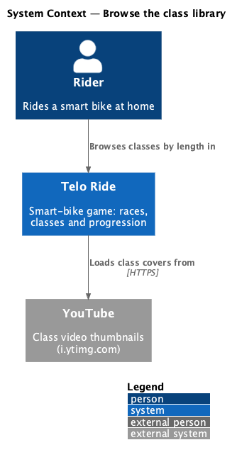
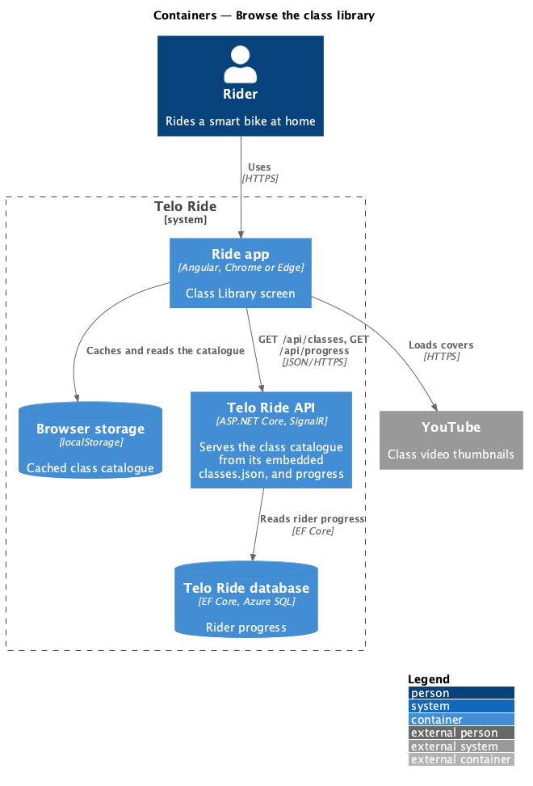
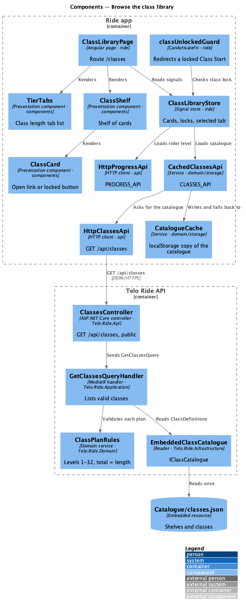
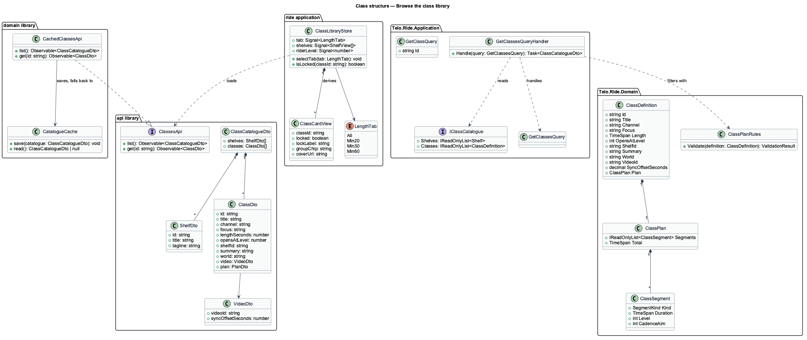
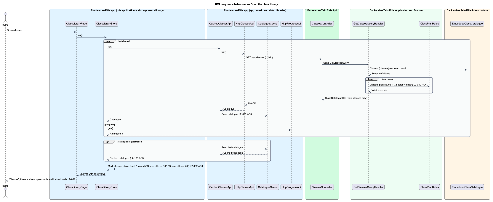
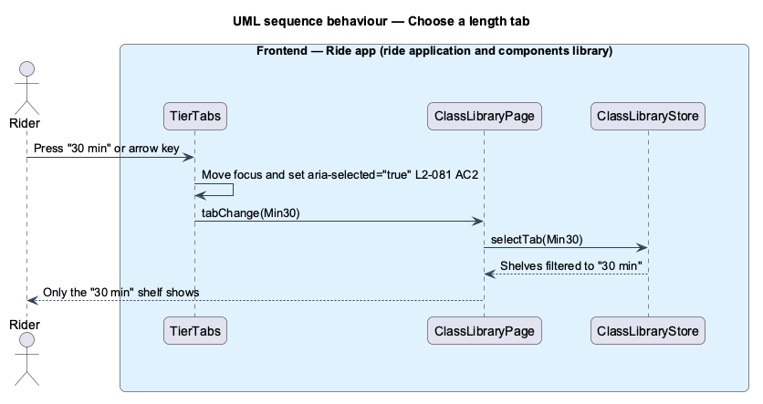
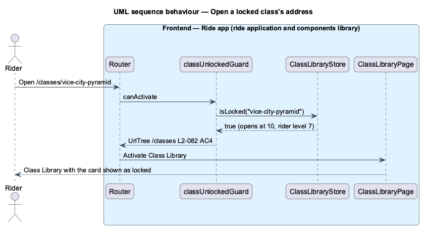

# Browse the class library

## Overview

Telo Ride has two doors: **Race** and **Classes**. This feature is the first screen behind the
Classes door. It lists every class a rider may ride, grouped by length, and shows which classes
the rider's level has not yet opened.

> **class** — catalogue entry pairing a YouTube video with a bike plan that follows it

> **plan** — timed list of segments a ride follows, each with a kind, a duration, a level and a cadence aim

> **sync offset** — video time at which the ride clock's 0:00 starts, for example 0:12.0

> **shelf** — group of classes of one length band (20 min, 30 min, 60 min endurance) with its own title and tagline

> **class tier** — rider level at which a class opens ("Opens at level 10")

The catalogue is data, not code. The backend ships it as a JSON file, validates every class and
serves only valid classes, to anyone, signed in or not (ADR 0028). The Ride app caches the
catalogue so the library and a solo class still read without a network (`L2-135`). The rider's level, which decides the locks, comes from the backend's
progress (`L2-044`); the tier rule itself belongs to the progression subsystem (`L2-043`).

The Class Library lives at `/classes`. An open class card leads to that class's Class Start
(`/classes/:id`, see the *start a class* feature). A locked card is a disabled button and leads
nowhere.

## Description

The slice runs from the library page down to the catalogue rows in the database.

**Frontend — `ride` application**

- **`ClassLibraryPage`** (`wz-class-library-page`, route `/classes`, `loadComponent`) — routed
  page. It reads the catalogue and the rider's level from `ClassLibraryStore` and renders the
  header, the length tabs and one shelf per length band.
- **`ClassLibraryStore`** — signal store provided on the page, so it and its requests go when
  the rider leaves; the route binds `CLASSES_API` and `PROGRESS_API`. It loads the
  catalogue through `CLASSES_API` (which falls back to the kept catalogue), loads the rider's
  level through `PROGRESS_API`, and derives each card's view model: open or locked, the lock
  label, the cover URL, the length and, once group sessions exist, the next group chip
  (`L2-083`). It holds the selected tab, and `unavailable` with `retry()` when no catalogue
  can be read (`L2-081` AC7).
- **`classUnlockedGuard`** — `CanActivateFn` on `/classes/:id`. It redirects a locked class's
  address to `/classes` (`L2-082` AC4).

**Frontend — `components` library**

- **`TierTabs`** (`wz-tier-tabs`) — tab list "Class length" with All, 20 min, 30 min and 60 min
  (WAI-ARIA tabs, automatic activation). It sets `aria-selected="true"` on the chosen tab, keeps
  only that tab in the tab order, moves with the arrow keys, Home and End, and names the shelves'
  `tabpanel` it controls. Each tab is at least 44 px tall.
- **`ClassShelf`** (`wz-class-shelf`) — one shelf: title, tagline and a grid of cards (one column
  on a phone, two at sm, three at lg).
- **`ClassCard`** (`a[wz-class-card]`, `button[wz-class-card]`) — one class: cover, group chip
  "Group in {m} min · {n}/10" (from journey 14), length, resistance profile, title and
  "{channel} · {focus}". The page puts it on a link to the Class Start when the class is open;
  locked, on a button with `aria-disabled="true"`, a lock and "Opens at level {n}" and no chip.
  The button stays focusable, as the design system's locked cards do, so the level is announced.
- **`ClassProfile`** (`wz-class-profile`) — small resistance profile drawn from the plan's
  segments: each bar as wide as its segment lasts and as tall as its level against the plan's
  highest level.

**Frontend — `api` and `domain` libraries**

- **`ClassesApi`** / `CLASSES_API` — contract and token: `list()` returns the
  `ClassCatalogueDto` (shelves and classes), `get(id)` one class; it refuses with a
  `ClassesApiError` whose `code` is `class_not_found` or `catalogue_unavailable`.
  **`HttpClassesApi`** (`api`) is its HTTP client for `GET /api/classes` and
  `GET /api/classes/{id}`; it only asks.
- **`ClassDto`** — id, title, channel, focus, length in seconds, opens-at level, shelf id,
  summary, world, `VideoDto { videoId, syncOffsetSeconds }` and `PlanDto`.
- **`CachedClassesApi`** (`domain/storage`) — the `CLASSES_API` the app binds. It asks
  `HttpClassesApi` for the catalogue, saves each answer in `CatalogueCache` and, when the request
  fails, answers from the cache, or refuses with `catalogue_unavailable` when none is kept;
  `get(id)` finds the class in that catalogue, or refuses with `class_not_found`. The library and the class ride both read through it.
- **`ProgressApi`** / `PROGRESS_API` — owned by the progression subsystem; this slice reads only
  `level()`, the rider level. Until progress is kept by the backend (journey 10), the app binds
  **`NewRiderProgress`** (`domain`), which answers level 1: a rider with no progress is a new
  rider (`L2-043` AC2).
- **`CatalogueCache`** (`domain/storage`) — keeps the last catalogue in `localStorage`
  (`telo-ride.class-catalogue`) for offline reading (ADR 0028).

**Backend**

- **`ClassesController`** (`Telo.Ride.Api`, `[AllowAnonymous]`) — `GET /api/classes` sends one
  `GetClassesQuery`; `GET /api/classes/{id}` sends one `GetClassQuery`, which refuses an unknown
  or invalid class with 404 and the code `class_not_found`.
- **`GetClassesQueryHandler`** (`Telo.Ride.Application`) — reads the catalogue through
  `IClassCatalogue`, keeps the classes that pass `ClassPlanRules` in catalogue order, logs each
  one left out by id, and maps them and the shelves to `ClassCatalogueDto`.
- **`ClassDefinition`** (`Telo.Ride.Domain`) — catalogue entry: id, title, channel, focus,
  length, opens-at level, shelf, summary, world, YouTube video id, sync offset and plan.
- **`ClassPlanRules`** (`Telo.Ride.Domain`) — validates a class: a YouTube video id of 11
  characters from `A–Z a–z 0–9 _ -`, a sync offset of 0 or more, segment levels 1 to 32,
  durations above 0, and a plan total equal to the class length (`L2-080` AC4).
- **`IClassCatalogue`** (`Telo.Ride.Application`) and **`EmbeddedClassCatalogue`**
  (`Telo.Ride.Infrastructure`) — the port and its reader of `Catalogue/classes.json`, embedded in
  the assembly and read once (ADR 0028). Tests replace the port; none reads a file.

The cover image URL is built from the validated video id
(`https://i.ytimg.com/vi/<videoId>/mqdefault.jpg`, ADR 0014), never from a submitted link.

**Slices.** Slice 6.1 builds the catalogue: the backend's endpoints, file and rules, and
`CachedClassesApi` with its cache, which the class ride reads from then on, so a solo class
starts without a network once the catalogue has been read. Slice 6.2 builds the Class Library
screen, its store and its components, with the locks for the rider level `PROGRESS_API` gives
(level 1 until journey 10 keeps progress, so the new rider's locks of `L2-082` AC3 show). Slice
6.3 adds `classUnlockedGuard` with the Class Start route it guards (`L2-082` AC4). The group
chip comes with slice 14.2: the store reads every class's next session (`GET
/api/classes/sessions`, `CLASSES_API.nextSessions()`) every 30 seconds and `groupChip()` turns
each into "Group in 9 min · 6/10" (whole minutes rounded up, from the device's clock); whenever
the sessions cannot be read, or the rider is signed out, an open card shows none (`L2-081` AC6). The mid rider's locks (`L2-082` AC1) follow once
the backend gives a level (journeys 10 and 12).

## Requirements

| L2 ID | Refines (L1) | Requirement |
|-------|--------------|-------------|
| `L2-080` | `L1-014` | The catalogue shall hold, in order, 20 Minute Power Intervals, 20 Min Threshold Builder, 30 Minute HIIT Cardio, 30 Min Tempo Paceline, 30 Min Vice City Pyramid, 60 Min Dolomites Endurance and 60 Min Coastal Endurance + Surges, each with its channel, focus, length and opening level. Each class shall have a YouTube video, a sync offset, a summary and a plan whose length matches the class. The catalogue shall come from the backend and be cached for offline reading. A class whose segment levels fall outside 1 to 32, or whose plan total differs from its length, shall not be listed. |
| `L2-081` | `L1-014` | The Class Library at `/classes` shall read "Classes" and "Ride a video alone whenever you like, or join a group of 8–10 riders. The bike follows the class either way." The "Class length" tabs (All, 20 min, 30 min, 60 min) shall mark the chosen tab `aria-selected="true"`, show only its shelf ("All" shows every shelf) and move with the arrow keys. The shelves shall read "20 min" / "Short and sharp — fits a lunch break.", "30 min" / "Structured intervals with a proper warm-up." and "60 min endurance" / "Long aerobic rides. Steady legs, steady heart." An open card shall link to its Class Start and show the cover, "Group in {m} min · {n}/10", the length, a resistance profile, the title and "{channel} · {focus}". Cards shall be one column on a phone, two at sm and three at lg. An open card shall show no group chip while the group sessions cannot be read. With no catalogue read and none kept, the library shall read "The classes can’t be loaded. Check your connection and try again." with "Try again". |
| `L2-082` | `L1-014` | For the mid rider (level 7), 30 Min Vice City Pyramid and 60 Min Dolomites Endurance shall read "Opens at level 10" and 60 Min Coastal Endurance + Surges "Opens at level 20"; for the new rider (level 1), 30 Min Tempo Paceline shall also read "Opens at level 5". A locked card shall be a disabled button with a lock and no group chip. A locked class's Class Start address shall open the Class Library instead. |

## Diagrams

### System context

The rider browses classes in Telo Ride. The library shows YouTube thumbnails as covers; it plays
no video.

### Containers

The Ride app reads the catalogue from the Telo Ride API, which reads it from the Telo Ride
database. The app keeps a copy in browser storage for offline reading.

### Components

`ClassLibraryPage` renders the presentation components from `ClassLibraryStore`, which combines
the catalogue from `CLASSES_API` with the rider level from `PROGRESS_API`. On the backend,
`ClassesController` sends `GetClassesQuery`, whose handler filters classes through
`ClassPlanRules`.

### Class structure

`ClassLibraryStore` builds one `ClassCardView` per `ClassDto`, deciding open or locked from the
rider level. On the backend, `ClassDefinition` holds a `ClassPlan` of `ClassSegment`s that
`ClassPlanRules` validates.

### Behaviour — open the library

The store requests the catalogue and the progress in parallel. The backend lists only valid
classes (`L2-080` AC4). A failed request falls back to the cached catalogue (`L2-080` AC3).
Locks follow the rider level (`L2-082`).

### Behaviour — choose a length tab

The tab list is local state: choosing a tab, by pointer or arrow key, filters the shelves with no
request (`L2-081` AC2).

### Behaviour — open a locked class's address

`classUnlockedGuard` compares the class's opening level with the rider level and redirects a
locked class to the library (`L2-082` AC4).

## Open questions

- **The rider level before progress.** Journey 10 keeps XP and levels on the backend. Until
  then `NewRiderProgress` answers level 1 for every rider, so the library shows the new rider's
  locks; the HTTP `ProgressApi` replaces it with the same contract.
- **The library's loading state.** None is drawn: the head and tabs show at once and the shelves
  follow when the catalogue arrives, from the backend or at once from the device's copy.
- **The six classes' own videos.** Only 30 Minute HIIT Cardio has a published video. The Telo
  Ride Studio and Scenic classes carry GCN Training stand-ins of the same focus (ADR 0028) until
  the owner supplies each `videoId` and `syncOffsetSeconds`.
