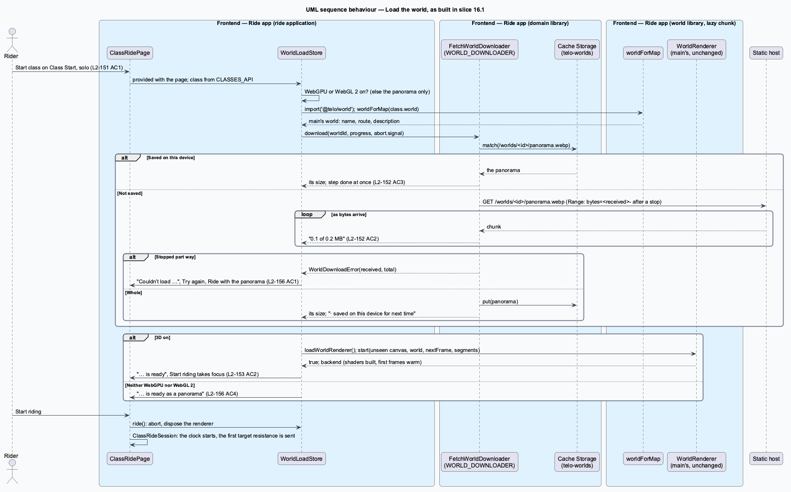
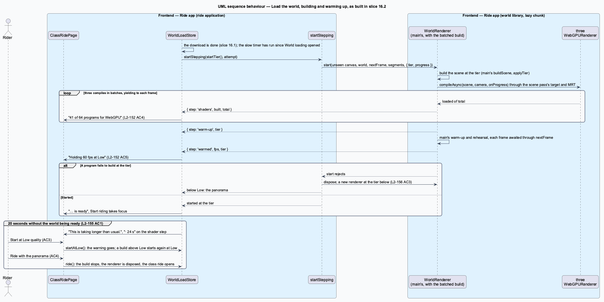
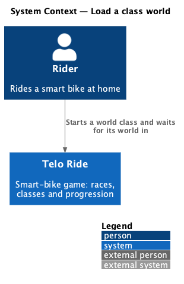
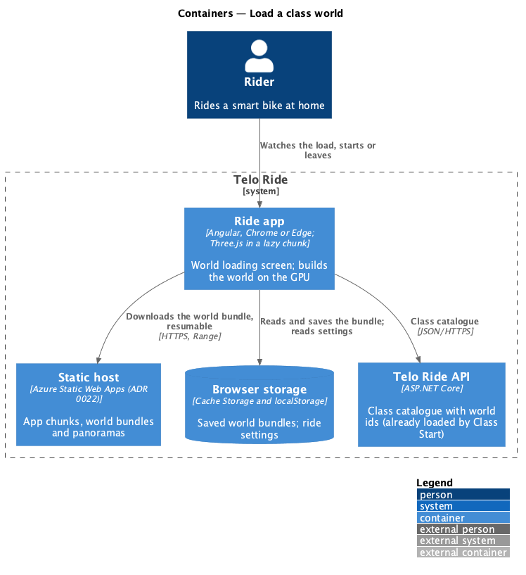
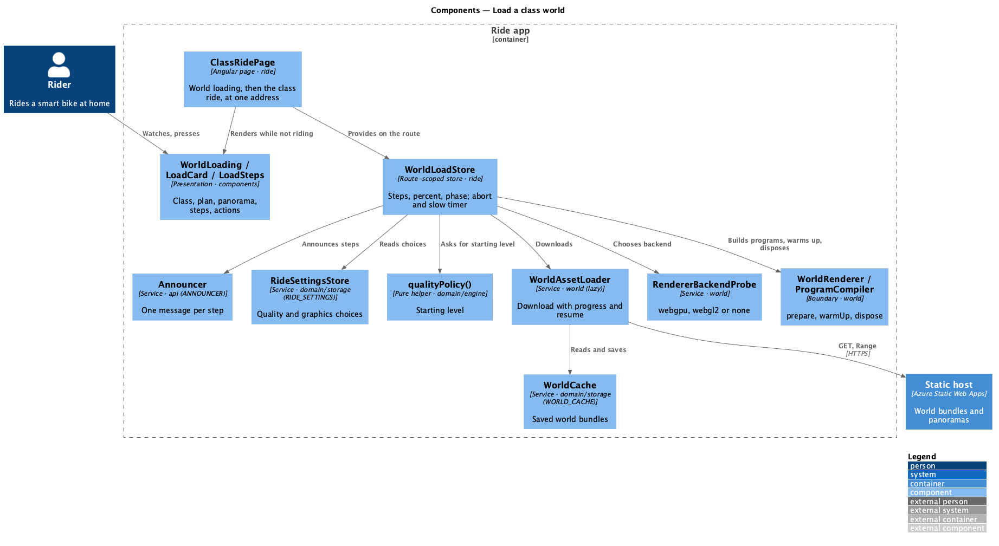
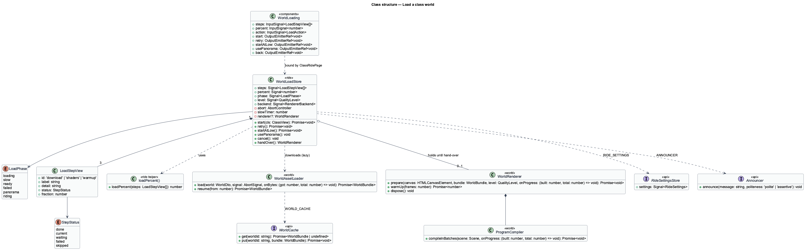
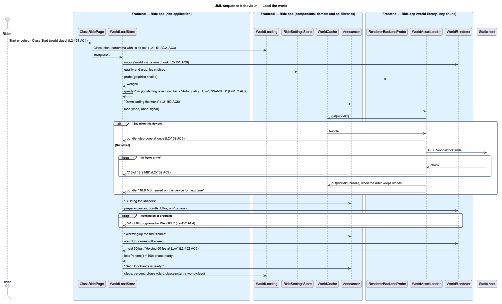
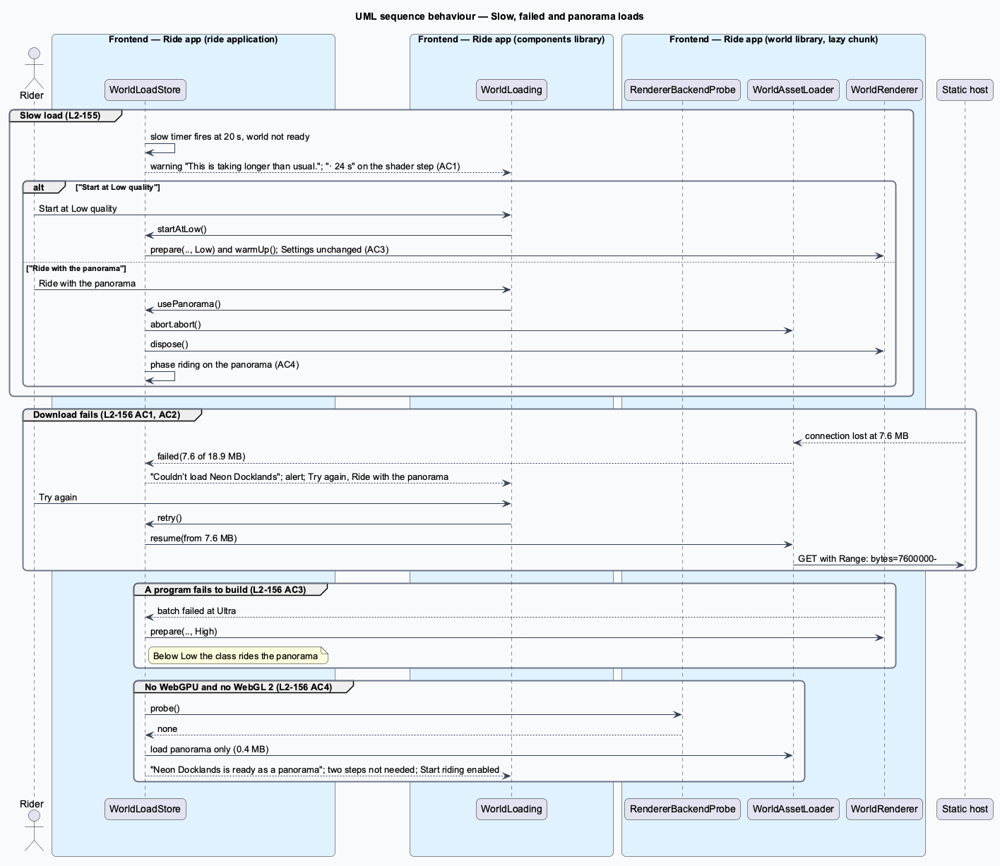
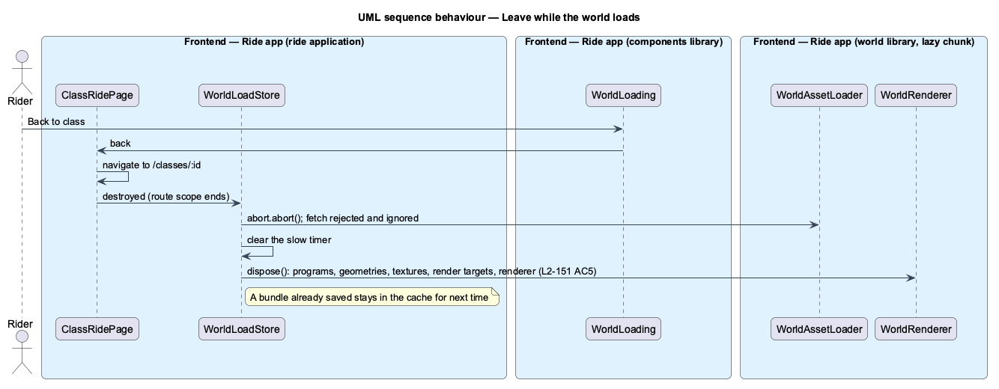

# Load a class world

## Overview

A world class is a class that rides in a 3D world of its own rather than beside a video alone
(`L2-080` AC5). The world is the heaviest thing the app draws: a download of tens of megabytes,
dozens of shader programs to build for the graphics chip, and a first frame that stutters if
anything is still compiling when the clock starts. World loading is the screen that does that
work before the class starts, says what it is doing, and always offers a way forward.

> **world class** — class whose catalogue entry names a world to ride in

> **world loading** — screen at `/classes/:id/ride` that gets the class's world ready before the class ride takes its place

> **load step** — one of the three stages of world loading: download the world, build the shaders, warm up the first frames

> **world bundle** — same-origin file set holding one world's geometry, textures and scene description, downloaded once per device

> **shader program** — compiled GPU program for one material at one quality level and graphics API

> **warm-up** — drawing the start of the route off screen so every program and texture is on the GPU before the first visible frame

> **panorama** — still photograph of a world, used when the world cannot be drawn in 3D

> **slow load** — world loading that has run 20 seconds without the world being ready

The screen opens when the rider presses Start or Join on Class Start for a world class. It shows
the class, its plan and the world's panorama behind a load card. The load card lists the three
load steps, the overall percentage and the bike, quality and graphics in use. When loading is
slow it offers a lighter quality or the panorama. When the download fails it offers to try again
or to ride the panorama. A browser that draws neither WebGPU nor WebGL 2 goes straight to the
panorama. How the class then starts, solo or with a group, and what happens with the bike while
the world loads, is designed in `classes/start-a-world-class`.

The feature sits in the classes subsystem beside `classes/start-a-class` and
`classes/ride-a-class`. It reuses the `world` library designed in `race/render-the-race-world`,
the quality rules of `settings/tune-world-quality` and the saved worlds of
`settings/manage-saved-worlds`. Nothing in it calls the Telo Ride API beyond the class catalogue
already loaded by Class Start.

## Description

**Frontend — `ride` application**

- **`ClassRidePage`** (`/classes/:id/ride`, designed in `classes/ride-a-class`) — provides
  `WorldLoadStore` on the route when the class names a world. It renders `WorldLoading` while
  `WorldLoadStore.phase()` is not `riding`, and the class ride once it is. The address does not
  change at the handover (`L2-151` AC1).
- **`WorldLoadStore`** — route-scoped signal store. It holds `steps` (three `LoadStepView`s),
  `percent`, `phase` (`loading`, `slow`, `ready`, `failed`, `panorama`, `riding`), `level`,
  `backend` and the world. It exposes `start(classView)`, `retry()`, `startAtLow()`,
  `usePanorama()` and `cancel()`. It owns one `AbortController` for the download and a 20-second
  slow timer, both bound to `DestroyRef` (`L2-155` AC1). On destroy it aborts the download,
  clears the timer and calls `WorldRenderer.dispose()` unless the renderer has been handed to the
  class ride (`L2-151` AC5).
- **`loadPercent(steps)`** — pure helper in `ride` with unit tests. It returns a whole percentage
  as a weighted sum of the three steps' fractions. The weights are `<TO SUPPLY>` until the first
  measured loads; the bar never moves backwards.
- **`LoadAnnouncer`** — part of `WorldLoadStore`. It sends one polite message through `ANNOUNCER`
  when a step starts, when the world is ready and when a step fails, never for a percentage
  (`L2-152` AC6).

**Frontend — `components` library**

- **`WorldLoading`** (`wz-world-loading`, block `world-loading`) — presentation. Inputs: the class
  view, the world view (name, route name, description, panorama URL and its alternative text),
  `steps`, `percent`, `facts`, `notice` and `action`. Outputs: `start`, `retry`, `startAtLow`,
  `usePanorama`, `back` and `openSettings`. It renders the slim class header ("Back to class",
  Full screen), the eyebrow ("Neon Docklands · Harbour Bridges Loop · Solo"), the only `h1`, the
  description and `ClassPlan`, hidden below 640 px (`L2-151` AC2, AC4). The panorama fills the
  screen under an ink scrim that keeps text at 4.5:1 or more in both themes (`L2-151` AC3).
- **`LoadCard`** (block `load-card`) — heading ("Getting Neon Docklands ready"), percentage,
  `Progress` (`role="progressbar"`, "Loading Neon Docklands"), `LoadSteps`, the facts pills, the
  notice and the actions.
- **`LoadSteps`** (block `load-steps`) — ordered list. The running step carries
  `aria-current="step"`; done, failed and not-needed steps say so in visually hidden words and an
  icon, never by colour alone (`L2-152` AC1).

**Frontend — `world` library (lazy) and `domain`**

- **`WorldAssetLoader`** (`world`) — fetches the world bundle from
  `frontend/public/worlds/<worldId>/` with `fetch` and the store's `AbortSignal`, reporting bytes
  received and the total from `Content-Length` (`L2-152` AC2). It reads `WORLD_CACHE` first and
  returns at once on a hit (`L2-152` AC3). After a failure it resumes with an HTTP `Range`
  request from the bytes already received (`L2-156` AC2). It stores the finished bundle through
  `WORLD_CACHE` when the rider keeps worlds (`settings/manage-saved-worlds`).
- **`WorldRenderer.prepare(canvas, bundle, level, onProgress)`** (`world`) — builds the scene at a
  quality level. `ProgramCompiler` compiles the scene's materials in batches and reports programs
  built and the total for the backend ("41 of 64 programs for WebGPU", `L2-152` AC4). When a
  batch fails it reports the failure; the store asks for the next lower level, and below `low`
  moves to the panorama (`L2-156` AC3).
- **`WorldRenderer.warmUp(frames)`** (`world`) — draws the start of the route into an off-screen
  render target for `<TO SUPPLY>` frames and reports the frame rate it held ("Holding 60 fps at
  Low", `L2-152` AC5).
- **`RendererBackendProbe`** (`world`, from `race/render-the-race-world`) — returns `webgpu`,
  `webgl2` or `none`, honouring the rider's graphics choice (`settings/tune-world-quality`). With
  `none` the store downloads only the panorama and marks the other two steps not needed
  (`L2-156` AC4).
- **`qualityPolicy()`** (`domain/engine`, from `settings/tune-world-quality`) — gives the starting
  level from the settings, the backend and the device check.
- **`WorldCache`** / `WORLD_CACHE` (contract in `api`, implementation in `domain/storage`) —
  designed in `settings/manage-saved-worlds`.
- **`ClassDto.worldId`** and **`WorldDto`** (`api`) — the catalogue fields read here: the world's
  id, name, route name, description, panorama URL, alternative text and bundle size.

**Bundle and memory.** `ClassRidePage` imports the `world` library with dynamic `import()` when
World loading opens, so neither Three.js nor any scene module enters the initial bundle
(`L2-151` AC6, `L2-136`). "Back to class" calls `cancel()`, which aborts the download and
disposes every program, geometry, texture, render target and the renderer (`L2-151` AC5).

### As built in slice 16.1

Slice 16.1 builds the solo class's World loading with the download, saved worlds and a resumed
download. `main` wins on what a world is: its worlds are drawn by code, so what is downloaded is
`main`'s world unchanged, the `world` library's chunk with its scene modules and the world's
assets under `/worlds/<worldId>/`. A world's only asset is its panorama, so a download is 0.1 to
0.3 MB, not the tens of megabytes the description assumed; the mocks' "18.9 MB" is illustrative.

- **`ClassRidePage`** renders World loading while the solo class's world gets ready, and the ride
  (`ClassRideSession`, the page as it was, with every provider of the ride) once the rider
  presses Start riding. The ride's store is created only then, so the clock and the bike's first
  command wait for Start riding (`L2-153` AC4). A group class (Join) still opens the ride at once
  until 16.4.
- **`WorldLoadStore`** (provided by the page) runs the steps. It imports the `world` library and
  takes the class's world from `worldForMap`, the table the race maps already use, so Telo Ride's
  `vicecity` is drawn as `main`'s South Beach Sunrise. Download the world: `WORLD_DOWNLOADER`
  fetches the world's panorama with progress; the detail reads the bytes received and the total
  ("0.1 of 0.2 MB"), and once done "0.2 MB · saved on this device for next time". Build the
  shaders and Warm up the first frames: `main`'s `WorldRenderer.start()`, on a canvas that is
  never shown, compiles the scene's programs over a few frames and rehearses the ride's first
  frame (`main` #882). The shader step is in progress while it runs and both are done when it
  resolves; the program counts, the warm-up's own progress and frame rate, the slow-load warning
  and the step down are slice 16.2's, so until then the shader step's detail reads "Programs for
  WebGPU" and the warm-up's "Drawn off screen so the start is smooth". Where neither WebGPU nor
  WebGL 2 is on (checked before the download), or `start()` resolves false, the screen reads
  "Neon Docklands is ready as a panorama", the download step "Download the panorama", the other
  two "Not needed for the panorama", and Start riding is enabled (`L2-156` AC4).
- **`worldLoadView(state)`** turns the state into the card's words: the download weighs 40 % and
  the shaders and warm-up the rest; the status is set as each step starts ("Downloading the
  world, 0 percent.", "Building the shaders, 40 percent.", "Neon Docklands is ready."), never
  at each percent. The facts are the bike ("Echelon EX-5s" once connected, else "No bike") and
  the graphics API ("WebGPU", "WebGL 2", or "Panorama").
- **`FetchWorldDownloader`** (`domain/storage`, bound by the page) reads a saved world from Cache
  Storage (`telo-worlds`) and resolves at once (`L2-152` AC3). Otherwise it fetches the panorama,
  reading the body as it streams. A request that fails, a body that errors, or a body shorter
  than its `Content-Length` is a stopped download: it keeps the bytes received for as long as the
  class ride is open, and Try again sends `Range: bytes=<received>-` and joins the two parts; a
  server that answers with the whole file starts it again (`L2-156` AC2). A finished world is
  saved; the Settings that list, clear and stop saving worlds are slice 20.5's
  (`settings/manage-saved-worlds`). Offline with nothing saved, the download fails at once
  (`L2-156` AC5).
- **Start riding** opens the class ride as before, and the renderer World loading built is
  disposed; slice 16.3 hands it to the ride and fades the world in. Ride with the panorama (after
  a stopped download) opens the ride too. "Back to class" aborts the download and disposes the
  renderer (`L2-151` AC5).
- **Components:** `LoadCard`, `LoadSteps`, `Progress` and `Pill` join `components`, and `Banner`
  gains the `danger` (an alert) and `info` tones; the world-loading layout is the page's own
  stylesheet, as Class Start's is.

## As built in slice 16.2

- **`WorldRenderer.start(canvas, world, nextFrame, segments, options)`** takes a `tier` to start at
  and a `progress` callback (`WorldStartOptions` in `api`). After `main`'s `buildScene` and
  `applyTier`, and before `main`'s warm-up, it builds the scene's programs with three's own
  `compileAsync`, which compiles in batches and yields to each frame. It compiles into the scene
  pass's render target and MRT, so the programs share three's cache key with the ride's
  frames and the warm-up builds none twice. It reports `{ step: 'shaders', built, total }` as
  three reports each item loaded (one per part and surface), and the detail reads "41 of 64 programs for WebGPU" (`L2-152` AC4). It then reports
  `{ step: 'warm-up', tier }`, runs `main`'s warm-up and rehearsal unchanged, and reports
  `{ step: 'warmed', fps, tier }`. The rate is the median of the rehearsal's frame intervals,
  rounded, and the warm-up step reads "Holding 60 fps at Low" (AC5). The copied materials, scenes
  and warm-up are unchanged.
- **The step down** (`L2-156` AC3): a build whose `compileAsync` rejects rejects `start`.
  `startStepping(tier, attempt)` (a pure helper in `ride` with unit tests) then disposes that
  renderer and tries the tier below on a new one. Below Low, or where `start` resolves false
  (no WebGPU or WebGL 2), the class rides the panorama.
- **The quality fact** reads "Auto quality · Low" from the tier the build starts at, which is
  `main`'s `startTier()`: always Low, so the ride never opens high and drops in front of the
  rider. "Quality settings" still waits for slice 20.2.
- **The percentage:** the download weighs 40 %, the shaders 40 % (by programs built of the
  total) and the warm-up 20 %; the bar never moves backwards.
- **Slow loading** (`L2-155`): `WorldLoadStore` reads the time once a second from when World
  loading opened (a time difference, so a skipped tick loses nothing). After 20 seconds without
  the world being ready the card shows a warning banner ("This is taking longer than usual.",
  `Banner`'s new `warning` tone with a clock). The shader step's detail adds the seconds spent
  on the shaders ("· 24 s"), the status reads "Still building the shaders, 41 percent." (or
  "Still downloading the world, …"), and the actions are "Start at Low quality", "Ride with the
  panorama" and "Or keep waiting: Start riding turns on when the world is ready."
- **Start at Low quality** hides the warning for the rest of this load. A build above Low starts
  again at Low; since `main` always starts at Low, the build already running is at Low and
  carries on. Nothing is saved to Settings (AC3).
- **Ride with the panorama** stops the build, disposes the renderer and opens the class ride,
  as it does after a stopped download (AC4).

## Open questions

1. A world's code is downloaded as the `world` library's chunk through `import()`, whose bytes the
   page cannot follow; the bytes shown are the world's assets alone.
2. "Quality settings" (`L2-151` AC7) waits for Settings and the quality controls (slices 20.1
   and 20.2). The "Auto quality · Low" fact (`L2-152` AC7) shows from slice 16.2, and is always
   Low until a rider can choose the starting level.
3. A world `main` gives no panorama (South Beach Sunrise, which draws Vice City) has nothing to
   download and no photograph behind the card: its download step reads "Built into the app" and
   the scene's colour stands behind the card.
4. `L2-165` AC3 saves a world when a ride in it ends; this slice saves it when its download
   finishes, as the description's `WorldAssetLoader` does, so a ride left during loading still
   keeps what it downloaded.
5. `L2-151` AC3 gives the alternative text of Neon Docklands' panorama only; the others
   (`WORLD_PANORAMAS` in `api`) are written in its shape from what each panorama shows.
6. `main` has no batched build, so slice 16.2 counts what three's `compileAsync` reports: one
   item per part and surface. Old Town Criterium's 143 items share 68 programs, and the warm-up
   then builds only 4 more (its passes), so the count reads high against distinct programs. Until
   Settings can choose a higher starting level, "Start at Low quality" changes nothing but the
   warning, because `main` always starts at Low.
7. The warm-up's frame rate is measured over `main`'s four rehearsal frames (`REHEARSALS`); the
   design's `<TO SUPPLY>` frame count is taken from `main`.

## Requirements

The feature realizes the following level-2 (L2) requirements. Each L2 requirement refines a
level-1 (L1) requirement, cited by identifier.

| L2 ID | Refines (L1) | Requirement |
|-------|--------------|-------------|
| `L2-151` | `L1-025` | Pressing Start or Join on Class Start for a world class shall open World loading at `/classes/:id/ride` before the class ride. It shall show the class's world and route ("Neon Docklands · Harbour Bridges Loop · Solo"), the class name as the only `h1`, the world's description and the plan, over the world's panorama with its alternative text, under a scrim that keeps every word at 4.5:1 or more. On a phone the plan shall be hidden; from lg the load card shall sit on the right. "Back to class" shall stop loading and release everything it acquired. The renderer and the scene code shall load in their own chunks when World loading opens. "Quality settings" shall open Settings at its World section. |
| `L2-152` | `L1-025` | The load card shall list "Download the world", "Build the shaders" and "Warm up the first frames", each marked done, in progress (`aria-current="step"`), waiting, failed or not needed by an icon and words. The download shall show bytes received and the total; a saved world shall skip it. The shader step shall show programs built and the total for the graphics API. The warm-up shall draw the start of the route off screen. The card shall show the percentage, a progress bar and the bike, quality and graphics, and shall announce each step and readiness, never each percent. |
| `L2-155` | `L1-025` | After 20 seconds without the world being ready, a warning shall read "This is taking longer than usual." with "Start at Low quality" and "Ride with the panorama". Start at Low quality shall rebuild the shaders and warm-up at Low for this ride only, leaving Settings unchanged. Ride with the panorama shall start the class ride on the panorama and stop loading. |
| `L2-156` | `L1-025` | A failed download shall show "Couldn’t load Neon Docklands", the download step failed with the bytes reached, and an alert with "Try again" and "Ride with the panorama"; Try again shall resume from the bytes received. A shader program that fails to build shall move to the level below, and below Low to the panorama. Without WebGPU and WebGL 2 the screen shall read "Neon Docklands is ready as a panorama", with the other steps not needed and Start riding enabled. Offline with no saved world it shall show the failure at once. |

## Diagrams

### System context

The rider gets a class's world ready in Telo Ride. Telo Ride serves the world bundle from its own
origin; no third party takes part.

### Containers

The Ride app downloads the world bundle from the static host, keeps it in the browser's Cache
Storage, and reads the class catalogue the Telo Ride API already served to Class Start.

### Components

`WorldLoadStore` drives the lazy `world` library through its three steps and feeds the
presentation components. The settings store and the world cache decide the starting level and
whether the download is needed.

### Class structure

`WorldLoadStore` owns the load steps, the abort controller and the slow timer, and holds the
renderer until it hands it to the class ride or disposes it.

### Behaviour — load the world

The store picks the backend and the starting level, skips the download for a saved world, builds
the shader programs in batches and warms up the first frames, announcing each step.

### Behaviour — slow, failed and panorama loads

A slow load offers Low or the panorama. A failed download resumes from the bytes received. A
failed program build drops a level. A browser without 3D goes straight to the panorama.

### Behaviour — leave while loading

"Back to class" aborts the download, disposes everything the renderer built and returns to Class
Start.

