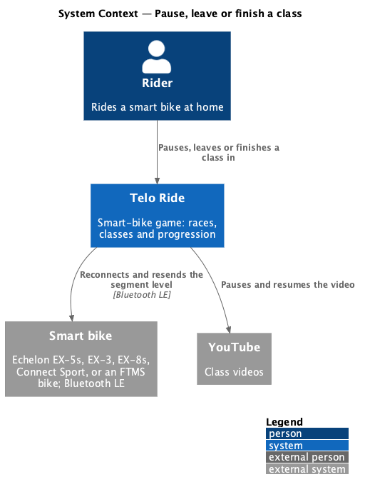
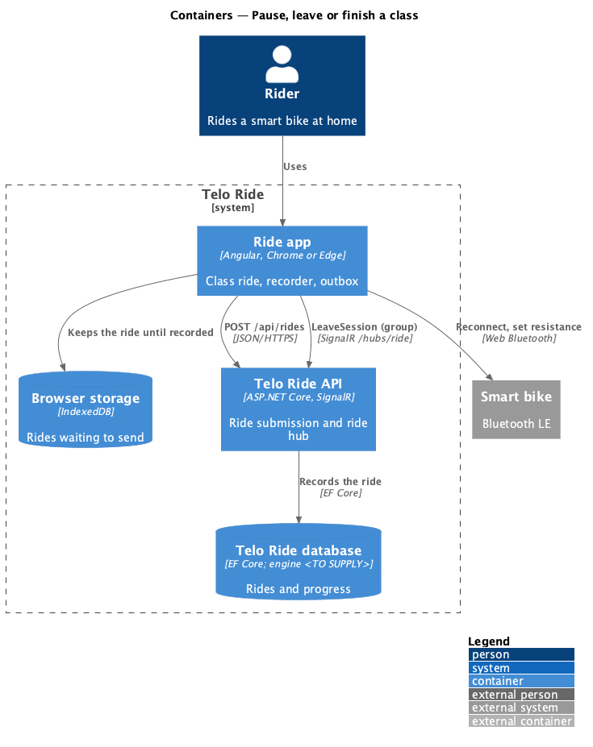
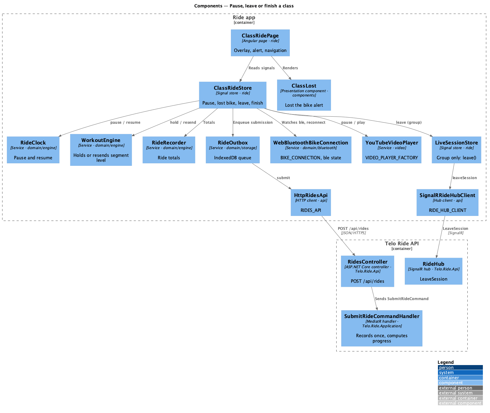
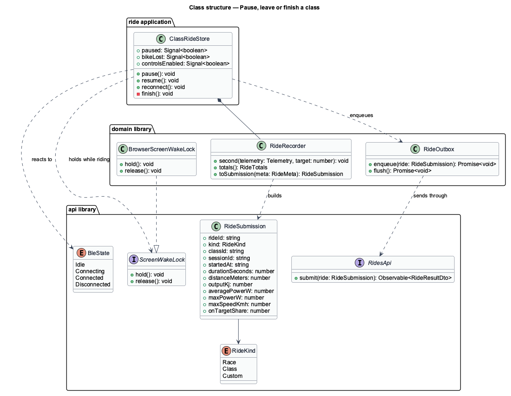
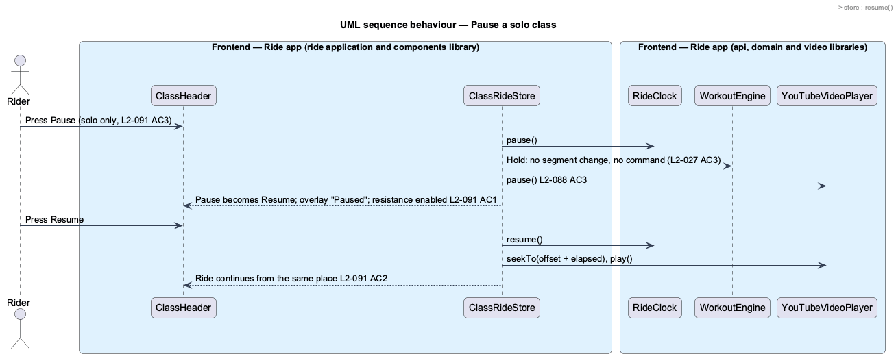
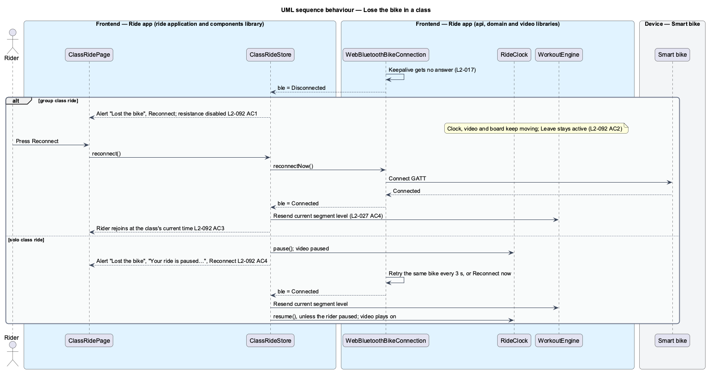
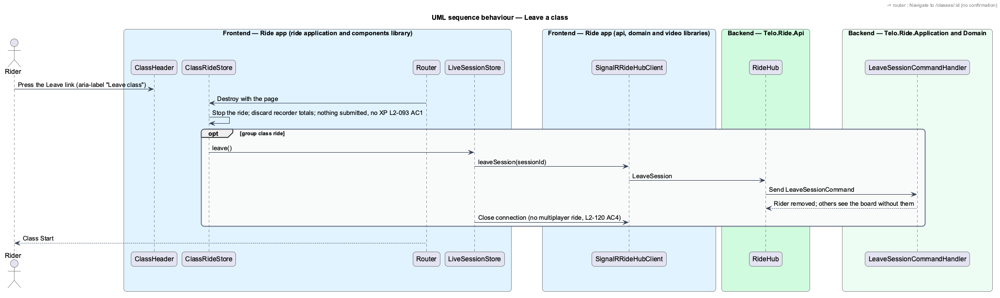
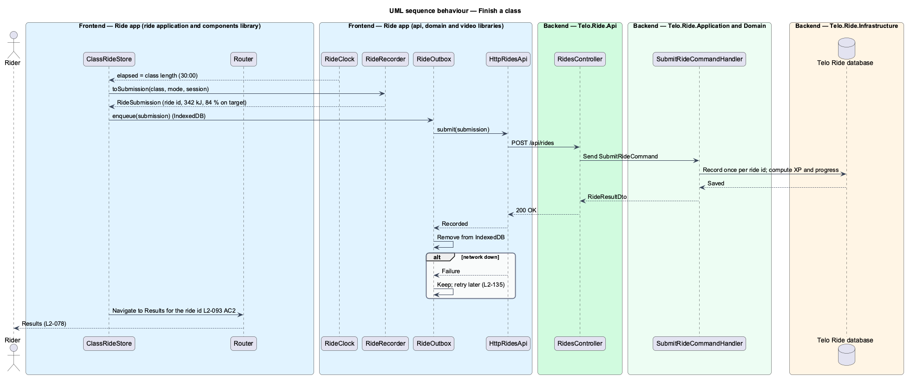

# Pause, leave or finish a class

## Overview

A class ride ends in one of two ways: the rider leaves, or the class plan runs out. In between,
a solo rider may pause, and any rider may lose the bike. The rules differ between a solo ride,
which belongs to the rider alone, and a group ride, which keeps going on the server's clock
whatever one rider does.

> **solo class ride** — class ride with no session; its clock is the rider's own and may pause

> **group class ride** — class ride in a group session; its clock follows the session and never pauses

> **lost bike** — state in which the connected bike has stopped answering over Bluetooth (`ble` state `disconnected`), detected by the bike subsystem's keepalive (`L2-016`, `L2-017`)

> **ride submission** — record of a finished ride sent to the backend, which computes XP and progress from it

Leaving earns nothing and asks for no confirmation (`L2-093` AC1; the journey's one-line
summary, "leave with confirmation", predates it). Finishing submits the ride and opens Results
(`L2-078`). The submission goes through the ride outbox, so a ride that finishes without a
network is kept and sent later (`L2-135`).

## Description

**Frontend — `ride` application**

- **`ClassRideStore`** (see *ride a class*) — adds `pause()`, `resume()`, `reconnect()` and the
  finish, which opens Results. It watches `BIKE_CONNECTION.ble` once a second on the app's
  `TICKER` (the ride clock's ticks stop while the ride is held): a lost bike in solo pauses the
  ride; in a group it disables the resistance controls and lets the class move on. Leaving the
  page destroys it, which stops the ride and discards it, and in a group leaves the session.
- **`ClassRidePage`** — shows the "Paused" overlay (solo) and the lost-bike alert, and its Leave
  link goes to Class Start.

**Frontend — `components` library**

- **`ClassHeader`** — Pause becomes Resume while paused; there is no Pause in a group
  (`L2-091` AC3). Leave stays active while the bike is lost (`L2-092` AC2).
- **`ClassLost`** (`wz-class-lost`) — alert (`role="alert"`) "Lost the bike" with "The class
  keeps going. Pedal to wake the bike and you’ll rejoin where everyone is." in a group, or "Your
  ride is paused. Pedal to wake the bike and it carries on from here." in solo, and
  **Reconnect**.
- **`ClassResist`** — disabled while the bike is lost; enabled while paused (`L2-091` AC1).

**Frontend — `domain` and `api` libraries**

- **`RideClock.pause()` / `resume()`** — hold and continue the monotonic clock.
- **`WorkoutEngine`** — sends no segment change while paused (`L2-027` AC3), and resends the
  current segment's level when the bike reconnects (`L2-027` AC4, `L2-092` AC3).
- **`BikeConnection.reconnectNow()`** — owned by the bike subsystem; called from the **Reconnect**
  press. The connection also retries the same bike every 3 seconds on its own (`L2-017`).
- **`ScreenWakeLock`** / `SCREEN_WAKE_LOCK` (`api`) and **`BrowserScreenWakeLock`**
  (`domain/browser`) — `hold()` keeps the screen awake with `navigator.wakeLock.request('screen')`
  and takes it again when the tab returns to view; `release()` lets it go. The store holds it from
  the ride's start until the rider leaves or the class ends (`L2-133` AC3). Where the browser has
  no Screen Wake Lock API, it does nothing.
- **Leave guard** — while the ride runs, the page listens for `beforeunload` and asks the browser
  to confirm closing or reloading the tab (`L2-133` AC4); it stops listening when the ride ends.
- **`RideRecorder`** (`domain/engine`) — accumulates the ride's totals each running second:
  duration, distance, output in kJ, average power and the share of seconds on target. It holds
  totals, not a trace, so its memory does not grow with the ride.
- **`RideOutbox`** (`domain/storage`) — stores a `RideSubmission` in IndexedDB with its ride id
  and sends it through `RIDES_API`; it retries when the network returns (`L2-135`).
- **`RidesApi`** / `RIDES_API` / **`HttpRidesApi`** — `POST /api/rides`, owned by the
  progression subsystem (*keep progress on the backend*).
- **`LiveSessionStore.leave()`** — owned by the multiplayer subsystem; calls
  `RIDE_HUB_CLIENT.leaveSession()` so the service knows the rider has left a group session.

**Backend**

- **`RidesController`** → **`SubmitRideCommandHandler`** (progression subsystem) records the ride
  once per ride id and returns XP, stars, streak and unlocks. For a group class, the recorded
  place and output come from the service's own progress, not from the submission (`L2-125`).
- **`RideHub.LeaveSession`** → **`LeaveSessionCommandHandler`** (multiplayer subsystem) removes
  the rider from the board for everyone.

**Slices.** Slice 5.4 builds the solo parts: Pause and Resume with the video (`L2-088` AC3),
the solo lost bike with `ClassLost` and Reconnect, Leave to Class Start (`/classes/:id`, which
slice 6.3 builds; until then the route shows Page not found), the wake lock and the leave guard,
and the finish: at the class length the clock stops at the length, the video pauses and Results
opens at `/results` (slice 11.1 builds it). The header's Pause and Resume are a button, not the
mock's link, since it acts; Leave stays a link, since it only goes to Class Start. `RideRecorder`, `RideOutbox` and the submission through
`RIDES_API` come with *record a ride* (10.1) and the ride outbox (17.1); the group parts come with
the group class (journey 14).

## Requirements

| L2 ID | Refines (L1) | Requirement |
|-------|--------------|-------------|
| `L2-091` | `L1-015` | In a solo class ride, Pause shall stop the video and the clock, show an overlay reading "Paused" and turn Pause into Resume, with the resistance controls still enabled. Resume shall pick the ride up where it left off. A group class ride shall have no Pause. |
| `L2-092` | `L1-015` | In a group class ride, when the bike stops answering, an alert shall read "Lost the bike" and "The class keeps going. Pedal to wake the bike and you’ll rejoin where everyone is." with **Reconnect**, and the resistance controls shall be disabled. The video, clock and board shall move on without the rider, and Leave shall stay active. When the bike reconnects, the current segment's level shall be sent and the rider shall rejoin at the class's current time. In a solo class ride, the ride shall pause until the bike is back. |
| `L2-093` | `L1-015` | When the rider presses Leave, Class Start shall open without a confirmation and the ride shall earn nothing; in a group, the other riders shall see the rider leave the board. When the clock reaches the class length, the ride shall be submitted and Results shall open (`L2-078`). |

## Diagrams

### System context

The rider pauses, leaves or finishes a class in Telo Ride. The smart bike may stop answering at
any point.

### Containers

Pausing and the lost-bike rules stay inside the Ride app. Leaving a group and finishing reach the
Telo Ride API: the ride hub for leaving and `POST /api/rides` for the submission, held in
browser storage until it is recorded.

### Components

`ClassRideStore` coordinates the clock, the engine, the bike connection and the player. On
finish, `RideRecorder` builds the submission that `RideOutbox` sends through `RIDES_API`.

### Class structure

`ClassRideStore` reacts to `BleState` and owns a `RideRecorder` whose totals become a
`RideSubmission` for `RideOutbox`.

### Behaviour — pause a solo class

Pause holds the clock, the engine and the video; Resume continues all three from the same place
(`L2-091`, `L2-088` AC3).

### Behaviour — lose the bike

In a group the class moves on and the controls are disabled; on reconnect the current level is
sent. In solo the ride pauses until the bike is back (`L2-092`).

### Behaviour — leave a class

Leave tears the ride down without a submission and, in a group, tells the service (`L2-093` AC1).

### Behaviour — finish a class

At the class length the ride is stored, submitted and Results opens (`L2-093` AC2).

