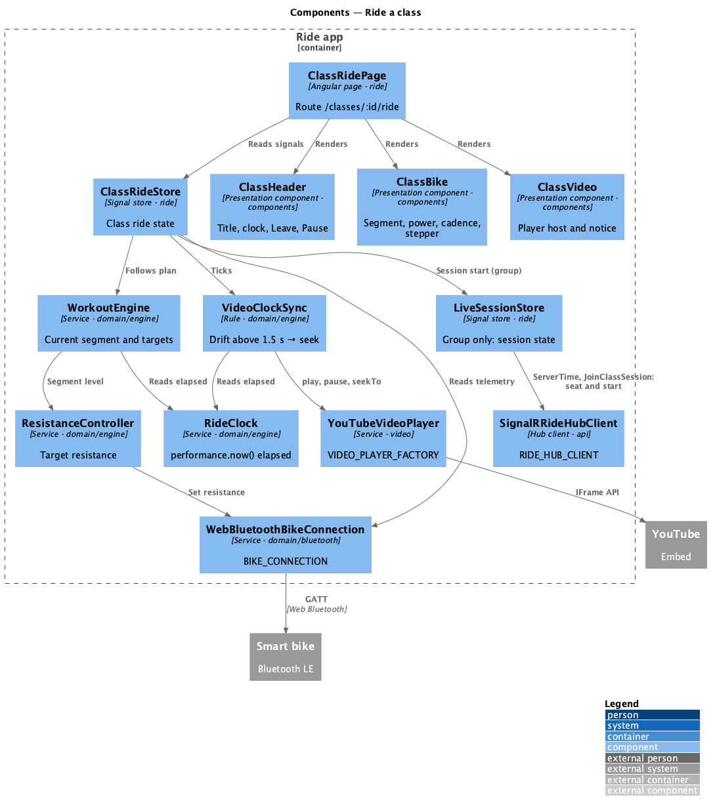
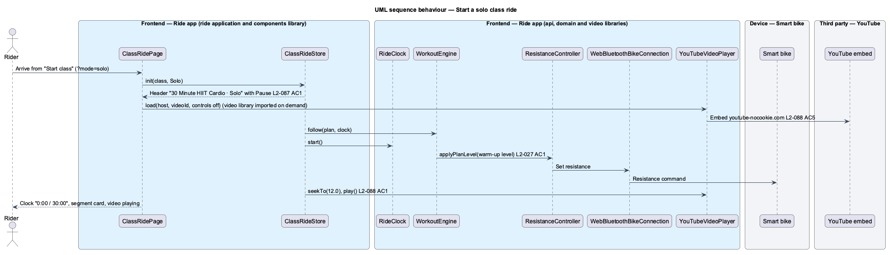
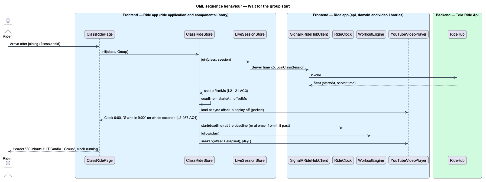
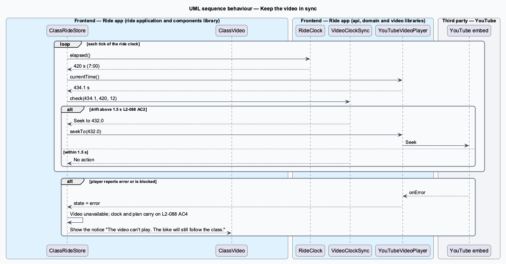
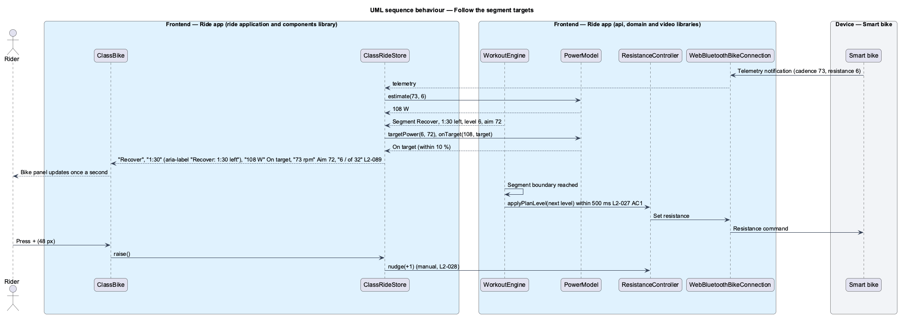

# Ride a class

## Overview

The class ride is where the rider pedals along to a class video while Telo Ride drives the bike
through the class plan. It lives at `/classes/:id/ride`, solo (`?mode=solo`) or in a group
session (`?session={sessionId}`).

> **ride clock** — monotonic elapsed time of the ride, from 0:00 to the class length, that leads the plan and the video

> **segment** — one timed part of the plan with a kind (warm-up, work, recover, steady, cool-down), a duration, a level and a cadence aim

> **target power** — power the segment asks for, computed from its level and cadence aim by the formula of `L2-023` AC3

> **drift** — difference between the video's time and the ride clock plus the sync offset

Three things run in step. The ride clock counts the class. The workout engine finds the current
segment and sends its level to the bike as the target resistance. The video follows the clock:
it never leads it, and when it drifts more than 1.5 seconds it seeks back (`L2-088`). If the
video cannot play, the plan and the clock carry on without it.

In a group session, the clock and the video hold at 0:00 until the session's start, which the
service sends as a server time (`L2-121` AC3). The output board of a group ride is the
*ride with a group* feature; pausing, losing the bike, leaving and finishing are the
*pause, leave or finish a class* feature.

## Description

**Frontend — `ride` application**

- **`ClassRidePage`** (`wz-class-ride-page`, route `/classes/:id/ride`, `loadComponent`) —
  routed page. It provides the route-scoped `ClassRideStore`, `WorkoutEngine`, `RideClock` and
  `VideoClockSync`, renders the header, the video and the bike panel, and tears every one of
  them down when the rider leaves.
- **`LiveSessionStore`** — route-scoped live session state, owned by the multiplayer subsystem
  and provided on this route only in group mode. It wraps `RIDE_HUB_CLIENT` for the session and
  exposes the seat, whose `startsAt` is the session's start in server time, and the measured clock
  offset (`offsetMs`).
- **`ClassRideStore`** — signal store. It holds the class, the mode (solo or group), the
  session start (from `LiveSessionStore`), the current segment view, the power and cadence readouts with their targets,
  and the video state (`ready`, `unavailable`). It exposes the actions the header and the
  stepper raise. It loads the class with `CLASSES_API.get(id)` (`GET /api/classes/{id}`, ADR
  0014), bound with `HttpClient` on the class ride route, and starts the ride once it has it.
  The route also binds `MONOTONIC_TIME` to `performance.now()` and reconnects a remembered bike
  as Home does; a rider with none goes to Connect Bike.
- In a production build the header has no "Finish" shortcut (`L2-087` AC3). The shortcut exists
  only behind a development build flag replaced at compile time, so its code is not in the
  production bundle.

**Frontend — `components` library**

The header's lockup is the small one (`size="sm"`), whose wordmark hides below 384 px.

- **`ClassHeader`** (`wz-class-header`) — "{class} · Group · 9 riders" or "{class} · Solo", the
  clock (`role="timer"`, "7:00 / 30:00"), Leave (`aria-label="Leave class"`), Pause in solo, and
  Full screen. Below md it hides the class name and the total; below 384 px it hides the
  wordmark.
- **`ClassVideo`** (`wz-class-video`) — the 16:9 frame with the class cover
  (`https://i.ytimg.com/vi/<videoId>/hqdefault.jpg`, cropped by `.photo--yt`), the element the
  player takes over, and, when the video cannot play, the warning under it: "The video can't
  play. The bike will still follow the class." (`role="status"`, `L2-088` AC4), drawn by
  **`InlineMessage`** (`wz-inline-message`, tone `warn`). From lg the frame fills the column above
  the bike panel. It emits the player's element (`frame`) once drawn, for the page to hand to the
  store; it finds it from its host rather than with `viewChild`, whose query runtime would be the
  app's first and land in the initial bundle.
- **`ClassBike`** (`wz-class-bike`) — bike panel; one row of four at md or wider. It holds
  **`ClassSegment`** (kind, time left with `aria-label="Recover: 1:30 left"`, progress bar, plan
  profile), two **`ClassStat`**s (Power "108 W" with "On target" or the delta; Cadence "73 rpm"
  with "Aim 72") and **`ClassResist`** (stepper "6 / of 32", 48 px − and + buttons,
  `aria-label` "Resistance 6 of 32"). The stepper shows the bike's reported resistance, or a
  dash before any (`L2-026`); its buttons raise `ResistanceController.nudge` and are disabled
  while it cannot control the bike. Power is "On target" within 10 % of the segment's target
  power, otherwise the signed delta ("+12 W", "-47 W") styled over or under (`L2-059` AC2). Before
  the bike reports power, Power reads a dash with the target ("Target 107 W"); the countdown
  rounds the time left up, so it agrees with the clock after a late tick.

**Frontend — `domain`, `api` and `video` libraries**

- **`RideClock`** (`domain/engine`) — elapsed time from `performance.now()` (`L2-133`). It can
  start at once or at a server time corrected by `ServerClock`.
- **`WorkoutEngine`** (`domain/engine`) — follows a `Plan` against the `RideClock` on each of
  `RideTicker`'s ticks. Its `state` is the current `PlanState` from `planStateAt` (the segment and
  its index, time left, segment progress and the target power), and on each segment boundary it
  asks `ResistanceController` to send the segment level within 500 ms (`L2-027`). A paused clock
  changes no segment and sends nothing. Slice 5.1 builds it with `RideClock` and `RideTicker`
  (*keep the ride clock true*); `startAt` for a group start comes with the group class.
- **`PowerModel`** (`domain/engine`) — `target(cadenceAim, level)` and
  `onTarget(power, target)` (within 10 %), shared with the race HUD (`L2-059` AC2).
- **`ResistanceController`** (`domain/engine`) — owned by the bike subsystem's *control
  resistance* feature. It sends target resistance through `BIKE_CONNECTION` and handles the
  manual stepper (`L2-028`).
- **`VideoClockSync`** (`domain/engine`) — pure rule. `check(videoTime, elapsed, offset)` compares
  the player's time with `offset + elapsed` and returns the time to seek to when they are more than
  1.5 s apart, otherwise `null` (`L2-088` AC2). The store asks it on each tick while the video
  plays; mirroring pause comes with Pause (5.4).
- **`VideoPlayer`** / `VIDEO_PLAYER_FACTORY` (`api`) — the contract: `load(host, videoId,
  {startSeconds, controls, title})`, a `state` signal (`loading`, `playing`, `paused`, `error`),
  `currentTime()`, `play()`, `pause()`, `seekTo(seconds)` and `destroy()`. The token holds a
  function resolving a new player; the class ride route binds it to a dynamic import of the
  `video` library, so the player's code loads only when a ride starts.
- **`YouTubeVideoPlayer`** (`video` library, depends on `api` only) — loads the YouTube IFrame
  API (`https://www.youtube.com/iframe_api`) once and embeds the video from
  `https://www.youtube-nocookie.com` (`L2-088` AC5), without controls and out of the tab order
  in the class ride. A blocked script, a player error or a removed video turn its state to
  `error`; the store then shows the notice and the clock and the plan carry on (AC4). Unit
  tests give the store a fake player; Playwright answers the IFrame API's script with a fake
  `YT.Player`, and the covers with a local picture, so no request leaves localhost (ADR 0012).
- **`BikeConnection`** / `BIKE_CONNECTION` — live telemetry (power, cadence, resistance) and the
  `ble` state, owned by the bike subsystem.

**Slices.** Slice 5.1 built the engine and the clock. Slice 5.2 builds the solo route, the
store, the header's lockup, name and clock, and the bike panel, proved by Playwright on the fake
Bluetooth with a fake clock; the backend's `GET /api/classes/{id}` comes with the catalogue API
(6.1). Slice 5.3 adds the `video` library, `VideoClockSync`, the video with its notice and the
class's `video` (`VideoDto { videoId, syncOffsetSeconds }`, as the catalogue serves it). Pause,
Leave, the wake lock and the leave guard are 5.4; Full screen
is journey 24; the group header and board come with the group class: slice 14.4 reads "· Group"
in the header, drops Pause from a group ride and holds it at 0:00 under "Starts in m:ss" until the
session's start; the board is 14.5. A class that cannot load
is a mock gap, for the class start (6.3).

**Backend.** A solo class ride makes no backend request until it loads its class, and none
again until it ends. A group ride learns its start from the seat `JoinClassSession` returns, so it
needs no start message: the schedule is fixed, and every client converts the same server time
through its own measured offset.

## Requirements

| L2 ID | Refines (L1) | Requirement |
|-------|--------------|-------------|
| `L2-087` | `L1-015` | The class ride at `/classes/:id/ride` in a group shall show the header "30 Minute HIIT Cardio · Group · 9 riders" with the clock (`role="timer"`, "7:00 / 30:00"), Leave (`aria-label="Leave class"`) and Full screen; in solo it shall read "· Solo" and add Pause. On a phone the class name shall be hidden below md, the total "/ 30:00" hidden, and the wordmark hidden below 384 px. A production build shall have no "Finish" shortcut. In a group session that has not started, the clock and video shall hold at 0:00 with the time left to the start and both shall begin at the session's start. |
| `L2-088` | `L1-015` | At 7:00 of a running class ride with a 0:12 offset, the video shall play at 7:12 without player controls. When the video drifts more than 1.5 seconds from the ride clock plus the offset, it shall seek back into sync. When a solo ride pauses, the video shall pause, and Resume shall play it from the same place. When the video cannot load or is blocked, the plan and clock shall carry on and a notice shall say the video is unavailable. The YouTube player shall use the privacy-enhanced domain (`youtube-nocookie.com`). |
| `L2-089` | `L1-015` | The segment card shall show the kind ("Recover"), the time left ("1:30", `aria-label="Recover: 1:30 left"`), a progress bar and the plan profile. Power shall read "108 W" with "On target" or the delta (`L2-059` AC2). Cadence shall read "73 rpm" with "Aim 72". The resistance stepper shall read "6 / of 32" with 48 px − and + buttons (`L2-028`). At md or wider the bike panel shall be one row of four. |

## Diagrams

### System context

The rider rides a class in Telo Ride. Telo Ride sets the smart bike's resistance and plays the
class video from YouTube.

### Containers

The Ride app talks to the bike over Web Bluetooth and embeds the YouTube player. In a group it
keeps the ride hub connection that the join opened.

### Components

`ClassRidePage` owns the route-scoped engine parts. `WorkoutEngine` and `VideoClockSync` both
read `RideClock`; the engine drives `ResistanceController`, and the sync drives the player.

### Class structure

`ClassRideStore` composes `WorkoutEngine`, `RideClock` and `VideoClockSync`. The engine walks a
`Plan` of `Segment`s and uses `PowerModel` for target power.

### Behaviour — start a solo class ride

The clock starts at once, the engine sends the first segment's level, and the video plays from
the sync offset (`L2-087` AC1, `L2-088` AC1).

### Behaviour — wait for the group start

The clock and video hold at 0:00 with the time left; both begin at the server start time,
corrected for the device's clock offset (`L2-087` AC4). The seat carries the start
(`SeatAssignment.startsAt`); the store converts it to the monotonic clock once (`startsAt` less
`offsetMs`) and counts down on whole seconds before it, so "Starts in" flips as the start draws a
second closer. The video loads parked at its sync offset (`autoplay` off) and plays from the
offset plus the time ridden when the clock starts. A rider who arrives after the start (a reload,
a rejoin) starts the `RideClock` from the session's start, so the clock reads the session's time.
Without a seat or an offset (the hub cannot be reached) the ride starts at once with the bike, as
a ride alone does (`L2-126`); a refused join leaves the ride.

### Behaviour — keep the video in sync

On each tick `VideoClockSync` measures drift and seeks above 1.5 s. A player error turns the
video off and leaves the ride running (`L2-088` AC2, AC4).

### Behaviour — follow the segment targets

Each second the engine updates the segment card and the targets; at a boundary it sends the next
level (`L2-089`, `L2-027`).

