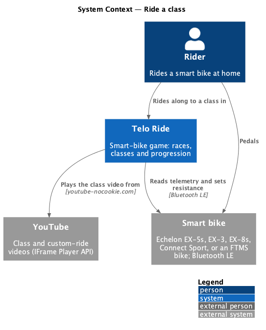
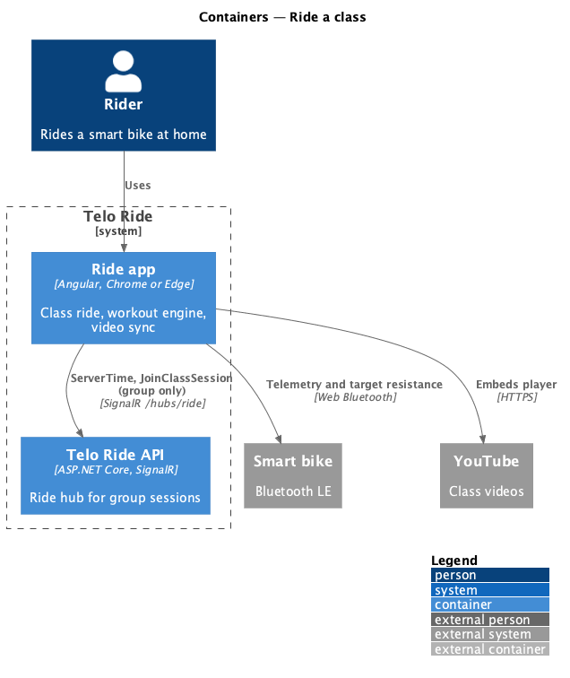
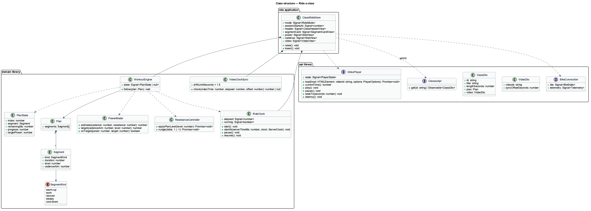

# Ride a class

## Overview

A class from the library (`classes/browse-classes`) is a plan with the YouTube video it follows. This feature is the class page at `/classes/:id`: it shows the class, previews its video at the start point, and starts a ride with the class's configuration (L2-080, L1-014). Before starting, the rider may change the levels, the link or the start point for this ride. The catalogue is never written.

**class page** — page at `/classes/:id` that shows one class and starts a ride with its plan and video

**class draft** — the class's plan, link and start point as the page holds them, including the rider's changes; it lives only in the page

**edited** — state of a class draft whose levels, link or start point differ from the class in the catalogue

**effort level** / **recover level** — on the class page, the highest `work_level` or `rest_level` of the plan; one step of its stepper moves every effort's (recover's) level by 1, which keeps the plan's shape

Starting a class adds no new backend path. The page posts the ordinary `POST /api/workout` (`workouts/start-and-stop-workout`) with the plan as shown and `video` `{url, start_seconds}` or `null`. The dashboard then plays the video as `workouts/ride-along-video` describes. The state contract is unchanged.

The feature reuses four existing parts:
- the L2-029 link and start-point rules (`core/video-link.ts`);
- the preview figures of L2-059 (`core/ride-preview.ts`);
- the replace-ride dialog of L2-052 (`dashboard/replace-ride-dialog`);
- the setup drafts (`core/plan-draft.store.ts`), which `Change intervals in full setup` fills.

## Description

### Backend

None new. `GET /api/classes/{id}` belongs to `classes/browse-classes` (L2-078 criteria 3 and 4). `POST /api/workout` validates the plan exactly as on setup (L2-010).

### Frontend (`frontend/projects/wattzup/src/app/`, with presentation components in `frontend/projects/components/`)

**Pure rules.**
- **`class-draft.ts`** (`core/`, new, with `class-draft.spec.ts`):
  - `ClassDraft` = `{ plan: WorkoutPlan, url: string, start: number }`. `draftOf(entry)` builds it from the class. The `url` is `https://www.youtube.com/watch?v=<video_id>` when the plan has a video, else empty. The `start` is the class's `start_seconds`, else 0 (L2-080 criteria 2 and 3).
  - `levelRows(plan)` returns `[{name: 'Work', level, canLower, canRaise}, {name: 'Recover', …}]` for `hiit` and `intervals`, with each level the highest of its kind and `canLower` / `canRaise` false once the lowest (highest) level of the kind is at 1 (32). For `flat` it returns `[{name: 'Steady', …}]` (criteria 7 and 8).
  - `shiftLevels(plan, row, dir)` moves every effort's level (`work_level` of the plan, or of each set), or every recover's (`rest_level`), or the flat `level`, by `dir`. Each level stays within 1 to 32. It returns the plan unchanged at the limit, so the button is disabled. Warm-up and cool-down levels never move (criterion 7).
  - `isEdited(draft, entry)` is true when the plan, the link or the start point differs from `draftOf(entry)` (criterion 9).
  - `structureLine(plan)` returns:
    - `<rounds> × <work> / <recover>` for `hiit`;
    - `<efforts> × <work> · <first recover> → <last non-zero recover> recover` for an `intervals` plan whose recovers differ;
    - `<efforts> × <work> / <recover>` when they are all equal;
    - `Level <n> throughout` for `flat`.

    Times use `formatDuration` (criterion 6).
  - `cadenceLine(plan)` returns `<work> / <recover> rpm`, or `<n> rpm` for `flat`. A plan whose sets differ reads the first set's cadences (criterion 6).
  - `stretchLine(plan)` returns `<m:ss> warm-up · <m:ss> cool-down`, with each part only when present (criterion 6).
  - `toStartRequest(draft)` returns the plan with `video` `{url, start_seconds}` when `videoIdOf(url)` accepts the link, else `null` (criteria 4 and 10).
  - `toSetupDrafts(draft)` returns a `PlanDraft` whose `mode` is the class's kind (`hiit`, `intervals` or `flat`), with the HIIT or flat fields filled from the plan. For `intervals` it also returns an `IntervalsDraft` with the class's warm-up, sets and cool-down. It also returns the `VideoDraft` `{on: true, url, start}`, or `{on: false}` without a link (criterion 12).

**Presentation components (`frontend/projects/components/`).** These follow `docs/mocks/pages/class/*` and keep the mocks' BEM blocks.
- **`LevelRow`** (`level-row/`, `wz-level-row`, new):
  - `level-row__name` with a `swatch` (`work`, `rest` or `steady`);
  - `Lower <name> resistance` and `Raise <name> resistance` icon buttons, each at least 44 × 44 px;
  - `level-row__value` `<n> / 32`, with `aria-live="polite"` and `aria-label` `<Work|Recover|Steady> level <n> of 32` (criterion 15).

  Inputs: `name`, `level`, `canLower`, `canRaise`. Output: `step` (`-1` or `1`).
- The plan card's strip is the profile `previewOf` draws for setup (`svg.profile`), labelled `Resistance profile: <structure>, peak level <n>`, with the legend `Work` / `Recover`.

**Page.**
- **`ClassPage`** (`dashboard/class-page/`, new, route `classes/:id`, guarded by `bikeOnly` from `classes/browse-classes`; title `<class title> · Wattzup`):
  - **Loading.** On entry it calls `CLASS_API.get(id)` and shows a skeleton until the class arrives (criterion 13).
  - **Not found.** `'not-found'` shows `ClassNotFound` (`dashboard/class-not-found/`, new), the error page block `We can't find that class` / `It isn't in the class library. Pick another, or build your own ride.`, with `All classes` and `Build your own ride` (criterion 13).
  - **Header.** `All classes` (link to `/classes`), the bike's name, the chips `<channel>`, `<shelf title>` and `<focus>`, the `h1` title and the description, all rendered as text (criterion 1).
  - **Video.**
    - The `video-frame` preview goes through `YOUTUBE_PLAYER` (`workouts/ride-along-video`), cued at `start`. Its caption is `<channel> · <title>` / `Cued at <m:ss.s>, the ride's 0:00` (criterion 2).
    - Without a valid link, the poster reads `Paste this ride's YouTube link below to play it in sync on the dashboard.` (criterion 3).
    - The `YouTube link` field and its error follow L2-029 criteria 18 and 19 through `videoIdOf` (criterion 4).
    - `Ride starts at` uses `stepStart` and `formatStart` (`core/video-link.ts`): − and + are `Half a second earlier` / `Half a second later`, with the hint below. The preview cues to each new point (criterion 5).
  - **The plan card.**
    - It shows the total time, the profile strip, the stretch line, `Structure`, `Cadence` and `Expected avg power` (`~<w> W`). The figures come from `previewOf` (`core/ride-preview.ts`) and the helpers above, and update on every change (criteria 6 and 7).
    - `Resistance` shows one `wz-level-row` per `levelRows` entry (criteria 7 and 8).
    - `Reset to class` appears while `isEdited`, and puts back `draftOf(entry)` (criterion 9).
  - **Start ride.**
    - It reads `LiveStateService.state().workout`. With an active workout, it opens the replace-ride dialog (L2-052) first.
    - With none, or once the dialog confirms, it calls `WORKOUT_API.start(toStartRequest(draft))`. The button reads `Starting…` and is disabled while the request runs.
    - Success navigates to `/` (criterion 10).
    - A failure shows the `alert` `Couldn't start the ride` / `The Wattzup server didn't accept the plan. Your settings are kept — try again.` above the start button, which then reads `Try again` (`class/error`), and keeps every value (criterion 11).
  - **Full setup.** `Change intervals in full setup` is a link to `/setup`; a plain click calls `toSetupDrafts(draft)`. It saves the drafts through `PlanDraftStore`: `save`, `saveIntervals` for an `intervals` class, and `saveVideo`. These replace what was there, and then it navigates to `/setup`. Setup restores its mode from `PlanDraft.mode` as it does on any load, so it opens in the class's mode with the class's plan and video (criterion 12).
- **Layout.** Under 1024 px the preview keeps 16:9 at full width above the plan card. Under 576 px nothing scrolls sideways. Every button has a visible focus ring (criterion 15).
- **Treadmill.** The `bikeOnly` guard redirects `/classes/<id>` to `/setup` on the treadmill (criterion 14).

### Screen states

| Mock | State |
|---|---|
| `pages/class/default` | *30 Minute HIIT Cardio*: the GCN preview cued at 0:12.0, 30:00, `8 × 0:30 · 3:00 → 1:30 recover`, `98 / 72 rpm`, `~154 W`, Work 24 and Recover 6 |
| `pages/class/edited` | Work raised to 26 and Recover to 8 (`~177 W`), with `Reset to class` shown |
| `pages/class/no-link` | *20 Minute Power Intervals* with no link: the poster prompt and an empty `YouTube link` field |
| `pages/class/invalid-link` | A Vimeo link: the field error, no preview; Start ride still enabled |
| `pages/class/flat` | *60 Min Dolomites Endurance*: `Level 12 throughout`, `85 rpm` and one `Steady` row |
| `pages/class/loading` | The skeleton |
| `pages/class/submitting` | `Starting…`, disabled |
| `pages/class/error` | `Couldn't start the ride`, with `Try again` and every value kept |
| `pages/class/not-found` | `We can't find that class` |
| `pages/ride/class-workout` | The dashboard after Start ride: the video playing in sync at 11:42, at the class's levels |

### Acceptance tests

The backend paths are covered by `classes/browse-classes` (`GET /api/classes/{id}`) and `workouts/start-and-stop-workout` (`POST /api/workout`). This feature adds no API test.

Playwright (`frontend/e2e/`, Chromium only):
- **Fixtures.** The shared fixture answers `/api/classes/{id}` from recordings (`e2e/fixtures/recorded/class-30-minute-hiit-cardio.json`, `class-not-found.json`). It answers `POST /api/workout` and the event stream as on setup, and serves YouTube through `FakeYouTube` (`workouts/ride-along-video`).
- **Page object.** `e2e/pages/class.page.ts`.
- **Spec `e2e/class.spec.ts`:**
  - `shows the class header, chips and description, with All classes back to the library` (L2-080 AC1)
  - `previews the video cued at the start point with its caption and link` (L2-080 AC2)
  - `shows the paste prompt and an empty link for a class without a video` (L2-080 AC3)
  - `names a link that is not YouTube and still starts without a video` (L2-080 AC4)
  - `steps the start point by half a second and not below 0:00.0` (L2-080 AC5)
  - `shows the plan card's total, structure, cadence and expected power` (L2-080 AC6)
  - `raises every effort with Work and recomputes the plan card` (L2-080 AC7)
  - `shows one Steady row for a flat class` (L2-080 AC8)
  - `shows Reset to class after a change and puts every value back` (L2-080 AC9)
  - `starts the ride with the shown plan and video and opens the dashboard` (L2-080 AC10)
  - `asks to replace a ride in progress before starting` (L2-080 AC10, L2-052)
  - `keeps every value and offers Try again when the start fails` (L2-080 AC11)
  - `opens full setup in the class's mode with its plan and video` (L2-080 AC12)
  - `shows We can't find that class for an unknown id` (L2-080 AC13)
  - `redirects the treadmill to setup` (L2-080 AC14)

Unit tests: `class-draft.spec.ts` covers each row of `structureLine` (hiit, intervals with differing and equal recovers, flat); `cadenceLine`; `shiftLevels` at 1 and 32 and on a plan whose sets differ; `isEdited` for each kind of change; `toStartRequest` with a valid, an invalid and an empty link; `toSetupDrafts` for each kind. The responsive criterion (L2-080 AC15) is covered by the responsive sweep, which runs only when a person asks.

### Open questions

- **Sets with different levels.** L2-080 criterion 7 shows the highest effort level and moves every effort by 1, which keeps the plan's shape. A class whose sets differ shows its peak, not each set. Editing sets one by one belongs to full setup.
- **Cadence of mixed sets.** `cadenceLine` reads the first set when sets differ. <TO SUPPLY> if the spec should show a range instead.
- **Replaced drafts.** Opening full setup from a class replaces the rider's saved setup drafts for that mode, as L2-080 criterion 12 states. No confirmation is asked.

## Requirements

| L2 ID | Refines (L1) | Requirement |
|-------|--------------|-------------|
| `L2-080` | `L1-014` | Class page. `/classes/:id` shows one class (L2-078) and starts a ride with its plan and video. Changes made here apply to this ride only; the catalogue is never written. |
| `L2-078` | `L1-005` | Class endpoints. Criteria 3 and 4: `GET /api/classes/{id}` answers 200 with the class, or 404 ProblemDetails with `code` `class_not_found` for an id not in the catalogue. |
| `L2-010` | `L1-004` | Workout plan definition and validation. The class page posts the plan and `video` `{url, start_seconds}` to `POST /api/workout`, which validates them as on setup. |
| `L2-029` | `L1-007` | Ride setup screen. Criteria 18 and 19: the link preview, the start point and the invalid-link message, reused on the class page; criterion 12 of L2-080 opens setup prefilled. |
| `L2-052` | `L1-007` | Replace-ride dialog. Given an active workout when Start ride is pressed, the dialog opens first. |
| `L2-059` | `L1-007` | Ride preview on setup. The class page's plan card computes total time, structure, time under load and expected power as the setup preview does. |
| `L2-076` | `L1-007` | Video ride-along. A ride started from a class plays its video on the dashboard as specified (mock `ride/class-workout`). |

## Diagrams

### System context

The rider opens a class in Wattzup and starts the ride, and Wattzup drives the bike. The browser loads the video preview from YouTube's player.

### Containers

Wattzup Web reads the class from the Wattzup API, and posts the ride to it. The YouTube player runs in the browser beside Wattzup Web.

### Components

`ClassPage` holds the class draft and applies the rules in `class-draft.ts`. It previews through `YOUTUBE_PLAYER`, and starts through `WORKOUT_API`, with `ReplaceRideDialog` first when a ride is running. `Change intervals in full setup` writes the setup drafts through `PlanDraftStore`.

### Class structure

`ClassDraft` is built from a `ClassEntry` and changed only through the pure functions of `class-draft.ts`. `ClassPage` renders `LevelRow` per level row, and turns the draft into a start request or into setup drafts.

### Behaviour — open a class

The page asks for the class by id and shows a skeleton. A class gives the header, the preview and the plan card. A 404 gives `We can't find that class` (L2-080 criteria 1 to 3 and 13).

### Behaviour — adjust the levels, then reset

A press of `Raise work resistance` moves every effort's level by 1 and recomputes the plan card. `Reset to class` appears while anything differs from the class and puts the class back (L2-080 criteria 5, 7 and 9).

### Behaviour — start the ride

With a ride in progress, the replace-ride dialog asks first. The page posts the plan as shown with the video, and opens the dashboard on success. A failure keeps every value and offers `Try again` (L2-080 criteria 10 and 11, L2-052).

### Behaviour — open in full setup

`Change intervals in full setup` writes the class draft into the matching setup draft and the video draft, then opens `/setup` in that mode (L2-080 criterion 12).

