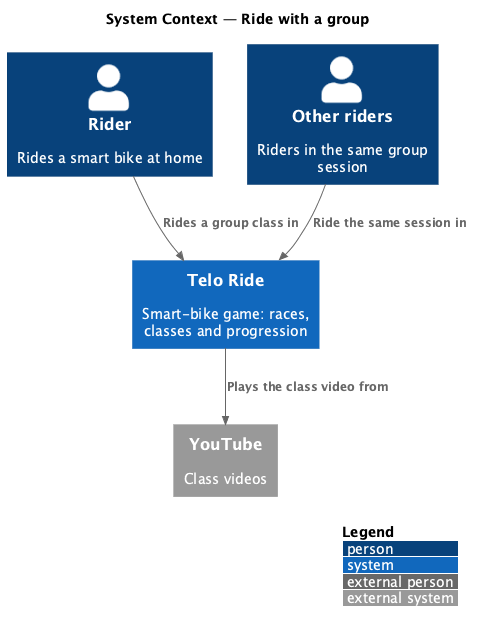
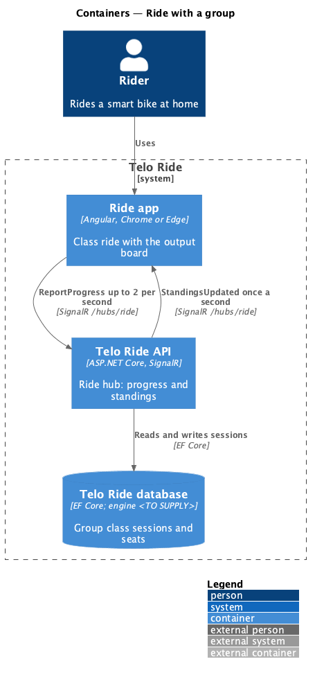
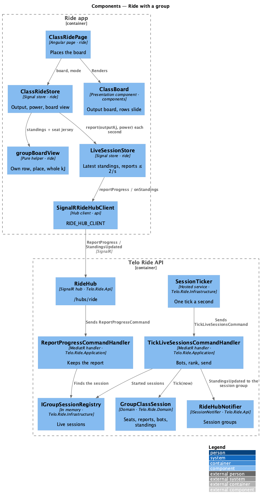
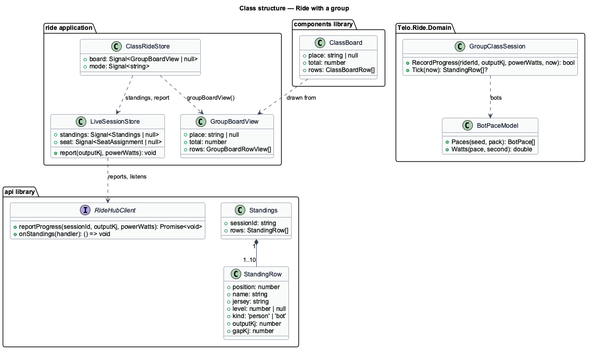
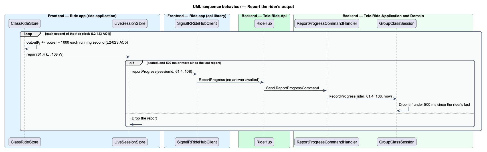
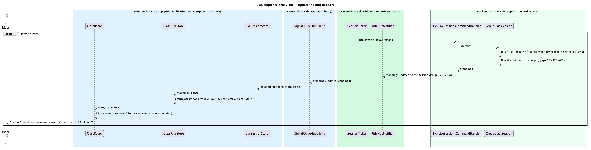

# Ride with a group

## Overview

A group class ride is a class ride shared with up to nine other riders in one group session.
Everyone rides the same video on the same clock. Beside the video, an output board ranks the
field by the energy each rider has put out, so heavier gears count.

> **output** — mechanical energy the rider has produced in the ride, in kilojoules (kJ), the sum of each running second's power ÷ 1000 (`L2-023` AC5)

> **output board** — live list of every rider in the session ranked by output, highest first

> **standings** — ranked list the multiplayer service sends once a second for a session

The board is fed by the multiplayer service, never by the browser's own arithmetic: each client
reports its rider's output and power at most twice a second; the service ranks the field and
sends the standings to everyone once a second (`L2-123`). The ride app only displays what it
receives, with the rider's own row marked.

This slice adds the board to the class ride described in *ride a class*. A solo class ride has no
board and gives the video the full width.

## Description

**Frontend — `ride` application**

- **`LiveSessionStore`** — route-scoped live session state, owned by the multiplayer subsystem.
  It wraps `RIDE_HUB_CLIENT` for the session, holds only the latest standings for its session
  (each `StandingsUpdated` replaces the last, so nothing grows for the length of a ride) and
  sends progress with `report(outputKj, powerWatts)`, which waits for the seat and drops a report
  less than 500 ms after the last one sent (`L2-123` AC1).
- **`ClassRideStore`** (see *ride a class*) — adds each second's power to the ride's output
  (`RideRecorder.outputKj`) and, in a group ride, calls `LiveSessionStore.report` with it and the
  power on each of the ride clock's seconds. It derives the board from the standings with
  `groupBoardView` and the header's mode, "Group · 9 riders" once the board counts the field.
- **`groupBoardView`** — pure helper with its unit tests. It keeps the hub's order (the hub
  ranks once a second, so the board reorders at most once a second, `L2-090` AC2), rounds each
  output to whole kJ, marks the rider's own row (the row in their seat's jersey, unique in a
  session) as "You" in the `you` jersey, and gives the place as an ordinal over the field
  ("5th / 9").
- **`ClassRidePage`** — places the board as a right-hand column at lg or wider
  (`class-ride__body--group`) and under the video below lg; in solo it renders no board
  (`L2-090` AC3–4).

**Frontend — `components` library**

- **`ClassBoard`** (`wz-class-board`) — "Output" heading with the place, and an ordered list of
  rows: rank, jersey dot, display name (rendered as text) and output in kJ; the rider's row
  carries `aria-current="true"`. When the order changes each row slides from its old place over
  `--duration-fast` (150 ms, 0 under reduced motion), by FLIP with the Web Animations API.

**Frontend — `api` library**

- **`RideHubClient`** / `RIDE_HUB_CLIENT` / **`SignalRRideHubClient`** — owned by the
  multiplayer subsystem. This slice adds `reportProgress(sessionId, outputKj, powerWatts)`, sent
  without awaiting an answer, and `onStandings(handler)` for the `StandingsUpdated` server event.
- **`Standings`** / **`StandingRow`** — session id and rows of position, name, jersey, level
  (none for a bot), kind (`person` or `bot`), output in kJ and gap to the leader in kJ.

**Backend** (multiplayer subsystem, *share progress and standings*)

- **`RideHub.ReportProgress(sessionId, outputKj, powerWatts)`** sends one
  `ReportProgressCommand`; the handler records it in the session `IGroupSessionRegistry` holds.
- **`SessionTicker`** — hosted service in `Telo.Ride.Infrastructure` that sends
  `TickLiveSessionsCommand` once a second. Its handler, for each started session, fills it with
  bots at the first tick when fewer than 8 riders are seated (`L2-083`), moves them, ranks the
  field by output and sends `StandingsUpdated` to the session's hub group through
  `ISessionNotifier` (`RideHubNotifier`). A seated rider's connection joins that group in
  `JoinClassSession`.
- **`GroupClassSession`** (`Telo.Ride.Domain`) — keeps each seated rider's last report and its
  bots. Its bots ride `BotPaceModel` around the easy pack (130 W), seeded with the session's id,
  so a session replays the same way; each is "Pacer Nova", "Pacer Rook" and so on in its own
  jersey. Its standings rank by output, highest first, seats before bots on a tie, with each
  gap to the leader in kJ.

**Slices.** Slice 14.5 builds all of the above. Leaving a session, a rider who stops reporting
and dropping a gone connection are journey 15 (`L2-124`).

## Requirements

| L2 ID | Refines (L1) | Requirement |
|-------|--------------|-------------|
| `L2-090` | `L1-015` | A group class ride's board shall read "Output" with the rider's place ("5th / 9") and list every rider by output in kJ, highest first, with the rider's row carrying `aria-current="true"`. When outputs change, the board shall reorder at most once a second, with rows sliding over 150 ms. At lg or wider the board shall be a right-hand column; below lg it shall sit under the video. A solo class ride shall have no board, and the video shall take the full width. |

## Diagrams

### System context

Riders in one group session ride the same class in Telo Ride and see each other on the board.

### Containers

Each Ride app reports progress to the Telo Ride API's ride hub and receives the standings from
it. Session state lives in the API process and the database.

### Components

`ProgressReporter` sends the rider's progress through the hub client; `LiveSessionStore` receives
the standings and `GroupBoardStore` turns them into rows for `ClassBoard`. On the backend,
`SessionTicker` ranks each session through `RankingPolicy`.

### Class structure

`GroupBoardStore` holds a bounded list of `BoardRowView`s built from the `StandingsDto` that
`LiveSessionStore` holds. `ProgressReporter` carries `ProgressReport` up through the hub contract.

### Behaviour — report the rider's output

The class ride sends output and power at most twice a second (`L2-123` AC1).

### Behaviour — update the output board

The service ranks by output and sends the standings once a second, so the board reorders at most
once a second; it slides moved rows over 150 ms (`L2-090` AC1–2).

## Open questions

- **The mock's field.** The Class Ride mock draws nine riders, eight people and one bot ("Pacer
  Nova"). Under `L2-083` a session with eight riders starts without bots, and one with fewer is
  filled to 10, so no session the service runs looks like that. The board draws whatever the
  standings hold, so the mock is kept as drawn; redraw it with ten riders if the field should
  match a real session.
- **The rider's own row.** The board finds it by the seat's jersey, which is unique in a
  session: bots ride in the jerseys of their names, which no seat of a session with bots uses.
  A rider id in the standings would do the same, at the cost of sending every rider's id to
  everyone.
