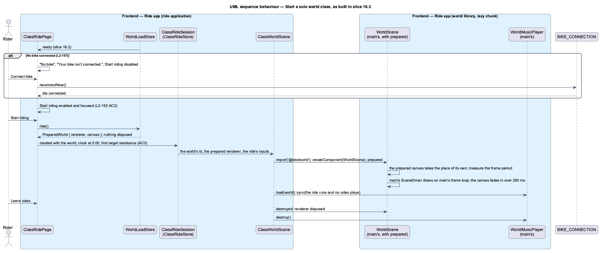
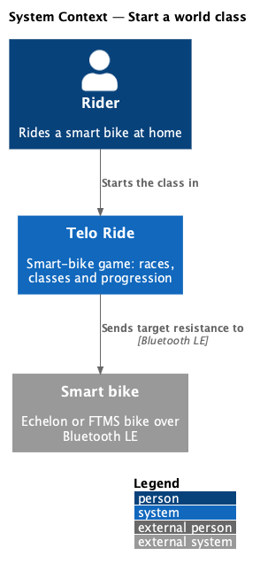
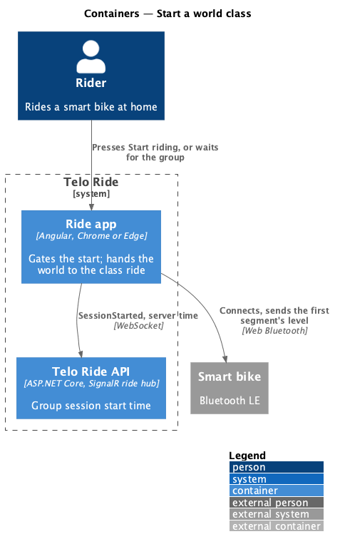
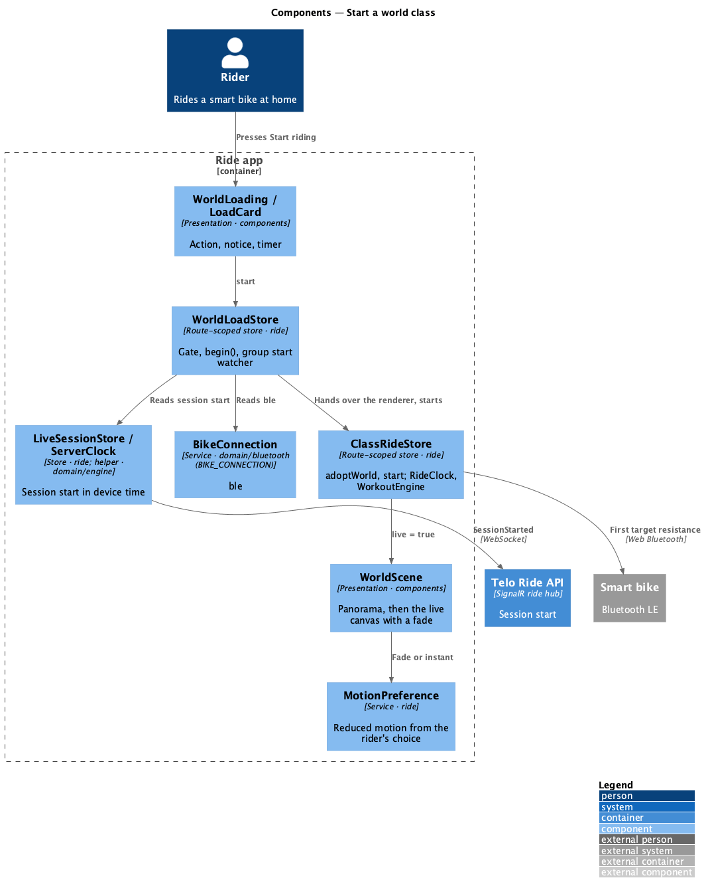
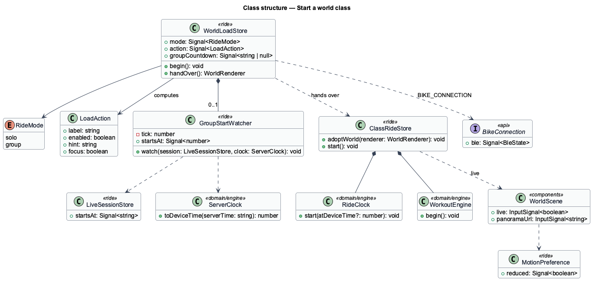
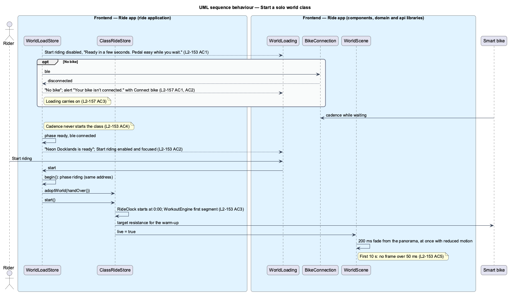
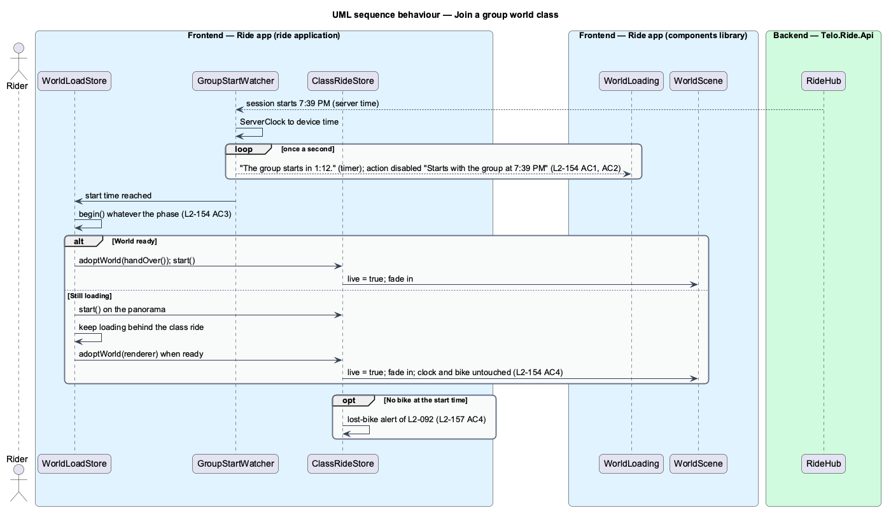

# Start a world class

## Overview

When a class's world is ready, the class starts. A solo class starts when the rider presses
Start riding; a group class starts at the session's start time for everyone, whether this
rider's world is ready or not. In both cases the ride never starts on a world that would stutter,
and the bike and the world never wait for each other.

> **hand-over** — moment the class ride takes the place of World loading at the same address and the world replaces the panorama

> **cross-fade** — 200 ms opacity transition from the panorama to the live world, instant with reduced motion

> **session start** — server time at which a group session's class ride starts for every rider in it

The feature follows `classes/load-a-class-world`, which gets the world ready, and leads into
`classes/ride-a-class`, which runs the class. Group sessions, their seats and their start time
come from `classes/ride-with-a-group` and the multiplayer subsystem. The lost-bike behaviour in a
group class is `classes/pause-leave-or-finish-a-class` (`L2-092`).

## Description

**Frontend — `ride` application**

- **`WorldStartGate`** — part of `WorldLoadStore`. A computed signal decides the action on the
  load card from the phase, `ble` and the mode:
  - solo, loading: Start riding disabled, "Ready in a few seconds. Pedal easy while you wait."
    (`L2-153` AC1);
  - solo, ready and connected: Start riding enabled, focused, "Your 5:00 warm-up starts the
    moment you press Start." (`L2-153` AC2);
  - no bike: Start riding disabled, "Start riding turns on when the bike is connected and the
    world is ready." (`L2-157` AC2);
  - group: disabled "Starts with the group at 7:39 PM", "Pedal easy: everyone’s warm-up starts
    together." (`L2-154` AC2).
- **`WorldLoadStore.begin()`** — solo hand-over. It sets the phase to `riding`, passes the
  prepared `WorldRenderer` to `ClassRideStore` with `handOver()`, and asks `ClassRideStore` to
  start: `RideClock` starts at 0:00 and `WorkoutEngine` sends the first segment's target
  resistance (`L2-153` AC3). Cadence from the bike never calls `begin()` (`L2-153` AC4).
- **`GroupStartWatcher`** — part of `WorldLoadStore` in group mode. It reads the session start
  from `LiveSessionStore` and `ServerClock`, drives the "The group starts in 1:12." timer once a
  second, and at the start time calls `begin()` whatever the phase (`L2-154` AC1, AC3). If the
  world is not ready, the class ride runs on the panorama while loading continues behind it.
- **`ClassRideStore.adoptWorld(renderer)`** (from `classes/ride-a-class`) — attaches a prepared
  renderer to the class ride's scene. When it arrives after the ride started, the scene
  cross-fades from the panorama without touching `RideClock` or the bike (`L2-154` AC4).
- **`MotionPreference`** (from `ui/support-screen-readers-and-motion`, reading the rider's choice
  in `settings/adjust-sound-motion-and-display`) — makes the cross-fade instant when motion is
  reduced (`L2-153` AC3).

**Frontend — `components` and `domain`**

- **`WorldScene`** (`components`, block `world-scene`) — the class ride's canvas host with the
  panorama layered under it. Input `live`; the canvas fades in over 200 ms when it turns true.
- **`BikeConnection`** / `BIKE_CONNECTION` (`api`, implemented in `domain/bluetooth`) — the
  `ble` signal the gate reads. With no bike the facts read "No bike" and an alert reads "Your bike
  isn’t connected." with "Connect bike" (`L2-157` AC1). Loading carries on regardless
  (`L2-157` AC3).

**First frames.** Every program and texture the first frames need is built and uploaded in the
warm-up (`classes/load-a-class-world`), so the first 10 seconds draw no frame longer than 50 ms on
the reference laptop (`L2-153` AC5). The check is a heap-and-frame measurement that runs only when
a person asks, like the other performance sweeps.

**Class ride in a world.** The class ride that takes over is the class ride of
`classes/ride-a-class` with the world on its stage (`docs/mocks/pages/class-ride/world.html`): the
world fills the stage over its panorama, and the class video plays in the stage's corner with its
own sound. The header and the bike panel are unchanged.

**Group with no bike.** At the session start a group class starts even with no bike, showing the
lost-bike alert of `L2-092` (`L2-157` AC4).

## As built in slice 16.3

- **The gate** (`L2-153` AC1, AC2, `L2-157` AC1 to AC3): Start riding is enabled only when the
  world is ready and the bike is connected. With no bike the facts read "No bike" in the danger
  tone, a danger alert reads "Your bike isn’t connected." and "The world keeps loading. Pedal once
  to wake the bike, then connect it.", with "Connect bike", and the hint reads "Start riding turns
  on when the bike is connected and the world is ready." The status adds "The bike is not
  connected." Loading carries on regardless. "Connect bike" asks the connection to try the
  remembered bike at once (`reconnectNow()`), as the class ride's Reconnect does: a class ride
  always has a remembered bike, and leaving for Connect would throw away the world being built.
- **The hand-over** (`L2-153` AC3, AC5): `WorldLoadStore.ride()` hands the started renderer and
  the canvas it drew on (`PreparedWorld` in `api`) to the class ride, and no longer disposes them.
  `ClassRideSession` takes the class's world, its panorama and the prepared renderer as inputs
  from `ClassRidePage`, and lays them out with the `ClassWorld` component (`components`, block
  `class-world`), the class video inset in its corner (`ClassVideo`'s new `inset`). Its
  `ClassWorldScene` directive imports the `world` library and creates `main`'s `WorldScene` there,
  as the race's `RaceWorld` does, with the new `prepared` input. `WorldScene` then puts the prepared canvas in
  place of its own, measures the frame period and draws on `main`'s loop and `SceneDriver`, with
  no second renderer and nothing compiled again. The canvas fades in over `--duration-base`
  (200 ms), which the tokens make 0 with reduced motion. A ride that reaches the class without a
  prepared renderer (the panorama, or a group until slice 16.4) shows the panorama on the stage.
- **The world's music** (`main`'s `world-music.ts` and `world-music-player.ts`, with
  `frontend/projects/ride/public/music/`): `ClassWorldScene` loads the world's track and plays it while the ride runs
  and no class video is playing, because a class video has its own sound and the music plays under
  the ride sound, which a class video mutes (`L2-163` AC1). In practice the track plays when the
  video is unavailable. The "World music" setting arrives with slice 20.4, so it is on until then.
- **Not copied:** `main`'s `world-ride-view.ts` (the view model of `main`'s World Ride HUD) and
  `world-ride-access.ts` (the guard of `main`'s `/classes/:id/world` route). The screens around
  the world are built from Telo Ride's mocks, and the class ride is reached through World loading
  at `/classes/:id/ride`, so neither has a use. `world-ambience.ts` is copied with its spec;
  playing the ambience waits for ride sound in slice 20.4.

## Requirements

The feature realizes the following level-2 (L2) requirements. Each L2 requirement refines a
level-1 (L1) requirement, cited by identifier.

| L2 ID | Refines (L1) | Requirement |
|-------|--------------|-------------|
| `L2-153` | `L1-025` | While a solo world class loads, Start riding shall be disabled with "Ready in a few seconds. Pedal easy while you wait.". When the world is ready and the bike connected, the heading shall read "Neon Docklands is ready", Start riding shall be enabled and take focus. Pressing it shall start the clock at 0:00, send the first segment's target resistance, and replace the panorama with the world in a 200 ms fade, at once with reduced motion. Pedalling shall not start the class. In the first 10 seconds no frame shall take longer than 50 ms on the reference laptop. |
| `L2-154` | `L1-025` | Before a group world class starts, a notice shall read "The group starts in 1:12." as a timer counting each second, with the session in the facts, and the action shall be disabled with "Starts with the group at 7:39 PM". At the session's start time the class ride shall start with everyone whether the world is ready or not; a world that becomes ready later shall fade in without interrupting the clock or the bike. |
| `L2-157` | `L1-025` | With no bike connected, the facts shall read "No bike" and an alert shall read "Your bike isn’t connected." with "Connect bike"; Start riding shall stay disabled until the bike connects and the world is ready. Loading shall not wait for the bike, nor the bike for the world. A group class with no bike at the start time shall start with the lost-bike alert of L2-092. |

## Diagrams

### System context

The rider starts the class in Telo Ride, which drives the smart bike over Bluetooth. In a group,
the Telo Ride API sets the start time for everyone.

### Containers

The Ride app connects to the bike over Web Bluetooth and, in a group, to the Telo Ride API's ride
hub for the session start.

### Components

`WorldLoadStore` gates the start on the world, the bike and the session, then hands the prepared
renderer to `ClassRideStore`.

### Class structure

The gate is a computed view over the load phase, `ble` and the session; the hand-over moves the
renderer from the load store to the class ride.

### Behaviour — start a solo world class

Start riding turns on only when the world is ready and the bike connected. Pressing it starts the
clock, sends the first target resistance and fades the world in.

### Behaviour — join a group world class

The class starts at the session time for everyone. A world still loading keeps loading behind the
panorama and fades in when ready.

## Open questions

1. A world class now shows its video as an inset of the stage, so the world fills the stage and the
   coach still leads (`docs/specs/L2.md` open question 13). The inset's size and corner are this
   slice's choice, drawn in the `world` mock.
2. `main`'s World Ride plays the world's track whenever the ride runs. A class ride has a video
   with its own sound, so the track plays only while no video plays (`L2-163` AC1).
3. "Connect bike" retries the remembered bike in place rather than opening Connect, which would
   leave World loading.
