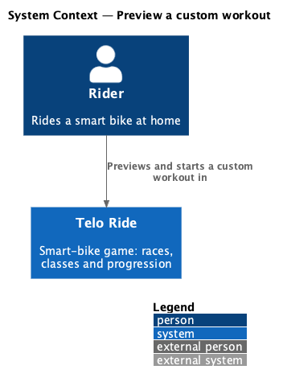
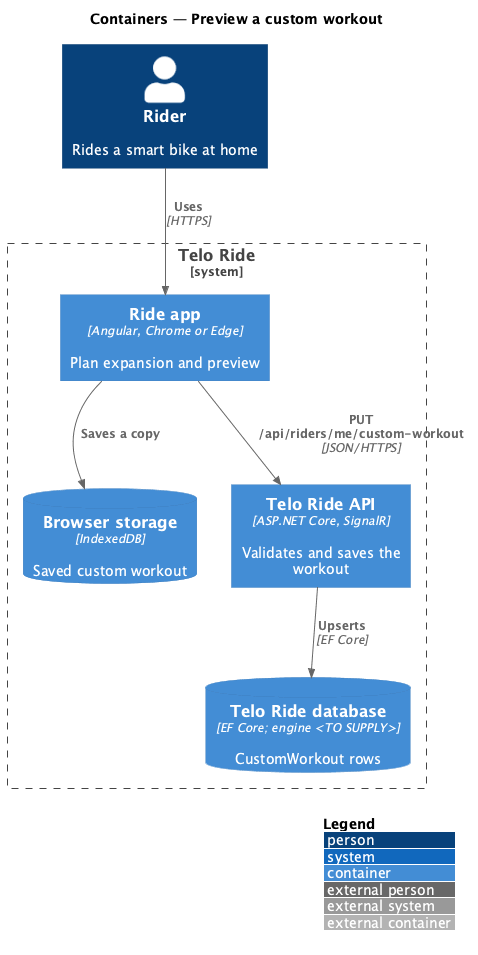
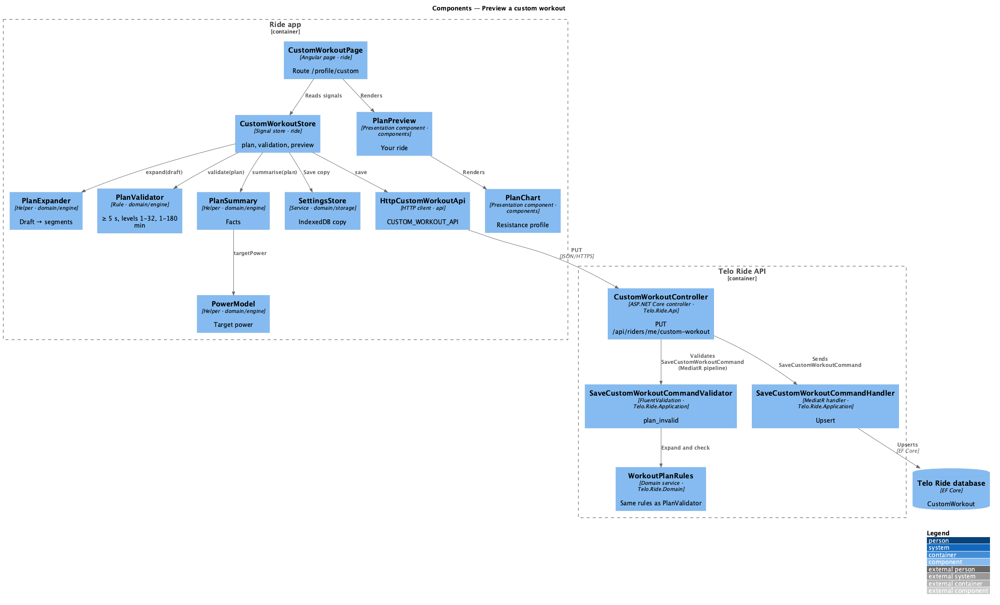
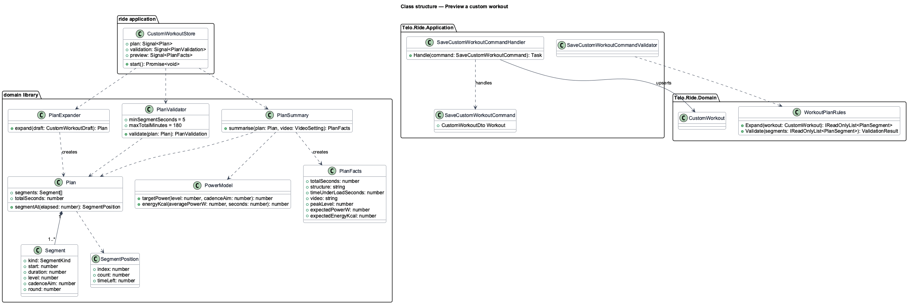
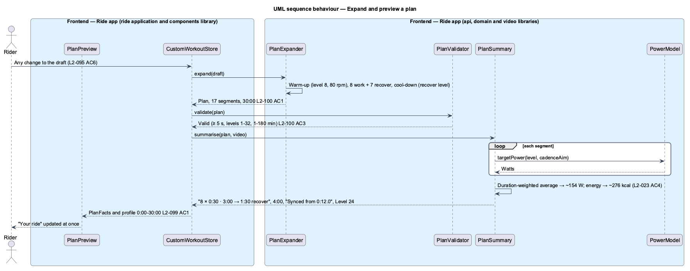
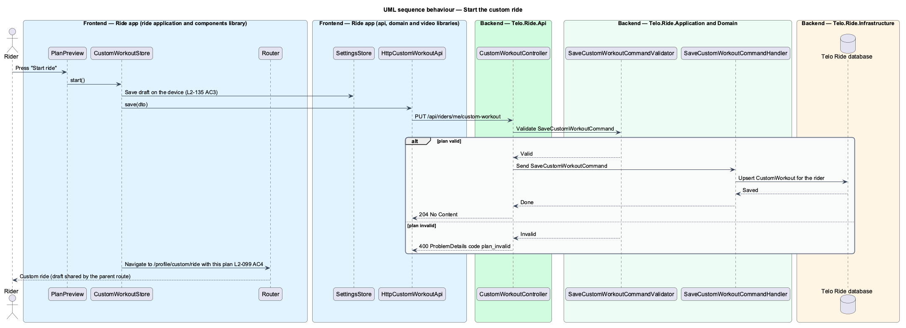

# Preview a custom workout

## Overview

Before a custom ride starts, the rider sees what it will ask of them. The "Your ride" preview
sits beside the setup form (see *set up a custom workout*) and updates on every change. It shows
the total time, a resistance profile and six facts: structure, time under load, video, peak
resistance, expected average power and expected energy. "Start ride" saves the workout to the
rider's account and opens the custom ride.

> **plan expansion** — turning a custom workout's settings into the ordered list of timed segments the ride follows

> **segment** — one timed part of a plan with a kind (warm-up, work, recover, steady, cool-down), a start, a duration, a level, a cadence aim and, for HIIT, a round

> **time under load** — total duration of the work segments

> **target power** — power a segment asks for, from its level and cadence aim by the formula of `L2-023` AC3: max(0, round(cadence × (0.55 + level × 0.155)))

The preview and the ride use one expansion, so what the rider previews is what the bike does.
The same expansion runs in the backend to validate a saved workout, against the same table of
cases.

## Description

**Frontend — `ride` application**

- **`CustomWorkoutStore`** (see *set up a custom workout*) — derives `plan` (a `computed` signal
  over the draft through `expandCustomWorkout`), `problems` (through `validatePlan`) and
  `preview` (through `customWorkoutPreview`). From slice 21.3, `start()` saves the draft and
  navigates to `/profile/custom/ride`.
- **`CustomWorkoutPage`** — hosts the video section's preview player through
  `VIDEO_PLAYER_FACTORY`, parked at the offset with YouTube's controls, and destroys it when the
  switch goes off, the link changes or the rider leaves.

**Frontend — `components` library**

- **`PlanPreview`** (`aside[wz-plan-preview]`) — "Your ride": the total, the resistance profile
  from 0:00 to the total (Class Start's **`ClassProfile`**, at the preview's height, so both
  draw a plan alike), the facts list and the legend. Start ride joins it in slice 21.3.
- **`VideoSync`** (`wz-video-sync`) — "Ride along to a video": the switch, the "YouTube link"
  field (invalid with its message), the player's frame, "Ride 0:00 starts at" with "Half a
  second earlier" and "Half a second later", "Use video's current time", "Check" and the help
  text (`L2-098`).

**Frontend — `domain` library (`engine/`)**

- **`expandCustomWorkout(draft): Plan`** — HIIT: a warm-up at level 8 aiming at 80 rpm
  (`L2-096` AC3); then for each round a work segment at the work level aiming at 90 rpm and,
  except after the last round, a recover segment at the recover level aiming at 72 rpm, as
  `L2-102` AC1 shows; then a cool-down at the recover level aiming at 85 rpm. A warm-up or
  cool-down of 0:00 is left out. The GCN plan expands to 17 segments. Flat: one steady segment at
  the chosen level and cadence goal.
- **`planStateAt(plan, elapsedMs)`** (slice 6.1) — finds the current segment and its time left:
  6:52 → segment 3 of 17, Recover, 1:38 left (`L2-100` AC2).
- **`validatePlan(plan)`** — every segment at least 5 seconds, every level 1 to 32, total 1 to
  180 minutes (`L2-100` AC3); returns the rules broken, none for a valid plan.
- **`customWorkoutPreview(draft, plan)`** — the total, and the facts: structure
  (`PlanSummary.structure`, "8 × 0:30 · 3:00 → 1:30 recover" or "Level 12 throughout"), time
  under load (HIIT only), video ("Synced from 0:12.0", "Off" or "Link needed"), peak resistance
  ("Level 24"), expected average power (`PlanSummary.averagePower`, duration-weighted target
  power) and expected energy (`EnergyModel.kcal`, `L2-023` AC4).
- **`video-link.ts`** — `videoIdOf(link)`: the 11-character id of a `youtube.com/watch?v=`,
  `youtu.be/` or `youtube.com/shorts/` link, else `null`; `formatOffset` ("0:12.0") and
  `parseOffset`; the offset steps by 0.5 s, never below 0.

**Later slices.** Start ride, saving the workout to the device and the account
(`CustomWorkoutApi.save`, `PUT /api/riders/me/custom-workout`, the backend's
`SaveCustomWorkoutCommand` with `WorkoutPlanRules` refusing with `plan_invalid`) and opening the
next setup from it are slice 21.3, with the ride they start.

## Requirements

| L2 ID | Refines (L1) | Requirement |
|-------|--------------|-------------|
| `L2-099` | `L1-016` | For the GCN plan with a 5:00 warm-up and 6:00 cool-down, "Your ride" shall show a total of 30:00 with a resistance profile from 0:00 to 30:00 and the facts Structure "8 × 0:30 · 3:00 → 1:30 recover", Time under load "4:00", Video "Synced from 0:12.0", Peak resistance "Level 24", Expected avg power "~154 W" and Expected energy "~276 kcal". For flat at level 12, 85 rpm and 30 min, it shall read "Level 12 throughout", "Level 12", "~205 W" and "~367 kcal", with no time under load. Expected power shall be each segment's target power (`L2-023` AC3) weighted by its duration, and expected energy shall follow `L2-023` AC4. "Start ride" shall open the custom ride with this plan and save the workout to the rider's account for next time. |
| `L2-100` | `L1-016` | The GCN plan shall expand to 17 segments: warm-up, then eight work and seven recover alternating, then cool-down. At 6:52 the current segment shall be segment 3 of 17 (Recover, round 1) with 1:38 left. A plan shall be refused unless every segment is at least 5 seconds, every level is 1 to 32 and the total is 1 to 180 minutes. |

## Diagrams

### System context

The rider previews and starts a custom workout in Telo Ride, which keeps it in the rider's
account.

### Containers

The Ride app expands and summarises the plan on the device. "Start ride" saves it to the Telo
Ride API and to browser storage.

### Components

`CustomWorkoutStore` derives the plan, its validity and its summary from the draft. On start it
saves through `CUSTOM_WORKOUT_API`, where the backend validates the plan again.

### Class structure

`PlanExpander` produces a `Plan` of `Segment`s; `PlanValidator` and `PlanSummary` read it, and
`PlanSummary` uses `PowerModel`. The backend's `WorkoutPlanRules` applies the same rules.

### Behaviour — expand and preview

Each draft change re-expands the plan, validates it and recomputes the facts (`L2-099`,
`L2-100`).

### Behaviour — start the ride

"Start ride" saves the workout on the device and to the account, then opens the custom ride with
the plan (`L2-099` AC4).

## Open questions

1. **Cadence aims.** Work aims at 90 rpm and the cool-down at 85 rpm: the one pair that gives
   `L2-099` AC1's ~154 W and ~276 kcal. `main` aims at 100 and 70 rpm (~155 W, ~278 kcal).
2. **The chart.** The preview draws Class Start's `ClassProfile` rather than a chart of its own,
   with its bars scaled to the plan's highest level, as the mock's are for GCN.
3. **Video wording.** "Off" with the switch off, and "Link needed" with a link that is not
   YouTube's, added to `L2-099` AC5 with the `video-off` and `invalid-link` mocks.
4. **A typed offset.** The offset field takes "0:12.0", "12.5" or "1:02:03.5"; anything else
   puts back the last offset.
