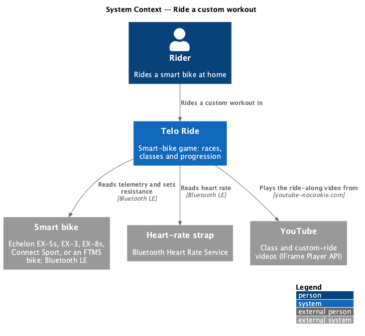
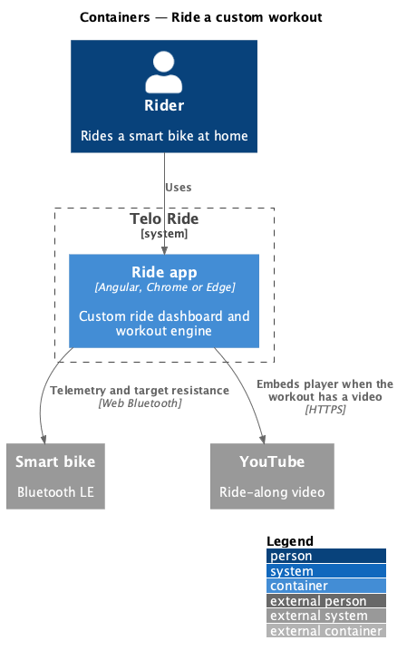
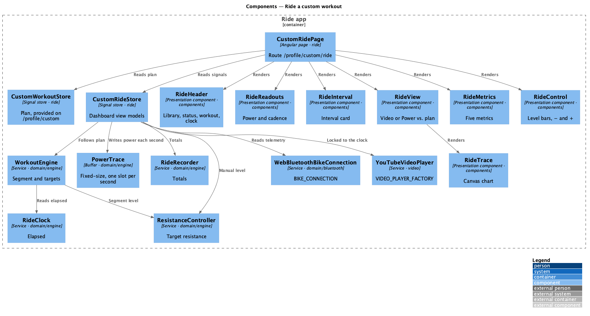
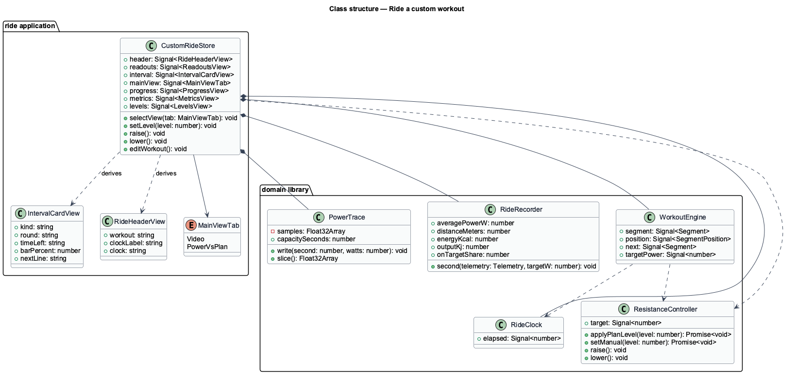
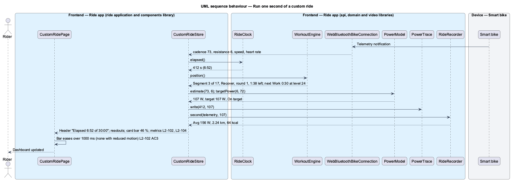
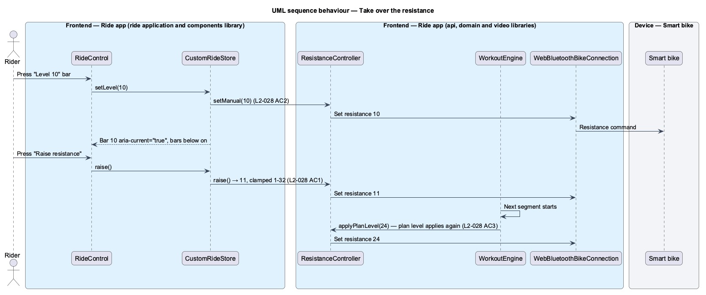
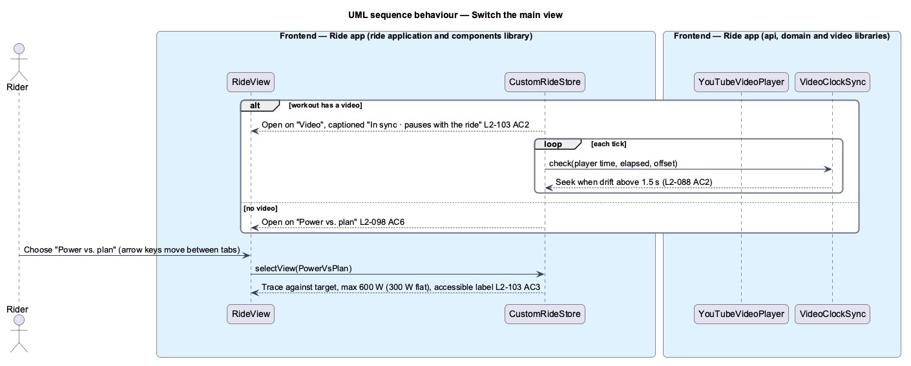
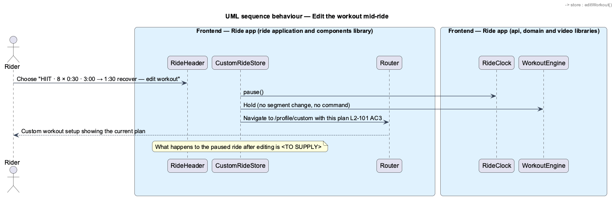

# Ride a custom workout

## Overview

The custom ride is the dashboard on which the rider rides their own workout. It lives at
`/profile/custom/ride` and opens from "Start ride" (see *preview a custom workout*). Unlike a
race or a class, it gives the rider full manual control alongside the plan: 32 level bars, −
and + buttons, and a choice of main view.

> **dashboard** — custom ride screen: header, telemetry column and a 340 px control aside

> **interval card** — readout of the current segment: kind, round, time left, a bar and the next segment

> **main view** — tabbed area showing either the ride-along video or the "Power vs. plan" chart

> **power trace** — series of the rider's power, one point per running second, drawn against the plan's target power

The plan drives the resistance: on each segment boundary the workout engine sends the segment's
level, and a manual change lasts until the next segment (`L2-027`, `L2-028`). Telemetry from the
bike updates the readouts once a second (`L2-134`). Pausing, losing the bike and starting
without a bike are *pause or lose the bike on a custom ride*; leaving and ending are *leave or
end a custom ride*.

## Description

**Frontend — `ride` application**

- **Start ride** (in *preview a custom workout*'s `PlanPreview`) — disabled while the plan is
  refused (`L2-100` AC3) or the video link is not YouTube's (`L2-098` AC2), with the reason under
  it; pressed, it saves the workout and opens `/profile/custom/ride` (`L2-099` AC4).
- **`CustomRidePage`** (`wz-custom-ride-page`, child route `ride` of `/profile/custom`) — routed
  page. It provides the route-scoped `CustomRideStore` and the class ride's engine: `RideClock`,
  `RideTicker`, `WorkoutEngine`, `ResistanceController`, `BikeTelemetry` and `VideoClockSync`. It
  rides the plan of the parent route's `CustomWorkoutStore`. Telemetry sits on the left and the
  control aside on the right at lg; below lg the aside goes under the telemetry.
- **`CustomRideStore`** — signal store. The ride starts once the bike is connected; the clock,
  the engine and the target resistance then follow the plan as in a class ride. It derives the
  header's workout and clock, the readouts, the interval card, the main view, the progress strip
  and the metrics from the engine, the clock, the bike telemetry and a `RideRecorder`. At the
  plan's end the clock stops at the total; what follows is slice 21.4's. The workout link
  navigates to `/profile/custom`, whose draft is the ride's plan (`L2-101` AC3).

**Frontend — `components` library**

- **`RideHeader`** (`header[wz-ride-header]`) — the lockup, the bike status (`L2-019`), the
  projected workout link ("HIIT · 8 × 0:30 · 3:00 → 1:30 recover" or "Flat · Level 12 · 30 min",
  with the hidden text "— edit workout"), the clock (`role="timer"`, "Elapsed 6:52 of 30:00") and
  Full screen. "Library", Pause and End join it in slice 21.4 and "Feedback" in slice 26.1.
- **`RideReadouts`** (`wz-ride-readouts`) — Power ("107 W", "Target 107 W", "On target") and
  Cadence ("72 rpm", "Aim for 72"), then the projected **`RideInterval`**
  (`wz-ride-interval`): "Recover", "Round 1 of 8", "1:38" (`aria-label="1:38 left in this
  interval"`), a bar eased over 1000 ms each second (no easing with reduced motion), and "Next:
  Work 0:30 at level 24" or "Last stretch".
- **`RideView`** (`wz-ride-view`) — tab list "Main view" with "Video" (only with a video) and
  "Power vs. plan"; the Video panel is the player's frame captioned "In sync · pauses with the
  ride", then the progress strip; the chart panel is **`RideTrace`**; the time ticks every 5:00.
- **`RideTrace`** (`wz-ride-trace`) — SVG, as the mock draws it: the plan's target blocks, the
  rider's power as a line and area, and the playhead; maximum 600 W (300 W for flat); the label
  "Power against the plan: {p} watts now against a {t} watt target, {elapsed} of {total}
  ridden".
- **`RideMetrics`** (`wz-ride-metrics`) — Heart rate, Avg power, Speed, Distance and Energy; two
  columns on a phone, five from sm.
- **`RideControl`** (`aside[wz-ride-control]`) — "Resistance": Lower and Raise around the
  level, 32 "Level N" bars, the current one `aria-current="true"`, the note "Following the plan —
  levels change with each interval." or "Holding a flat level for the whole ride.", and "Sent to
  bike" (`L2-029`).

**Frontend — `domain`, `api` and `video` libraries**

- **`WorkoutEngine`**, **`RideClock`**, **`RideTicker`**, **`PowerModel`**,
  **`ResistanceController`**, **`BikeTelemetry`**, **`VideoClockSync`** and **`RideRecorder`** —
  as in the class ride (see *ride a class*).
- **`PowerTrace`** (`domain/engine`) — fixed-size `Float32Array`, one slot per second of the
  plan (at most 10,800 for 180 minutes), allocated at the start and released with the page.
  Nothing grows during the ride.
- **`SentLog`** (`domain/engine`) — the commands sent this ride, newest first, at most 50
  (`L2-029` AC3).
- **`VideoPlayer`** / `VIDEO_PLAYER_FACTORY` — loaded only when the workout has a video. Without
  one the main view opens on "Power vs. plan" (`L2-098` AC6).

**Backend.** Start ride saves the workout: `PUT /api/riders/me/custom-workout`, read back by
`GET` when Custom workout opens (`L2-094` AC3). The running ride makes no backend request.

## Requirements

| L2 ID | Refines (L1) | Requirement |
|-------|--------------|-------------|
| `L2-101` | `L1-016` | The custom ride at `/profile/custom/ride` shall show a header holding the lockup and "Library" (`L2-107`); the bike status (`L2-019`); the workout "HIIT · 8 × 0:30 · 3:00 → 1:30 recover" with the hidden text "— edit workout"; "Feedback" (`L2-116`) and the clock (`role="timer"`, "Elapsed 6:52 of 30:00"); Pause, End and Full screen. In flat mode the workout shall read "Flat · Level 12 · 30 min". Choosing the workout link shall pause the ride and open Custom workout with this plan. On a phone Pause, Resume and End shall be at least 48 px; from sm at least 40 px. |
| `L2-102` | `L1-016` | At 6:52 into the GCN plan, Power shall read "107 W" with "Target 107 W" and "On target"; Cadence "73 rpm" with "Aim for 72"; the interval card "Recover", "Round 1 of 8" and "1:38" (`aria-label="1:38 left in this interval"`) with its bar at 46 % and "Next: Work 0:30 at level 24". On the last segment the next line shall read "Last stretch". Each second the interval bar shall ease to its new value over 1000 ms, with no easing under reduced motion. |
| `L2-103` | `L1-016` | The main view shall be a tab list "Main view" with "Video" and "Power vs. plan". Video shall play the workout's video locked to the ride clock at its offset (`L2-088` AC1–3), captioned "In sync · pauses with the ride". "Power vs. plan" shall draw the rider's power against the plan's target power with the legend Actual, Work target and Recover, a maximum of 600 W (300 W for flat) and the label "Power against the plan: {p} watts now against a {t} watt target, {elapsed} of {total} ridden". The progress strip shall read "Ride progress: 6:52 of 30:00" with a tick every 5:00. |
| `L2-104` | `L1-016` | The metrics shall read Heart rate, Avg power, Speed, Distance and Energy ("123 bpm", "156 W", "17.5 km/h", "2.24 km", "64 kcal"), two columns on a phone and five from sm. At lg or wider telemetry shall be on the left and a 340 px control aside on the right; below lg the aside shall go under the telemetry. |

## Diagrams

### System context

The rider rides their own workout in Telo Ride, which reads and controls the smart bike and may
play a ride-along video.

### Containers

The running custom ride stays inside the Ride app: Web Bluetooth to the bike, and the YouTube
embed when the workout has a video.

### Components

`CustomRidePage` owns the route-scoped engine parts and reads the plan from the parent route's
`CustomWorkoutStore`. `CustomRideStore` feeds every presentation component.

### Class structure

`CustomRideStore` composes `WorkoutEngine`, `RideClock`, `RideRecorder` and `PowerTrace`, and
derives one view model per dashboard part.

### Behaviour — run one second of the ride

Each second the store reads the clock, the segment and the telemetry, writes the power trace and
the totals, and updates every readout (`L2-102`, `L2-103`, `L2-104`).

### Behaviour — take over the resistance

A level bar or the − and + buttons set the target resistance until the next segment
(`L2-028`).

### Behaviour — switch the main view

The tabs swap the video and the chart; the video, when present, stays locked to the clock
(`L2-103`).

### Behaviour — edit the workout mid-ride

The workout link pauses the ride and opens Custom workout with this plan (`L2-101` AC3).

## Open questions

1. **72 rpm, not 73.** `L2-102` AC1 read 73 rpm with 107 W at level 6; by `L2-023` AC3 73 rpm
   is 108 W, so the spec and mocks now read 72 rpm.
2. **Slice 21.4.** "Library", Pause and End, the overlays for no bike, Bluetooth off and a lost
   bike, and the plan's end are slice 21.4's (`L2-105` to `L2-108`); "Feedback" is slice 26.1's.
3. **Edit workout.** The workout link opens Custom workout with the ride's plan; the ride is not
   kept, so Start ride begins a new one.
4. **The trace in SVG.** The design names a canvas; the mock draws SVG, and the trace is SVG,
   bounded by the plan's length in seconds.
