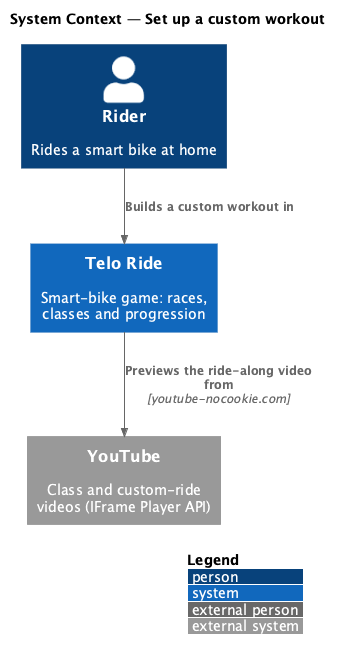
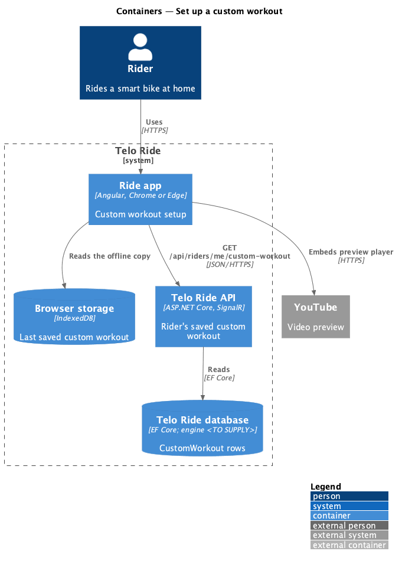
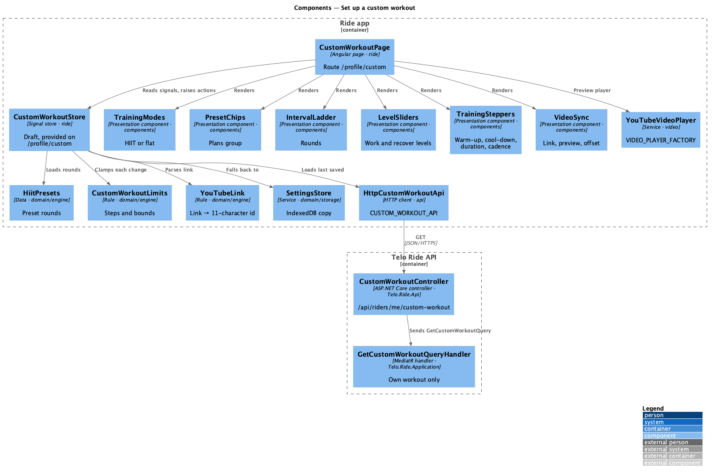
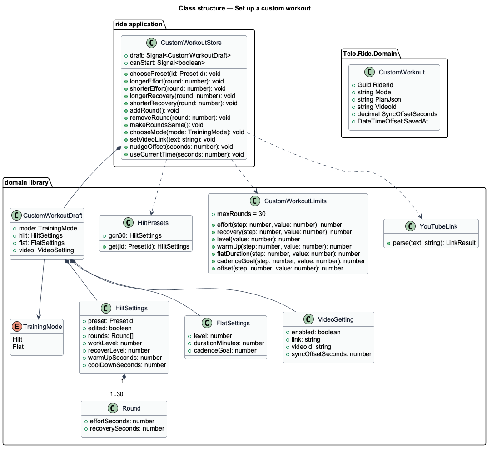
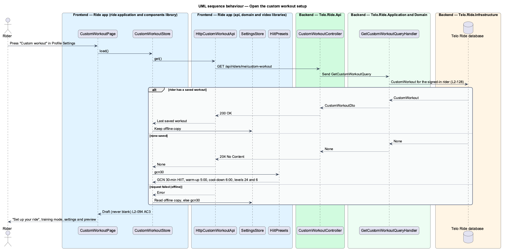
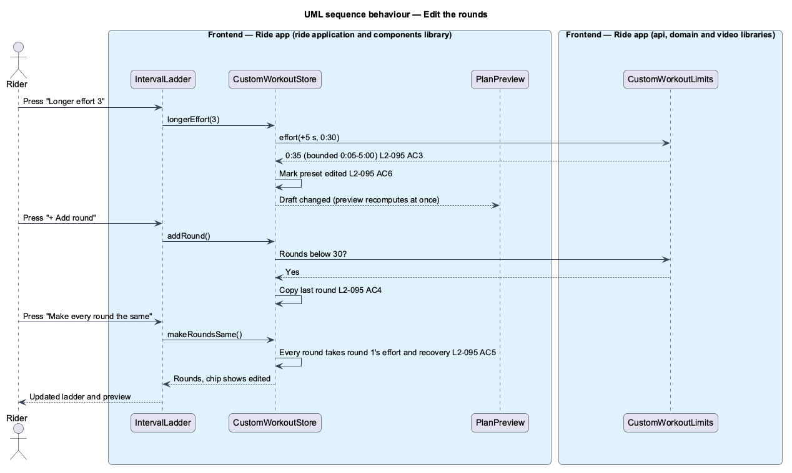
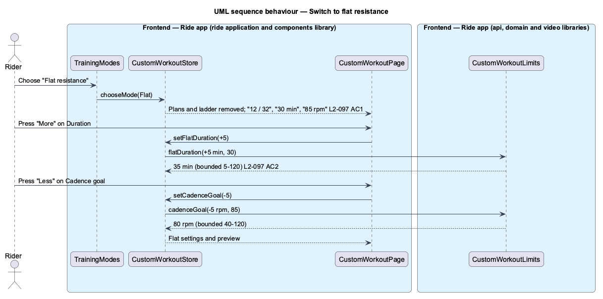
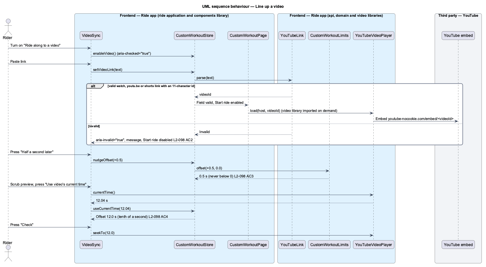

# Set up a custom workout

## Overview

Besides races and classes, a rider may build a ride of their own. Custom workout lives under
Profile, at `/profile/custom`, and opens from Profile's Settings (`L2-112`). The rider picks one
of two training modes, adjusts the plan, and may attach a YouTube video to ride along to. Telo
Ride then drives the bike's resistance through the plan.

> **training mode** — kind of custom plan: HIIT intervals or flat resistance

> **HIIT** — high-intensity interval training: rounds of a hard effort followed by an easier recovery

> **round** — one effort and the recovery after it, each with a duration

> **preset plan** — named starting set of rounds: "GCN 30-min HIIT", "Tabata", "40 / 20", "Minute on", "Long climbs"

> **work resistance** / **recover resistance** — levels (1 to 32) the bike holds during efforts and recoveries

> **flat resistance** — one level held for the whole ride at a cadence goal

> **sync offset** — video time at which the ride clock's 0:00 starts ("Ride 0:00 starts at")

The form never opens blank: it starts from the rider's last saved custom workout, or from the GCN
30-min HIIT plan if there is none (`L2-094` AC3). Every change updates the ride preview at once;
the preview, plan expansion and start are the *preview a custom workout* feature.

## Description

The route `/profile/custom` uses `loadChildren` (`custom-workout.routes.ts`). Its parent route
provides `CustomWorkoutStore`, so the setup screen and, from slice 21.3, the custom ride
(`/profile/custom/ride`) share one draft, and the draft goes when the rider leaves both.

**Frontend — `api` library**

- **`CustomWorkoutDraft`** (`workout/custom-workout.ts`) — `mode` (`hiit` or `flat`), `preset`
  (`gcn30`, `tabata`, `forty-twenty`, `minute-on`, `long-climbs`), `edited`, `rounds` (each an
  `effort` and a `recovery` in seconds), `workLevel`, `recoverLevel`, `warmUp` and `coolDown` in
  seconds, and `flat` (`level`, `minutes`, `cadence`).

**Frontend — `domain` library (`engine/custom-workout.ts`)**

- **`HIIT_PRESETS`** — each plan's name, its ladder title and rounds: GCN 30-min HIIT ("GCN
  30-min HIIT · GCN Training"), eight efforts of 0:30 with recoveries 3:00, 2:30, 2:30, 2:00,
  2:00, 1:30, 1:30 and 1:30 (the last runs into the cool-down); Tabata 8 × 0:20 / 0:15;
  40 / 20 10 × 0:40 / 0:20; Minute on 10 × 1:00 / 1:00; Long climbs 4 × 5:00 / 3:00 (`L2-095`
  AC7), the others titled "· Telo Ride".
- **`newCustomWorkout()`** — GCN 30-min HIIT, work 24, recover 6, warm-up 5:00, cool-down 6:00,
  flat level 12 for 30 min at 85 rpm.
- **Edits**, pure functions of a draft with `CUSTOM_WORKOUT_LIMITS`: `choosePreset`,
  `chooseMode`, `stepEffort` (±0:05 within 0:05 to 5:00), `stepRecovery` (±0:15 within 0:15 to
  10:00), `addRound` (a copy of the last, up to 30), `removeRound` (down to one),
  `makeRoundsSame`, `setLevel` (1 to 32), `stepWarmUp` and `stepCoolDown` (±1:00 within 0:00 to
  20:00), `stepFlatMinutes` (±5 within 5 to 120) and `stepFlatCadence` (±5 within 40 to 120).
  Every edit of a round marks the draft `edited`; choosing a plan clears it.

**Frontend — `components` library**

- **`TrainingHeader`** (`wz-training-header`) — the lockup, the bike name, its projected Close
  link (`a[wz-training-close]`) and Full screen.
- **`TrainingModes`** (`wz-training-modes`) — radio group "Training mode": "HIIT intervals" and
  "Flat resistance" with their descriptions, arrow keys moving the choice.
- **`PresetChips`** (`wz-preset-chips`) — group "Plans"; the chosen chip `aria-pressed="true"`,
  reading "· edited" after its name once changed.
- **`IntervalLadder`** (`wz-interval-ladder`) — the ladder block's title and "Make every round
  the same", then a row per round with its mini-steppers ("Shorter effort N", "Longer effort N",
  "Shorter recovery N", "Longer recovery N") and "Remove round N"; the last round reads "Into
  cool-down"; "Add round". A button at its bound is disabled.
- **`LevelSlider`** (`wz-level-slider`) — label, "24 / 32", a range from 1 to 32 and "Light …
  Max"; the rest and large variants.
- **`TrainingStepper`** (`wz-training-stepper`) — a group named by its label, "Less" and "More"
  ("Less Warm-up", "More Warm-up") around its value.

**Frontend — `ride` application**

- **`CustomWorkoutStore`** — the draft as a signal, and one method per edit.
- **`CustomWorkoutPage`** (`/profile/custom`) — the header, "Set up your ride", the lead, the
  training mode, then HIIT's plans, ladder, level sliders, warm-up and cool-down, or flat's
  resistance level, duration, cadence goal and its note.

**Later slices.** The "Your ride" preview and Start ride (`L2-099`, `L2-100`) are slice 21.2.
The video section (`L2-098`), the saved workout it opens from (`L2-094` AC3's "last saved",
through `CUSTOM_WORKOUT_API`) and the ride are slice 21.3, where Start ride first saves a
workout and a ride plays the video.

## Requirements

| L2 ID | Refines (L1) | Requirement |
|-------|--------------|-------------|
| `L2-094` | `L1-016` | Custom workout (`/profile/custom`) shall open from Profile's Settings with the lockup, the bike name, "Close" (to Profile) and Full screen, and read "Set up your ride" and "Telo Ride drives the bike's resistance for you. Pick how." "Training mode" shall be a radio group of "HIIT intervals" ("Hard and easy efforts on repeat. Resistance switches at every interval.") and "Flat resistance" ("One level, held the whole ride. You set the pace with your legs."). The form shall start from the GCN 30-min HIIT plan, never blank, or from the rider's last saved custom workout. At lg or wider settings and preview shall be two independently scrolling columns; at sm or wider the mode cards and steppers shall go two across. |
| `L2-095` | `L1-016` | The chips "GCN 30-min HIIT", "Tabata", "40 / 20", "Minute on" and "Long climbs" shall form a group "Plans" with the chosen one `aria-pressed="true"`, and choosing one shall load its rounds. GCN 30-min HIIT shall read "GCN 30-min HIIT · GCN Training" and list eight efforts of 0:30 with recoveries 3:00, 2:30, 2:30, 2:00, 2:00, 1:30 and 1:30, round 8 reading "Into cool-down". Effort shall move by 0:05 within 0:05 to 5:00 and recovery by 0:15 within 0:15 to 10:00. "+ Add round" shall copy the last round, up to 30; "Remove round N" shall remove it, down to one. "Make every round the same" shall give every round round 1's effort and recovery. Any change shall show the chip as edited and update the preview at once. |
| `L2-096` | `L1-016` | "Work resistance" shall read "24 / 32" and "Recover resistance" "6 / 32", each a range from 1 to 32 labelled "Light … Max", 24 px tall. "Warm-up" shall read 5:00 and "Cool-down" 6:00, moving by 1:00 within 0:00 to 20:00. The expanded warm-up shall run at level 8 with a cadence aim of 80 rpm, and the cool-down at the recover level. |
| `L2-097` | `L1-016` | Choosing "Flat resistance" shall remove the plans and ladder and show "Resistance level" "12 / 32", "Duration" "30 min" and "Cadence goal" "85 rpm", with "You can still nudge the level mid-ride from the dashboard." Duration shall move by 5 min within 5 to 120 min and cadence goal by 5 rpm within 40 to 120. The expanded flat plan shall be one steady segment at the chosen level and cadence goal for the whole duration. |
| `L2-098` | `L1-016` | With "Ride along to a video" on (`aria-checked="true"`), a "YouTube link" field, a preview player, "Ride 0:00 starts at", "Use video's current time" and "Check" shall show. A link that is not a `youtube.com/watch?v=`, `youtu.be/` or `youtube.com/shorts/` address with an 11-character video id shall mark the field invalid with a message and disable Start ride. "Half a second earlier" and "Half a second later" shall move the offset by 0.5 s, never below 0. "Use video's current time" shall set the offset to the preview's current time to a tenth of a second, and "Check" shall seek the preview to the offset. The help text shall read "Scrub the preview past the intro to the moment the warm-up begins, then use that time. The video skips to it when you start, and pauses and resumes with the ride." With the switch off, the ride shall have no video and its main view shall open on "Power vs. plan". |

## Diagrams

### System context

The rider builds a custom workout in Telo Ride and may preview a YouTube video to line up its
start.

### Containers

The Ride app loads the rider's last saved workout from the Telo Ride API and keeps a copy in
browser storage. The video preview comes from YouTube.

### Components

`CustomWorkoutPage` renders the form from `CustomWorkoutStore`. The store applies
`CustomWorkoutLimits`, loads presets from `HiitPresets` and checks links with `YouTubeLink`.

### Class structure

`CustomWorkoutDraft` holds either HIIT settings (rounds, levels, warm-up, cool-down) or flat
settings, and an optional `VideoSetting`. The backend's `CustomWorkout` mirrors it per rider.

### Behaviour — open the setup

The store loads the last saved workout from the backend, falls back to the device copy, and then
to the GCN 30-min HIIT preset (`L2-094` AC3).

### Behaviour — edit the rounds

Each ladder action applies its step and bound, marks the preset edited and recomputes the
preview (`L2-095`).

### Behaviour — switch to flat resistance

Flat mode swaps the plans and ladder for three settings with their own steps (`L2-097`).

### Behaviour — line up a video

The link is parsed to a video id; only a valid id loads the preview player. The offset is
nudged, captured from the preview or checked against it (`L2-098`).

## Open questions

1. **The other plans.** Their rounds are settled in `L2-095` AC7. Tabata's recoveries are 0:15,
   not the classic 0:10, since no recovery is shorter than 0:15.
2. **The edited mark.** "· edited" after the chosen chip's name, as `custom-setup/edited` draws it.
3. **Slider height.** `L2-096` AC1 draws the ranges 24 px tall; they are 44 px tall here, as every
   other range in the app, for touch.
4. **Ladder buttons.** The mini-steppers are 28 px and the remove button 32 px, as drawn; each
   takes touches across 44 px around it.
