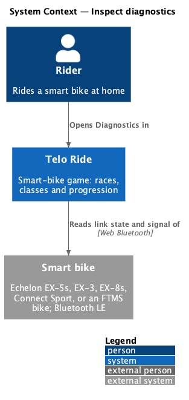
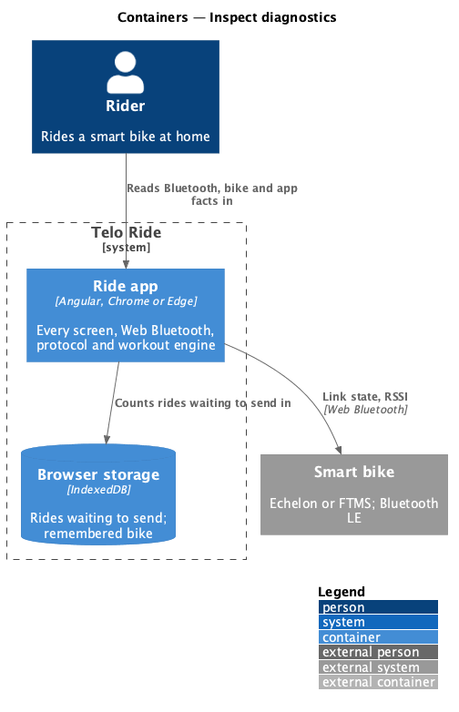
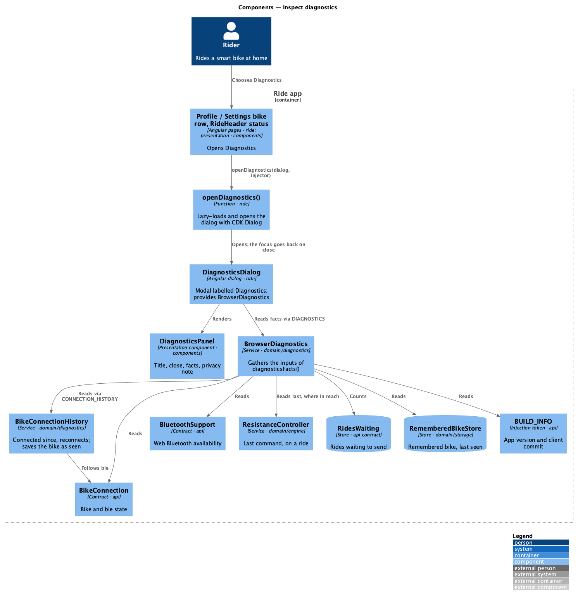
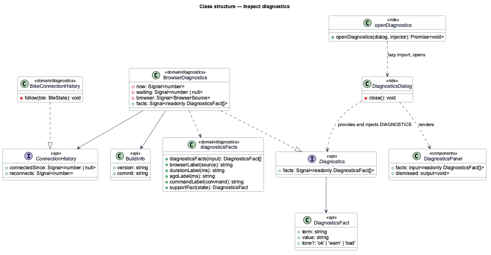
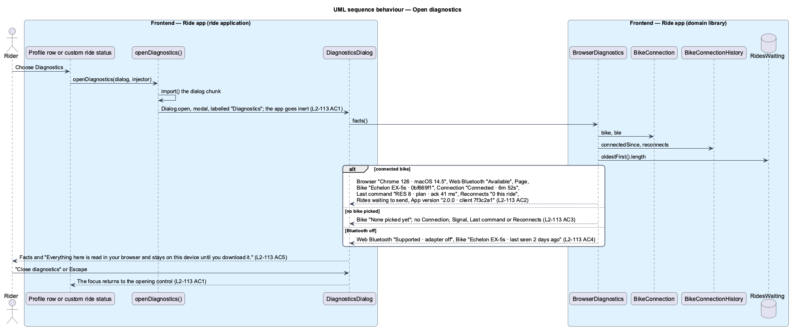

# Inspect diagnostics

## Overview

When a ride goes wrong, the cause usually sits between the browser, the Bluetooth radio and the bike. Telo Ride gives the rider one place to see the state of all three, without a network and without sending anything anywhere. This feature is the Diagnostics dialog: a read-only summary of the browser, Web Bluetooth, the bike link and the app, opened from Profile or from the custom ride's bike status.

The following terms are used in this design:

- **Diagnostics** — modal dialog that lists facts about the browser, Bluetooth, the bike and the app, and holds the packet log controls
- **fact** — one labelled value in the dialog, such as Browser "Chrome 126 · macOS 14.5"
- **RSSI** — received signal strength indicator of the bike's advertisements, in dBm, available only where the browser reports it
- **rides waiting to send** — finished rides kept on the device until the backend has recorded them (`L2-135`)

The dialog's lower half, the packet log switch and download, belongs to [record-the-packet-log](../record-the-packet-log/README.md). Every fact is read in the browser and stays on the device; the only way a fact leaves is in a feedback report the rider sends with diagnostics attached ([feedback/send-feedback](../../feedback/send-feedback/README.md)).

## Description

The slice lives in the Ride app. No backend takes part.

- **`openDiagnostics(dialog, injector)`** — function in `ride`'s `diagnostics/`. It loads the dialog's chunk with a dynamic `import()` and opens `DiagnosticsDialog` through the CDK `Dialog` service with the opener's injector, so the dialog adds nothing to the screens that offer it and, on a ride, reaches its `ResistanceController`. Three controls call it:
  - Profile's bike row and the Settings Bike section's row, which become buttons (`aria-haspopup="dialog"`) once a bike is paired; with none they still go to Connect Bike to pair one;
  - the custom ride's bike status, now a button with `aria-label` "Diagnostics: {bike} {state}" and title "Diagnostics" ([bike/keep-the-bike-connected](../../bike/keep-the-bike-connected/README.md)); `RideHeader` emits `diagnostics`.
- **`DiagnosticsDialog`** — dialog component in `ride`, a layer over a scrim (the mock's `diagnostics-layer`). It provides its own `BrowserDiagnostics`, released when it closes, and renders `DiagnosticsPanel`. It is modal and labelled by the panel's title. The CDK traps the focus and closes it on Escape; "Close diagnostics" closes it too. The routes that open it provide `provideInertBehindDialogs()` (Profile, Settings, the custom ride), which makes the app inert behind it and gives the focus back to the control that opened it.
- **`DiagnosticsPanel`** — presentation component in `components` (block `diagnostics`): the title "Diagnostics" (`id="diagnostics-title"`), "Close diagnostics", each fact as a `dt` and a `dd` (rendered as text, never as HTML; a tone as `data-tone`, the words always saying it too), and the privacy note "Everything here is read in your browser and stays on this device until you download it.". Slice 25.2 adds the packet log below.
- **`Diagnostics`** — contract in `api` with token `DIAGNOSTICS`, exposing `facts` as a signal of `DiagnosticsFact` (term, value, optional tone).
- **`diagnosticsFacts(input)`** — pure function in `domain`'s `diagnostics/`, with table tests, and the labels it uses (`browserLabel`, `durationLabel`, `agoLabel`, `commandLabel`, `supportFact`). In order:
  - Browser, "Chrome 126 · macOS 14.5": from the client hints where the browser gives them (the brand and the high-entropy `platformVersion`), else the user-agent string (which freezes macOS at 10.15);
  - Web Bluetooth: "Available", "Supported · adapter off", "Needs a secure (https) page" or "Not in this browser";
  - Page, the address;
  - with a bike the connection knows and Bluetooth on: Bike "Echelon EX-5s · 0bf669f1" (the name and the first part of its service, as "Sent to bike" names the link), Connection "Connected · 6m 52s" (or "Connecting", "Disconnected", "Not connected"), Last command "RES 8 · plan · ack 41 ms" ("None sent yet" off a ride) and Reconnects "0 this ride";
  - without one, Bike reads the remembered bike and when it was last seen, "Echelon EX-5s · last seen 2 days ago", or "None picked yet", and the link facts are absent;
  - Rides waiting to send, once counted, and App version "2.0.0 · client 7f3c2a1".
  Signal is never shown: no browser this app runs in reports the strength of a connected bike (Web Bluetooth gives RSSI only while watching advertisements).
- **`BrowserDiagnostics`** — implementation in `domain`'s `diagnostics/`. It gathers the input: `navigator` and its client hints; `BluetoothSupport`; `location.href`; `BikeConnection`; `ConnectionHistory`; `ResistanceController.last`, where the opener's injector has one; `RidesWaiting.oldestFirst()`, counted once; `RememberedBike.get()` and `lastSeen()`; `BUILD_INFO`. Its clock ticks each second for Connection and stops when the dialog closes.
- **`ConnectionHistory`** — contract in `api` (token `CONNECTION_HISTORY`), implemented by `BikeConnectionHistory` in `domain`'s `diagnostics/` and started on the app's parent route, so it follows the link from the first screen. It notes when the link connected, counts each return to `connected` after a drop, starts again when the link goes `idle`, and saves the remembered bike again each time it connects.
- **`RememberedBike.lastSeen()`** — `save()` now records `seenAt`; `lastSeen()` reads it, or a record's `pairedAt` from before this slice.
- **`BUILD_INFO`** — injection token in `api` holding the app version and the client commit, bound on the app's lazy parent route (importing the `api` barrel in `app.config.ts` cost the initial bundle 3.85 kB) from build-time constants: angular.json's `define` sets `TELO_VERSION` ("2.0.0") and `TELO_COMMIT` ("dev"), and the deploy builds with `--define TELO_COMMIT` set to the short commit.

A read-only FTMS bike's "Read only" explanation (`L2-014`) is not shown yet; its wording is `<TO SUPPLY>`.

## Requirements

The feature realizes the following level-2 (L2) requirements. Each L2 requirement refines a level-1 (L1) requirement, cited by identifier.

| L2 ID | Refines (L1) | Requirement |
|-------|--------------|-------------|
| `L2-113` | `L1-018` | Diagnostics, opened from Profile or the custom ride's bike status, shall be a modal dialog labelled "Diagnostics"; the page behind shall be inert, and close ("Close diagnostics", or Escape) shall return focus to what opened it. With a connected bike the facts shall read Browser "Chrome 126 · macOS 14.5"; Web Bluetooth "Available"; Page, Bike "Echelon EX-5s · 0bf669f1" and Connection "Connected · 6m 52s"; Signal (RSSI in dBm, where the browser reports it); Last command "RES 8 · plan · ack 41 ms" and Reconnects "0 this ride"; Rides waiting to send, and App version "2.0.0 · client 7f3c2a1". With no bike picked, Bike shall read "None picked yet" and Connection, Signal, Last command and Reconnects shall be absent. With Bluetooth off, Web Bluetooth shall read "Supported · adapter off" and Bike "Echelon EX-5s · last seen 2 days ago". The dialog shall read "Everything here is read in your browser and stays on this device until you download it." |

## Diagrams

### System context

The rider opens Diagnostics in Telo Ride, which reads the bike's link state and signal over Web Bluetooth.

### Containers

Every fact comes from the Ride app, the bike link and browser storage. Nothing reaches the backend.

### Components

The opening control calls `openDiagnostics()`, which lazy-loads and opens `DiagnosticsDialog`. The dialog reads its own `BrowserDiagnostics` through `DIAGNOSTICS`, which gathers facts from the bike connection and its history, Bluetooth support, the ride's last command, the rides waiting to send, the remembered bike and the build information.

### Class structure

`BrowserDiagnostics` realizes `Diagnostics` and formats its values with `diagnosticsFormat`. `DiagnosticsFacts` marks the four bike-link facts optional, since they are absent with no bike picked.

### Behaviour — open diagnostics

Opening Diagnostics lazy-loads the dialog and makes the page behind inert. The facts depend on the state: connected, no bike picked, or Bluetooth off (`L2-113`). Closing returns focus to the control that opened the dialog.

