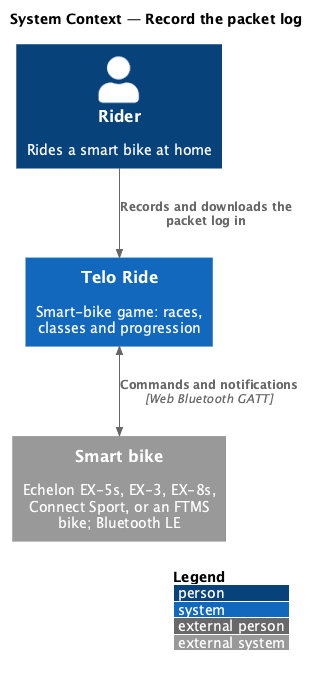
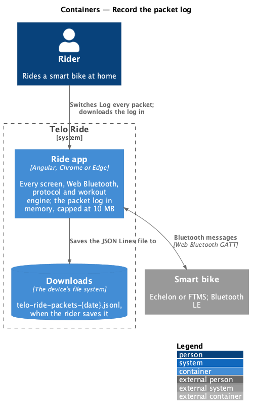
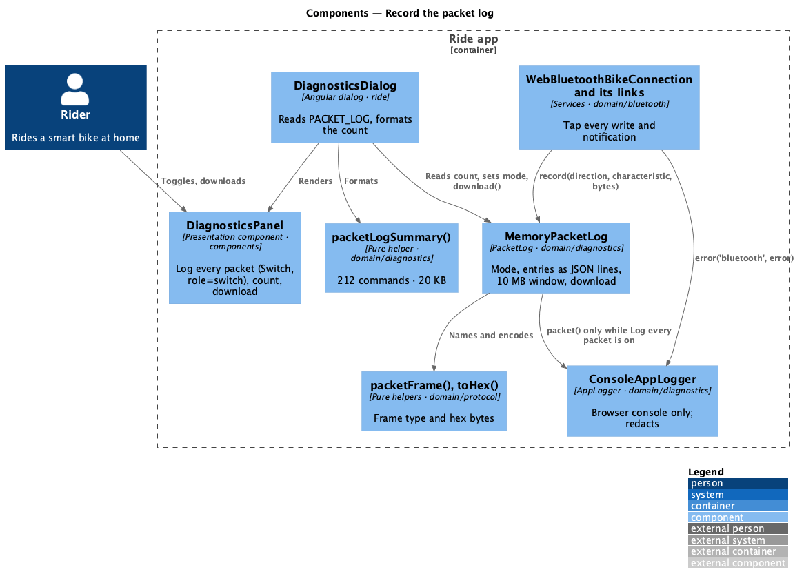
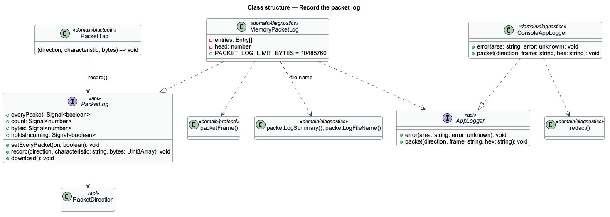
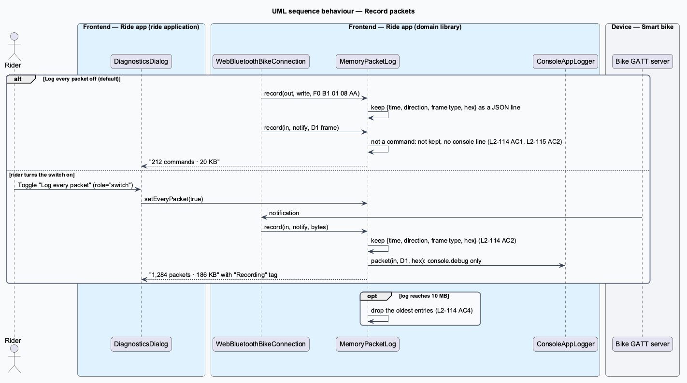
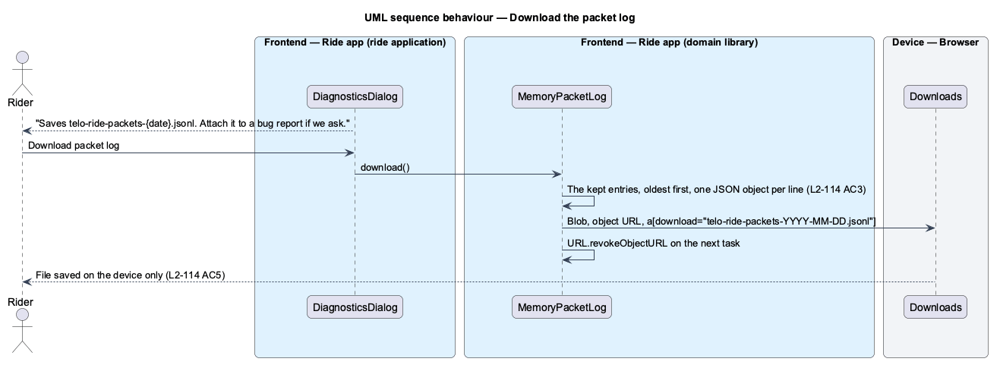
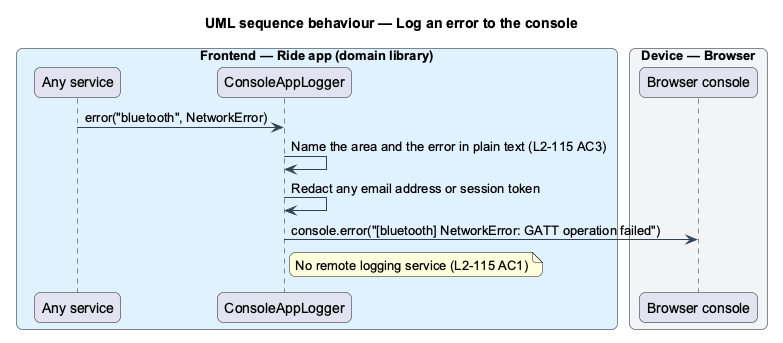

# Record the packet log

## Overview

Some bike problems show only in the bytes: a frame the bike stops sending, a command it never acknowledges, a drop after a particular write. Telo Ride lets the rider record every Bluetooth message while reproducing a problem and download that record as a file. The record stays on the device unless the rider attaches it to a feedback report. This feature is the packet log and its console counterpart.

The following terms are used in this design:

- **packet** — one Bluetooth message between the app and the bike, in either direction: a command written to the bike or a notification from it
- **command** — packet the app writes to the bike, such as set resistance or keepalive
- **packet log** — on-device record of packets: commands only by default, every packet while "Log every packet" is on
- **JSON Lines** — text format with one JSON object per line, used for the downloaded file `telo-ride-packets-{YYYY-MM-DD}.jsonl`
- **console logging** — messages the app writes to the browser's developer console, and nowhere else

The switch, the count and the download sit in the lower half of the Diagnostics dialog ([inspect-diagnostics](../inspect-diagnostics/README.md)). The "Sent to bike" log on Custom ride shows the last 50 commands; older commands remain in the packet log ([bike/control-resistance](../../bike/control-resistance/README.md)). Attaching the log to a report belongs to [feedback/send-feedback](../../feedback/send-feedback/README.md) (`L2-117`).

## Description

The slice lives in the Ride app. No backend takes part.

- **`PacketLog`** — contract in `api` with token `PACKET_LOG`, bound with the bike connection on the app's lazy parent route (`provideBikeConnection()`), so one log serves every screen. It exposes `everyPacket`, `count`, `bytes` and `holdsIncoming` as signals, `setEveryPacket(on)`, `record(direction, characteristic, bytes)` and `download()`.
- **`PacketTap`** — the Bluetooth links hand each message to the log: `EchelonLink` and `FtmsLink` call it as each write goes out (inside the write queue, so the log's order is the bike's), and `WebBluetoothBikeConnection` (with `FtmsLink` for Control Point indications) as each notification arrives. The simulated bike sends no packets, so its log stays empty.
- **`MemoryPacketLog`** — implementation in `domain`'s `diagnostics/`. Each kept packet becomes one JSON line, `{"time","direction","frame","hex"}`: an ISO time; `out` to the bike or `in` from it; the frame type from `packetFrame()` in `protocol/` (an Echelon frame's command byte such as `B1` or `D1`, or the FTMS characteristic's name); the bytes as upper-case hex pairs (`toHex()`). With "Log every packet" off, the default, it keeps commands and drops the bike's messages; with it on, every packet both ways, each also sent to `AppLogger.packet()`. The lines sit in a window of at most 10 MB in memory that drops the oldest first, so a ride of any length holds a bounded log, and the log does not survive a reload. `download()` builds a JSON Lines `Blob` from the kept lines, clicks a temporary link named `telo-ride-packets-{YYYY-MM-DD}.jsonl` by the device's date, and revokes the object URL on the next task.
- **`packetLogSummary()`, `packetLogFileName()`** — pure helpers in `domain`'s `diagnostics/`, with unit tests. The count line reads "212 commands · 20 KB" while only commands are kept, and "1,284 packets · 186 KB" once the bike's messages are among them, with a "Recording" tag (a dot and the word) while the switch is on. The size is whole kilobytes, rounded up, then megabytes.
- **`DiagnosticsPanel`** gains the packet log under the facts (block `diagnostics`, elements `log`, `switch-row`, `well`, `count`, `recording`, `file`): "Log every packet" is the `Switch` (`button[wz-switch]`, `role="switch"`), labelled by the label and described by "Records each Bluetooth message, not just the commands we send. Turn on while reproducing a problem — it uses memory."; then the count, "Download packet log" (`wz-button`, raised, small), and "Saves telo-ride-packets-{date}.jsonl. Attach it to a bug report if we ask.". `DiagnosticsDialog` reads `PACKET_LOG` and passes the summary, the switch and the file name in.
- **`AppLogger`** — contract in `api` with token `APP_LOGGER`: `error(area, error)` and `packet(direction, frame, hex)`.
- **`ConsoleAppLogger`** — implementation in `domain`'s `diagnostics/`, bound on the parent route with the bike connection (not in `app.config.ts`, which would put it in the initial bundle). It writes to the browser console only; no remote logging service exists. An error reads "[bluetooth] NetworkError: GATT operation failed", and `redact()` takes out any email address, bearer token, JWT or token in a query before it is written. Packet lines go to `console.debug`, and only while "Log every packet" is on. The Web Bluetooth bike connection and heart rate strap log their errors through it.

The packet log leaves the device only inside a feedback report the rider sends with diagnostics attached.

## Requirements

The feature realizes the following level-2 (L2) requirements. Each L2 requirement refines a level-1 (L1) requirement, cited by identifier.

| L2 ID | Refines (L1) | Requirement |
|-------|--------------|-------------|
| `L2-114` | `L1-018` | With "Log every packet" (`role="switch"`) off, only commands shall be kept and the count shall read "212 commands · 20 KB". With the switch on, every message in both directions shall be kept and the count shall read "1,284 packets · 186 KB" with a "Recording" tag. "Download packet log" shall save `telo-ride-packets-{YYYY-MM-DD}.jsonl` with one JSON object per message (time, direction, frame type, hex bytes), and the dialog shall read "Saves telo-ride-packets-{date}.jsonl. Attach it to a bug report if we ask.". When the log reaches 10 MB, the oldest entries shall be dropped. The packet log shall never leave the device except in a feedback report the rider sends with diagnostics attached (L2-117). |
| `L2-115` | `L1-018` | The app shall log to the browser console only, with no remote logging service. With "Log every packet" off, no per-packet line shall be written to the console. A logged error shall name the area and the error in plain text and hold no email or session token. |

## Diagrams

### System context

The rider records and downloads the packet log in Telo Ride, which captures the commands and notifications it exchanges with the bike.

### Containers

The Ride app keeps the packet log in memory, capped at 10 MB. The downloaded file is saved on the device.

### Components

The Bluetooth links pass every packet to `MemoryPacketLog`, which keeps it according to the mode in its 10 MB window and saves the file on download. `ConsoleAppLogger` receives per-packet lines only while "Log every packet" is on.

### Class structure

`MemoryPacketLog` realizes `PacketLog`, naming each frame with `packetFrame()`. `ConsoleAppLogger` realizes `AppLogger` and redacts before it writes.

### Behaviour — record packets

With the switch off, commands are kept and notifications are not, and the console stays quiet. With it on, every packet is kept and echoed to the console. Past 10 MB, the oldest entries go (`L2-114`, `L2-115`).

### Behaviour — download the packet log

The exporter streams every entry into a JSON Lines file named for the day, triggers the download, and revokes the object URL (`L2-114`).

### Behaviour — log an error to the console

A service reports an error with its area. The logger writes it in plain text to the browser console, with any email address or session token redacted (`L2-115`).

## Open questions

- **In memory, not IndexedDB.** The log is a bounded 10 MB window in memory rather than an IndexedDB store: AGENTS.md allows a fixed-size or windowed buffer, a rider's hour of every packet stays far below the cap (about 1.5 MB at four notifications a second), and nothing then needs a schema or a clean-up. It does not survive a reload; a log of a crash that reloads the page would need the store.
- **The switch is not remembered.** "Log every packet" starts off each time the app starts, rather than persisting through the ride settings: it uses memory, and a rider who forgot it on would record every ride.
- **The switch's off colour.** The design system draws the off switch in `--color-line` inside the dialog by styling the `switch` block from `diagnostics`; AGENTS.md forbids styling another component's block, so the off switch keeps the `switch` block's own `--color-raised`.
