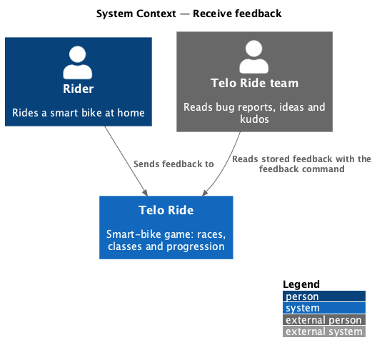
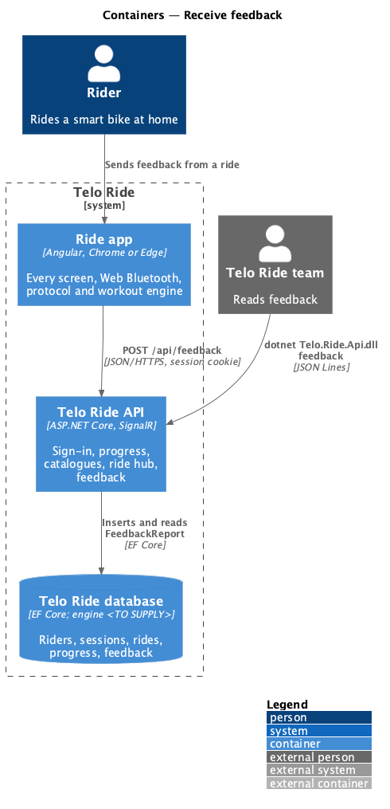
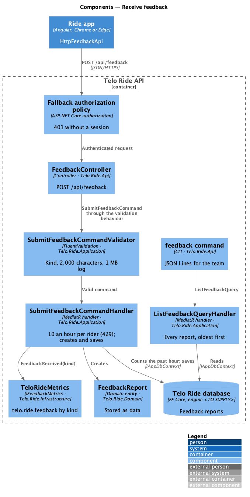
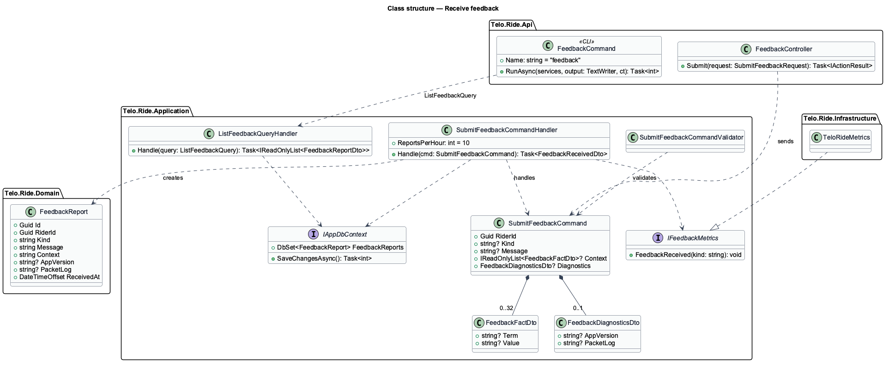
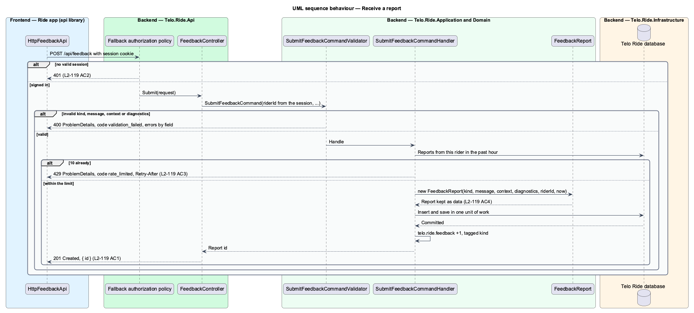

# Receive feedback

## Overview

Feedback a rider sends from a ride (`feedback/send-feedback`) reaches the Telo Ride team through
the backend. This feature covers the backend side: the endpoint that accepts a report, the checks
it applies, and how the report is stored so the team can read it safely.

**feedback report** — stored record of one piece of feedback: its kind, message, ride context,
optional diagnostics, the rider's account and the time it arrived

**rate limit** — cap on how many reports one rider may send in an hour; past it the API answers 429

A signed-in rider posts a report to `POST /api/feedback`. The API stores it with its kind,
message, context, optional diagnostics, the rider's account and the time, and answers 201 with the
report's id. A request without a session is refused with 401. A rider who has sent 10 reports in
the past hour is refused with 429. The message and context are kept as data; nothing in Telo Ride
renders them as HTML. The team reads stored reports with the API's `feedback` command, which
writes them as JSON Lines, each naming its rider by id and never by a contact detail.

## Description

- **`FeedbackController.Submit`** — `Telo.Ride.Api` action for `POST /api/feedback`. It carries no
  `[AllowAnonymous]`, so the fallback authorization policy refuses a request without a valid
  session with 401 (`L2-119` AC2). `[RequestSizeLimit]` admits 2 MB, room for 1 MB of packet log
  escaped as JSON beside the message and context; the rest of the API keeps the server's default.
  It sends one `SubmitFeedbackCommand` with the rider id from the session and answers 201 with
  `{ "id": … }`.
- **`SubmitFeedbackCommand`** — `Telo.Ride.Application` request: `RiderId`, `Kind`, `Message`,
  `Context` (a list of `FeedbackFactDto`, `term` and `value`, as the app shows them under "Attached
  from Ride") and optional `Diagnostics` (`FeedbackDiagnosticsDto`: `AppVersion`, `PacketLog`). The
  rider id comes from the session, never from the body.
- **`SubmitFeedbackCommandValidator`** — FluentValidation validator, run by `ValidationBehavior`.
  `Kind` is `bug`, `improvement` or `kudos`; `Message` is at most 2,000 characters and not only
  spaces; `Context` holds at most 32 facts, each a term of up to 40 characters and a value of up
  to 200; `Diagnostics` is accepted for `bug` only, with an app version of up to 64 characters and
  a packet log of at most 1,048,576 characters. A breach is the API's usual 400 ProblemDetails,
  `code` `validation_failed`, with `errors` keyed by the field as the app sends it
  (`diagnostics.packetLog`, `context[0].value`); `ValidationBehavior` now camel-cases every
  segment of a nested name.
- **`SubmitFeedbackCommandHandler`** — counts the rider's reports received in the past hour; at
  10 it throws `DomainRuleException` `rate_limited` (`RuleKind.TooManyRequests`), which the API
  answers with 429 and a `Retry-After` of the seconds until the hour's first report falls out of it
  (`L2-119` AC3). This is the pattern of the ride limit (`security/limit-abuse`): the count is of
  stored rows, so it holds across API instances and runs on `TimeProvider`. Otherwise it creates a
  `FeedbackReport` with the rider id and `TimeProvider.GetUtcNow()`, saves it through
  `IAppDbContext` (`L2-119` AC1), and counts it on `IFeedbackMetrics`.
- **`FeedbackReport`** — entity in `Telo.Ride.Domain`: `Id`, `RiderId`, `Kind`, `Message`,
  `Context` (the facts as JSON), `AppVersion` and `PacketLog` (both null without diagnostics),
  `ReceivedAt`. Message and context are stored exactly as received (`L2-119` AC4). Table
  `FeedbackReports`, indexed on rider and time, deleted with its rider (migration
  `FeedbackReports`).
- **Account erasure** — `ErasePendingAccountsCommandHandler` removes a deleted rider's feedback
  with the rest of its data (`L2-006` AC3).
- **`feedback` command** — `dotnet Telo.Ride.Api.dll feedback` sends one `ListFeedbackQuery` and
  writes every report, oldest first, to standard output as JSON Lines: id, rider id, kind, message,
  context, app version, packet log and time received. Message and context are JSON strings, so a
  reader sees them as text. It exits 0, or 1 on failure, as `migrate` does.
- **Telemetry** — `TeloRideMetrics` implements `IFeedbackMetrics` with the counter
  `telo.ride.feedback`, tagged by `kind` alone. No log, metric or span carries the message, the
  context, the packet log or the rider's email (`AGENTS.md`); `FeedbackTelemetryTests` proves it.

## Requirements

The feature realizes the following level-2 (L2) requirements. Each L2 requirement refines a
level-1 (L1) requirement, cited by identifier.

| L2 ID | Refines (L1) | Requirement |
|-------|--------------|-------------|
| `L2-119` (AC1) | `L1-019` | When a signed-in rider posts feedback, the backend shall store it with its kind, message, context, optional diagnostics, the rider's account and the time, and the API shall answer 201. |
| `L2-119` (AC2) | `L1-019` | The backend shall refuse feedback posted without a session with 401. |
| `L2-119` (AC3) | `L1-019` | The backend shall refuse a report with 429 when one rider has sent more than 10 reports in an hour. |
| `L2-119` (AC4) | `L1-019` | The backend shall keep a report's message and context as data and shall never render them as HTML anywhere. |

## Diagrams

### System context

The rider's report travels through Telo Ride to the Telo Ride team, who read it with the API's
`feedback` command.

### Containers

The Ride app posts the report to the Telo Ride API, which stores it in the Telo Ride database.

### Components

Authorization runs before `FeedbackController`; the controller sends one command, which is
validated and then handled, the hourly limit checked against the stored reports. The `feedback`
command reads them back for the team.

### Class structure

`SubmitFeedbackCommandHandler` handles `SubmitFeedbackCommand`, validated by
`SubmitFeedbackCommandValidator`, and creates a `FeedbackReport`.

### Behaviour — receive a report

A request is refused with 401 without a session, with 400 when it is not feedback and with 429
past the limit; otherwise it is stored and answered with 201 (`L2-119`).

## Open questions

- **Rate limit in the handler.** The design first named ASP.NET Core's rate limiter, partitioned
  in process memory. Slice 26.2 counts stored reports instead, as the ride limit does, so the
  limit holds across instances and its tests advance `FakeTimeProvider`.
- **How the team reads feedback.** The `feedback` command writes JSON Lines from a shell with the
  database's connection string. A tool, a notification or an export elsewhere is not specified.
- **Retention.** Reports and their packet logs are kept until the rider's account is erased; a
  shorter retention is not specified.
