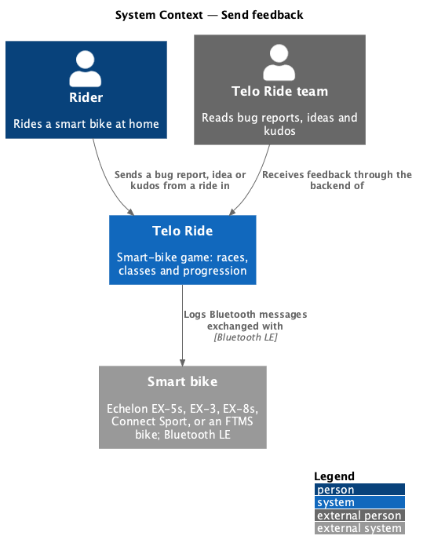
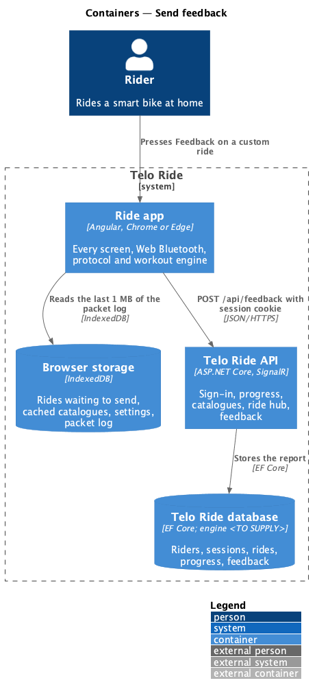
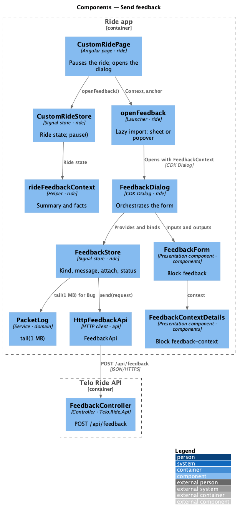
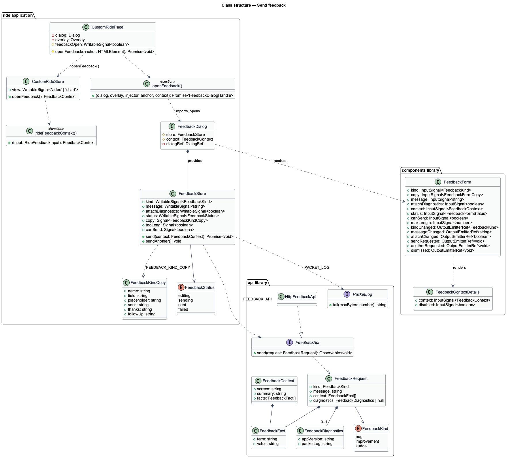
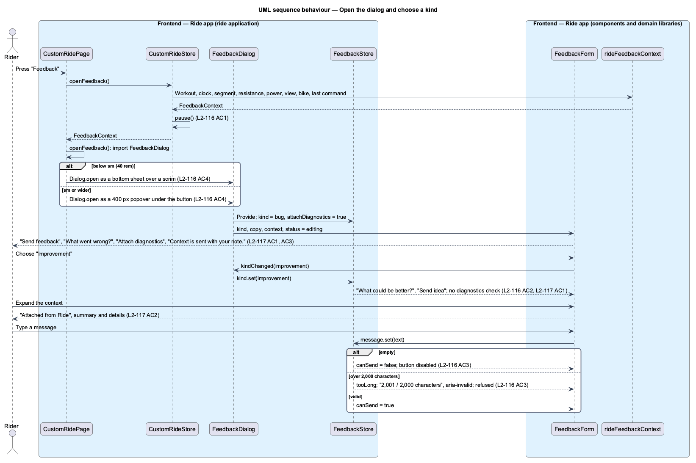
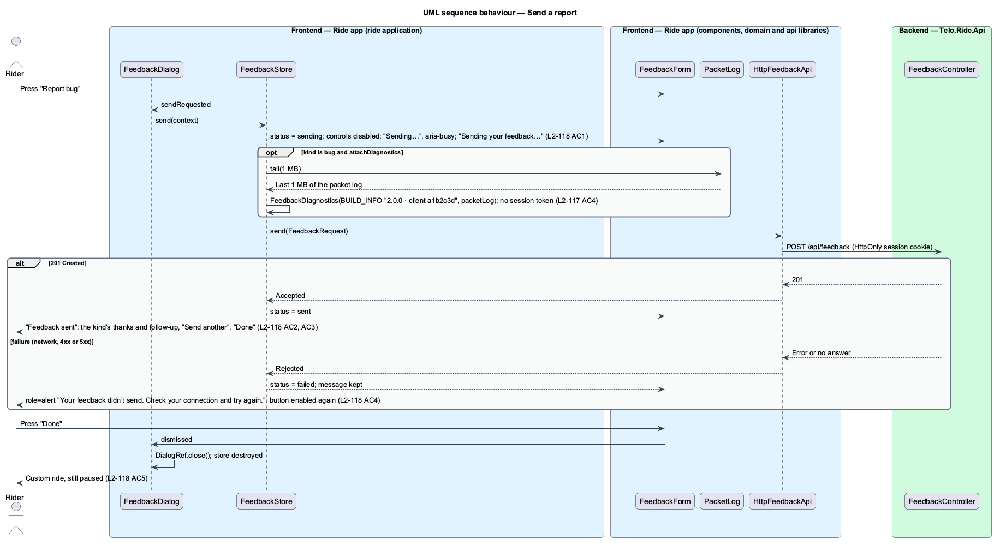

# Send feedback

## Overview

Telo Ride is in active development, and the people riding it see problems and ideas first. This
feature lets a rider send a bug report, an idea or kudos from the middle of a custom ride without
losing their place: the ride pauses, a small dialog takes the note, and the ride stays paused when
the dialog closes.

**feedback** — note from a rider to the Telo Ride team, of one of three kinds: Bug, Improvement or
Kudos

**ride context** — snapshot of the ride's state when the dialog opened: workout, elapsed time,
segment, resistance, plan level, cadence, power, heart rate, distance, state, view, machine,
Bluetooth and last command

**diagnostics** — the last 1 MB of the Bluetooth packet log and the app version, attached to a bug
report so the team can reproduce it

**packet log** — on-device record of every Bluetooth message to and from the bike
(`diagnostics/record-the-packet-log`)

The rider presses "Feedback" in the custom ride header. The ride pauses and the "Send feedback"
dialog opens: a bottom sheet on a phone, a 400 px popover under the button from sm. The rider picks
a kind, writes a message of up to 2,000 characters and sends it. A bug report attaches diagnostics
by default. Every report carries the ride context. The backend side of the slice is
`feedback/receive-feedback`.

## Description

**Frontend (Ride app)**

- **`CustomRidePage`** — `ride` page. `RideHeader`'s "Feedback" button (`ride-header__link--feedback`,
  `aria-haspopup="dialog"`, `aria-expanded` while open) emits itself as the anchor. The page asks
  `CustomRideStore.openFeedback()` for the ride's context, which reads the ride as it stands and then
  pauses it (`L2-116` AC1), and opens Send feedback with `openFeedback()` (`L2-116` AC4). Closing
  the dialog leaves the ride paused (`L2-118` AC5); leaving the page closes it.
- **`openFeedback()`** — `ride` launcher that imports `FeedbackDialog` only when the rider presses
  Feedback, then opens it through the CDK `Dialog` service with `ariaLabelledBy: 'feedback-title'`
  and focus on the message. `matchMedia('(min-width: 40rem)')` picks the form: from sm a 25 rem
  (400 px) popover under the button, its right edge on the button's, through a
  `FlexibleConnectedPositionStrategy`; below sm a full-width bottom sheet through a global position
  strategy (`L2-116` AC4). A press outside closes it.
- **`CustomRideStore.openFeedback()`** — returns a `FeedbackContext` from `rideFeedbackContext()`,
  fed by the store's signals: workout, clock, segment and its time left, resistance, the segment's
  level, cadence and its aim, power and its target, heart rate, distance, the ride's state, the main
  view's tab (`view`, which `RideView` reports through `tabChosen`), the bike's name, its status and
  the `ResistanceController`'s last command. A ride that is running pauses.
- **`rideFeedbackContext()`** — pure `ride` helper with its unit spec: the summary "HIIT · 8 × 0:30 ·
  Recover · 6:52 in" and the fourteen facts as text, "—" where nothing is known (`L2-117` AC2).
- **`FeedbackDialog`** — `ride` dialog component. It provides `FeedbackStore`, so the draft goes
  when the dialog closes, reads the context from `DIALOG_DATA`, binds the store to `FeedbackForm`,
  and closes through `DialogRef` on "Close feedback", "Done" and Escape. On a phone it draws the
  scrim behind the sheet.
- **`FeedbackStore`** — signal store. Signals: `kind` (`bug`, `improvement`, `kudos`; Bug first),
  `message`, `attachDiagnostics` (true; offered for Bug only), `status` (`editing`, `sending`,
  `sent`, `failed`). Computed: `copy` from `FEEDBACK_KIND_COPY`, `tooLong` (more than
  `FEEDBACK_MAX_LENGTH`, 2,000 characters), `canSend` (not blank, not too long, not sending).
  `send(context)` builds a `FeedbackRequest` and calls `FeedbackApi`; a bug with diagnostics
  carries `PacketLog.tail(1 MB)` and `BUILD_INFO`'s "2.0.0 · client a1b2c3d" (`L2-117` AC4). A
  refusal keeps the message and sets `failed` (`L2-118` AC4). `sendAnother()` clears the message
  and returns to `editing`, keeping the kind.
- **`FEEDBACK_KIND_COPY`** — table in the `ride` application, one row per kind:

  | Kind | Field label | Send button | Thanks | Follow-up |
  |------|-------------|-------------|--------|-----------|
  | Bug | "What went wrong?" | "Report bug" | "Thanks — we’re on it." | "Bug reports go straight to the team. If we need more detail, we’ll email you." |
  | Improvement | "What could be better?" | "Send idea" | "Thanks — that’s a good one." | "Every idea is read by the team that decides what we build next." |
  | Kudos | "What’s working for you?" | "Send kudos" | "Thanks — that made our day." | "Kudos go straight to the people who built it." |

  Each row also holds its example placeholder from the mocks: Bug "e.g. Resistance stayed at L8
  when the video dropped to recovery.", Improvement "e.g. Let me save a custom ride so I don’t
  rebuild it every week." and Kudos "e.g. The resistance landing on the beat makes the HIIT videos
  so much better."
- **`FeedbackForm`** — `components` presentation component for the design-system block `feedback`
  (BEM classes as in `docs/mocks/dialogs/feedback/`). Inputs: `kind`, `copy`, `message`,
  `attachDiagnostics`, `context`, `status`, `canSend`, `maxLength`. Outputs: `kindChanged`,
  `messageChanged`, `attachChanged`, `sendRequested`, `anotherRequested`, `dismissed`. It renders the
  title `#feedback-title` ("Send feedback", then "Feedback sent"), the kind radio group ("Type of
  feedback", arrow keys move the choice), the textarea, and past 2,000 characters
  `.feedback__count` "2,001 / 2,000 characters" with `aria-invalid` (`L2-116` AC3); the "Attach
  diagnostics" check for Bug only (`L2-117` AC1); the context; the footer "Context is sent with
  your note." (`L2-117` AC3); and the sending, failed and sent states. While sending, every control
  is disabled, the button reads "Sending…" with `aria-busy="true"`, and a visually hidden
  `role="status"` element reads "Sending your feedback…" (`L2-118` AC1). A failure shows
  `.feedback__error` with `role="alert"`, "Your feedback didn’t send. Check your connection and try
  again." (`L2-118` AC4). The sent state is a `role="status"` region with the kind's badge, thanks,
  follow-up, "Send another" and "Done" (`L2-118` AC2, AC3).
- **`FeedbackContextDetails`** — `components` presentation component for the block
  `feedback-context`: "Attached from Ride" and the summary on a toggle (`aria-expanded`,
  `aria-controls="feedback-details"`) that opens on the facts as a `dl` "Attached details"
  (`L2-117` AC2). Message and facts render as text, never as HTML.
- **`PacketLog.tail(maxBytes)`** — the newest whole JSON lines that fit, oldest first, from
  `MemoryPacketLog` behind `PACKET_LOG` (`diagnostics/record-the-packet-log`).
- **`BUILD_INFO`** — `api` token for the version and commit, bound on the `ride.routes.ts` parent
  route (`diagnostics/inspect-diagnostics`).
- **`FeedbackApi`** — `api` contract, token `FEEDBACK_API`, implementation `HttpFeedbackApi`, for
  `POST /api/feedback`, bound on the custom ride route. The session travels as the `HttpOnly`
  cookie, so no token is in the body or the packet log (`L2-117` AC4).

## Requirements

The feature realizes the following level-2 (L2) requirements. Each L2 requirement refines a
level-1 (L1) requirement, cited by identifier.

| L2 ID | Refines (L1) | Requirement |
|-------|--------------|-------------|
| `L2-116` | `L1-019` | When the rider presses "Feedback" on a custom ride, the ride shall pause and a dialog shall read "Send feedback", with "Close feedback". "Type of feedback" (Bug, Improvement, Kudos) shall change the field and send button: Bug "What went wrong?", "Report bug"; Improvement "What could be better?", "Send idea"; Kudos "What’s working for you?", "Send kudos"; each with its own example placeholder. The send button shall be disabled for an empty message, and a message over 2,000 characters shall be refused with the count shown. On a phone the dialog shall be a bottom sheet; from sm it shall be a 400 px popover under the button. |
| `L2-117` | `L1-019` | For Bug, "Attach diagnostics" shall be checked, with "Bike connection log and app version, so we can reproduce it."; for Improvement and Kudos it shall be absent. The expanded context disclosure shall read "Attached from Ride" with a summary and list the ride's workout, elapsed, segment, resistance, plan level, cadence, power, heart rate, distance, state, view, machine, Bluetooth and last command. The footer shall read "Context is sent with your note." A report with diagnostics shall carry the last 1 MB of the packet log and the app version, and shall never carry the session token. |
| `L2-118` | `L1-019` | While sending, every control shall be disabled, the button shall read "Sending…" with `aria-busy="true"`, and a hidden status shall read "Sending your feedback…". An accepted bug report shall show "Thanks — we’re on it." and "Bug reports go straight to the team. If we need more detail, we’ll email you.", with "Send another" and "Done"; an accepted idea or kudos shall show thanks that fits its kind. A failed send shall keep the message, announce an error and enable the button again. "Done" shall close the dialog, and the ride shall stay paused. |

## Diagrams

### System context

The rider sends feedback through Telo Ride while riding the smart bike; the team receives it
through the backend.

### Containers

The Ride app takes the tail of the packet log it holds in memory and posts the report to the Telo Ride API,
which stores it in the Telo Ride database.

### Components

`CustomRidePage` pauses the ride and opens `FeedbackDialog`; the dialog's `FeedbackStore` drives
`FeedbackForm` and sends through `FeedbackApi`.

### Class structure

`FeedbackStore` holds the draft and status, uses `FEEDBACK_KIND_COPY` for its words and builds a
`FeedbackRequest` with the context's facts and an optional `FeedbackDiagnostics` part.

### Behaviour — open the dialog and choose a kind

Pressing "Feedback" reads the ride's context, pauses the ride and opens the dialog in the form the
breakpoint calls for; each
kind changes the label, placeholder, button and diagnostics option (`L2-116`, `L2-117` AC1–AC3).

### Behaviour — send a report

Sending disables the form, attaches diagnostics for a bug, and ends in thanks or in a kept message
with an error; "Done" leaves the ride paused (`L2-117` AC4, `L2-118`).

## Open questions

- **Thanks for an idea and for kudos.** The mocks drew the sent state for a bug only. Slice 26.1
  wrote "Thanks — that’s a good one." / "Every idea is read by the team that decides what we build
  next." and "Thanks — that made our day." / "Kudos go straight to the people who built it.", and
  drew them in `sent-idea.html` and `sent-kudos.html`; the team may reword them.
- **The error's words.** `L2-118` AC4 asks for an announced error without its words. The slice
  wrote "Your feedback didn’t send. Check your connection and try again." (`failed.html`).
- **The count.** `L2-116` AC3 shows the count when the message is refused; the form shows it only
  past 2,000 characters (`too-long.html`), so a rider writing a short note sees no counter.
- **The context block.** The disclosure is its own block, `feedback-context`, so each component
  keeps within the 6 kB style budget; the mocks and the design system were renamed with it.
- **The endpoint.** Slice 26.2 added `POST /api/feedback` (`feedback/receive-feedback`); it answers
  201 with the report's id, and 429 `rate_limited` past 10 reports in an hour, which the dialog
  shows as its failed state.
- **A 429's words.** The failed state reads "Check your connection and try again." for every
  refusal, a 429 `rate_limited` included, as the generic message `AGENTS.md` asks for. Words of
  its own for the hourly limit would need a mock state and the requirement's say.
