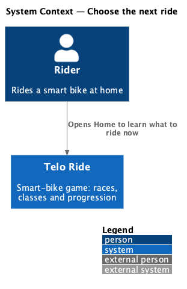
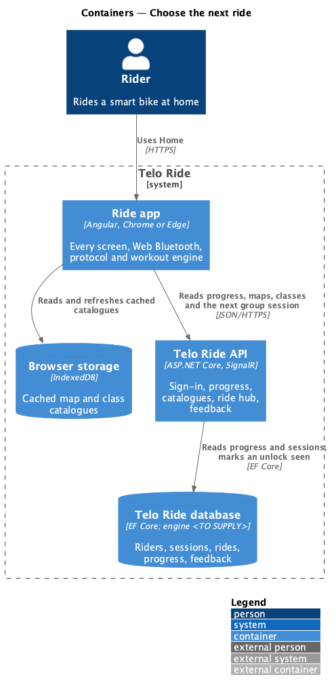
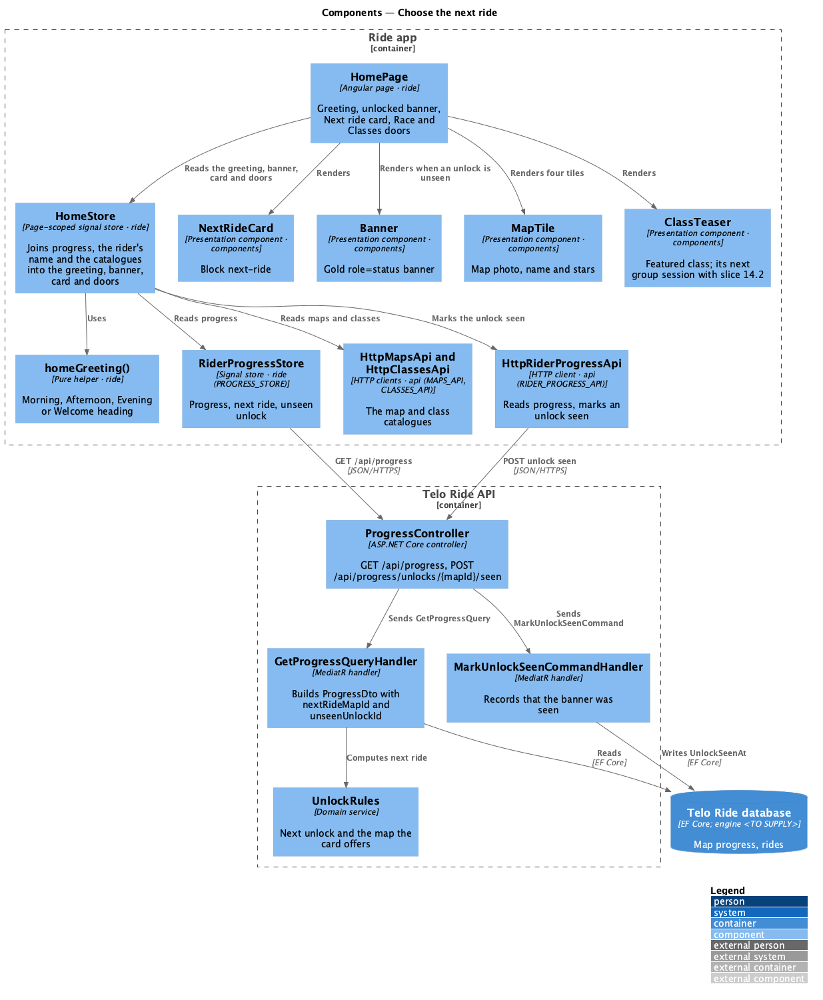
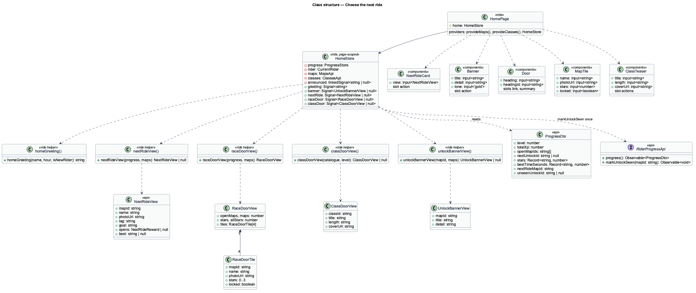
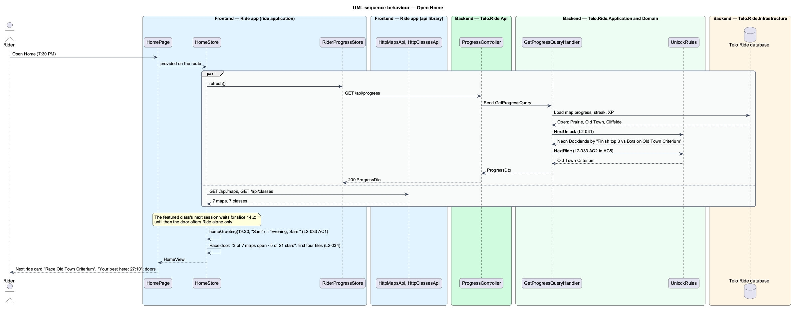
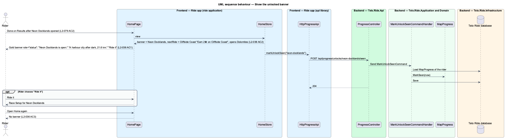
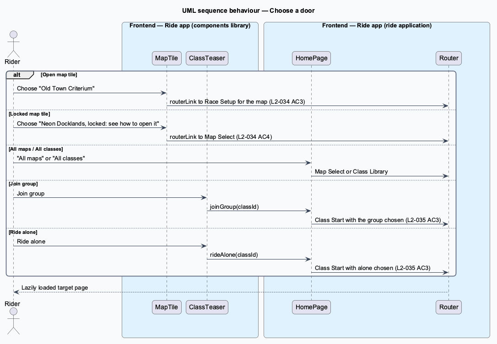

# Choose the next ride

## Overview

Home is the first screen a signed-in rider sees. Its single job is to answer "what should I ride
now?" within ten seconds for any rider (L1-007). It does so with four parts, read top to bottom:

- **greeting** — heading that names the rider and the time of day
- **unlocked banner** — gold notice, shown once, that a ride has just opened a map
- **Next ride card** — card that offers one map to race now, chosen to move the rider towards
  their next unlock
- **doors** — two entry points, the Race door (maps) and the Classes door (video classes)

The terms below come from the progression subsystem and are used in one sense only:

- **map** — route in a 3D world, raced in the Race door; seven maps open in a fixed unlock order
- **unlock goal** — one condition that opens a locked map: a top-3 finish against bots on another
  map, a number of stars on another map, or a rider level
- **next unlock** — first locked map in unlock order whose goal the rider can work on now (L2-041)
- **group session** — live class that a group of riders rides together, starting every 15 minutes

Home reads every progress value from the backend (L2-044), so the card and the doors agree with
Map Select, Race Setup and Profile on every device. The backend computes the next unlock and the
map the card offers; the Ride app formats them.

## Description

The slice runs from `HomePage` in the Ride app to the progress endpoint of the Telo Ride API.

- **`HomePage`** — routed page in the `ride` application (`wz-home-page`), loaded with
  `loadComponent` as a child of `MainShell` (see `show-the-app-header`). It renders the greeting,
  the banner, the card and the two doors, and handles their outputs by routing.
- **`HomeStore`** — signal store provided on `HomePage` itself, with the catalogue clients, so
  its state goes when the rider leaves and its code loads with the page (a child route of its own
  would add its loader to the initial bundle). It reads `PROGRESS_STORE`, `CURRENT_RIDER` (the
  display name), `MAPS_API` and `CLASSES_API`. The card's words come from the pure helper
  `nextRideView()`, which has unit tests. It marks the banner seen once it has shown.
- **`NextRideCard`** — presentation component in `components` (`wz-next-ride-card`, block
  `next-ride`) taking a `NextRideView` (a type in `api`) and the page's "Race {map}" link in its
  `action` slot.
- **`homeGreeting()`** — pure helper in `ride` with unit tests. It returns "Morning, {name}."
  before 12:00, "Afternoon, {name}." from 12:00 to 16:59, and "Evening, {name}." otherwise. For a
  rider with no rides (no XP yet: every recorded ride earns XP) it returns "Welcome, {name}. Your
  first race opens a new map."
- **`NextRideCard`** — presentation component (`wz-next-ride-card`, block `next-ride`). It shows
  the photo tag, "Your next unlock" with the goal, "Opens {map}" with the map's place, "Your best
  here: {time}" when a best exists, and the primary action "Race {map}". At lg (≥ 1024 px) or
  wider it splits 3 : 2, photo to text.
- **`Banner`** — presentation component (`wz-banner`, block `banner`, modifier `banner--gold`)
  with `role="status"`.
- **`MapTile`** — presentation component (`wz-map-tile`, block `map-tile`). An open tile links
  to Race Setup for its map. A locked tile shows a greyed photo with a lock and links to Map
  Select with the `aria-label` "{map}, locked: see how to open it". Stars render through `Stars`
  with `role="img"` and "N of 3 stars".
- **`ClassTeaser`** — presentation component (`wz-class-teaser`, block `class-teaser`) with the
  featured class, its length, its next session's seats and start time, and the outputs
  `joinGroup` and `rideAlone`.
- **`ProgressDto`** — read model from `GET /api/progress`. Beyond the header's fields it holds
  `openMapIds`, `nextUnlockId`, `stars` and `bestTimeSeconds` (slice 12.1). This slice adds
  `nextRideMapId` (the map the card offers) and `unseenUnlockId` (a map a ride opened that Home
  has not yet announced, or `null`).
- **The card's words** — the goal is the catalogue's `unlockGoal` for the next unlock, as on Map
  Select. A level goal adds " · {n} to go", where {n} is the levels still to climb: the
  catalogue's `unlockLevel` (the level a level goal asks for, `null` for any other goal) less the
  rider's level. With every
  map open there is no next unlock: the goal reads "Earn {n}★ on {map}", where {n} is one more
  star than the map holds, and no reward shows.
- **`MapsApi`** and **`ClassesApi`** — the catalogue clients in `api` for `GET /api/maps` and
  `GET /api/classes`, owned by `race/browse-maps` and `classes/browse-the-class-library`.
- **Group sessions** — the Classes door's "Next group class starts in 9 min", the teaser's seats
  and start time, and "Join group" need the group session schedule, which slice 14.2 brings.
  Until then the door shows the featured class with "Ride alone" only
  (`docs/mocks/pages/home/no-groups.html`), as Class Start and the Class Library do with no
  sessions to read.
- **`GetProgressQueryHandler`** — MediatR handler. It asks `UnlockRules` for the next unlock
  (`NextUnlock`, slice 12.1) and the map to offer (`NextRide`), using these rules: for a top-3 goal, the goal's prerequisite map; for a star
  goal, the map the stars are earned on; for a level goal, the rider's most recently opened map;
  with every map open, the open map with the fewest stars and the goal "Earn {n}★ on {map}".
- **`MarkUnlockSeenCommand`** and **`MarkUnlockSeenCommandHandler`** — backend write path for
  `POST /api/progress/unlocks/{mapId}/seen`. The handler sets `MapProgress.UnlockSeenAt`, so the
  banner shows once per account, on whichever device opens Home first.
  `unseenUnlockId` is the most recently opened map whose `UnlockSeenAt` is not set.
- **Featured class** — the class whose teaser the Classes door shows ("30 Minute HIIT Cardio" in
  the mocks). With group sessions (slice 14.2), it is the class of the next session. Until then it
  is the first class on the catalogue's 30 min shelf that the rider's level has opened. In the
  catalogue that is 30 Minute HIIT Cardio, at level 1, so it is open for every rider.

Layout lives in the page and component stylesheets: the doors sit side by side at lg or wider and
stack below; map tiles are four across at sm (≥ 640 px) or wider and two across on a phone; on a
phone nothing in the card is wider than the viewport.

## Requirements

| L2 ID | Refines (L1) | Requirement |
|-------|--------------|-------------|
| `L2-033` | `L1-007` | Home shall greet the rider "Morning, {name}." before 12:00, "Afternoon, {name}." from 12:00 to 16:59 and "Evening, {name}." otherwise; a new rider shall read "Welcome, Sam. Your first race opens a new map." |
| `L2-033` (AC2) | `L1-007` | For the mid rider, the Next ride card shall show "Old Town Criterium · 14.2 km · Easy", "Your next unlock" with "Finish top 3 vs Bots on Old Town Criterium", "Opens Neon Docklands" with "A harbour city after dark", "Your best here: 27:10", and "Race Old Town Criterium", which shall go to Race Setup for that map with Bots chosen. |
| `L2-033` (AC3–AC5) | `L1-007` | A new rider's card shall offer Prairie Paceline ("Opens Cliffside Coast") with no best line; a level goal shall read "Reach rider level 10 · {n} to go" and offer the most recently opened map; with every map open, the card shall offer the open map with the fewest stars with "Earn {n}★ on {map}". |
| `L2-033` (AC6) | `L1-007` | At lg or wider the card shall be split 3 : 2 (photo : text); on a phone nothing in the card shall be wider than the viewport. |
| `L2-034` | `L1-007` | The Race door shall show "Race", "All maps" (to Map Select) and "3 of 7 maps open · 5 of 21 stars" for the mid rider, with tiles for the first four maps in unlock order, each with its name and stars (`role="img"`, "N of 3 stars"). |
| `L2-034` (AC3–AC5) | `L1-007` | An open map's tile shall open Race Setup for that map; a locked tile shall show a greyed photo with a lock and link to Map Select with `aria-label` "{map}, locked: see how to open it"; tiles shall be four across at sm or wider and two across on a phone. |
| `L2-035` | `L1-007` | The Classes door shall read "Classes" with "All classes" (to the Class Library) and the featured class's next group session ("Next group class starts in 9 min"), with a teaser reading "30 Minute HIIT Cardio", "30:00" and "6 of 10 riders · 7:39 PM", and "Join group" and "Ride alone". |
| `L2-035` (AC3–AC4) | `L1-007` | "Join group" shall open Class Start with the group chosen and "Ride alone" with alone chosen; at lg or wider the doors shall sit side by side and below lg they shall stack. |
| `L2-036` | `L1-007` | After a ride opens Neon Docklands, Home shall show a gold banner (`role="status"`) above the card reading "Neon Docklands is open." with "A harbour city after dark, 21.6 km." and "Ride it" (to Race Setup for Neon Docklands). |
| `L2-036` (AC2–AC3) | `L1-007` | While the banner shows, the card shall already offer the next unlock (Cliffside Coast, "Earn 2★ on Cliffside Coast", "Opens Dolomites"); once seen, the banner shall be gone the next time Home opens. |

## Diagrams

### System context

The rider opens Home in Telo Ride to learn what to ride now. No external system takes part.

### Containers

The Ride app reads progress, the catalogues and the featured class's next session from the Telo
Ride API, and reads cached catalogues from browser storage when the network is slow or absent.

### Components

`HomeStore` joins the progress, the rider's name and the two catalogues into the greeting, the
banner, the card and the doors, which `HomePage` renders through six presentation components. On the backend, `GetProgressQueryHandler` uses `UnlockRules` to choose
the card's map, and `MarkUnlockSeenCommandHandler` records the banner as seen.

### Class structure

The store derives each part through its own pure helper (`homeGreeting()`, `nextRideView()`,
`raceDoorView()`, `classDoorView()` and `unlockBannerView()`), each with unit tests, from
`ProgressDto` and the catalogues.

### Behaviour — open Home

The store loads the catalogues in parallel with the progress the shell reads; each part shows
once its sources have arrived (the featured session comes with slice 14.2). The backend returns
the next unlock (L2-041) and the map to offer; the store formats the greeting and the Race door
summary.

### Behaviour — show the unlocked banner

After a ride opens a map, Home shows the banner while the card already offers the following
unlock. The store then marks the unlock seen, so the next visit shows no banner (L2-036 AC3).

### Behaviour — choose a door

Each tile, link and teaser action routes to a lazily loaded page: Race Setup, Map Select, the
Class Library or Class Start with the group or alone chosen.

