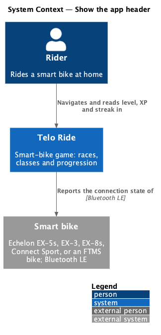
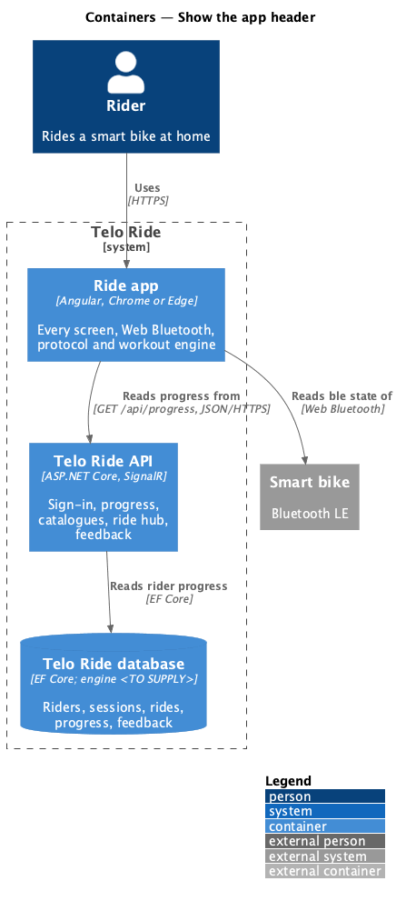
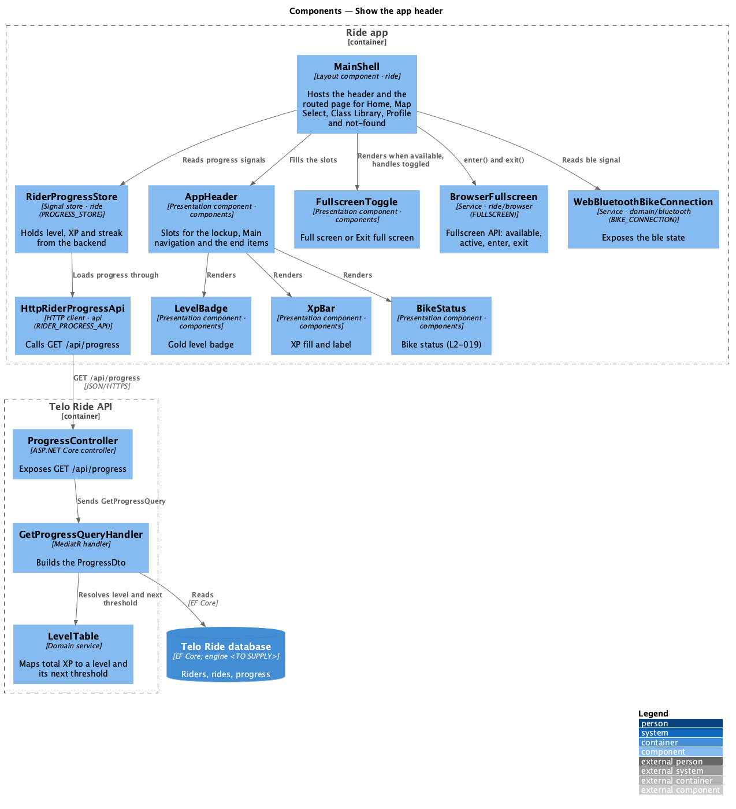
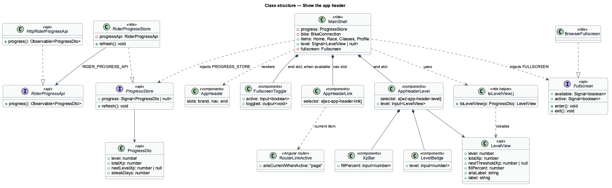
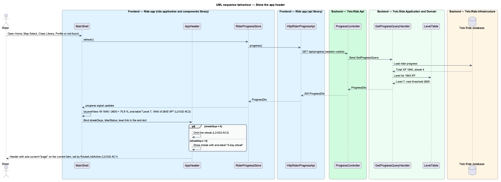
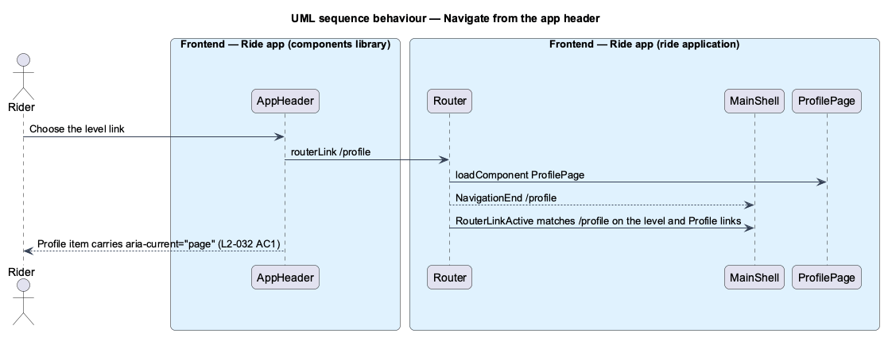

# Show the app header

## Overview

Telo Ride is a browser app that turns a smart bike at home into a game. Five screens share one
*app header*: Home, Map Select, the Class Library, Profile and the not-found page. The header is
the rider's constant anchor between rides. It names the product, moves the rider between the four
main areas, and keeps the rider's standing in view.

The header carries four pieces of state:

- **rider level** — rank from 1 to 30 that total XP builds (see `earn-xp-and-rider-levels`)
- **XP** — experience points every finished ride earns
- **streak** — count of consecutive calendar days with at least one finished ride
- **bike status** — short statement of whether the bike is connected, owned by
  `bike/keep-the-bike-connected` (L2-019)

Level, XP and streak come from the backend, so the header shows the same values on every device
(L2-044). The bike status comes from the Bluetooth link state, `ble`, held in the browser.
The header also offers Full screen, owned by `ui/switch-theme-and-full-screen` (L2-144).

This feature belongs to the home subsystem. It does not decide what the rider rides next; that is
`choose-the-next-ride`.

## Description

The slice runs from a layout route in the Ride app to the progress endpoint of the Telo Ride API.

- **`MainShell`** — layout component in the `ride` application (`wz-main-shell`), built by slice
  1.1. It is the parent route of Home, Map Select, the Class Library, Profile and not-found; each
  child route uses `loadComponent`. It fills the header's slots with router links: the brand
  (`<a wz-app-header-brand routerLink="/" aria-label="Home">`) and the four nav items
  (`<a wz-app-header-link routerLinkActive ariaCurrentWhenActive="page">`, Home matched exactly,
  the others by prefix), so the router marks the current item. This slice adds the end items: it
  injects `PROGRESS_STORE`, `BIKE_CONNECTION` and `FULLSCREEN`, and fills the `end` slot. That
  slot holds the bike status, the streak, the level link to Profile, and `FullscreenToggle`
  inside `@if (fullscreen.available())`. The toggle's `toggled` output calls the service's
  `enter()` or `exit()` (L2-144). `BrowserFullscreen` is bound on the shell's route, so it goes
  with the shell.
- **`AppHeader`** — presentation component in the `components` library (`wz-app-header`, block
  `app-header`). It lays out three slots, `brand`, `nav` (inside the navigation landmark "Main")
  and `end`; the app places the bike status, the streak, the level link and Full screen in
  `end`. It knows no route and injects nothing.
- **`AppHeaderBrand`**, **`AppHeaderLink`** and **`AppHeaderLevel`** — attribute components in
  `components` on the app's `<a>` elements (`a[wz-app-header-brand]`, `a[wz-app-header-link]`,
  `a[wz-app-header-level]`). Each styles its host as the block's element (`app-header__brand`,
  `app-header__nav-link`, `app-header__level`) with a hit area of at least 44 px, and the app
  adds `routerLink`; `aria-current="page"` is styled through the attribute.
- **`LevelBadge`** and **`XpBar`** — presentation components in `components` for the gold level
  badge and the XP fill with its label.
- **`ProgressStore`** — contract and `PROGRESS_STORE` token in the `api` library. It exposes the
  backend's `ProgressDto` as a signal (`null` until it arrives) and a `refresh()` method.
  **`RiderProgressStore`** in `ride` implements it. It is provided on the shell's route, which
  the header, Home and Profile share; the screens outside the shell that need it (Results) bind
  it with their slices.
- **`RiderProgressApi`** / **`HttpRiderProgressApi`** — contract, `RIDER_PROGRESS_API` token and
  HTTP client in `api`. `progress()` calls `GET /api/progress` with the session cookie. The
  older `PROGRESS_API` (`level()` and `maps()`) reads the same endpoint through `HttpProgressApi`.
  It has been bound on the map and class routes since slices 12.1 and 12.2.
- **`AppHeaderStreak`** — presentation component in `components` (`wz-app-header-streak`,
  element `app-header__streak`), placed by the shell in the `end` slot like the bike status,
  only when the streak is above 0 (L2-032 AC3). It draws the flame and the numeral, hidden from
  assistive technology, and the visually hidden text "4-day streak": a name on a plain `span` is
  not announced, so the mocks' `aria-label` gave way to the design system's hidden text.
- **`toLevelView()`** — pure helper in `ride` with unit tests. It turns a `ProgressDto` into a
  `LevelView`: the visible label "1,840 / 2,600 XP", the `aria-label` "Level 7, 1840 of 2600
  XP", and the fill percentage. The fill is total XP divided by the next level's threshold
  (1,840 / 2,600 = 70.8 %), as L2-032 AC2 states. At level 30 the next threshold is `null`, the
  bar is full, and the label reads "21,400 XP" and the `aria-label` "Level 30, 21400 XP". Until
  the progress arrives, or when it cannot be read, the level link is absent.
- Slice 10.3 builds the level link, `LevelBadge`, `XpBar`, the store and the endpoint; slice 10.4
  adds the streak; slice 13.1 adds Full screen, whose contract, service and toggle
  `ui/switch-theme-and-full-screen` designs. Slice 24.2 brings Full screen to the page headers
  outside the shell. Profile's headline reads its level from the same store, so the two never
  disagree.
- **`ProgressController`**, **`GetProgressQuery`**, **`GetProgressQueryHandler`** — the
  backend read path in `Telo.Ride.Api` and `Telo.Ride.Application`. The handler loads the
  rider's progress, asks `LevelTable` for the level and next threshold, and returns the
  `ProgressDto`. The same endpoint serves `choose-the-next-ride` and `show-the-profile`.
- **`LevelTable`** — domain service in `Telo.Ride.Domain`, specified in
  `progression/earn-xp-and-rider-levels`.

Layout lives in `app-header.scss`. On a phone the navigation takes its own full-width row with
equal items, the XP bar and label are hidden, and only the badge shows. The bike status shows at
lg (≥ 1024 px) or wider. Breakpoints come from design-system tokens.

## Requirements

| L2 ID | Refines (L1) | Requirement |
|-------|--------------|-------------|
| `L2-032` | `L1-007` | Home, Map Select, the Class Library, Profile and not-found shall share one header holding the Telo Ride lockup (a link to Home), the navigation "Main" with Home, Race, Classes and Profile, the bike status (L2-019), the streak, the level and Full screen; the current page's item shall carry `aria-current="page"`. |
| `L2-032` (AC2) | `L1-007` | For the mid rider, the streak shall read 4, named "4-day streak" by visually hidden text, and the level link shall read `aria-label="Level 7, 1840 of 2600 XP"` with a gold level badge, an XP bar filled to 70.8 % and "1,840 / 2,600 XP", and shall go to Profile. |
| `L2-032` (AC3) | `L1-007` | For a rider with no streak, the streak shall be absent. |
| `L2-032` (AC4) | `L1-007` | On a phone, the navigation shall take its own full-width row with equal items, the XP bar and label shall be hidden and only the badge shall show; the bike status shall show only at lg or wider. |

## Diagrams

### System context

The rider uses Telo Ride to move between screens and read their standing. Telo Ride reads the
connection state of the smart bike to fill the bike status.

### Containers

The Ride app reads `ble` from the bike over Web Bluetooth and reads level, XP and streak from the
Telo Ride API, which keeps them in the Telo Ride database.

### Components

`MainShell` joins the progress store and the bike connection, binds `AppHeader` and fills its
slots with router links. On the
backend, `ProgressController` sends one `GetProgressQuery`; its handler uses `LevelTable` for the
level and next threshold.

### Class structure

`RiderProgressStore` realises the `ProgressStore` contract over `ProgressApi`. `MainShell`
turns the `ProgressDto` into a `LevelView` through `toLevelView()` and binds it to the level
link in `AppHeader`'s `end` slot, which composes `LevelBadge` and `XpBar`. The nav items are
`AppHeaderLink`s marked by `RouterLinkActive`.

### Behaviour — show the header

On entering any of the five screens, the store refreshes progress from the backend. The shell
computes the level view of L2-032 AC2, and the header omits the streak when it is 0 (L2-032 AC3).

### Behaviour — navigate from the header

Choosing an item routes to a lazily loaded page. When the navigation ends, `RouterLinkActive`
moves `aria-current="page"` to the new item (L2-032 AC1).

