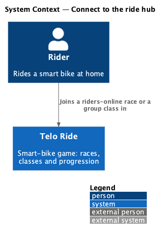
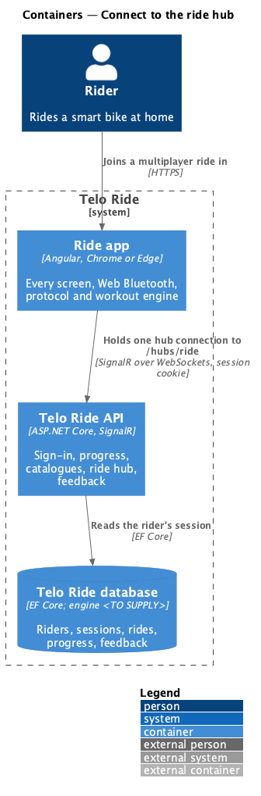
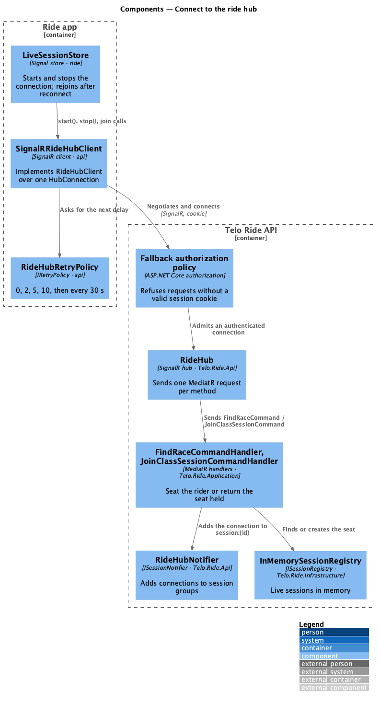
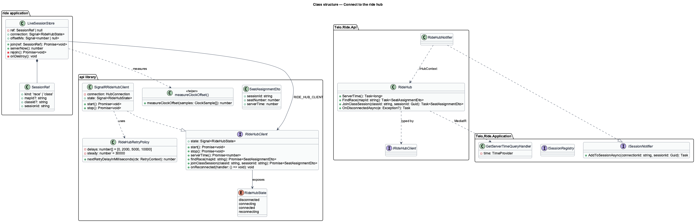
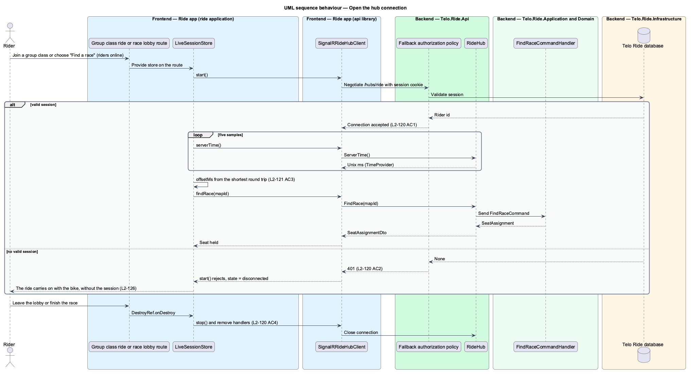
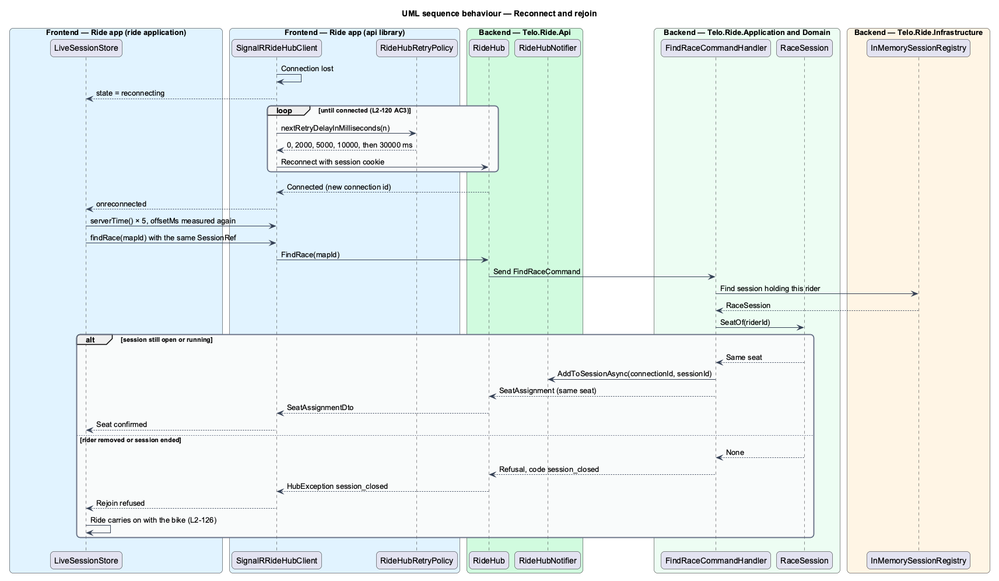

# Connect to the ride hub

## Overview

Telo Ride is a smart-bike game that runs in the browser. Most rides need nothing but the bike: a
solo race, a bots race, a solo class and a custom workout all run on the device. Two kinds of ride
have more than one person in them, a riders-online race and a group class, and the backend runs
both. This feature covers the live link between the browser and the backend for those two kinds
of ride.

**ride hub** — SignalR hub in the Telo Ride API at `/hubs/ride` that carries every message of a
live race or group class

**session** — one live race or one group class run by the multiplayer service

**hub connection** — one SignalR connection from the Ride app to the ride hub, authenticated by
the rider's session cookie

The Ride app opens exactly one hub connection when the rider joins a riders-online race or a
group class, and closes it when the rider leaves that ride. Any other use of the app holds no
connection, so the backend carries no idle sockets and the browser holds no idle timers. When the
connection drops, the app retries on a fixed schedule and, once back, rejoins its session in the
same seat while that session is still open. On every connect and reconnect it measures its
clock offset from the hub's time, so a start sent as a server time begins at the same moment on
every device (`L2-121` AC3). The other multiplayer features (race sessions, group
class sessions, standings, DNF, results and the lost-service notice) all travel over this
connection.

## Description

The slice spans the `api` library and `ride` application in the frontend, and the API layer of
the backend.

**Frontend (Ride app)**

- **`RideHubClient`** — contract in the `api` library for the ride hub: `start()`, `stop()`,
  `serverTime()` (the hub's `ServerTime`), `onReconnected(handler)`, the client-to-server methods
  `FindRace`, `JoinClassSession`, `SetReady`, `ReportProgress` and `LeaveSession`, and a signal
  `state` of `RideHubState`. Injected through the `RIDE_HUB_CLIENT` token, which the routes that
  hold a live session bind, never `app.config.ts`.
- **`SignalRRideHubClient`** — implementation of `RideHubClient` in the `api` library. On
  `start()` it imports `@microsoft/signalr` dynamically, so the SignalR library stays out of
  every chunk until a live session needs it. Its ESM build calls `require` only on its Node
  paths (`ws`, `eventsource`, `node-fetch`), which made esbuild add a `require` shim to the
  initial chunk; the `ride` build defines `require` as `undefined` (`angular.json`), as it is in
  every browser, so the shim and those paths drop out. It builds a `HubConnection` with
  `HubConnectionBuilder` for `/hubs/ride`, sends the session cookie
  (`withCredentials: true`), and registers the server-to-client handlers `SeatsChanged`,
  `CountdownStarted`, `SessionStarted`, `StandingsUpdated`, `RiderLeft` and `SessionEnded`. It
  is the only code that opens a hub connection; no component opens its own (`AGENTS.md`).
- **`RideHubRetryPolicy`** — `IRetryPolicy` in the `api` library. Its
  `nextRetryDelayInMilliseconds` returns 0, 2,000, 5,000 and 10,000 ms for the first four
  retries and 30,000 ms for every retry after, and never returns `null`, so the client keeps
  trying for the length of the ride (`L2-120` AC3).
- **`RideHubState`** — union of `'disconnected' | 'connecting' | 'connected' | 'reconnecting'`.
- **`measureClockOffset()`** — pure helper in the `api` library with unit tests. Each sample is
  the device time a `serverTime()` call was sent, the server time it returned and the device
  time it came back; the offset is the server time minus the midpoint of the round trip, from
  the sample with the shortest round trip. The store takes five samples.
- **`LiveSessionStore`** — signal store in the `ride` application, provided on the routes of a
  riders-online race (lobby and race) and a group class ride. It calls `start()` when the first
  of these routes activates and `stop()` from `DestroyRef.onDestroy` when the rider leaves them,
  which releases the connection, its handlers and its retry timer (`L2-120` AC4). It keeps the
  rider's `SessionRef` (session id, kind and the join arguments) and, on `onreconnected`, invokes
  the same join method again to rejoin. On each connect and reconnect it measures the clock
  offset and exposes it as `offsetMs`, with `serverNow()` reading the device clock plus the
  offset.

**Backend (Telo Ride API)**

- **`RideHub`** — `Hub<IRideHubClient>` in `Telo.Ride.Api`, mapped at `/hubs/ride`. The fallback
  authorization policy covers it, so a negotiate or WebSocket request without a valid session
  cookie is refused with 401 (`L2-120` AC2). Each hub method sends one MediatR request and
  checks nothing itself. `ServerTime` sends `GetServerTimeQuery`, whose handler answers with
  `TimeProvider`'s time in Unix milliseconds.
- **`IRideHubClient`** — strongly typed client interface naming the server-to-client messages.
- **`FindRaceCommandHandler`** and **`JoinClassSessionCommandHandler`** — in
  `Telo.Ride.Application`. Seats are keyed by rider id, so a rider who already holds a seat in an
  open or running session receives that same seat back. A rejoin after a reconnect is therefore
  the same call as the first join (`L2-120` AC3). A rider removed from the session (`L2-124`
  AC4), or a session that has ended, is refused with the code `session_closed`, and the ride
  carries on with the bike (`L2-126`).
- **`ISessionNotifier`** — Application port that adds a connection to a session's SignalR group
  (`session:{sessionId}`) and sends messages to the group. `RideHubNotifier` in `Telo.Ride.Api`
  implements it over `IHubContext<RideHub, IRideHubClient>`. A reconnect yields a new connection
  id, so each join call re-adds the caller to the group.
- **`ISessionRegistry`** — Application port over the live sessions held in memory;
  `InMemorySessionRegistry` in `Telo.Ride.Infrastructure` implements it. Running more than one
  API instance needs a SignalR backplane and a shared registry: `<TO SUPPLY>`.

**Slices.** Slice 14.1 builds the connection: the contract and token, the SignalR client and
its retry policy, the clock offset, `LiveSessionStore`'s start, stop, re-measure and rejoin
hook, and the hub's `ServerTime`. It holds the connection on a group class ride
(`/classes/:id/ride?session={sessionId}`), the first route to bind the token; a solo class ride
holds none. `JoinClassSession` and the seat it returns come with slice 14.3, and the race
methods, `IRideHubClient`, `ISessionNotifier` and `ISessionRegistry` with the slices that send
their messages (14.2 to 15).

## Requirements

The feature realizes the following level-2 (L2) requirements. Each L2 requirement refines a
level-1 (L1) requirement, cited by identifier.

| L2 ID | Refines (L1) | Requirement |
|-------|--------------|-------------|
| `L2-120` (AC1) | `L1-020` | When a signed-in rider joins a riders-online race or a group class, the app shall open one SignalR connection to the backend's ride hub with the session cookie. |
| `L2-120` (AC2) | `L1-020` | The backend shall refuse a hub connection opened without a valid session. |
| `L2-120` (AC3) | `L1-020` | When the connection drops, the app shall retry after 0, 2, 5, 10 and then every 30 seconds, and shall rejoin its session with the same seat if it is still open. |
| `L2-120` (AC4) | `L1-020` | When the rider is in no multiplayer ride, the app shall hold no hub connection. |
| `L2-121` (AC3, the offset) | `L1-020` | Each client shall correct for its measured clock offset, so every client's clock starts within 250 ms of the others'. |

## Diagrams

### System context

The rider uses Telo Ride; this feature involves no external system, because the hub connection
runs between two parts of Telo Ride.

### Containers

The Ride app holds one SignalR connection to the Telo Ride API, which reads the rider's session
from the Telo Ride database to authenticate it.

### Components

`LiveSessionStore` owns the connection's lifetime through `RideHubClient`; on the backend,
`RideHub` dispatches each join to a handler that seats the rider and re-adds the connection to
the session group through `ISessionNotifier`.

### Class structure

`SignalRRideHubClient` realizes `RideHubClient` and depends on `RideHubRetryPolicy`;
`RideHub` depends on MediatR and is typed by `IRideHubClient`.

### Behaviour — open the hub connection

Entering a multiplayer route starts the connection; the fallback policy refuses a request with
no valid session before the hub runs (`L2-120` AC1, AC2). Leaving the route stops it (`L2-120`
AC4).

### Behaviour — reconnect and rejoin

After a drop, `RideHubRetryPolicy` paces the retries; on reconnect, the store repeats its join
call and the handler returns the seat the rider already holds (`L2-120` AC3).

