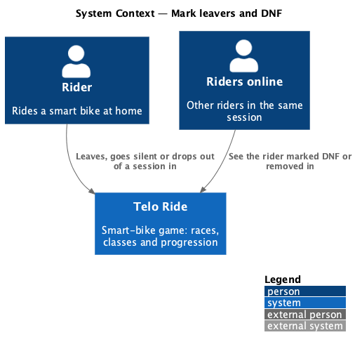
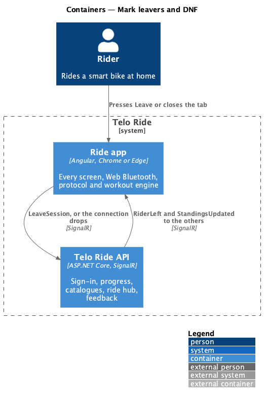
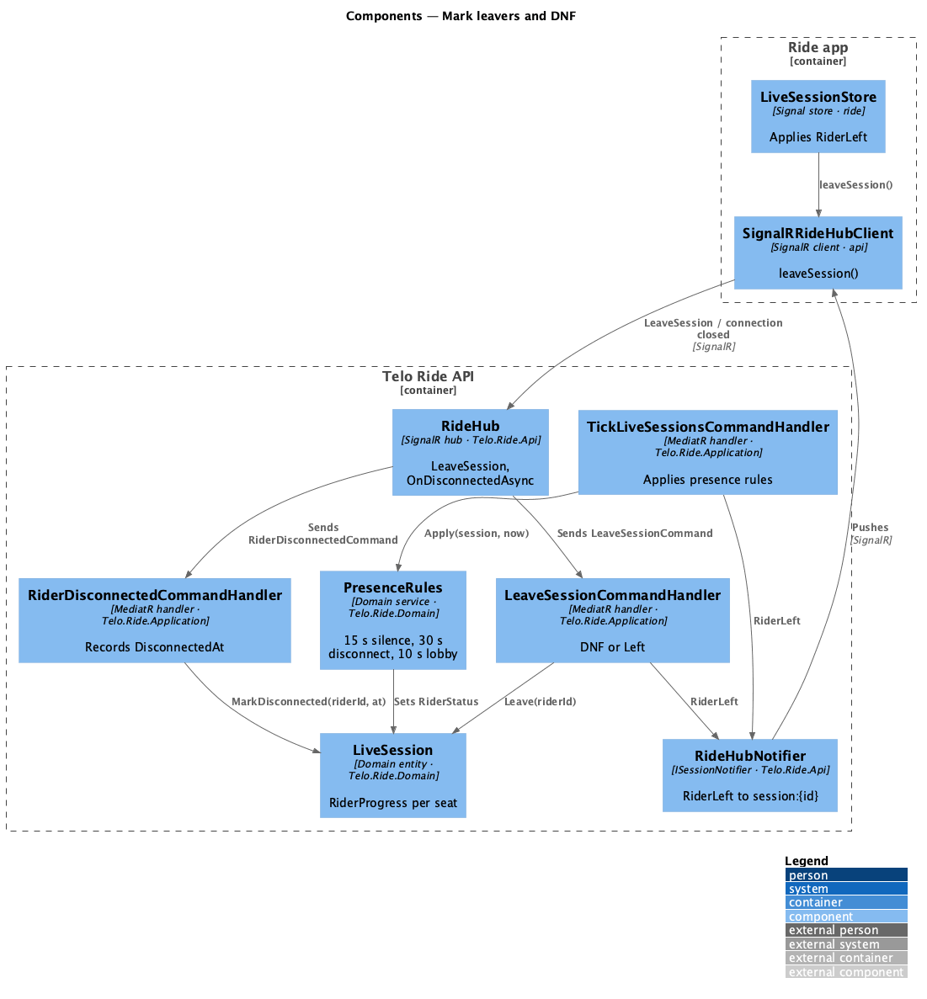
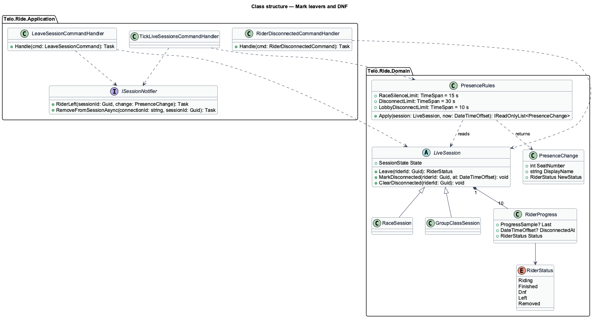
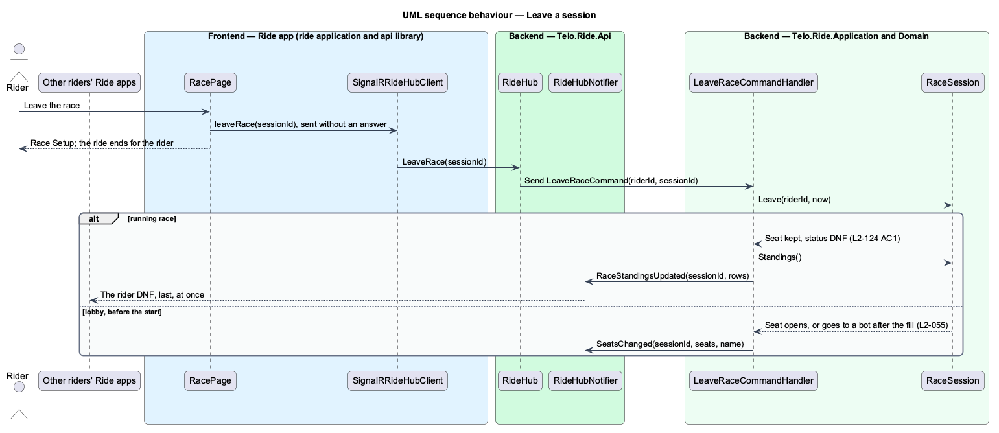
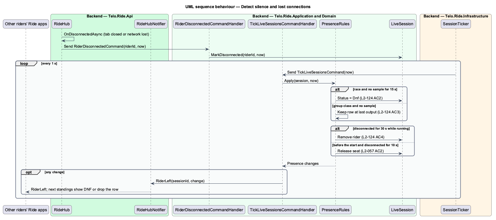

# Mark leavers and DNF

## Overview

A live session goes on for every rider when one of them stops. A rider may press Leave, stop
pedalling, close the tab or lose their network. This feature covers how the multiplayer service
notices each case and what the other riders see.

**DNF** — did not finish; status of a racing rider who left or went silent, shown on every board
and ranked last

**silent rider** — seated rider whose client has sent no progress report for a stated time

**disconnected rider** — seated rider with no live hub connection

The rules differ by kind of session, because a race has a finish line and a class does not. A
rider who leaves a race is marked DNF for everyone at once, and a racing rider silent for 15
seconds is marked DNF. A silent rider in a group class keeps their row at its last output until
they rejoin or leave. In either kind of session, a rider whose connection has been gone for 30
seconds is removed from the session. Before the start, the race lobby's own rule applies: a seat
whose connection has been gone for 10 seconds is released (`L2-057` AC2, `L2-055`, designed in
`race/wait-in-the-race-lobby`). The design reads the two limits as one rule per phase:
10 seconds in the lobby, before the start, and 30 seconds once the session is running. The specs
state the two numbers in separate requirements (`L2-057` AC2 and `L2-124` AC4) without saying
which applies when; the phase split is the design's reading and needs confirming.

## Description

**Frontend (Ride app)**

- **`RideHubClient.leaveSession()`** — `api` method sending `LeaveSession`. The race and class
  pages call it from their Leave action before navigating away.
- **`LiveSessionStore`** — handles `RiderLeft` by updating the row's status, so the boards show
  DNF or drop the row without waiting for the next standings message.

**Backend**

- **`RideHub.LeaveSession()`** — sends `LeaveSessionCommand`.
- **`RideHub.OnDisconnectedAsync`** — sends `RiderDisconnectedCommand` with the rider id and the
  server time. A later join from the same rider clears the mark (see
  `multiplayer/connect-to-the-ride-hub`).
- **`LeaveSessionCommandHandler`** — `Telo.Ride.Application`. It calls `session.Leave(riderId)`.
  In a running race the rider's status becomes `Dnf` (`L2-124` AC1); in a group class it becomes
  `Left` and the row leaves the board. It removes the connection from the session group and sends
  `RiderLeft` to the rest of the group.
- **`RiderDisconnectedCommandHandler`** — records `DisconnectedAt` on the rider's
  `RiderProgress`.
- **`PresenceRules`** — domain service in `Telo.Ride.Domain` that `TickLiveSessionsCommandHandler`
  applies once a second to every running session. Its constants are named in one place:
  - `RaceSilenceLimit` = 15 s: a racing rider with no sample for 15 s becomes `Dnf`
    (`L2-124` AC2).
  - Group class: silence changes nothing; the row keeps its last output (`L2-124` AC3).
  - `DisconnectLimit` = 30 s: a rider disconnected for 30 s is removed from the session
    (`L2-124` AC4). A removed racing rider stays on the board as DNF; a removed class rider's row
    leaves the board.
  - `LobbyDisconnectLimit` = 10 s, before the start only (`L2-057` AC2).
- **`RiderStatus`** — `Riding`, `Finished`, `Dnf`, `Left`, `Removed`. `RankingPolicy` ranks `Dnf`
  rows after every other row (see `multiplayer/share-progress-and-standings`).
- **`RiderLeft`** — server-to-client message carrying the seat number, display name and new
  status.

**As built for riders-online races (slice 15.4).** A race keeps each seat's status in
`RaceSession` beside its distance: riding, finished (held at the route's length) or DNF. The race
page's Leave sends `LeaveRace(sessionId)`, the lobby's message, before it goes to Race Setup; once
the race has started, `RaceSession.Leave` keeps the seat and marks it DNF (before the start the
lobby's rule still applies, `L2-055`), and the handler sends `RaceStandingsUpdated` to the
session at once rather than a `RiderLeft` message, so every board shows the DNF on the same
message it already reads (`L2-124` AC1). At each second it rides, the session marks DNF a racing
rider whose last report, or the start when there is none, is 15 seconds old (`RaceSilenceLimit`,
AC2); a finished rider is never marked. A lost connection is noted in started races too, and at
30 seconds (`DisconnectLimit`) the rider is removed: DNF on the board and refused a rejoin
(`session_not_found`, AC4); joining again within 30 seconds clears the mark. A DNF seat keeps its
distance and ranks after every other row; its row carries `status` `dnf`, and the race board
reads "DNF" in place of its gap, the row in the faint colour (`race-board__row--dnf`, race mock
`someone-left`). A DNF is final for this slice. The group class rules are unchanged: a silent
rider keeps their last output (AC3, as slice 14.5 built it), and removing a class rider after 30
seconds gone is open question 1.

## Requirements

The feature realizes the following level-2 (L2) requirements. Each L2 requirement refines a
level-1 (L1) requirement, cited by identifier.

| L2 ID | Refines (L1) | Requirement |
|-------|--------------|-------------|
| `L2-124` (AC1) | `L1-020` | When a rider leaves a race session, the service shall mark the rider DNF for everyone at once. |
| `L2-124` (AC2) | `L1-020` | When a racing rider sends no progress for 15 seconds, the service shall mark the rider DNF. |
| `L2-124` (AC3) | `L1-020` | When a rider in a group class sends no progress, the service shall keep their row with its last output until they rejoin or leave. |
| `L2-124` (AC4) | `L1-020` | When a client's connection has been gone for 30 seconds, the service shall remove the rider from the session. |

## Diagrams

### System context

The rider and the other riders in a session see leavers through Telo Ride; no external system
takes part.

### Containers

The Ride app sends `LeaveSession` or drops its connection; the Telo Ride API applies the
presence rules in memory and tells the remaining riders.

### Components

`RideHub` turns a leave and a disconnect into commands; the tick handler applies `PresenceRules`
to each session.

### Class structure

`PresenceRules` reads each seat's `RiderProgress` and sets its `RiderStatus`.

### Behaviour — leave a session

Pressing Leave marks a racing rider DNF for everyone at once (`L2-124` AC1).

### Behaviour — detect silence and lost connections

Each tick marks silent racers DNF, keeps silent class riders, and removes riders disconnected for
30 seconds (`L2-124` AC2, AC3, AC4).

## Open questions

1. **A group class rider gone 30 seconds (`L2-124` AC4).** Not built with slice 15.4, which
   covers the race: a class rider whose connection has gone keeps their row at its last output,
   as a silent one does (AC3).
2. **No `RiderLeft` message.** As built, a race sends its standings at once instead; a class has
   no leave message yet.
3. **The rider marked DNF by the service.** The rider's own race does not yet hear that the
   service marked them DNF (silent 15 seconds while the page was away); it carries on and the
   result is settled by the service with slice 15.5.
