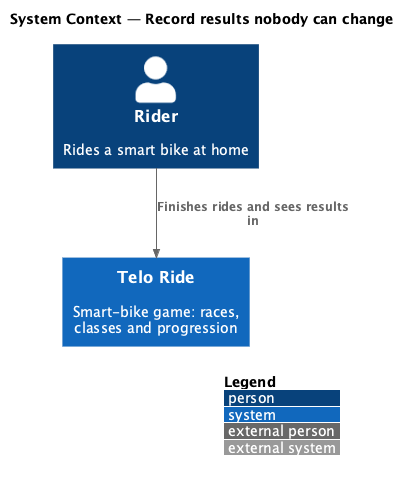
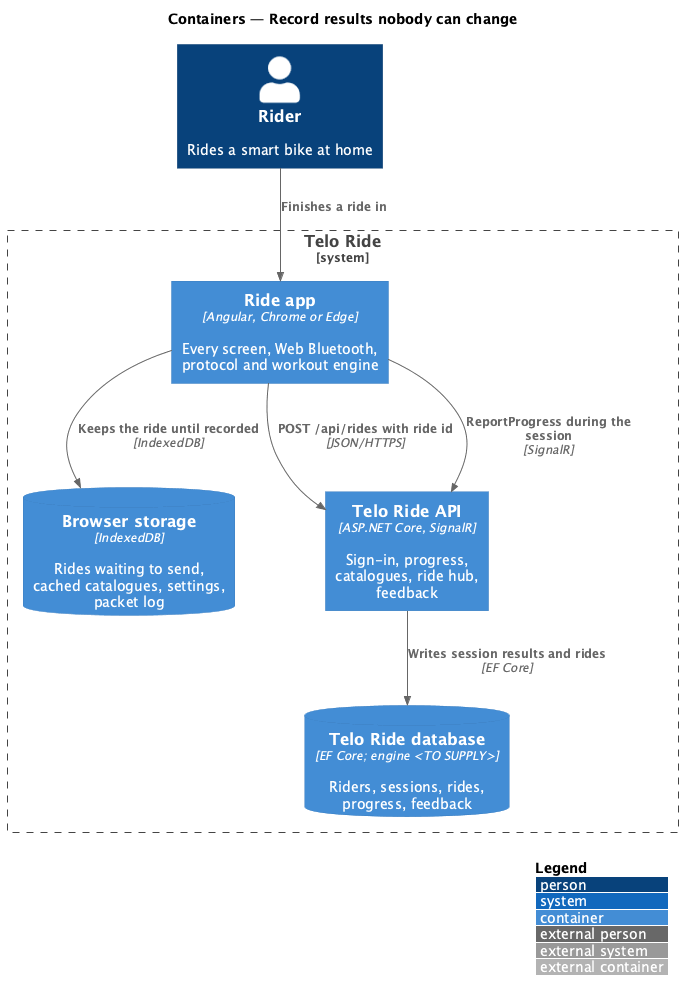
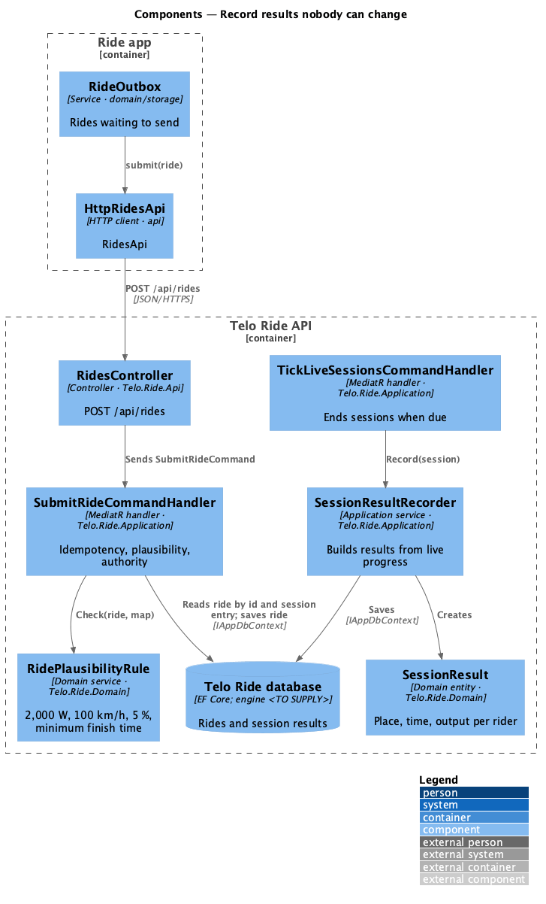
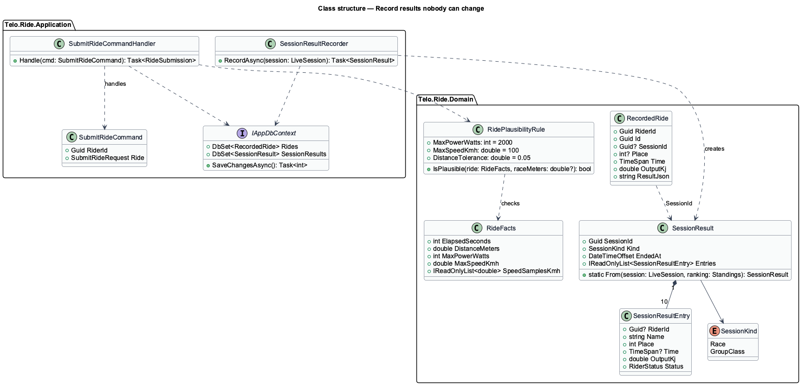
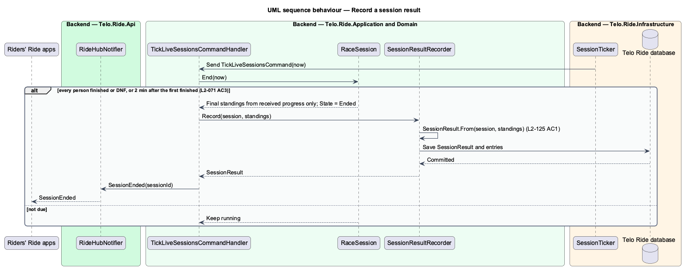
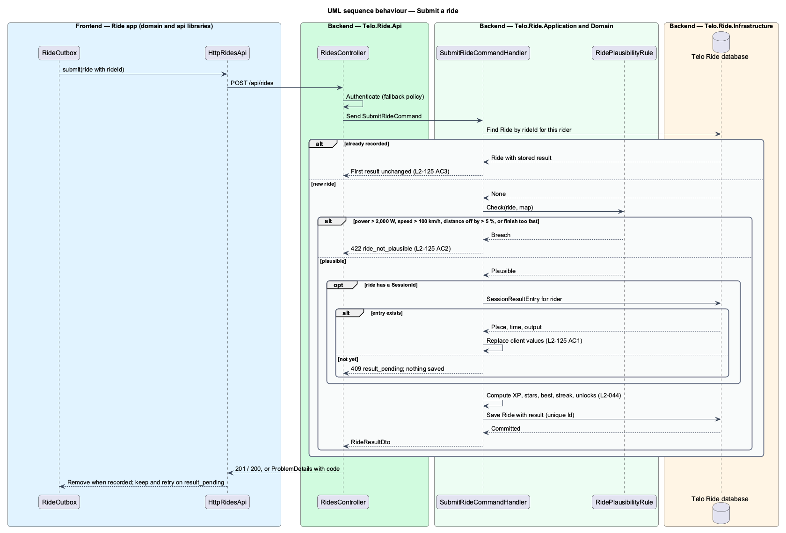

# Record results nobody can change

## Overview

Every finished ride in Telo Ride earns XP, and a race also earns a place. A browser is under the
rider's control, so anything it sends can be altered. This feature covers how the backend keeps
results honest: places, times and output in a multiplayer ride come from the progress the service
saw live, every submitted ride passes a plausibility check, and a ride sent twice is recorded once.

**session result** — the record of one finished race or group class session: each rider's place,
time and output as the service computed them

**plausibility check** — set of physical limits a submitted ride shall stay within

**ride id** — identifier the Ride app gives a ride when it starts; it is the idempotency key of
the ride's submission

When a riders-online race or a group class ends, the service records each rider's place, time and
output from the progress reports it received (`multiplayer/share-progress-and-standings`). When
the Ride app later submits the ride (`progression/keep-progress-on-the-backend`, `L2-044`), the
backend takes those values from the session result and ignores the client's. Every submitted ride,
solo or multiplayer, is refused with 422 `ride_not_plausible` when it breaks a physical limit. A
second submission of the same ride id records nothing new and answers with the first result.

## Description

**Frontend (Ride app)**

- **`RideOutbox`** — `domain/storage` queue of finished rides in IndexedDB, each with its ride id
  (`L2-135`). It submits through `RidesApi` and keeps a ride until the backend has recorded it, so
  a retry after a lost answer reuses the same ride id.
- **`RidesApi`** — `api` contract, token `RIDES_API`, implementation `HttpRidesApi`, for
  `POST /api/rides`. It surfaces a refusal's `code`, so Results can branch on
  `ride_not_plausible` and `result_pending`.

**Backend**

- **`TickLiveSessionsCommandHandler`** — ends a session when it is due and calls
  `SessionResultRecorder`. A group class session is due at the class length. A race session is due
  when every person has finished or is DNF, or 2 minutes after the first person finished
  (`L2-071` AC3); unfinished riders are then placed by distance.
- **`SessionResultRecorder`** — Application service. It builds a `SessionResult` from the
  session's `RiderProgress` and `RankingPolicy`, never from anything a client submitted
  (`L2-125` AC1), and saves it through `IAppDbContext`. In a race, a rider's entry is fixed the
  moment they finish, because no later rider can pass a finished one. It then sends
  `SessionEnded` to the session group.
- **`SessionResult`** and **`SessionResultEntry`** — entities in `Telo.Ride.Domain`:
  `SessionId`, `Kind`, `EndedAt`, and per rider `RiderId`, `Place`, `Time`, `OutputKj`, `Status`.
  Bots have entries with no rider id.
- **`RidesController.Submit`** — `Telo.Ride.Api` action for `POST /api/rides`; sends
  `SubmitRideCommand`. The handler's progression work belongs to
  `progression/keep-progress-on-the-backend`; this feature adds three steps to it.
- **`SubmitRideCommandHandler`** steps added here:
  1. Idempotency: if a `RecordedRide` with this ride id exists for the rider, return its stored
     `RideRecordedDto` and change nothing (`L2-125` AC3). The `RecordedRide` key, rider and ride id together,
     guards two concurrent first submissions.
  2. Plausibility: apply `RidePlausibilityRule`; refuse with 422 `ride_not_plausible` on any
     breach (`L2-125` AC2).
  3. Authority: for a ride with a `SessionId`, take place, time and output from the rider's
     `SessionResultEntry`. If the entry does not exist yet, answer 409 `result_pending`, and the
     outbox retries.
- **`RidePlausibilityRule`** — domain service. Limits, named as constants:
  `MaxPowerWatts` = 2,000; `MaxSpeedKmh` = 100; `DistanceTolerance` = 5 % between the reported
  distance and the integral of the per-second speed samples; and, for a race, a finish time no
  shorter than the map distance at 100 km/h. The per-second samples it reads are part of the ride
  submission defined by `L2-044`; their exact shape is owned there.
- **`ProblemDetails` `code`s** — `ride_not_plausible` (422) and `result_pending` (409).

### As built in slice 15.5

Slice 15.5 builds the race half of `L2-125` AC1; the plausibility check (AC2) and the single
recording of a ride id (AC3) were built with `progression/keep-progress-on-the-backend`.

- **The race session ends itself.** `RaceSession.End(now)` is due when every person has finished
  or is DNF, or 2 minutes after the first person finished; it returns the final standings and
  leaves the session `Ended`, which stops its ticks. Each entry is the seat's place, its time (the
  race second it reached the line, none for a rider placed by distance), its output (the sum, each
  second ridden, of the power last reported for a person or of the pace model's power for a bot,
  in kJ) and its status (`finished`, `dnf`, or `riding` for one placed by distance). Bots have
  entries with no rider id.
- **`SessionResultRecorder`** saves the `SessionResult`, keyed by the session id, with its entries,
  and the ticker then sends `SessionEnded` with the session id to the session's group.
- **`POST /api/rides`** takes `mode: "online"` with a `sessionId`. After the idempotency and
  plausibility steps, the rider's entry replaces the ride's place, field size, time and output; the
  field size is the number of entries. With no result yet the answer is 409 `result_pending`, and
  a session the rider has no entry in is 404 `session_not_found`. The recorded ride keeps its
  `SessionId`.
- **The Ride app** submits a riders-online race with its `sessionId`. The outbox sends a ride
  answered `result_pending` again every 5 seconds, for at most 3 minutes, and Results shows
  "Recording your ride…" (the `recording` state) meanwhile; after that it is not recorded.

## Open questions

1. A group class session's result (its output, at the class length) is not recorded yet; a group
   class ride still records the output its client sends.
2. Results' headline and final standings are still the Ride app's own; only the XP and the
   recorded ride take the service's place. Showing the service's place on Results needs the
   answer to carry it.
3. The service takes each reported distance as it comes. A report that implies more than
   100 km/h since the last one is not yet capped, so the service's time is only as honest as the
   progress it received.
4. The Ride app does not listen for `SessionEnded`; the outbox's retry finds the result within
   5 seconds of it.

## Requirements

The feature realizes the following level-2 (L2) requirements. Each L2 requirement refines a
level-1 (L1) requirement, cited by identifier.

| L2 ID | Refines (L1) | Requirement |
|-------|--------------|-------------|
| `L2-125` (AC1) | `L1-020` | When a riders-online race or group class ends, the service shall record each rider's place, time and output from the progress it received, and shall not take them from the client's submission. |
| `L2-125` (AC2) | `L1-020` | The backend shall refuse any submitted ride with 422 `ride_not_plausible` if power exceeds 2,000 W, speed exceeds 100 km/h, distance disagrees with speed over time by more than 5 %, or the finish time is shorter than the map allows at 100 km/h. |
| `L2-125` (AC3) | `L1-020` | When a ride id is submitted twice, the backend shall record it once, and the second answer shall be the first's result. |

## Diagrams

### System context

The rider's results are recorded by Telo Ride alone; no external system takes part.

### Containers

The Telo Ride API writes session results and rides to the Telo Ride database; the Ride app keeps a
ride in browser storage until the API has recorded it.

### Components

`SessionResultRecorder` writes the authoritative result at the end of a session;
`SubmitRideCommandHandler` checks idempotency, plausibility and authority before progression runs.

### Class structure

A `SessionResult` owns one `SessionResultEntry` per seat; a `RecordedRide` may refer to the session whose
entry overrides its client values.

### Behaviour — record a session result

At the end of a session, the service turns live progress into a stored result and tells every
rider (`L2-125` AC1).

### Behaviour — submit a ride

A submission is answered from the stored result when its ride id is known, refused when it breaks
a limit, and otherwise recorded with server-side values (`L2-125` AC2, AC3).

