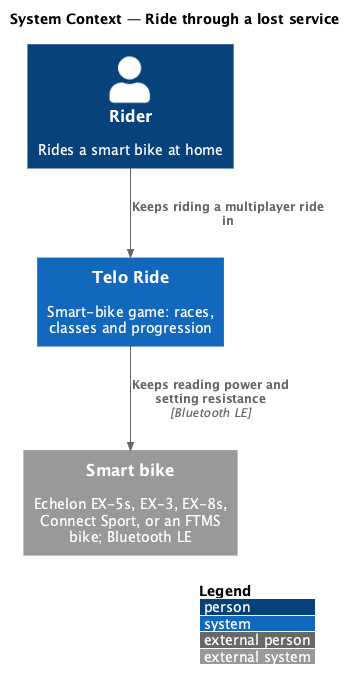
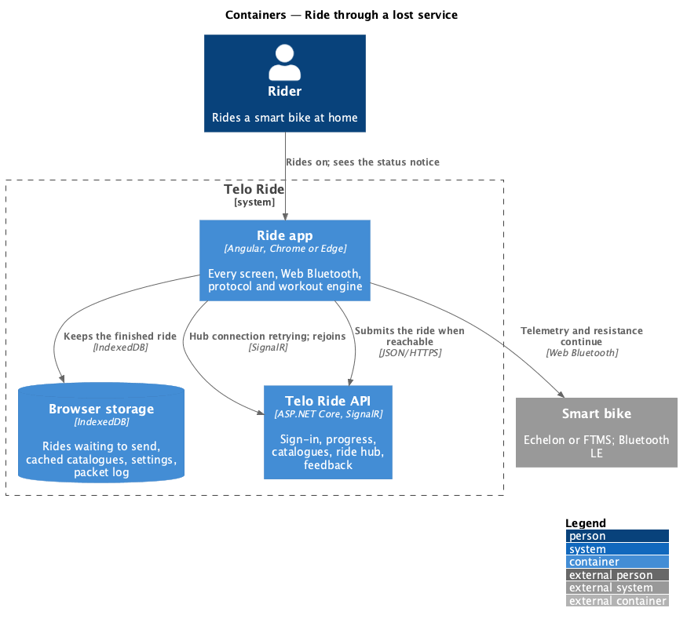
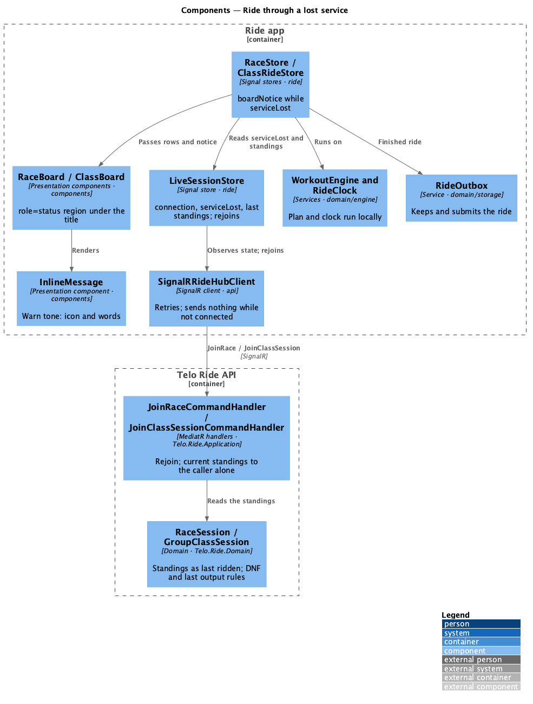
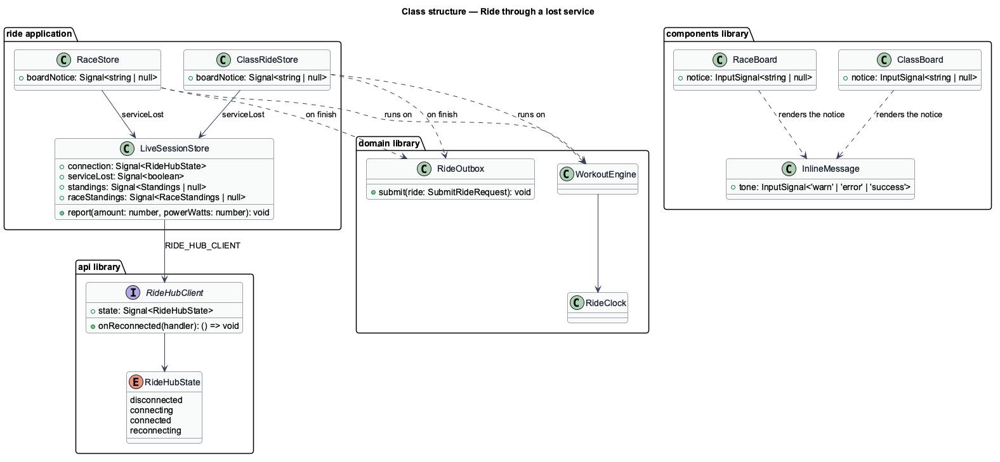
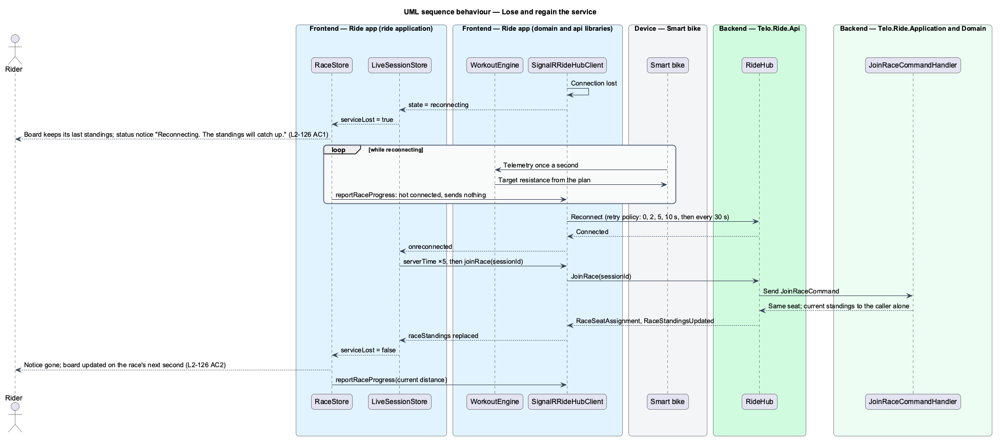
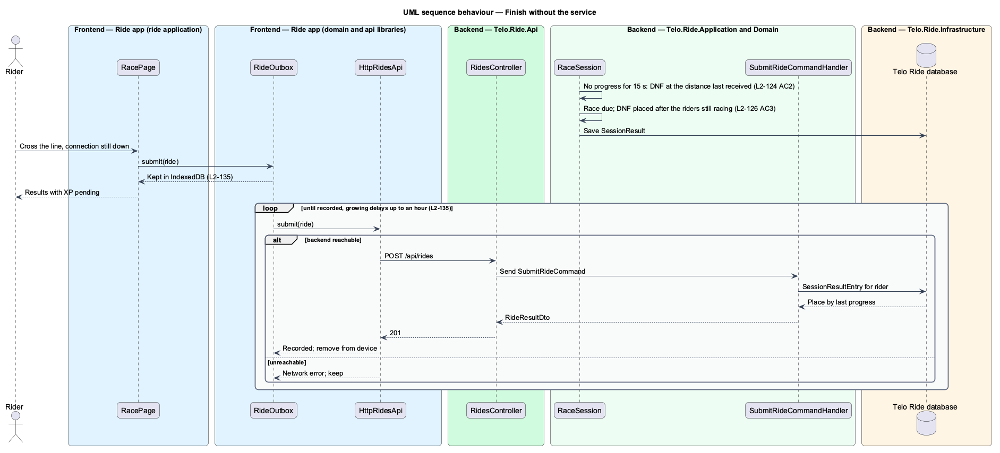

# Ride through a lost service

## Overview

A riders-online race or a group class depends on the multiplayer service only for the shared
board. The bike, the plan and the ride clock all run in the browser. This feature covers what
happens when the hub connection drops in the middle of such a ride: the ride carries on, the
rider is told the standings will catch up, and the ride still counts if the connection never
comes back.

**lost service** — state of a multiplayer ride whose hub connection has dropped and is retrying

**status notice** — short message announced politely to assistive technology (`role="status"`)
that tells the rider about a state without interrupting the ride

When the connection drops, the Ride app keeps driving the bike through the plan and keeps its own
clock. A status notice says the standings will catch up. When the connection returns, the app
rejoins its session (`multiplayer/connect-to-the-ride-hub`) and the standings update within one
second. When the connection is still down at the rider's finish, the ride is kept on the device
and submitted later (`L2-135`), and the service places the rider by the progress it last
received. The notice reads "Reconnecting. The standings will catch up." under the board's title
(mocks `race/service-lost` and `class-ride/service-lost`).

## Description

**Frontend (Ride app)**

- **`LiveSessionStore`** — exposes `connection` (the `RideHubState` signal) and a computed
  `serviceLost`, true while the hub is `reconnecting`. It never pauses the `WorkoutEngine` or the
  `RideClock` because of the hub (`L2-126` AC1); after each reconnect it measures the clock offset
  again and asks for the same seat (`L2-120` AC3, built by `connect-to-the-ride-hub`).
- **`RaceStore`** and **`ClassRideStore`** — `ride` stores. Each exposes a `boardNotice`, "Reconnecting.
  The standings will catch up." while `serviceLost` is true in a riders-online race or a group
  ride, and `null` otherwise; the board keeps the last standings the hub sent.
- **`RaceBoard`** and **`ClassBoard`** — `components` presentation components. Each takes a
  `notice` input and keeps a `role="status"` region under its title (`race-board__status`,
  `class-board__status`), always in the page, so assistive technology announces the words when
  they appear. The words are drawn by **`InlineMessage`** in its warn tone: the icon and the text
  carry the state, never colour alone.
- **`LiveSessionStore.report`** — while the hub is not `connected` the client sends nothing and
  keeps nothing; the next report after the rejoin carries the current totals. Nothing queues
  during the outage, so memory stays bounded.
- **`RideOutbox`** — keeps the finished ride in IndexedDB and submits it when the backend is
  reachable (`L2-135`, slice 17.1).

**Backend**

- **`JoinRaceCommandHandler`** and **`JoinClassSessionCommandHandler`** — a rejoin of a session
  that has started, after the connection joins the session's group, sends its current standings
  to that connection alone through `ISessionNotifier.RaceStandingsTo` or `StandingsTo`, so the
  board updates without waiting for the next tick (`L2-126` AC2). `RaceSession.Standings()` and
  `GroupClassSession.Current()` give the standings as last ridden, without riding on.
- **Placing a rider who never came back** (`L2-126` AC3) needs no new code: a group class keeps the
  row with its last output (`L2-124` AC3); a race marks a rider silent for 15 seconds DNF
  (`L2-124` AC2), and `RaceSession.Result` places every DNF after the riders still racing, by the
  distance last received.

## Requirements

The feature realizes the following level-2 (L2) requirements. Each L2 requirement refines a
level-1 (L1) requirement, cited by identifier.

| L2 ID | Refines (L1) | Requirement |
|-------|--------------|-------------|
| `L2-126` (AC1) | `L1-020` | When the hub connection drops during a riders-online race or group class, the ride shall carry on with the bike, and a status notice shall say the standings will catch up. |
| `L2-126` (AC2) | `L1-020` | When the connection is back and rejoins, the standings shall update within one second. |
| `L2-126` (AC3) | `L1-020` | When the connection is not back by the rider's finish, the ride shall be kept and submitted (`L2-135`), and the service shall place it by the progress it last received. |

## Diagrams

### System context

The rider keeps riding the smart bike through Telo Ride while the shared board is unavailable.

### Containers

The Ride app keeps the bike link and the ride local, holds the finished ride in browser storage,
and resumes the hub connection and ride submission when the Telo Ride API is reachable.

### Components

`LiveSessionStore` derives `serviceLost` from the hub state; the race and class ride stores pass the
notice to their boards while the engine and clock run on, and the rejoin handlers send the standings
to the rejoining connection alone.

### Class structure

The stores read `serviceLost` from `LiveSessionStore` and hand the boards their notice; the boards
draw it with `InlineMessage`; `RideOutbox` keeps the finished ride until the backend answers.

### Behaviour — lose and regain the service

The ride keeps going while the notice shows; the rejoin brings the standings back at once
(`L2-126` AC1, AC2).

### Behaviour — finish without the service

The finished ride waits in the outbox and is submitted when the backend answers; the race has
already placed the rider by the distance it last received, after the riders still racing (`L2-126`
AC3).

## Open questions

1. Resolved: `L2-126` AC3 and the race's 15-second DNF rule (`L2-124` AC2). The DNF rule stands; a
   race places a rider lost past 15 seconds after the riders still racing, by the distance last
   received, and `L2-126` AC3 now says so.
2. The notice uses `InlineMessage`'s warn tone, the one the lobby's left notice uses; the design
   system has no informational tone in the app yet.
3. A rider who stays away from a race for 30 seconds is removed (`L2-124` AC4), so their rejoin is
   refused with `session_not_found`; the race carries on with the bike, the board keeps its last
   standings and the notice stays until the race ends. Telling such a rider that they are out of
   the race is not built.
