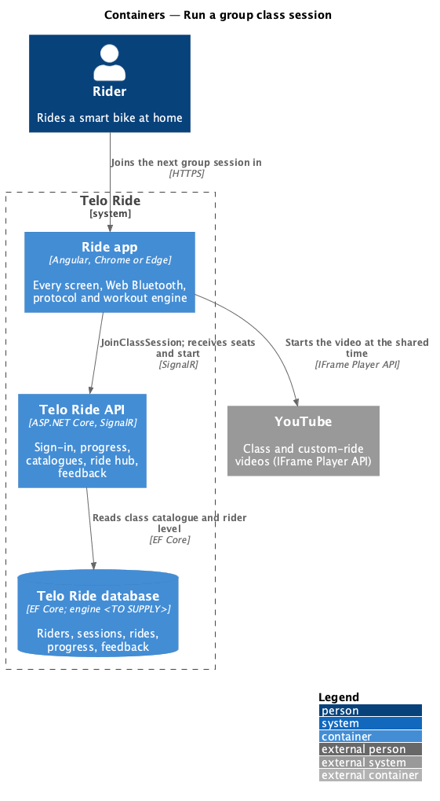
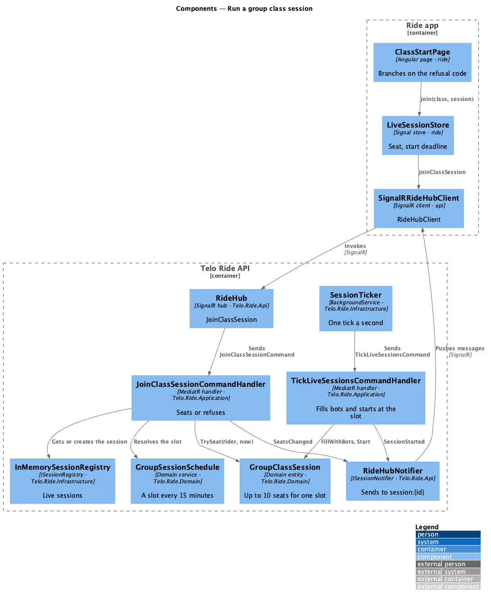

# Run a group class session

## Overview

A class in Telo Ride is a video with a bike plan that follows it. A rider can ride a class alone
at any time, or join a group session and ride it with other riders on a shared clock, ranked by
output. This feature covers how the multiplayer service schedules group sessions, seats riders,
refuses a full or started session and starts everyone's video and clock together.

**group session** — one live group class run by the multiplayer service, with a fixed start time
and up to 10 seats

**slot** — the start time of one group session; a class has one slot every 15 minutes

**output** — the energy a rider has put into the pedals since the start, in kilojoules (kJ)

Each open class has a group session starting every 15 minutes. A rider can join a session until it
starts, while fewer than 10 riders are seated. A rider who asks for a full session is refused with
`session_full` and offered the next one. When a session starts, bots fill the empty seats up to
10, and every client starts its video and ride clock at the same server time. Class Start
(`docs/detailed-designs/classes/start-a-class`) shows the next session and its seats; the class
ride (`docs/detailed-designs/classes/ride-with-a-group`) shows the board this session feeds.

## Description

**Frontend (Ride app)**

- **`RideHubClient.joinClassSession(classId, sessionId)`** — `api` contract method. It resolves
  with a `SeatAssignmentDto`, or rejects with a `RideHubError` whose `code` is `session_full`,
  `session_started` or `class_locked`, carrying the next session's id and start time.
- **`ClassStartPage`** — `ride` page. It branches on the refusal `code`: for `session_full` and
  `session_started` it shows the next session (`L2-086` AC2, AC3).
- **`LiveSessionStore`** and **`ServerClock`** — as in `multiplayer/run-a-race-session`. On
  `SessionStarted`, the store hands the local deadline to the `RideClock` and to the video player,
  so the video and the clock start together (`L2-122` AC3).

**Backend**

- **`RideHub.JoinClassSession(classId, sessionId)`** — sends `JoinClassSessionCommand`.
- **`JoinClassSessionCommandHandler`** — `Telo.Ride.Application`. It reads the class from the
  catalogue and refuses a rider below the class's opening level with `class_locked` (`L2-082`).
  It resolves the slot through `GroupSessionSchedule`, gets or creates the `GroupClassSession`
  for that slot, and asks the session to seat the rider. The session refuses with
  `session_started` once its start has passed and with `session_full` when 10 riders are seated
  (`L2-122` AC1, AC2). On success the handler adds the connection to the session group and sends
  `SeatsChanged`.
- **`GroupSessionSchedule`** — domain service in `Telo.Ride.Domain`. `Next(now, count)` yields
  the next slot start times after now, 15 minutes apart on the quarter hours (UTC), so a slot
  that starts now has started; `SessionId(classId, start)` names a slot's session
  (`hiit-cardio-30@20261121T1945Z`). The mocks' "7:39 PM" and "7:54 PM" are examples of what
  the app shows for the times it is given, not the anchor.
- **`GroupClassSession`** — `LiveSession` for one `ClassId` and slot. Its id is derived from the
  class id and the slot start, so two riders asking for the same slot reach the same session.
  `TrySeat(rider, now)` returns a `JoinOutcome`.
- **`TickLiveSessionsCommandHandler`** — at a group session's start, calls `FillWithBots`, which
  seats bots up to 10, and sends `SessionStarted` with the start as server time (`L2-122` AC3).
- **`GetClassSessionsQueryHandler`** — serves `GET /api/classes/{classId}/sessions` for Class
  Start; its design belongs to `classes/start-a-class`. It reads the same schedule and seat counts.

**Slices.** Slice 14.2 builds `GroupSessionSchedule` and the two reads of it, `GET
/api/classes/{classId}/sessions` (Class Start) and `GET /api/classes/sessions` (every class's
next session, for the Class Library's chip). Both need a signed-in rider, since a session lists
its riders. No rider is seated until slice 14.3 adds `JoinClassSession`, `GroupClassSession` and
the in-memory registry, so every seat reads free until then; slice 14.4 starts the session.

## Requirements

The feature realizes the following level-2 (L2) requirements. Each L2 requirement refines a
level-1 (L1) requirement, cited by identifier.

| L2 ID | Refines (L1) | Requirement |
|-------|--------------|-------------|
| `L2-122` (AC1) | `L1-020` | The service shall start a group session of each open class every 15 minutes. A rider shall be able to join until it starts, while fewer than 10 riders are seated. |
| `L2-122` (AC2) | `L1-020` | When a session is full, the service shall refuse a join with `session_full` and shall offer the next session. |
| `L2-122` (AC3) | `L1-020` | When a session starts, bots shall fill seats up to 10, and every client's video and clock shall start at the same server time (`L2-121` AC3). |

## Diagrams

### System context

Riders join a group class in Telo Ride; YouTube serves the class video that each client starts at
the shared time.

### Containers

The Ride app joins over the hub connection; the Telo Ride API reads the class catalogue and the
rider's level from the database and keeps the live session in memory.

### Components

`RideHub` sends the join to its handler, which uses `GroupSessionSchedule` and
`GroupClassSession`; `SessionTicker` starts the session on time.

### Class structure

`GroupClassSession` specializes `LiveSession` and returns a `JoinOutcome`;
`GroupSessionSchedule` produces its slots.

### Behaviour — join a group session

The handler seats the rider or refuses with a code that Class Start branches on (`L2-122` AC1,
AC2).

### Behaviour — start the session

At the slot, bots fill the session to 10 and every client starts its video and clock at the same
server time (`L2-122` AC3).

