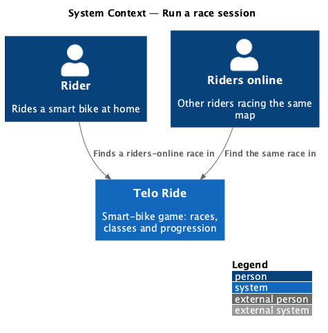
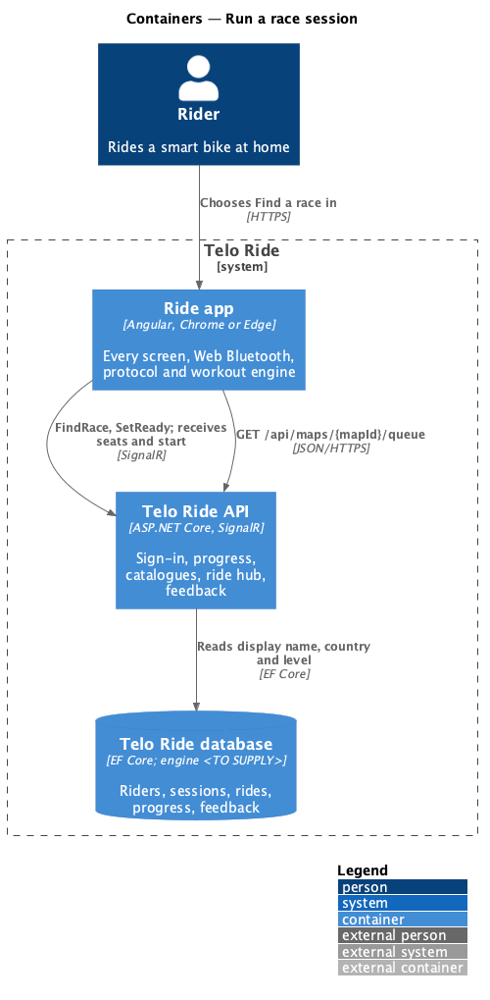
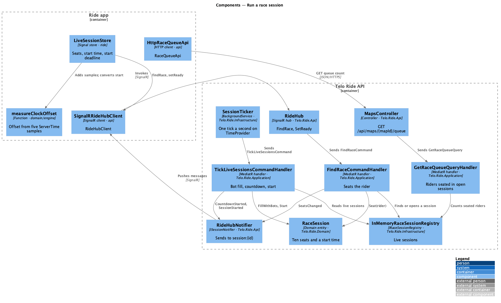
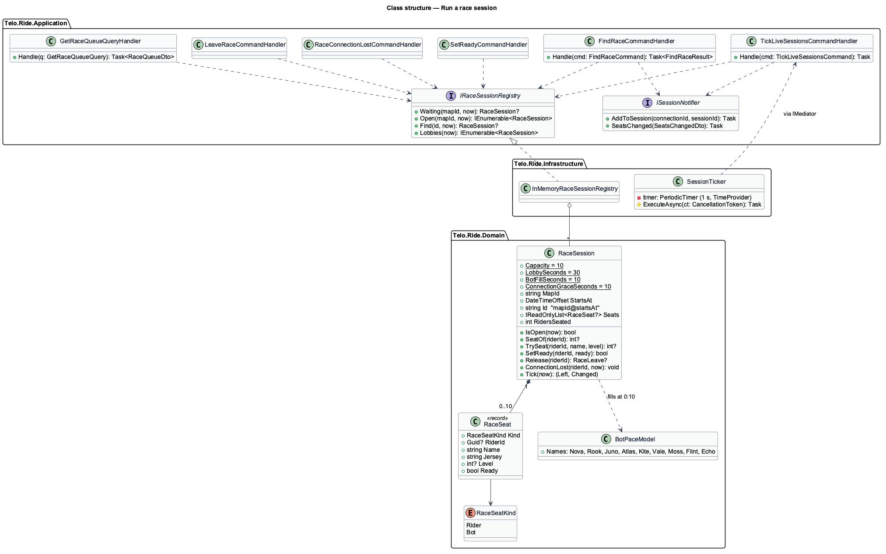
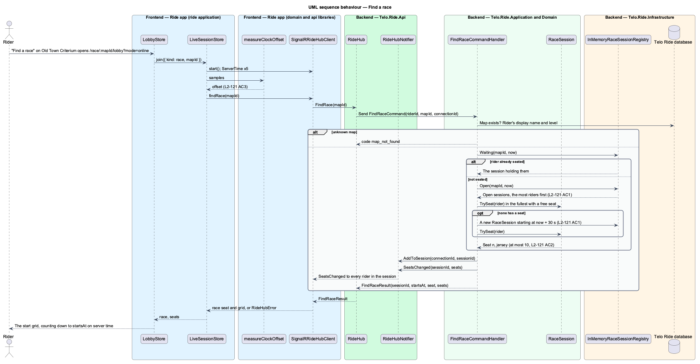
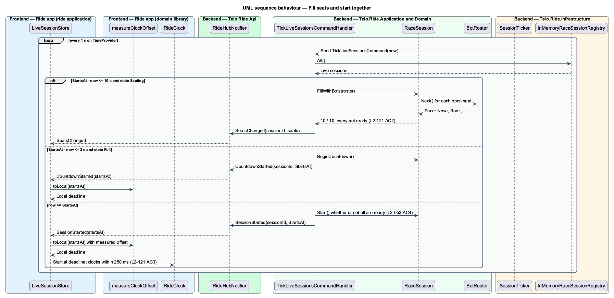
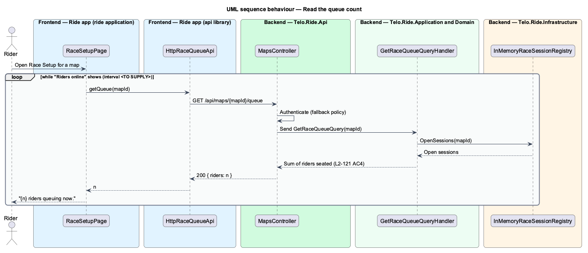

# Run a race session

## Overview

Telo Ride offers three ways to race a map: against the rider's best-time ghost, against bots run
in the browser, or against riders online. Only the third needs the backend. This feature covers
how the multiplayer service gathers riders online into a race, fills the empty seats and starts
everyone together.

**race session** — one live riders-online race on one map, holding up to 10 seats and a start
time set by the service

**open session** — race session still seating riders, before bots fill its empty seats

**seat** — numbered place on the start grid, held by a rider, a bot or nobody

**server time** — the Telo Ride API's UTC clock, in milliseconds, against which every client
measures its own clock offset

When a rider chooses "Find a race" on a map, the service seats them in the open session for that
map with the most riders, or opens a new session that starts 30 seconds later. Riders who join
later fill the remaining seats. Ten seconds before the start, bots take every seat still open, so
every race starts with 10 riders. The service then sends the start as a server time; each client
corrects for its measured clock offset, so all race clocks start within 250 ms of each other. Race
Setup also shows how many riders are queuing for a map, and the service supplies that count. The
race lobby (`docs/detailed-designs/race/wait-in-the-race-lobby`) presents what this feature
produces.

## Description

**Frontend (Ride app)**

- **`RideHubClient`** — `api` contract (see `multiplayer/connect-to-the-ride-hub`).
  `findRace(mapId)` answers a `RaceSeatAssignment` (session id, `startsAt` as server time, seat
  number, grid) or rejects with `RideHubError('map_not_found')`; `setReady` and `leaveRace` are
  sent without awaiting an answer; `onSeatsChanged` hands on each `SeatsChanged`.
- **`measureClockOffset`** — function in `domain/engine`, shared with group classes. From five
  `ServerTime` round trips it keeps the offset of the shortest:
  `offset = serverTime − (sentAt + receivedAt) / 2` (`L2-121` AC3).
- **`LiveSessionStore`** — signal store in the `ride` application, provided by the lobby page.
  It measures the offset, then sends `FindRace`; it holds the race seat, the grid from each
  `SeatsChanged` of its session and the last leaver's name, and finds the race again after a
  reconnect. The start deadline and the race clock come with slice 15.2.
- **`RaceQueueApi`** — `api` contract, token `RACE_QUEUE_API`, implementation `HttpRaceQueueApi`.
  It reads `GET /api/maps/{mapId}/queue`, which Race Setup polls for the "{n} riders queuing now"
  line while the "Riders online" option shows (`L2-121` AC4, `L2-048` AC3). Race Setup holds no
  hub connection (`L2-120` AC4), so the count travels over HTTP.

**Backend**

- **`RideHub.FindRace(mapId)`**, **`SetReady(sessionId, ready)`** and **`LeaveRace(sessionId)`**
  — `Telo.Ride.Api` hub methods; `OnDisconnectedAsync` sends `RaceConnectionLostCommand`. Each
  sends one MediatR request.
- **`MapsController.GetQueue(mapId)`** — `Telo.Ride.Api` action for `GET /api/maps/{mapId}/queue`,
  anonymous like the rest of the maps catalogue. It sends `GetRaceQueueQuery` and answers
  `{ riders }`.
- **`FindRaceCommandHandler`** — `Telo.Ride.Application`. It refuses an unknown map with
  `map_not_found`. It returns the seat the rider already holds, if any. Otherwise it seats the
  rider in the open session on the map with the most riders and a free seat, or opens a new
  `RaceSession` whose `StartsAt` is now plus 30 seconds (`L2-121` AC1). It adds the connection
  to the session group, sends `SeatsChanged` to the group and answers the session, its start,
  the seat and the grid.
- **`LeaveRaceCommandHandler`** and **`RaceConnectionLostCommandHandler`** — release the seat at
  once, or mark the connection lost so the tick releases it 10 seconds later (`L2-057`); a seat
  left after the bot fill goes to the next bot.
- **`SetReadyCommandHandler`** — marks the caller's seat ready or not ready and sends
  `SeatsChanged`.
- **`TickLiveSessionsCommandHandler`** — runs once a second for every live session. For a race
  lobby it releases seats whose connection has been gone 10 seconds, and at 10 seconds to the
  start fills every open seat with bots (`L2-121` AC2), sending one `SeatsChanged` per leaver or
  one for the change. The 3-second countdown and the start are slice 15.2; the start does not
  wait for ready riders (`L2-053` AC4).
- **`GetRaceQueueQueryHandler`** — counts the riders seated in open sessions for the map
  (`L2-121` AC4).
- **`SessionTicker`** — `BackgroundService` in `Telo.Ride.Infrastructure`. A `PeriodicTimer` of
  1 second on the injected `TimeProvider` sends `TickLiveSessionsCommand`. Tests advance a
  `FakeTimeProvider` instead of waiting.
- **`RaceSession`** — sealed domain type in `Telo.Ride.Domain` for one `MapId` and `StartsAt`,
  with `Id` "{mapId}@{startsAt}" and 10 seats. `TrySeat` places a rider in the first open seat
  with the first free jersey; `Release` empties it before the fill, or gives it to the next bot
  after; `Tick(now)` releases lost connections and fills the open seats with bots, ready, in
  `BotPaceModel` order (`L2-054` AC2).
- **`RaceSeat`** — a seat's `RaceSeatKind` (`Rider` or `Bot`), rider id, name, jersey, level
  and `Ready` flag; an empty seat is `null`.
- **`IRaceSessionRegistry`** — Application port over race sessions; `InMemoryRaceSessionRegistry`
  implements it and drops a session 3 hours after its start. Live sessions are not persisted; only results are (see
  `multiplayer/record-results-nobody-can-change`).

## Requirements

The feature realizes the following level-2 (L2) requirements. Each L2 requirement refines a
level-1 (L1) requirement, cited by identifier.

| L2 ID | Refines (L1) | Requirement |
|-------|--------------|-------------|
| `L2-121` (AC1) | `L1-020` | On "Find a race" for a map, the service shall seat the rider in the open session for that map with the most riders, or shall open a new one that starts 30 seconds later. |
| `L2-121` (AC2) | `L1-020` | A session shall hold at most 10 riders. At 10 seconds to the start, bots shall fill every open seat, so the session starts with 10. |
| `L2-121` (AC3) | `L1-020` | The service shall send the start as a server time. Each client shall correct for its measured clock offset, so every client's race clock starts within 250 ms of the others'. |
| `L2-121` (AC4) | `L1-020` | The queue count shown on Race Setup shall be the number of riders seated in open sessions for that map. |

## Diagrams

### System context

The rider races other riders through Telo Ride; no external system takes part in seating or
starting a race.

### Containers

The Ride app finds a race over the hub connection and reads the queue count over HTTPS. The Telo
Ride API keeps live sessions in its own memory and reads riders' display names and levels from
the database.

### Components

`RideHub` and `MapsController` dispatch to Application handlers. `SessionTicker` drives the time
rules once a second, and `RideHubNotifier` sends each change to the session group.

### Class structure

`RaceSession` owns up to 10 `RaceSeat`s; the handlers work on sessions through
`IRaceSessionRegistry` and report through `ISessionNotifier`.

### Behaviour — find a race

The lobby measures the clock offset, then finds a race. The handler returns a seat already held,
else seats the rider in the fullest open session, else opens a session that starts 30 seconds
later (`L2-121` AC1).

### Behaviour — fill seats and start together

Each tick applies the 10-second bot fill, the 3-second countdown and the start at a server time;
each client turns that server time into a local deadline with its measured offset (`L2-121` AC2,
AC3). Slice 15.1 built the bot fill; the countdown and the start are slice 15.2.

### Behaviour — read the queue count

Race Setup reads the number of riders seated in open sessions for the map over HTTPS
(`L2-121` AC4).

## Open questions

1. **As built in slice 15.1.** `RaceSession` stands alone rather than specializing an abstract
   `LiveSession`: group class sessions hold no seats list of their own, so nothing yet shares
   one. `RaceSessionMatcher` folded into the registry's `Open(mapId, now)`, `ServerClock` is the
   group classes' `measureClockOffset`, and `SessionState` waits for the start in slice 15.2.
   Seats carry no country yet.
2. **Who may find a race.** `FindRace` does not check the rider's level (3 or more) or that the
   map is open to them; Race Setup does. A refusal code may follow.
3. **A leaver after the fill.** The next unseated bot takes the seat; with all nine seated it
   stays empty, and the race starts with fewer than 10.
