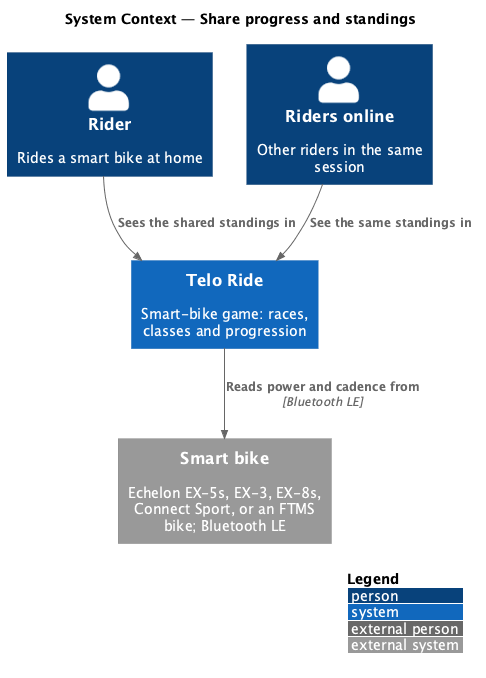
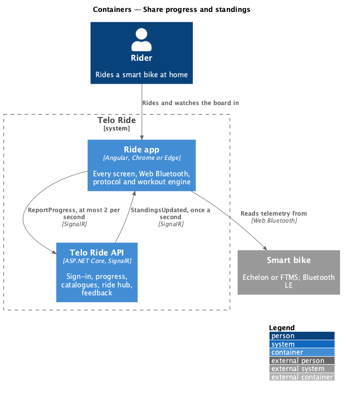
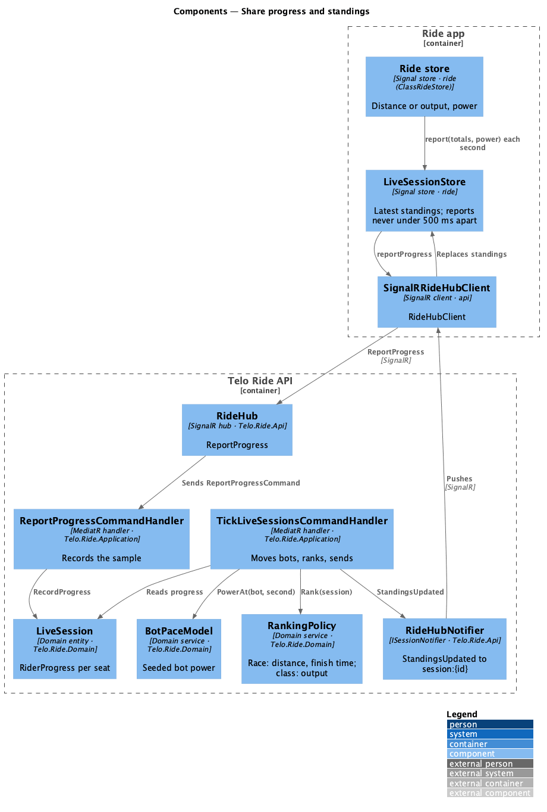
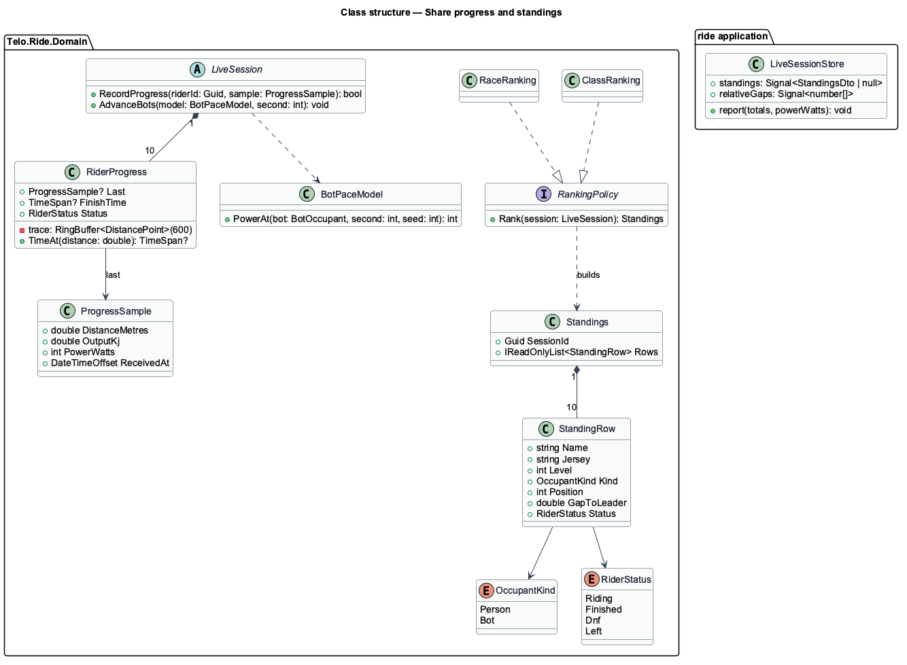
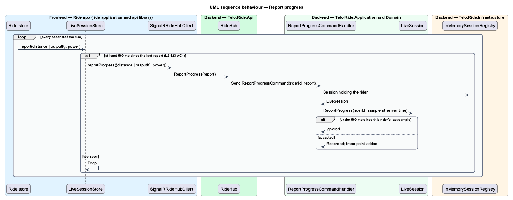
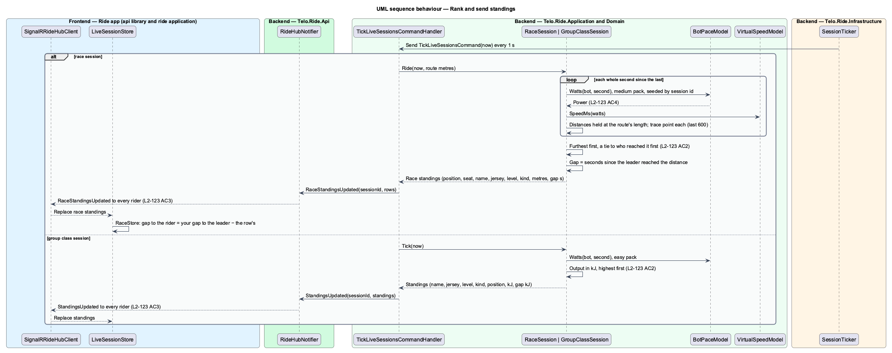

# Share progress and standings

## Overview

In a riders-online race or a group class, each rider pedals their own bike at home, yet all of
them see one shared board. This feature covers how that board is built: each client reports its
rider's progress, the multiplayer service moves the bots, ranks the field and sends the same
standings to everyone once a second.

**progress report** — message from a client carrying its rider's distance (race) or output in kJ
(class) and current power in watts

**standings** — ranked list of every rider in a session, with name, jersey, level, kind (person
or bot), position and gap

**gap** — distance in time (race) or output (class) between a rider and another rider on the board

**pace model** — deterministic rule that sets a bot's power second by second around the pack
strength, with a steady drift and swing of its own (`L2-067` AC1)

Each client sends a progress report every second and never more than twice a second. The service
ranks a race by distance covered, and by finish time once riders finish; it ranks a class by
output. Once a second it sends the standings to every rider in the session. Bots in these
sessions are run by the service, not the browser, on the same pace model the browser uses for a
bots race. The race standings board (`race/ride-a-race`) and the group output board
(`classes/ride-with-a-group`) render what this feature delivers.

## Description

**Frontend (Ride app)**

- **`LiveSessionStore.report(totals, power)`** — the ride's store (`ClassRideStore` for a group
  class) calls it on each of the ride clock's seconds with the ride's output (or, in a race,
  distance) and power. It sends nothing before the seat, and drops a report less than 500 ms
  after the last one sent (`L2-123` AC1); the ride clock's seconds stop with the ride, so nothing
  needs clearing.
- **`RideHubClient.reportProgress(sessionId, outputKj, powerWatts)`** — `api` method sending
  `ReportProgress` without awaiting an answer; `onStandings(handler)` hands on
  `StandingsUpdated`.
- **`LiveSessionStore.standings`** — signal holding the latest `StandingsDto` only. Each
  `StandingsUpdated` replaces it, so nothing grows during a ride (`AGENTS.md`, bounded buffers).
  A computed signal derives each row's gap relative to the rider from the rows' gaps to the
  leader.

**Backend**

- **`RideHub.ReportProgress(report)`** — sends `ReportProgressCommand`.
- **`ReportProgressCommandHandler`** — `Telo.Ride.Application`. It finds the caller's session and
  calls `RecordProgress(riderId, sample)`. The session ignores a sample that arrives less than
  500 ms after the rider's previous one.
- **`ProgressSample`** — value object in `Telo.Ride.Domain`: `DistanceMetres`, `OutputKj`,
  `PowerWatts`, `ReceivedAt` (server time).
- **`RiderProgress`** — per-seat state inside a `LiveSession`: the last sample, the finish time,
  the `RiderStatus`, and a distance trace of fixed length (one point a second, last 600 points)
  used for race gaps.
- **`BotPaceModel`** — domain service. `PowerAt(bot, second)` returns the bot's power from the
  pack strength, a per-bot drift and a swing seeded from the session id, so the same session
  replays the same way (`L2-067` AC1, `L2-123` AC4). The Ride app runs its own `BotPaceModel` in
  `domain/engine` for a bots race (`race/race-the-ghost-and-bots`). The two implementations stay
  equal through one shared table of cases (seed, pack strength, second, expected power) that both
  unit-test suites run. The power-to-speed constants that turn power
  into distance are the open question in `docs/specs/L2.md` (`L2-064`): `<TO SUPPLY>`. The pack
  strength the service uses for bots in a riders-online race is `<TO SUPPLY>`.
- **`RankingPolicy`** — domain service with two rules. `RaceRanking` orders finished riders by
  finish time ahead of unfinished riders ordered by distance; `ClassRanking` orders by output,
  highest first (`L2-123` AC2). DNF riders rank last (see `multiplayer/mark-leavers-and-dnf`).
  Each row's gap to the leader is, for a race, the seconds since the leader reached that rider's
  distance, read from the leader's trace; for a class, the difference in kJ.
- **`Standings`** and **`StandingRow`** — `Name`, `Jersey`, `Level`, `Kind` (`Person` or `Bot`),
  `Position`, `GapToLeader`, `Status` (`L2-123` AC3).
- **`TickLiveSessionsCommandHandler`** — for every running session, once a second: advances each
  bot with `BotPaceModel`, ranks with `RankingPolicy`, and sends `StandingsUpdated` to the
  session group through `ISessionNotifier`.

**As built for group classes (slice 14.5).** A group class keeps its progress in
`GroupClassSession` (the seats, each rider's last report and the bots) rather than a general
`LiveSession`; `ReportProgress` names its session, and the session keeps a report only from a
seated rider, from the start, 500 ms or more after the rider's last. Its bots ride
`BotPaceModel` around the easy pack (130 W), seeded with the session's id; each is "Pacer Nova",
"Pacer Rook" and so on, in the jersey of its name, and has no level. Bots fill a session to 10 at
its first tick when fewer than 8 riders are seated (`L2-083`). The standings rank by output,
seats before bots on a tie, with each gap to the leader in kJ. The service's `BotPaceModel` and
the Ride app's run one table of cases in their unit tests. `LiveSession`, `RiderProgress`, race
ranking and the distance trace come with the riders-online race.

## Requirements

The feature realizes the following level-2 (L2) requirements. Each L2 requirement refines a
level-1 (L1) requirement, cited by identifier.

| L2 ID | Refines (L1) | Requirement |
|-------|--------------|-------------|
| `L2-123` (AC1) | `L1-020` | During a session, each client shall send its rider's distance (race) or output in kJ (class) and its power every second, at most twice a second. |
| `L2-123` (AC2) | `L1-020` | The service shall rank a race by distance covered, then by finish time once finished, and a class by output. |
| `L2-123` (AC3) | `L1-020` | The service shall send the standings to every rider in the session once a second, with each rider's name, jersey, level, kind (person or bot), position and gap. |
| `L2-123` (AC4) | `L1-020` | The service shall move the bots in a session on the same pace model as `L2-067` AC1. |

## Diagrams

### System context

Riders in one session share progress through Telo Ride; no external system takes part.

### Containers

Each Ride app reports progress to the Telo Ride API and receives standings over the same hub
connection; live progress stays in the API's memory.

### Components

The ride's store reports through `LiveSessionStore` to `RideHub`; the tick handler combines `BotPaceModel` and `RankingPolicy`
and pushes the standings back through `RideHubNotifier`.

### Class structure

A `LiveSession` holds one `RiderProgress` per seat; `RankingPolicy` turns them into `Standings`
of `StandingRow`s.

### Behaviour — report progress

The client sends one sample a second; the session drops a sample that comes too soon
(`L2-123` AC1).

### Behaviour — rank and send standings

Each tick moves the bots, ranks the field and sends one standings message to every rider
(`L2-123` AC2, AC3, AC4).

