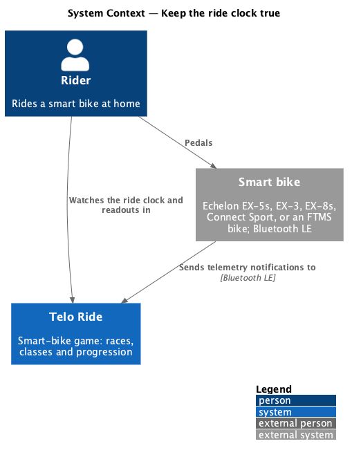
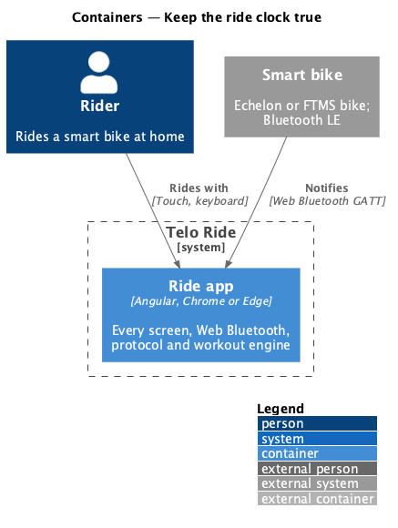
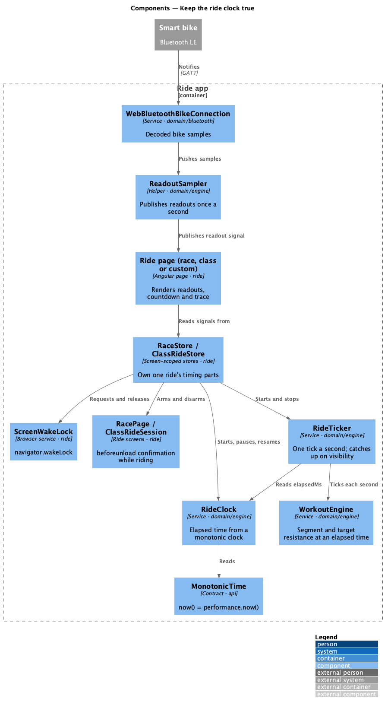
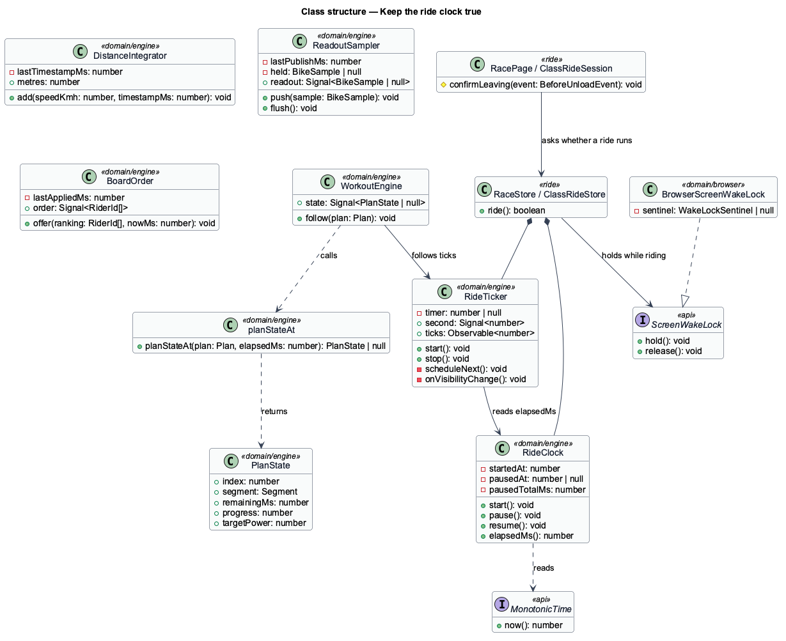
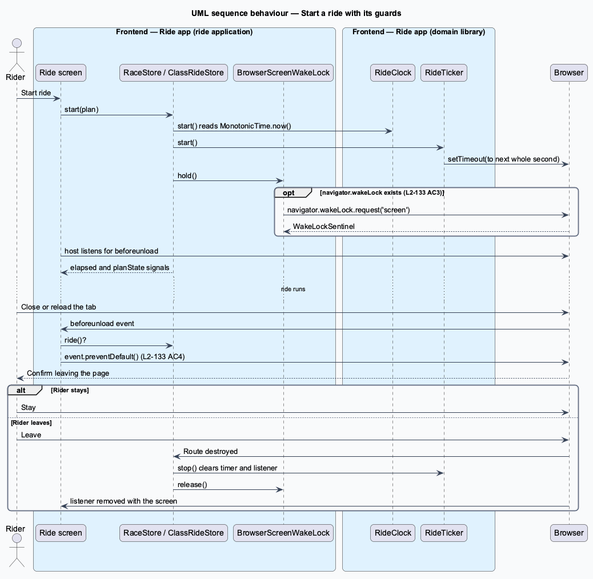
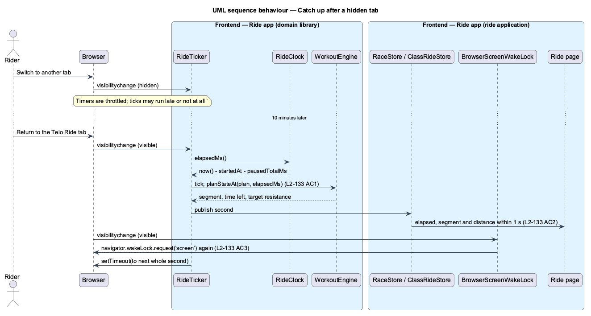
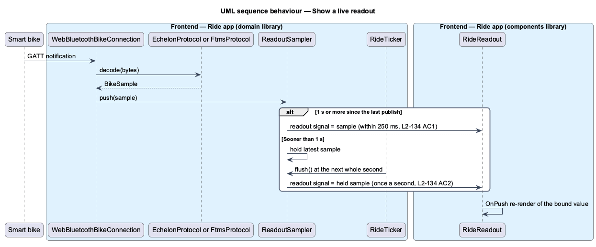

# Keep the ride clock true

## Overview

Telo Ride drives a smart bike through a timed plan for a race, a class or a custom workout. Every
readout the rider sees during a ride depends on one number: how long the ride has been running.
The plan's current segment, the countdown to the next interval, the distance and the target
resistance all derive from it.

Browsers slow down timers in a tab that is hidden or in the background. A clock that counts timer
ticks therefore falls behind when the rider switches to another tab, and the plan drifts from the
video and from other riders. This feature keeps the ride clock exact in a hidden tab, keeps the
screen awake during a ride, asks before a running ride is closed, and holds every live readout to
a fixed update rate.

- **ride clock** — elapsed riding time of the current ride, excluding paused time
- **monotonic clock** — time source that never jumps backwards and ignores wall-clock changes; `performance.now()` in the browser
- **tick** — once-a-second moment at which the ride's per-second values are recomputed
- **readout** — on-screen value of one live metric, such as power or cadence
- **board** — ranked list of riders in a race or group class

The feature belongs to the performance subsystem. It is a frontend-only slice: the backend takes
no part in timing a ride.

## Description

The slice lives in the Ride app. Timing rules sit in `domain`'s `engine/` folder; browser
integrations sit in the `ride` application, scoped to the ride route.

- **`MonotonicTime`** — contract in `api` with one method, `now(): number`, bound by the token
  `MONOTONIC_TIME`. The composition root (`app.config.ts`) binds it to `performance.now()`. Unit
  tests bind a fake clock that advances on demand.
- **`RideClock`** — service in `domain/engine`. It records the monotonic time at `start()`, adds
  up paused intervals in `pause()` and `resume()`, and answers `elapsedMs()` as the difference.
  It never counts ticks.
- **`RideTicker`** — service in `domain/engine`. It schedules the next tick with `setTimeout` at
  the next whole second of `RideClock.elapsedMs()` (a second later while paused). On each tick
  that reaches a new whole second it publishes it as the signal `second` and on `ticks`, so a
  paused ride publishes nothing. It listens for `visibilitychange` and ticks at once when the tab
  becomes visible. `stop()` clears the timer and removes the listener, and so does destroying
  its owner.
- **`planStateAt(plan, elapsedMs)`** — pure function of the plan (`domain/engine`). It returns
  the current `PlanState` (the segment and its index, the time left in it, its progress and its
  target power) for any elapsed time, or nothing once the plan has ended, so a late tick lands on
  the correct segment. **`WorkoutEngine`** calls it on each of `RideTicker`'s ticks and sends a
  new segment's level through `ResistanceController`; after a hidden tab only the current
  segment's level is sent, not every segment it missed.
- **`DistanceIntegrator`** — helper in `domain/engine`. It integrates speed over the timestamps of
  bike notifications, not over ticks, so distance stays correct while ticks are throttled.
- **`ReadoutSampler`** — helper in `domain/engine`. It turns the stream of decoded bike samples
  into the signal the readouts bind to. A sample arriving 1 s or more after the last publish
  publishes at once; a sample arriving sooner replaces the held value, which publishes at the end
  of that second. Readouts therefore change once a second and show a new reading within 250 ms of
  its notification at the bike's 1 Hz rate.
- **`BoardOrder`** — helper in `domain/engine`. It holds the board order and applies a new ranking
  at most once a second.
- **`ScreenWakeLock`** — contract in `api` (token `SCREEN_WAKE_LOCK`), implemented by
  `BrowserScreenWakeLock` in `domain`'s `browser/` folder over `navigator.wakeLock`. `hold()`
  requests a `screen` lock when a ride starts and again on `visibilitychange` to visible;
  `release()` lets it go when the ride ends. Where the API is absent it does nothing.
- **Leave guard** — each ride screen (`ClassRideSession`, `RacePage`) listens for `beforeunload`
  through its component `host` binding and calls `preventDefault()` while its ride runs, so the
  browser asks the rider to confirm leaving. Angular removes the listener with the component.
- **`RaceStore`** and **`ClassRideStore`** — the ride screens' stores in the `ride` application,
  provided with `RideClock`, `RideTicker` and `WorkoutEngine` on each ride screen. Each starts the
  clock and ticker, holds the wake lock while the ride runs and releases it on finishing or
  leaving; destroying the screen tears all of them down through `DestroyRef`.

The browser integrations (`BrowserScreenWakeLock`, `BrowserNetworkStatus`, `BrowserFullscreen`)
live in `domain`'s `browser/` folder, bound on the routes that use them.

Slice 5.1 builds `MonotonicTime`, `RideClock`, `RideTicker`, `planStateAt` and `WorkoutEngine`,
proved by unit tests with fake timers and end to end on the simulated bike. The class ride
screen (slice 5.2) binds `MONOTONIC_TIME` and runs them with the Playwright proof;
`ScreenWakeLock` and `LeaveRideGuard` (`L2-133` AC3, AC4) come with pausing, leaving and
finishing a class (slice 5.4), and the class ride's store holds them. Distance is counted once per
running second by `RideTotals` (slice 3.2, `L2-022`); the screen that runs it counts every
second the ticker publishes, so a late tick misses none. `ReadoutSampler` and `BoardOrder` come
with the screens that show readouts and boards.

Slice 18.2 proves a throttled hidden tab end to end on the race and the class ride: while the tab
is hidden the page's timers wait for the next whole minute, as Chrome's intensive throttling
does, and the bike's notifications still arrive each second; shown again after 10 minutes, the
clock, the plan's segment and the race's distance are where a visible tab's would be. It also
gives the race its leave guard (`L2-133` AC4), which only the class ride had.

## Requirements

| L2 ID | Refines (L1) | Requirement |
|-------|--------------|-------------|
| `L2-133` AC1 | `L1-022` | The ride clock of a running ride shall come from a monotonic clock (`performance.now()`) and shall not be computed by counting timer ticks. |
| `L2-133` AC2 | `L1-022` | After the tab is hidden for 10 minutes during a ride and shown again, the clock, the plan's segment and the distance shall be within 1 second of their values in a visible tab. |
| `L2-133` AC3 | `L1-022` | Where the browser offers the Screen Wake Lock API, a running ride shall keep the screen awake and shall take the lock again when the tab becomes visible. |
| `L2-133` AC4 | `L1-022` | When the rider closes or reloads the tab during a running ride, the browser shall ask the rider to confirm leaving. |
| `L2-134` AC1 | `L1-022` | The readouts shall show a notification from the bike within 250 ms. |
| `L2-134` AC2 | `L1-022` | Every readout, countdown and trace of a running ride shall update once each second. |
| `L2-134` AC3 | `L1-022` | A race or class board shall reorder at most once a second when places change. |

## Diagrams

### System context

The rider pedals the smart bike; Telo Ride receives its notifications and keeps time for the
ride on the device.

### Containers

Only the Ride app takes part. The backend never times a ride.

### Components

Each ride screen's store owns its timing parts. `RideClock` reads `MonotonicTime`;
`RideTicker` drives `WorkoutEngine` and the readouts once a second; the browser integrations
guard the screen and the tab.

### Class structure

`RideClock` depends on the `MonotonicTime` contract, `RideTicker` reads `RideClock`, and the
store composes every part so their lifetimes end together.

### Behaviour — start a ride with its guards

Starting a ride starts the clock, takes the wake lock and registers the leave guard
(`L2-133` AC3, AC4). Closing the tab during the ride raises the browser's confirmation.

### Behaviour — catch up after a hidden tab

While the tab is hidden the browser throttles timers, so ticks arrive late. On return the ticker
ticks at once and every value is recomputed from elapsed monotonic time (`L2-133` AC2).

### Behaviour — show a live readout

A notification from the bike is decoded and passed to `ReadoutSampler`, which publishes it within
the same second and holds later samples to the next second (`L2-134` AC1, AC2).

