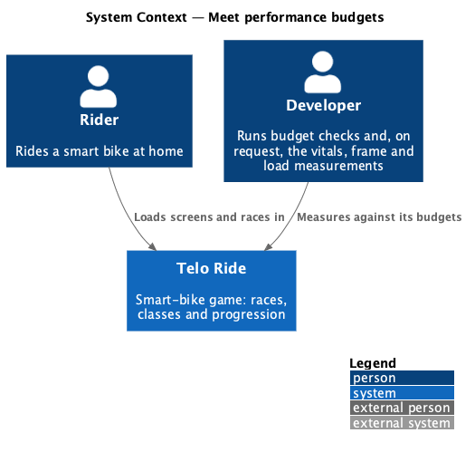
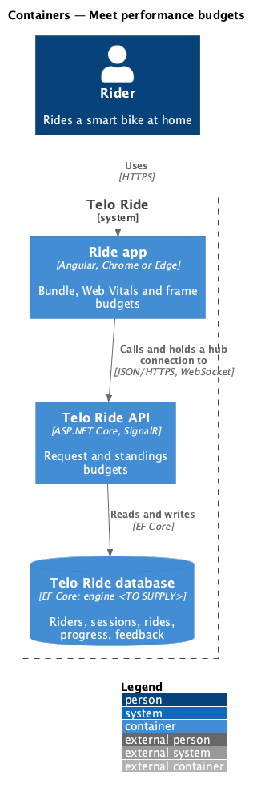
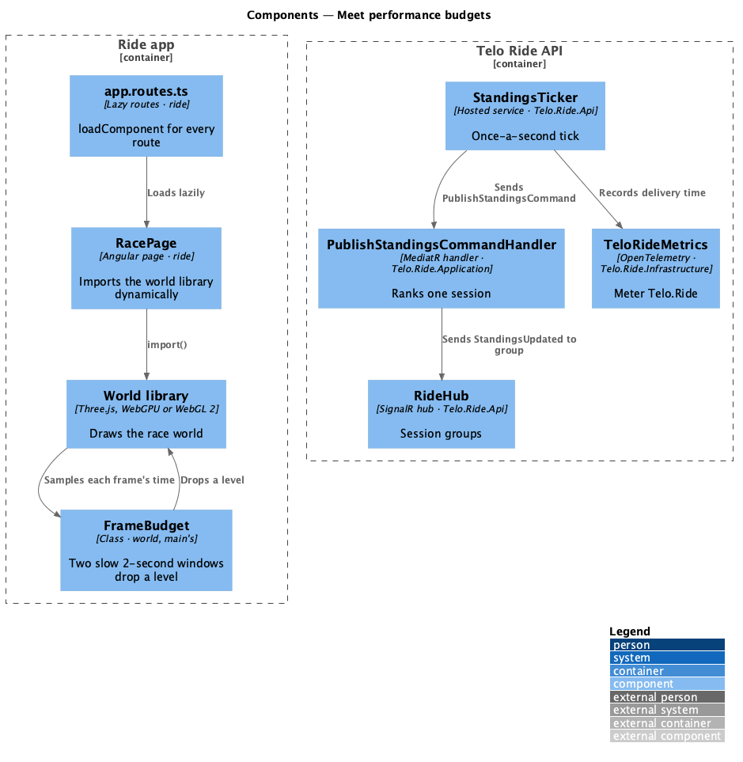
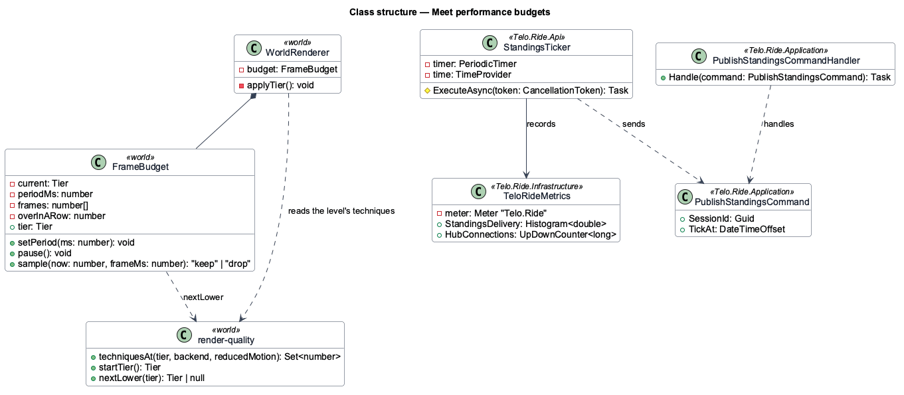
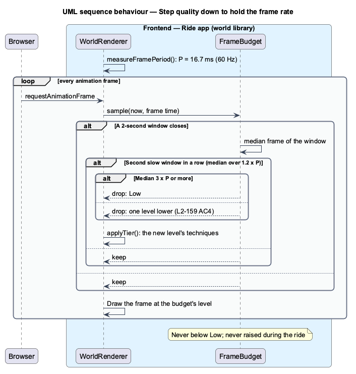
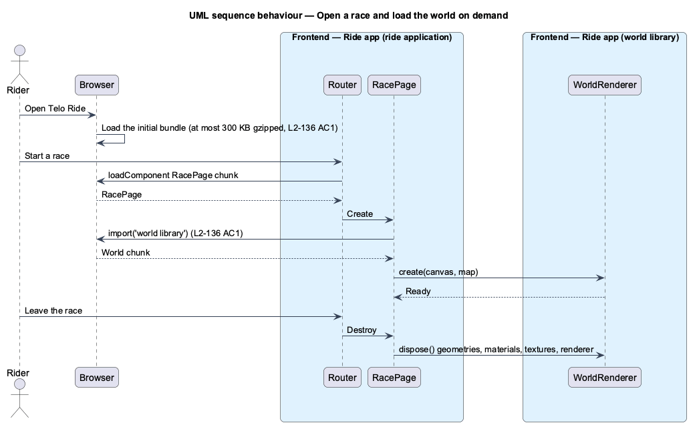
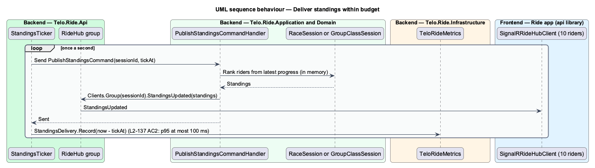

# Meet performance budgets

## Overview

Telo Ride runs for an hour or more on a tablet or low-power laptop beside the bike. It loads over a
mobile connection, draws its 3D world on integrated graphics, and answers every rider in a live
session at once. This feature turns those expectations into measured
budgets, names the parts that keep each budget, and names how each is measured.

- **initial bundle** — JavaScript and CSS the browser downloads before the first screen renders
- **Largest Contentful Paint (LCP)** — time until the largest visible element renders
- **Interaction to Next Paint (INP)** — delay from a rider's input to the next frame
- **quality step** — one notch of rendering detail (pixel ratio, shadow resolution, level of detail) that the 3D world gives up to keep its frame rate
- **standings tick** — once-a-second moment at which the backend ranks a session and sends standings
- **reference laptop** — the integrated-GPU laptop against which the race frame budget is measured; model `<TO SUPPLY>`

The feature belongs to the performance subsystem. It spans both the Ride app and the Telo Ride
API. The 3D world itself is designed in `race/render-the-race-world`; this slice covers how its
frame budget is held and measured.

## Description

### Frontend

- **Route-level lazy loading** — every route in `ride`'s `app.routes.ts` uses `loadComponent` or
  `loadChildren`. Heavy, below-the-fold parts use `@defer`.
- **World library** — the race's 3D world (Three.js, WebGPU with WebGL 2 fallback) is a separate
  library imported with dynamic `import()` from `RacePage` only, so it is never in the initial
  chunk.
- **Bundle budgets** — `angular.json` sets a `budgets` entry of type `initial` on the ride app's
  production configuration, measured in raw bytes. Since slice 19.1 it warns at 302 kB and fails
  at 305 kB, a few kilobytes above the 300.26 kB the initial bundle measures (`main` 277.44 kB
  and the global styles); raising it needs a reason in the change. The raw budget sat at 304 and
  310 kB before: the first use of `HttpClient` (slice 5.2) puts `@angular/common/http` in `main`
  wherever it is provided, about 20.7 kB raw, since `@angular/platform-browser` and
  `@angular/router` import it.
- **Gzipped initial bundle** — `frontend/scripts/bundle-size.mjs` (`npm run bundle:size`) reads
  the built `index.html`, gzips every script, stylesheet and module preload it loads before the
  first screen renders, and fails above 300 KB (`L2-136` AC1); it measured 89.77 kB at slice 19.1.
  `node tools/verify/verify.mjs` runs it after the production build, and CI's build job after
  the ride app's build. It lives in `frontend/` because CI checks out only `frontend/` and
  `backend/`.
- **`measureFramePeriod`** — `main`'s `frame-period.ts` in the world library. Before the world's
  first frame it takes the median of about 30 frame intervals and snaps it to the nearest common
  refresh rate: the display's frame period _P_ (16.7 ms at 60 Hz).
- **`FrameBudget`** — `main`'s class in `render-quality.ts`, fed each frame's time by the renderer.
  Every 2 seconds it takes the median frame of that window; a window whose median is over
  1.2 × _P_ is slow. After two slow windows in a row it drops one quality level, or straight to
  Low when the second window's median is 3 × _P_ or more, so the rider sees one change of look,
  not one per level. It never drops below Low and never raises the level during the ride
  (`L2-159` AC4). The renderer applies the new level on the next frame; its programs were
  compiled while the world loaded, so the drop costs no hitch. Frame rate is protected by giving
  up detail first (`L2-136` AC3).
- **Web Vitals measurement** — a Lighthouse run (`tools/perf/home-vitals.mjs`) with a mobile
  device profile and a 4G throttling profile measures Home cold. The device and network profile
  values are `<TO SUPPLY>`. Like the heap checks, it runs only when a person asks.

### Backend

- **ASP.NET Core metrics** — the built-in `http.server.request.duration` histogram, exported through
  OpenTelemetry with the route template as its only route attribute.
- **`TeloRideMetrics`** — class in `Telo.Ride.Infrastructure` holding instruments on the
  `Telo.Ride` meter: the histogram `telo.ride.standings.delivery` (milliseconds from the standings
  tick to the send completing) and the up-down counter `telo.ride.hub.connections`.
- **`StandingsTicker`** — hosted service in `Telo.Ride.Api` that, once a second, sends a
  `PublishStandingsCommand` per running session through MediatR. Its handler ranks the session
  (designed in `multiplayer/share-progress-and-standings`) and sends `StandingsUpdated` to the
  session's SignalR group.
- **Load test** — a scripted load test under `tools/load/` drives 200 requests a second across the
  API and 2,000 hub connections in sessions of 10 against one instance. The load-test tool and the
  instance size are `<TO SUPPLY>`. It runs only when a person asks.

## Requirements

| L2 ID | Refines (L1) | Requirement |
|-------|--------------|-------------|
| `L2-136` AC1 | `L1-022` | The production build's initial bundle shall be at most 300 KB gzipped, and the 3D world shall be loaded only when a race opens. |
| `L2-136` AC2 | `L1-022` | Home, loaded cold on a mid-range phone over a 4G profile, shall reach Largest Contentful Paint within 2.5 s and keep Interaction to Next Paint under 200 ms. |
| `L2-136` AC3 | `L1-022` | A race at 1920 × 1080 on the reference laptop (integrated GPU) shall hold at least 50 frames a second on average and shall not drop below 30 for more than one second; quality shall step down before frame rate does. |
| `L2-137` AC1 | `L1-022` | At 200 requests a second across the API, 95 % of requests shall answer within 200 ms. |
| `L2-137` AC2 | `L1-022` | In a session of 10 riders, standings shall reach every rider within 100 ms of the once-a-second tick at the 95th percentile. |
| `L2-137` AC3 | `L1-022` | One API instance shall hold 2,000 concurrent hub connections within those budgets. |

## Diagrams

### System context

The rider uses Telo Ride; the budgets are properties of Telo Ride itself, measured by a person on
request.

### Containers

The Ride app carries the bundle, Web Vitals and frame budgets; the Telo Ride API carries the
request and standings budgets.

### Components

On the frontend, lazy routes and the dynamically imported world library keep the initial bundle
small, and the renderer feeds `FrameBudget` each frame's time. On the backend, `StandingsTicker`
drives the standings and `TeloRideMetrics` records their delivery time.

### Class structure

The renderer owns one `FrameBudget`, judged against the period `measureFramePeriod` found, and
reads the techniques of its level from `techniquesAt`.
`StandingsTicker` sends one command per session and records into `TeloRideMetrics`.

### Behaviour — step quality down to hold the frame rate

Each frame the renderer hands `FrameBudget` the frame's time. When two 2-second windows in a row
have a median frame over 1.2 × _P_, the budget drops one level for the rest of the race, or
straight to Low when the second is 3 × _P_ or more; the renderer draws the new level's techniques
from the next frame (`L2-159` AC4, `L2-136` AC3).

### Behaviour — open a race and load the world

The initial bundle holds no 3D code; opening a race imports the world library on demand
(`L2-136` AC1).

### Behaviour — deliver standings within budget

Each second the ticker ranks every running session and sends its standings; the delivery time is
recorded for the 95th-percentile budget (`L2-137` AC2).

## Open questions

- **Slice 19.1 measures the built `index.html`, not `stats.json`.** This design first had a
  `tools/verify/bundle-size.mjs` read the initial chunks from the build's `stats.json`. The files
  `index.html` loads are exactly what the browser downloads before the first screen, and need no
  stats build, so the check reads them; it lives under `frontend/scripts/` for CI's sparse
  checkout. Every route already used `loadComponent` or `loadChildren`, so 19.1 added none; its
  acceptance spec proves Home opens without Three.js and the world's code arrives with a race.

- **Slice 8.5 follows `L2-159` AC4 and `main`.** This design first named a `FrameBudgetMonitor`
  averaging 120 frames and a `QualityGovernor` that stepped down below 50 frames a second and
  raised a step again after a stretch well above it. `L2-159` AC4 judges two 2-second windows
  against the display's frame period and never raises the level, and so does `main`'s
  `FrameBudget`, which the world library carries (ADR 0030). `main` wins on rendering, so its far
  slow window, 3 × _P_ or more, dropping straight to Low (its #896), joins `L2-159` AC4.
