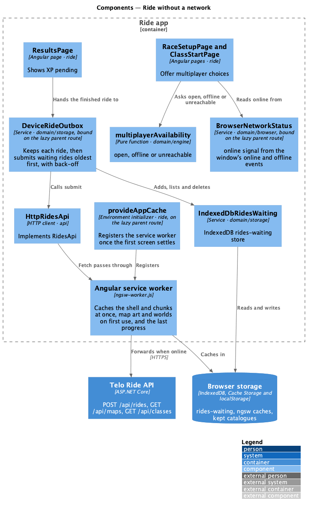

# Ride without a network

## Overview

A rider's home network may drop, or the Telo Ride backend may be unreachable, while the rider is
on the bike. The bike connection is local Bluetooth, so a ride itself does not need the network.
Only three things do: submitting the finished ride so the backend can compute its XP, loading the
app and its catalogues, and joining a ride with other people.

This feature keeps a finished ride on the device until the backend records it, caches the app and
the catalogues so solo rides start offline, and explains why multiplayer rides cannot be joined
while offline.

- **ride outbox** — IndexedDB store of finished rides that the backend has not yet recorded
- **ride id** — client-generated identifier of one ride, used by the backend as its idempotency key
- **app shell** — the HTML, scripts, styles and fonts needed to start the app
- **catalogue** — backend-served list of maps (`GET /api/maps`) or classes (`GET /api/classes`)
- **XP pending** — Results state of a ride whose XP the backend has not yet computed

The feature belongs to the performance subsystem. The backend endpoint that records a ride is
designed in `progression/keep-progress-on-the-backend` and
`multiplayer/record-results-nobody-can-change`; this slice only calls it.

## Description

- **`RidesWaiting`** — contract in `api` (token `RIDES_WAITING`), implemented by
  `IndexedDbRidesWaiting` in `domain/storage`. It keeps each finished ride in the IndexedDB object
  store `rides-waiting` of the database `telo-ride`, keyed by ride id, with `finishedAt` and
  `attempts`. It lists rides oldest first by `finishedAt` and deletes a ride once it is settled.
  Where IndexedDB cannot be opened (a private window that refuses it), it keeps the rides in
  memory for the session, as before this slice.
- **`RideOutbox`** — contract in `api` (token `RIDE_OUTBOX`), implemented by `DeviceRideOutbox` in
  `domain/storage` and bound on the screens' lazy parent route (`provideSession`), whose injector
  lasts as long as the app, so rides wait across screens. `submit` writes the ride to
  `RidesWaiting` before sending it, and `status` follows it for Results. It sends waiting rides one at a time, oldest first, through
  `RidesApi.submitRide`: when the app starts (an environment initializer creates it), on the window
  `online` event, after each new ride and on its own retry timer. A ride is removed from the device
  once the backend has recorded it.
  - **Kept and sent again:** a failure that is transient (no answer, 5xx, 429) or an ended
    session (401, which `L2-004` AC4 keeps until the rider signs in again). Results reads it as
    waiting offline ("Your XP will be added when you’re back online."). The next try is 30 seconds
    later, the delay doubling each time (30 s, 1 min, 2 min…) up to one hour (`L2-135` AC2); the
    `online` event tries at once.
  - **Dropped:** a ride the backend refuses for good (422 `ride_not_plausible`, or another 4xx).
    Sending it again would get the same answer, so it is removed and Results says it wasn't
    recorded (`L2-074` AC4).
  - A riders-online race the backend answers 409 `result_pending` is sent again every 5 seconds
    for up to 3 minutes (`L2-125` AC1), without holding up the rides behind it, and is then
    dropped as not recorded.
- **`RidesApi`** — contract in `api` (token `RIDES_API`), implemented by `HttpRidesApi` over
  `POST /api/rides`. The body carries the ride id, so a resubmission returns the first result
  (`L2-125` AC3).
- **`NetworkStatus`** — root-provided service in the `ride` application. It exposes `online` as a
  signal from `navigator.onLine` and the `online`/`offline` events, and `backendReachable` from the
  outcome of the last API call.
- **Angular service worker** — `@angular/service-worker` with `ngsw-config.json`. The asset group
  `app` prefetches the app shell and fonts. The asset group `lazy` caches route chunks and map
  worlds on first use. The data group `catalogues` caches `/api/maps` and `/api/classes` with the
  `freshness` strategy and a network timeout of `<TO SUPPLY>`, so the cached copy answers offline.
- **`MultiplayerAvailability`** — helper in `domain/engine` used by Race Setup and Class Start. It
  returns `unavailable('offline')` for riders-online races and group classes when `online` is false.
  The screens render the reason as text. The copy is a mock gap (`<TO SUPPLY>`).
- **`ResultsPage`** — when submission fails, the page shows the ride from `RideOutbox` with its XP
  marked pending (state designed in `results/show-xp-stars-and-personal-best`).

A solo class offline depends on the YouTube video already being in the browser's own HTTP cache.
The app's service worker does not cache cross-origin video, so this case is outside the app's
control.

## Requirements

| L2 ID | Refines (L1) | Requirement |
|-------|--------------|-------------|
| `L2-135` AC1 | `L1-022` | A ride that finishes while the network is down or the backend is unreachable shall be kept in IndexedDB with its id, and Results shall show the ride with its XP pending. |
| `L2-135` AC2 | `L1-022` | When the network returns, waiting rides shall be submitted oldest first, retried with growing delays up to an hour, and removed from the device once the backend has recorded them. |
| `L2-135` AC3 | `L1-022` | Once the app has been opened, the app shell and the map and class catalogues shall be cached, so a solo race, a bots race, a solo class (if the video is cached) and a custom ride can start without a network. |
| `L2-135` AC4 | `L1-022` | While the network is down, a riders-online race or group class shall not be joinable, and the screen shall say why. |

## Diagrams

### System context

The rider rides offline; Telo Ride later reaches its own backend to record the ride. YouTube
serves class videos when the network is up.

### Containers

The Ride app keeps waiting rides in browser storage and submits them to the Telo Ride API, which
records them in the database.

### Components

`DeviceRideOutbox` keeps rides in `IndexedDbRidesWaiting` and calls `RidesApi`; the service
worker answers shell and catalogue requests from its cache; `NetworkStatus` feeds the join rule.

### Class structure

`DeviceRideOutbox` implements `RideOutbox` and depends on the `RidesWaiting` and `RidesApi`
contracts. A `WaitingRide` record carries the ride id that makes resubmission safe.

### Behaviour — finish a ride offline

The ride is kept on the device before it is sent; the submission fails, it stays, and Results
shows its XP as pending (`L2-135` AC1).

### Behaviour — send waiting rides when the network returns

`DeviceRideOutbox` submits the oldest ride first, deletes it once recorded, and backs off on
failure (`L2-135` AC2).

### Behaviour — start a solo ride offline

The service worker serves the shell and the cached catalogue; the multiplayer choices say why they
are unavailable (`L2-135` AC3, AC4).

