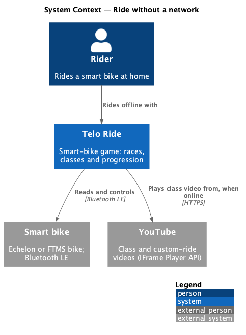
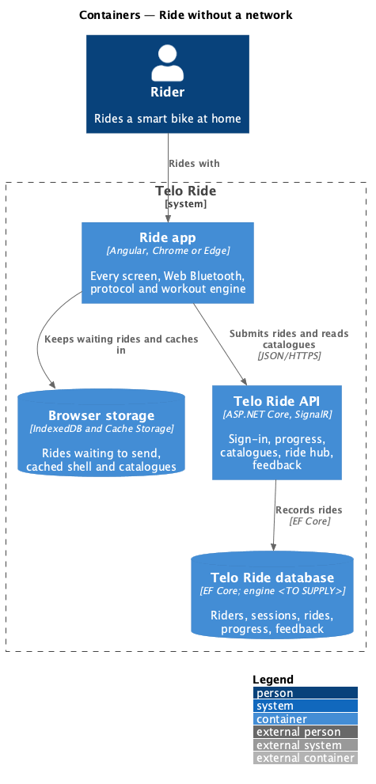
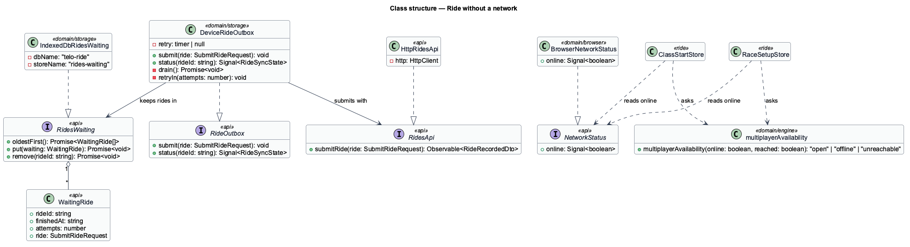
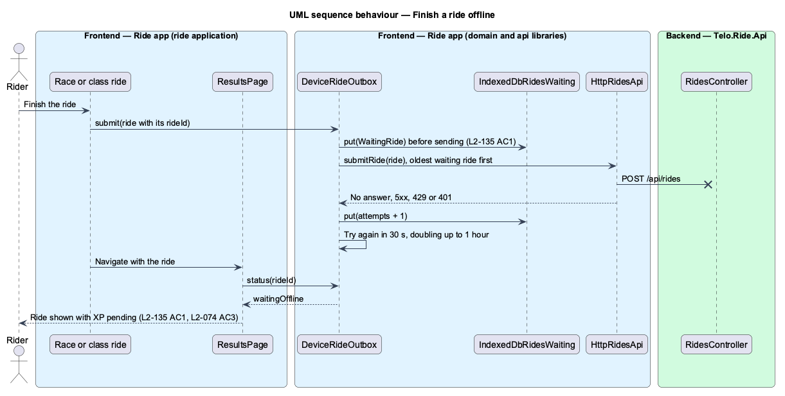
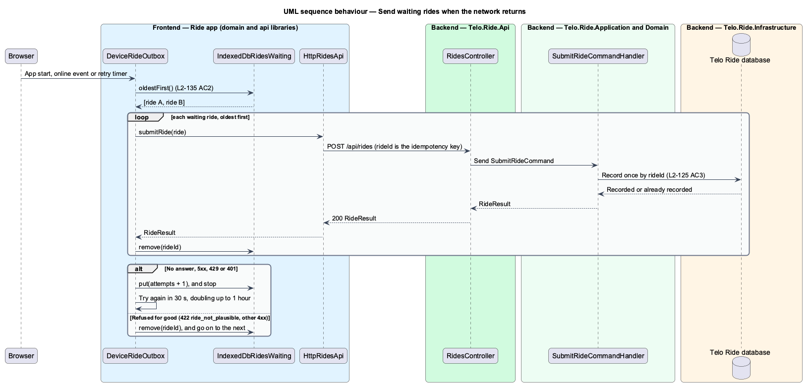
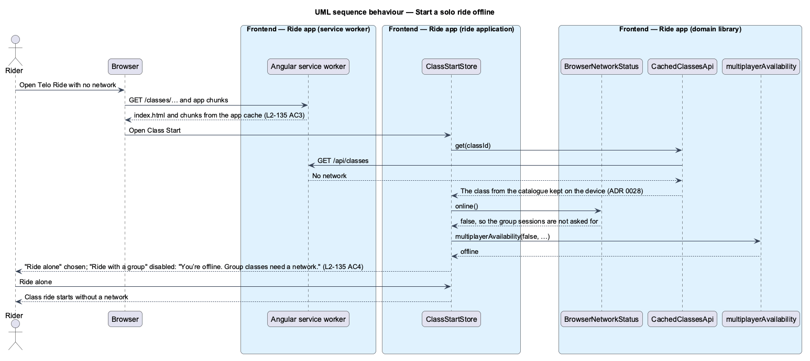

# Ride without a network

## Overview

A rider's home network may drop, or the Telo Ride backend may be unreachable, while the rider is
on the bike. The bike connection is local Bluetooth, so a ride itself does not need the network.
Only three things do: submitting the finished ride so the backend can compute its XP, loading the
app and its catalogues, and joining a ride with other people.

This feature keeps a finished ride on the device until the backend records it, caches the app so
solo rides start offline (the catalogues are already kept on the device, ADR 0028 and ADR 0029),
and explains why multiplayer rides cannot be joined while offline.

- **ride outbox** — IndexedDB store of finished rides that the backend has not yet recorded
- **ride id** — client-generated identifier of one ride, used by the backend as its idempotency key
- **app shell** — the HTML, scripts, styles and fonts needed to start the app
- **app cache** — the Angular service worker's caches of the app shell, its chunks and its art
- **catalogue** — backend-served list of maps (`GET /api/maps`) or classes (`GET /api/classes`)
- **XP pending** — Results state of a ride whose XP the backend has not yet computed

The feature belongs to the performance subsystem. The backend endpoint that records a ride is
designed in `progression/keep-progress-on-the-backend` and
`multiplayer/record-results-nobody-can-change`; this slice only calls it.

## Description

- **`RidesWaiting`** — contract in `api` (token `RIDES_WAITING`), implemented by
  `IndexedDbRidesWaiting` in `domain/storage`. It keeps each finished ride in the IndexedDB object
  store `rides-waiting` of the database `telo-ride`, keyed by ride id, with `finishedAt` and
  `attempts`. It lists rides oldest first by `finishedAt` and deletes a ride once it is settled.
  Where IndexedDB cannot be opened (a private window that refuses it), it keeps the rides in
  memory for the session, as before this slice.
- **`RideOutbox`** — contract in `api` (token `RIDE_OUTBOX`), implemented by `DeviceRideOutbox` in
  `domain/storage` and bound on the screens' lazy parent route (`provideSession`), whose injector
  lasts as long as the app, so rides wait across screens. `submit` writes the ride to
  `RidesWaiting` before sending it, and `status` follows it for Results. It sends waiting rides one at a time, oldest first, through
  `RidesApi.submitRide`: when the app starts (an environment initializer creates it), on the window
  `online` event, after each new ride and on its own retry timer. A ride is removed from the device
  once the backend has recorded it.
  - **Kept and sent again:** a failure that is transient (no answer, 5xx, 429) or an ended
    session (401, which `L2-004` AC4 keeps until the rider signs in again). Results reads it as
    waiting offline ("Your XP will be added when you’re back online."). The next try is 30 seconds
    later, the delay doubling each time (30 s, 1 min, 2 min…) up to one hour (`L2-135` AC2); the
    `online` event tries at once.
  - **Dropped:** a ride the backend refuses for good (422 `ride_not_plausible`, or another 4xx).
    Sending it again would get the same answer, so it is removed and Results says it wasn't
    recorded (`L2-074` AC4).
  - A riders-online race the backend answers 409 `result_pending` is sent again every 5 seconds
    for up to 3 minutes (`L2-125` AC1), without holding up the rides behind it, and is then
    dropped as not recorded.
- **`RidesApi`** — contract in `api` (token `RIDES_API`), implemented by `HttpRidesApi` over
  `POST /api/rides`. The body carries the ride id, so a resubmission returns the first result
  (`L2-125` AC3).
- **`NetworkStatus`** — contract in `api` (token `NETWORK_STATUS`), implemented by
  `BrowserNetworkStatus` in `domain/browser` and bound on the screens' lazy parent route, so one
  instance lasts as long as the app. It exposes `online`, a signal from `navigator.onLine` kept by
  the window's `online` and `offline` events, whose listeners go with it. Whether the backend
  answers is each screen's own read (the queue, the group sessions), so it holds nothing more.
- **Angular service worker** — `@angular/service-worker`'s `ngsw-worker.js`, written by the
  production build from `projects/ride/ngsw-config.json`. Its asset group `app` prefetches every
  file the app needs to start and ride: `index.html`, the favicon, the styles, every script chunk
  (about 4 MB, so a screen never opened online still opens offline) and the fonts. Its asset group
  `assets` caches on first use the map covers (`/maps/**`), the bike photo (`/machines/**`), the
  world panoramas (`/worlds/**`) and the mesh decoder (`/draco/**`). World music (`/music/**`,
  200 MB) is never cached. Its one data group, `progress`, keeps the last answer of
  `GET /api/progress` with the `freshness` strategy and no timeout: online the backend always
  answers, and when the request fails the kept answer does, so the race's open-map check and the
  header read the rider's maps and level offline. The catalogues need no data group: they are kept
  by `CachedMapsApi` and `CachedClassesApi` in `localStorage` (ADR 0028, ADR 0029). A new deploy is
  fetched in the background and used from the next start; telling the rider of it is
  `platform/install-the-app`.
- **`provideAppCache`** — environment initializer in the `ride` application, bound on the screens'
  lazy parent route (ADR 0032). Once the first screen has settled, or 30 seconds after it starts,
  it registers `ngsw-worker.js`, and it tells a worker that takes control to set itself up, as
  Angular's `provideServiceWorker` would from the initial bundle. A development build and a
  browser without service workers register nothing.
- **`FetchWorldDownloader`** — sends its panorama requests with Angular's `ngsw-bypass` header:
  it keeps the panoramas in its own cache with its own progress and `Range` resume (L2-152,
  L2-156), which the service worker, answering only once a file has fully arrived, would hide.
- **Telo Ride API** — serves `ngsw-worker.js` and `ngsw.json` with `Cache-Control: no-cache`, as
  `index.html`, so a deploy reaches the worker on the next start.
- **`multiplayerAvailability`** — pure function in `domain/engine` used by Race Setup and Class
  Start: from `online` and whether the screen's last read reached the service, it returns `open`,
  `offline` or `unreachable`, offline first. While offline the screens ask the service nothing; the
  moment the browser is back online they ask again at once. They render the reason as text
  (`L2-135` AC4, mocks `race-setup/offline` and `class-start/offline`):
  - Race Setup: Riders online is disabled and reads "You’re offline. Riders online needs a
    network."; a chosen Riders online falls back to Bots, the default (`L2-048` AC1).
  - Class Start: Ride with a group is disabled and reads "You’re offline. Group classes need a
    network."; Ride alone is chosen (`L2-085` AC5).
  - Unreachable keeps the words those screens already had ("Riders online can’t be reached right
    now.", "Group sessions can’t be reached right now.").
- **`ResultsPage`** — when submission fails, the page shows the ride from `RideOutbox` with its XP
  marked pending (state designed in `results/show-xp-stars-and-personal-best`).

A solo class offline depends on the YouTube video already being in the browser's own HTTP cache.
The app's service worker does not cache cross-origin video, so this case is outside the app's
control.

## Requirements

| L2 ID | Refines (L1) | Requirement |
|-------|--------------|-------------|
| `L2-135` AC1 | `L1-022` | A ride that finishes while the network is down or the backend is unreachable shall be kept in IndexedDB with its id, and Results shall show the ride with its XP pending. |
| `L2-135` AC2 | `L1-022` | When the network returns, waiting rides shall be submitted oldest first, retried with growing delays up to an hour, and removed from the device once the backend has recorded them. |
| `L2-135` AC3 | `L1-022` | Once the app has been opened, the app shell and the map and class catalogues shall be cached, so a solo race, a bots race, a solo class (if the video is cached) and a custom ride can start without a network. |
| `L2-135` AC4 | `L1-022` | While the network is down, a riders-online race or group class shall not be joinable, and the screen shall say why. |

## Diagrams

### System context

The rider rides offline; Telo Ride later reaches its own backend to record the ride. YouTube
serves class videos when the network is up.

### Containers

The Ride app keeps waiting rides in browser storage and submits them to the Telo Ride API, which
records them in the database.

### Components

`DeviceRideOutbox` keeps rides in `IndexedDbRidesWaiting` and calls `RidesApi`; `provideAppCache`
registers the service worker, which answers the shell, chunk and art requests from its cache;
`NetworkStatus` feeds the join rule.

### Class structure

`DeviceRideOutbox` implements `RideOutbox` and depends on the `RidesWaiting` and `RidesApi`
contracts. A `WaitingRide` record carries the ride id that makes resubmission safe.

### Behaviour — finish a ride offline

The ride is kept on the device before it is sent; the submission fails, it stays, and Results
shows its XP as pending (`L2-135` AC1).

### Behaviour — send waiting rides when the network returns

`DeviceRideOutbox` submits the oldest ride first, deletes it once recorded, and backs off on
failure (`L2-135` AC2).

### Behaviour — start a solo ride offline

The service worker serves the shell and chunks, the catalogue comes from the copy kept on the
device, and the multiplayer choices say why they are unavailable (`L2-135` AC3, AC4).

## Open questions

1. A ride kept because the session had ended (401, `L2-004` AC4) is tried again on the retry
   timer, as any ride that did not reach the backend, and on the next app start. Sending it the
   moment the rider signs in again would need the outbox to follow the current rider; slice 17.1
   leaves it to the timer, which tries again within the hour at the latest.
2. A ride is written to the device when it is submitted, a few milliseconds after the ride ends.
   A tab closed in that moment loses it; the race or class submits before it opens Results, so
   the rider sees Results only once the write has started.
3. Slice 17.2 caches every script chunk when the app is first opened, World Ride's 1.1 MB chunk
   among them, so any ride can start offline after one visit. If that download proves too heavy on
   a metered connection, the World Ride chunks could move to the `assets` group, cached on first
   use, at the cost of a world class never ridden online not starting offline.
4. The `progress` data group keeps the last answer for the device, not for a rider. A rider who
   signs out and another who signs in on the same device would see the first rider's maps and
   level only while the backend cannot be reached. Clearing it on sign-out would need the app to
   reach the worker's caches; slice 17.2 leaves it.
5. The progress is kept only once the worker controls the page, from the second screen the rider
   opens or the next start, since the first screen's requests are made before the worker is
   registered.
