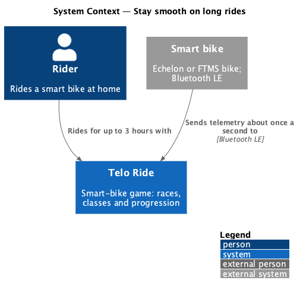
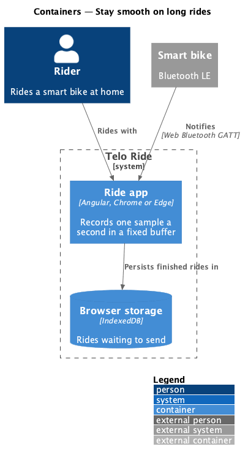
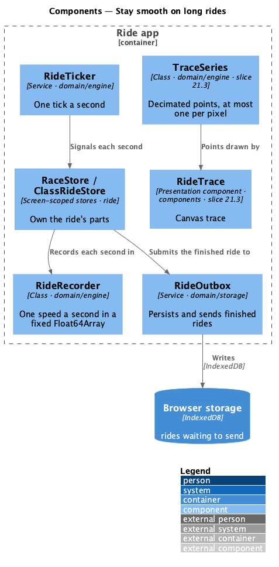
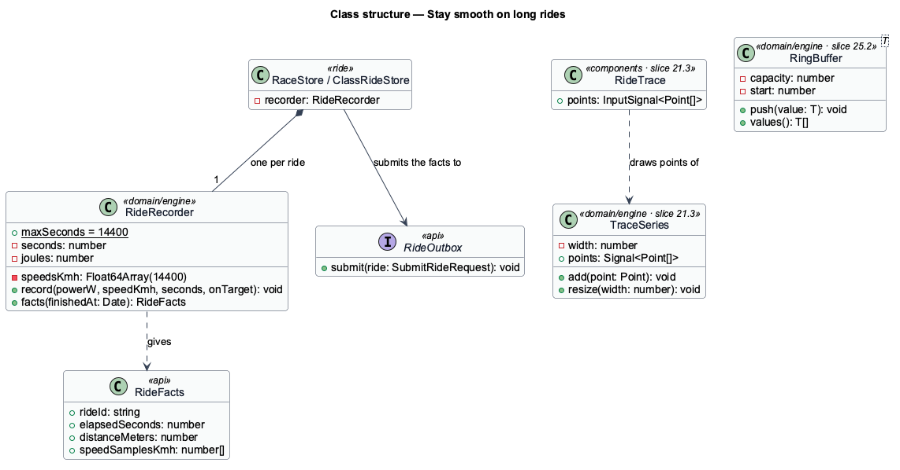
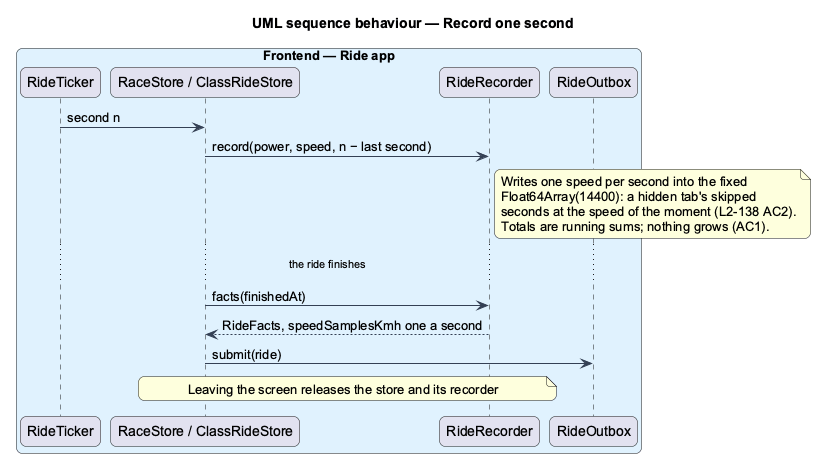
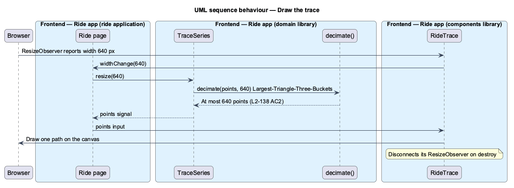
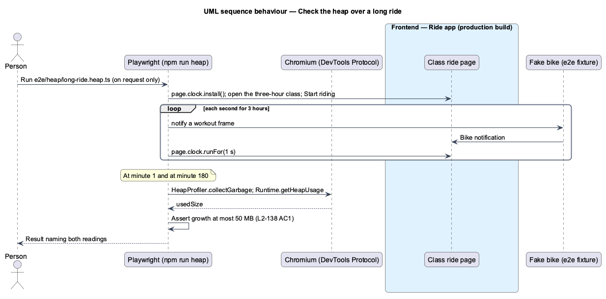

# Stay smooth on long rides

## Overview

A ride on Telo Ride may last three hours. During that time the app receives a bike notification
about once a second, records the rider's power and cadence, and draws them as a trace. Anything
the app keeps without a limit grows for the whole ride. On a tablet or low-power laptop that
growth makes the app slower toward the end of the ride, and may end the tab.

This feature bounds what a ride keeps in memory and what a trace draws, and names the check that
proves memory stays flat.

- **sample** — one second of a ride's trace: the speed the ride moved at in that second, in km/h
- **trace** — chart of a metric over the ride, drawn by the `RideTrace` component
- **decimation** — reduction of a series to at most one point per horizontal pixel of a chart
- **heap check** — measurement of the page's used JavaScript heap after a forced garbage collection, at two moments a check compares

The feature belongs to the performance subsystem and is frontend-only. The bounded packet log is
designed in `diagnostics/record-the-packet-log`.

## Description

- **`RideRecorder`** — class in `domain/engine` (slice 10.1), one per ride, created by the race's
  and the class ride's stores when the ride starts. It holds the ride's trace in one
  `Float64Array` of 14,400 seconds, four hours, the longest ride the backend records: 115 kB,
  allocated once. Each running second writes that second's speed; seconds a hidden tab skipped
  are filled at the speed of the moment, so the trace keeps one sample a second (`L2-138` AC2).
  Output, top power and the seconds on target are running sums, never lists. Nothing past four
  hours is kept. At the finish `facts()` copies the seconds ridden into the ride the outbox sends
  (`speedSamplesKmh`), and the recorder goes with its store when the rider leaves the screen.
- **Leaderboards** — the race's and the class ride's stores replace their standings on each
  standings tick, so a board holds the current field only. The race board measures its rows
  afresh each time; the class board's row positions (for the slide) forget a rider who leaves.
- **`TraceSeries`, `decimate(points, width)` and `RideTrace`** — the chart's bounded series (at
  most one point per pixel column, merged by Largest-Triangle-Three-Buckets) and the
  `wz-ride-trace` canvas that draws it come with the only chart, the custom ride's trace view
  (slice 21.3, `docs/mocks/pages/custom-ride/`), which `L2-138` AC2's second half needs.
- **`RingBuffer<T>`** — a fixed-capacity buffer in `domain/engine` for a live window that keeps
  its newest entries, first needed by the packet log's bounded command log (slice 25.2).
- **Teardown** — every part registers its cleanup with `DestroyRef`: timers, listeners,
  `ResizeObserver`s and object URLs end with the ride route.
- **Heap checks** — `frontend/e2e/heap/*.heap.ts`, run by `npm run heap` through
  `playwright.heap.config.ts` (the production build, one check at a time, 20 minutes each) and
  only when a person asks, never by verify, CI or an agent. Each reads the page's used heap with
  `Runtime.getHeapUsage` after `HeapProfiler.collectGarbage` through the Chrome DevTools Protocol
  (`e2e/heap/heap.ts`), and fails naming both readings.
  - `long-ride.heap.ts` rides the three-hour endurance class second by second on Playwright's
    paused clock, the fake bike notifying each second, and allows 50 MB of growth from minute 1 to
    minute 180 (`L2-138` AC1).
  - `enter-and-leave.heap.ts` enters and leaves the race with its 3D world (WebGL 2), and a class
    ride with its world loading, six times each in one page on the running clock. After the first
    leave every lazy chunk is loaded, so five more rounds may grow the heap by at most 5 MB; a
    leaked world or ride costs more than that each round.

## Requirements

| L2 ID | Refines (L1) | Requirement |
|-------|--------------|-------------|
| `L2-138` AC1 | `L1-022` | During a 3-hour ride, the page's memory shall grow by at most 50 MB from the first minute to the last. |
| `L2-138` AC2 | `L1-022` | The stored ride shall hold one sample a second, and the chart shall draw at most one point per pixel of width. |

## Diagrams

### System context

The smart bike feeds a long ride; Telo Ride records it on the device.

### Containers

The Ride app holds a ride's trace in one fixed buffer and hands it to the ride waiting to be sent.

### Components

The ride's store feeds `RideRecorder` each second it counts; at the finish the recorder's facts go
to the outbox. `TraceSeries` and `RideTrace` join with the custom ride's trace view.

### Class structure

`RideRecorder` holds one fixed `Float64Array` and running sums, and gives the `RideFacts` the
outbox sends; `RingBuffer` bounds every other live window, and `TraceSeries` the chart's points.

### Behaviour — record one second

Each counted second writes one sample into the fixed buffer; the finish copies the seconds ridden
into the ride the outbox sends (`L2-138` AC1, AC2).

### Behaviour — draw the trace

The trace receives at most one point per pixel of its width, recomputed when the width changes
(`L2-138` AC2).

### Behaviour — check the heap over a long ride

A person runs the long-ride heap check: a three-hour class ridden second by second under
Playwright's paused clock with the fake bike, measured at the first and last minute (`L2-138`
AC1).

## Open questions

- **Slice 19.2 keeps the trace in one fixed buffer, not chunks in IndexedDB.** This design first
  moved full 600-sample chunks of every metric to an IndexedDB `ride-samples` store and read them
  back at the finish. The stored ride keeps only the speed of each second, and four hours of it
  is 115 kB, allocated once by `RideRecorder` since slice 10.1, so memory does not grow with the
  ride and nothing needs to leave it. The ride waiting to be sent is persisted by the outbox
  (`performance/ride-without-a-network`). `e2e/long-ride.spec.ts` rides a three-hour class to its
  end and finds 10,800 samples; with a two-hour buffer it fails.
- **The ghost does not replay the best ride yet.** `L2-067` AC2 has the ghost replay the rider's
  best ride on a map second by second, and `GhostTrace` is metres at each second, which the
  stored speeds give. The backend checks `speedSamplesKmh` but does not keep it, and the race
  binds `NoBestRides`, so every ghost rides the medium pace (`L2-050` AC4). Keeping the best
  ride's samples and serving them is outside this slice; it is recorded here for the slice that
  takes it.
- **Slice 19.3 writes the heap checks but does not run them.** AGENTS.md lets only a person run a
  heap check, so the slice's checks are type-checked, linted and listed, and built only from flows
  the behaviour specs already prove (`startRace`, `startClassRide`, Leave race, Leave class, Race
  Setup's Start ride, Class Start's Start class). Their thresholds (5 MB over five rounds, 50 MB
  over three hours) are a person's first run to confirm; the 5 MB is this design's, `L2-138` names
  only the 50 MB. The long ride rides a class with the fake bike rather than a custom ride with
  `?simulate`, which has no screen until slice 21.3.
