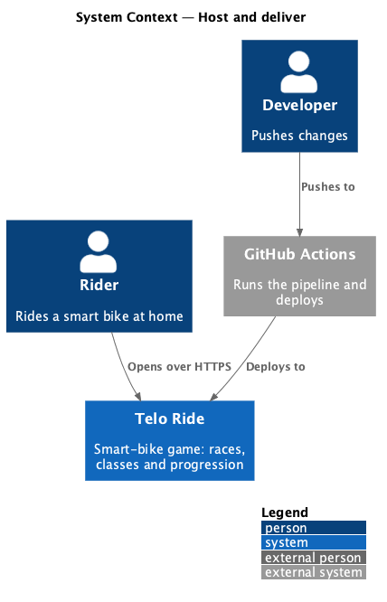
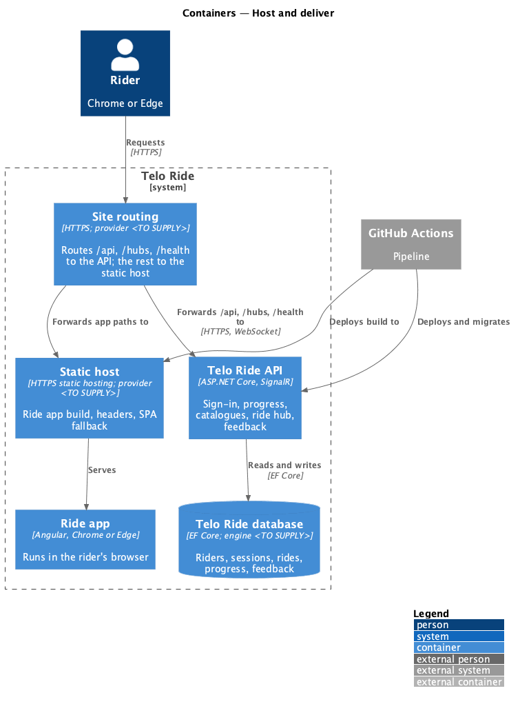
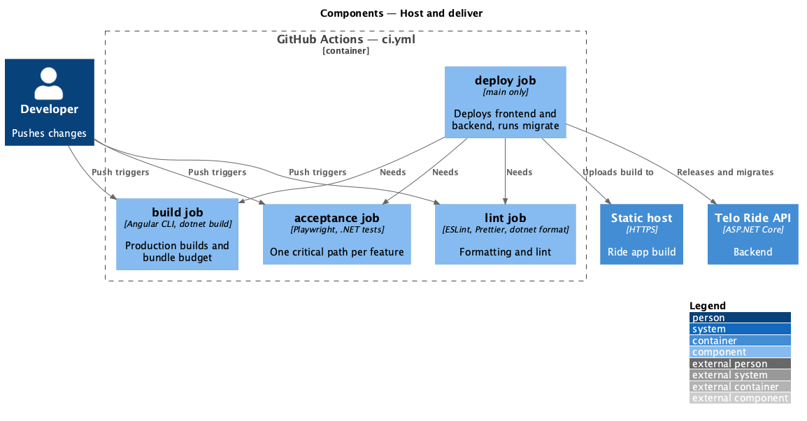
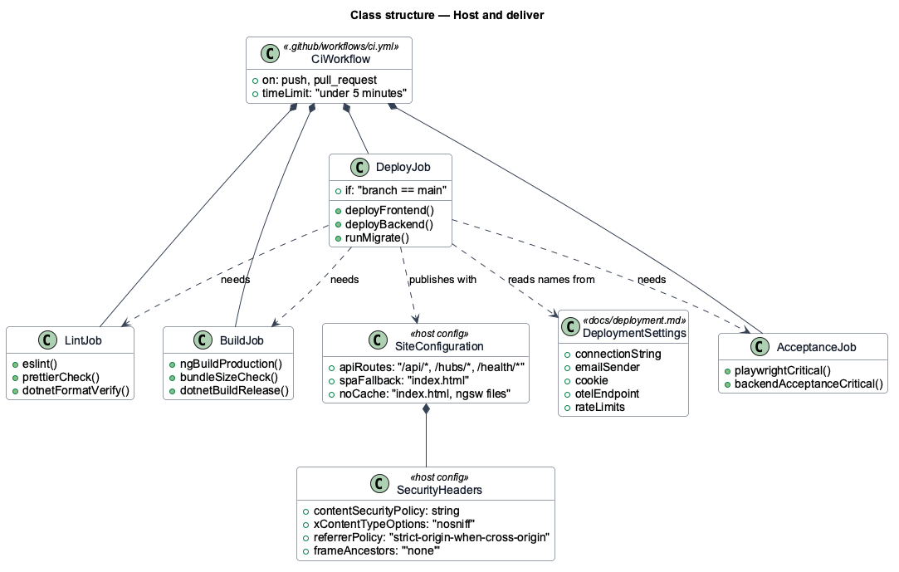
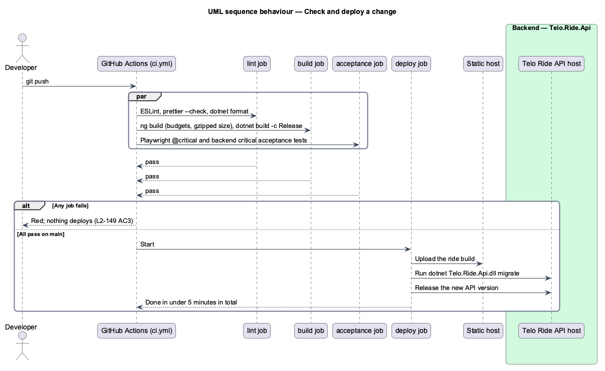
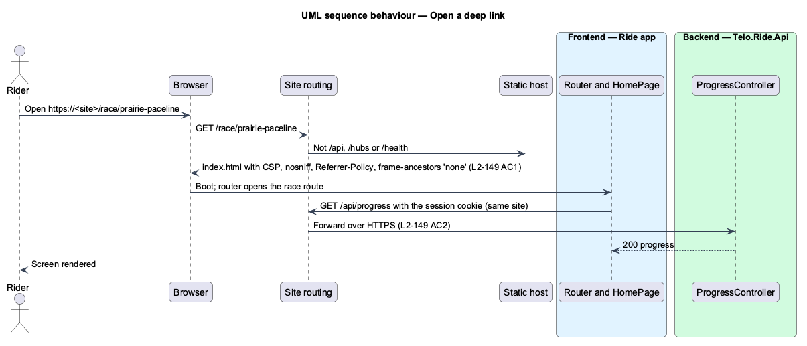

# Host and deliver

## Overview

Telo Ride reaches riders as a website. The Ride app is a folder of static files; the Telo Ride API
is a .NET service. Both have to be served over HTTPS from one site, so the session cookie is
same-site and the browser treats the app and its backend as one origin. Every change passes a
pipeline of checks before it reaches riders. This feature defines how the two parts are
hosted together and how a change travels from a push to production.

- **same site** — two addresses that share a registrable domain and scheme, so `SameSite` cookies flow between them
- **SPA fallback** — host rule that answers any path that is not a file with `index.html`, so client routes load directly
- **critical acceptance path** — the one acceptance test per feature that CI runs
- **pipeline** — the GitHub Actions workflow that checks and deploys each change

The feature belongs to the platform subsystem and spans frontend, backend and CI. ADR 0022 recorded
the earlier Azure Static Web Apps hosting of the frontend alone; ADR 0026 supersedes it: one Azure
App Service runs `Telo.Ride.Api`, which serves the app's build as well as the backend.

## Description

- **Static host** — serves the production build of `ride` (`frontend/dist/ride/browser/`) over
  HTTPS. It applies the SPA fallback, sends the security headers of `L2-131` (Content Security
  Policy, `X-Content-Type-Options: nosniff`, `Referrer-Policy: strict-origin-when-cross-origin`,
  `frame-ancestors 'none'`), and marks `index.html` and the service-worker files as not cacheable.
  The static host is `Telo.Ride.Api` itself: `UseStaticFiles` over `wwwroot`, before
  authentication, and `MapFallbackToFile("index.html")`; the headers are set once in
  `Hosting/SecurityHeaders.cs`, on every response (ADR 0026).
- **Same-site routing** — the site routes `/api/*`, `/hubs/*` and `/health/*` to the Telo Ride
  API and every other path to the static host. With one service there is no proxy: the API's
  endpoints take those paths, an unknown address under them answers ProblemDetails (401 without
  a session), never the app, and every other address that is not a file answers `index.html`.
- **Telo Ride API host** — runs `Telo.Ride.Api` over HTTPS behind the same site, with WebSockets
  enabled for SignalR: Azure App Service, Linux, .NET 10, B1, HTTPS only, WebSockets on.
- **`docs/deployment.md`** — lists every setting the deployed backend needs, added in the same
  change as the setting. Known settings: the database connection string, the email sender's
  credentials, the cookie name and domain, the OpenTelemetry exporter endpoint, and rate-limit
  values. The file path is introduced here.
- **`.github/workflows/ci.yml`** — one workflow on push and pull request:
  - `lint` — ESLint and `prettier --check` on `frontend/`, and `dotnet format --verify-no-changes`
    on `backend/`;
  - `build` — production build of `ride` with the `angular.json` budgets (the gzipped-size check
    of `performance/meet-performance-budgets` joins in slice 19.1), and `dotnet build -c Release`;
  - `acceptance` — the critical acceptance path per feature: Playwright specs tagged `@critical`
    (`npx playwright test --grep @critical`) and backend acceptance tests marked
    `[Trait("Category", "Critical")]` (`dotnet test --filter-trait "Category=Critical"`);
  - `deploy` — on `main` only, after the three jobs pass, publishes the API with the frontend
    build in its `wwwroot`, runs the `migrate` command (`platform/structure-the-backend`), and
    then deploys the package, so the new API version starts on a migrated database. It is
    skipped until the repository variables of `docs/deployment.md` are set.
- **Pipeline rules** — the workflow finishes in under 5 minutes. It runs no unit tests; those run
  locally with `node tools/verify/verify.mjs`. A flaky or slow check is fixed or removed, never
  retried.

## Requirements

| L2 ID | Refines (L1) | Requirement |
|-------|--------------|-------------|
| `L2-149` AC1 | `L1-024` | The deployed frontend shall be static files served over HTTPS with the headers of `L2-131`, and every address that matches no file shall serve the app so its routes work. |
| `L2-149` AC2 | `L1-024` | The deployed backend shall run over HTTPS behind the same site, so cookies are same-site, and each setting it needs shall be documented. |
| `L2-149` AC3 | `L1-024` | On each push, CI shall run lint, the production builds and one critical acceptance path per feature, fail on any of them, and finish in under 5 minutes; unit tests shall run locally, not in CI. |

## Diagrams

### System context

The rider reaches Telo Ride at one HTTPS site; a developer's push reaches production through
GitHub Actions.

### Containers

One site routes API, hub and health paths to the Telo Ride API and everything else to the static
host.

### Components

The pipeline's four jobs gate the deploy; the site's routing rules and headers serve the two
parts as one origin.

### Class structure

The workflow composes its jobs in order; the site configuration composes routes, headers and the
SPA fallback.

### Behaviour — check and deploy a change

A push runs lint, build and acceptance in parallel; on `main` a green run deploys and migrates
(`L2-149` AC3).

### Behaviour — open a deep link

A rider opens a route directly; the host serves the app with its headers, and the app's API call
carries the same-site cookie (`L2-149` AC1, AC2).

