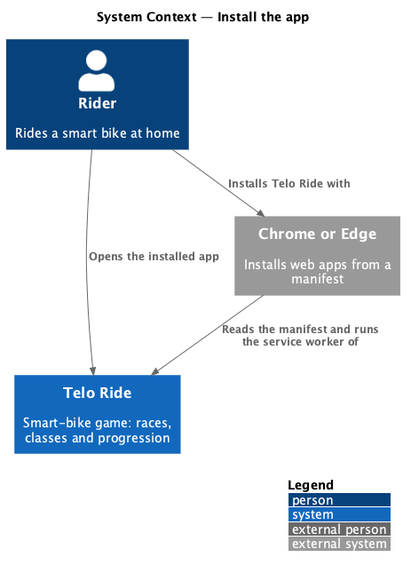
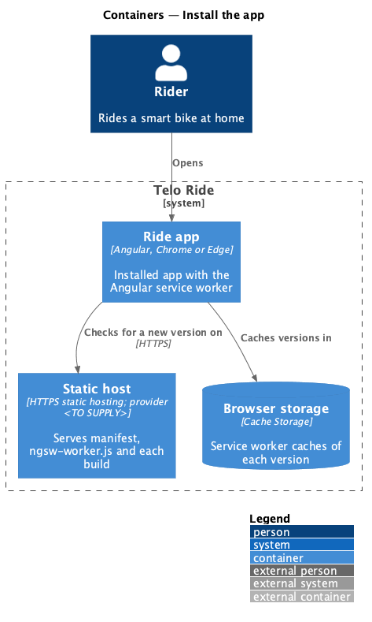

# Install the app

## Overview

A rider who rides several times a week wants Telo Ride one tap away, in its own window, without
browser toolbars. Chrome and Edge can install a site as an app when it publishes a web app
manifest and a service worker. Installed apps keep running the version they last loaded, so the
app offers each new version without interrupting a ride.

- **web app manifest** — JSON file that names the app and gives its icons, colours and display mode
- **installed app** — site installed by the browser that opens in its own window
- **version update** — new deployed build that the service worker has downloaded and can switch to
- **ride in progress** — state from the start of a race, class or custom ride until its Results open

The feature belongs to the platform subsystem. The app's own build serves the manifest and icons;
the backend that hosts the build (ADR 0025) only has to answer them with their types. The update
prompt's copy has no mock yet (`<TO SUPPLY>`).

## Description

- **`manifest.webmanifest`** — in the `ride` application's `public/` folder, linked from
  `index.html`. It sets `id`, `start_url` and `scope` to `/`, `name` and `short_name` to "Telo
  Ride", `display` to `standalone`, `background_color` and `theme_color` to the dark ink value
  (`#0a0b0d`, the value of `--palette-ink`; a manifest cannot read CSS tokens), and lists PNG icons
  of 192 px and 512 px and a maskable one of 512 px. `index.html` also sets
  `<meta name="theme-color">` to the same ink, so the window's title bar matches before the
  manifest is read.
- **App icon** — the logo mark alone on a full ink square, and a maskable copy with the mark inside
  the central 80% safe zone (design system: *Lockup*, App icon). Their SVG sources are in
  `docs/design-system/assets/icons/`; `tools/icons/render-icons.mjs` renders them to the PNGs in
  `public/icons/`, which are committed. The service worker's `app` group prefetches the manifest
  and icons with the app shell, so an installed app opens with its icon offline.
- **Angular service worker** — registered by `provideAppCache` on the screens' lazy parent route
  once the first screen settles (`performance/ride-without-a-network`, ADR 0032). It caches the app
  shell and checks for a new version on each navigation. `SwUpdate` is bound on the same route,
  so none of it joins the initial bundle.
- **`RideActivity`** — root service in the `ride` application with the signal `inProgress`. Ride
  pages set it on start and clear it when Results opens or the rider leaves.
- **`UpdatePrompt`** — root service in the `ride` application, started from `app.config.ts`. It
  listens to `SwUpdate.versionUpdates` for `VERSION_READY`. When no ride is in progress, it shows the
  update toast at once. During a ride it holds the update and shows the toast when `inProgress`
  turns false. On "Reload" it calls `SwUpdate.activateUpdate()` and then `document.location.reload()`.
  It never reloads on its own. It also handles `SwUpdate.unrecoverable` by offering the same reload,
  outside a ride.
- **`Toast`** — presentation component in `components` (`wz-toast`) used for the prompt, with an
  action button. Its message and action copy are `<TO SUPPLY>`.

## Proof

- **Installable (`L2-150` AC1).** A behaviour spec opens Home and asks Chromium, through the
  DevTools protocol, for the manifest it parsed and for its installability errors (none), and
  decodes each listed icon to check it is the PNG size it declares. A backend hosting test proves
  the API answers `manifest.webmanifest` as `application/manifest+json` and an icon as `image/png`
  without a session.
- The install prompt itself is the browser's; no test clicks it.

## Requirements

| L2 ID | Refines (L1) | Requirement |
|-------|--------------|-------------|
| `L2-150` AC1 | `L1-024` | In a supported browser, the app shall be installable from a web app manifest with the Telo Ride name, icons and dark theme colour. |
| `L2-150` AC2 | `L1-024` | When a new version is deployed, an installed app shall offer to reload into the new version when it opens, and shall never reload during a ride. |

## Diagrams

### System context

The rider installs Telo Ride through Chrome or Edge, which reads the manifest and runs the service
worker.

### Containers

The static host serves the manifest, the service worker and each new build to the Ride app.

### Components

`UpdatePrompt` listens to `SwUpdate` and reads `RideActivity`, so the toast appears only outside a
ride.

### Class structure

`UpdatePrompt` depends on Angular's `SwUpdate` and on `RideActivity`, and renders through the
`Toast` component.

### Behaviour — install the app

The browser reads the manifest and offers installation; the installed app opens in its own window
(`L2-150` AC1).

### Behaviour — offer a new version

The service worker finds a new version; the prompt waits for the ride to end before it offers the
reload (`L2-150` AC2).

## Open questions

- **Icon artwork.** The requirement asked for icons whose artwork was `<TO SUPPLY>`. Slice 27.1
  draws them from the logo mark on ink, in the dark theme's colours; a designer's own app icon
  replaces the two SVG sources and is rendered again.
- **An "Install" button of the app's own.** Chrome and Edge offer installation in the address bar
  and menu. A button in the app would need a `beforeinstallprompt` handler, a mock and copy; none
  is asked for.
