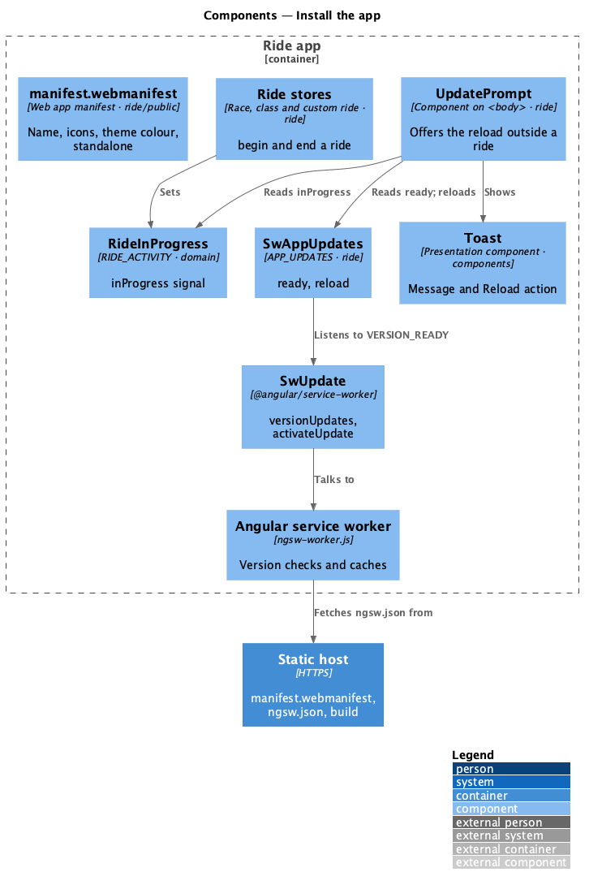
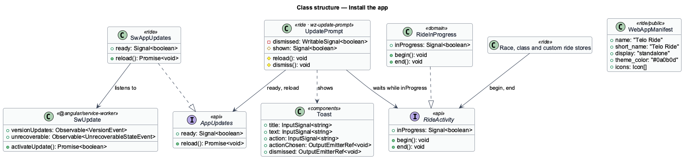
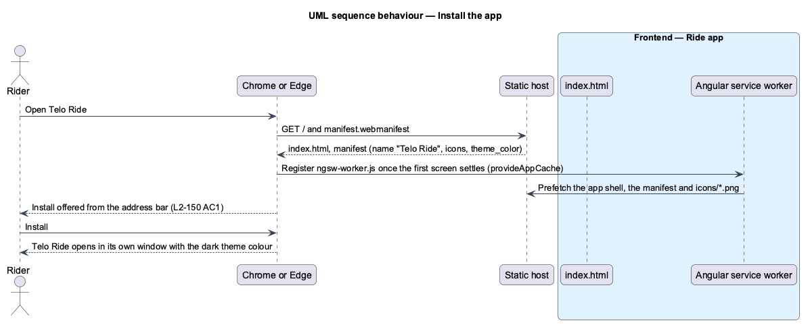
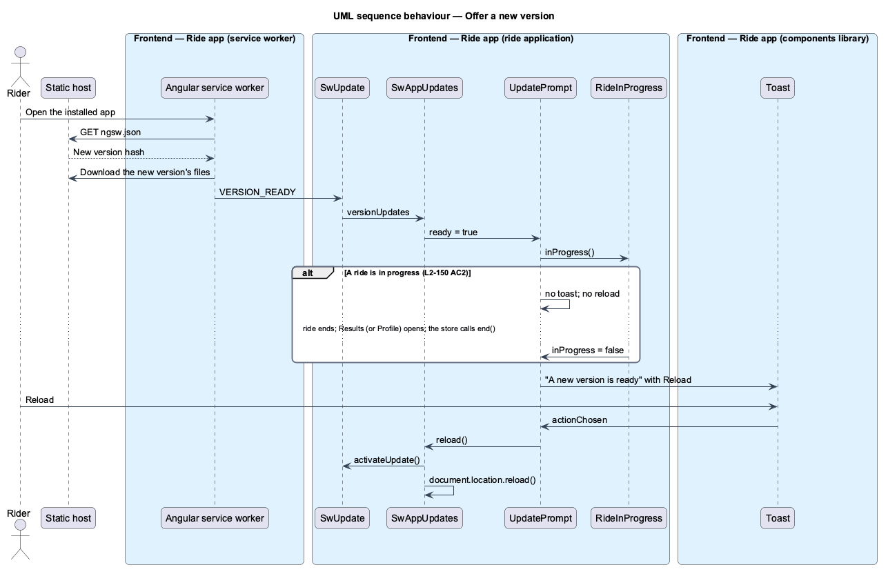

# Install the app

## Overview

A rider who rides several times a week wants Telo Ride one tap away, in its own window, without
browser toolbars. Chrome and Edge can install a site as an app when it publishes a web app
manifest and a service worker. Installed apps keep running the version they last loaded, so the
app offers each new version without interrupting a ride.

- **web app manifest** — JSON file that names the app and gives its icons, colours and display mode
- **installed app** — site installed by the browser that opens in its own window
- **version update** — new deployed build that the service worker has downloaded and can switch to
- **ride in progress** — state from the start of a race, class or custom ride until its Results open
  or the rider leaves it

The feature belongs to the platform subsystem. The app's own build serves the manifest and icons;
the backend that hosts the build (ADR 0025) only has to answer them with their types. The update
prompt is drawn in `docs/mocks/pages/home/update-ready.html`.

## Description

- **`manifest.webmanifest`** — in the `ride` application's `public/` folder, linked from
  `index.html`. It sets `id`, `start_url` and `scope` to `/`, `name` and `short_name` to "Telo
  Ride", `display` to `standalone`, `background_color` and `theme_color` to the dark ink value
  (`#0a0b0d`, the value of `--palette-ink`; a manifest cannot read CSS tokens), and lists PNG icons
  of 192 px and 512 px and a maskable one of 512 px. `index.html` also sets
  `<meta name="theme-color">` to the same ink, so the window's title bar matches before the
  manifest is read.
- **App icon** — the logo mark alone on a full ink square, and a maskable copy with the mark inside
  the central 80% safe zone (design system: *Lockup*, App icon). Their SVG sources are in
  `docs/design-system/assets/icons/`; `tools/icons/render-icons.mjs` renders them to the PNGs in
  `public/icons/`, which are committed. The service worker's `app` group prefetches the manifest
  and icons with the app shell, so an installed app opens with its icon offline.
- **Angular service worker** — registered by `provideAppCache` on the screens' lazy parent route
  once the first screen settles (`performance/ride-without-a-network`, ADR 0032). It caches the app
  shell and checks for a new version when the app opens (each navigation it serves). An installed
  app keeps the version it loaded until it is reloaded.
- **`provideAppUpdates`** — bound on the same lazy parent route as `provideAppCache`, so none of it
  joins the initial bundle (ADR 0032). It binds Angular's `provideServiceWorker` for `SwUpdate` and
  its channel to the worker (its registering app initializer runs only in the root injector, so it
  registers nothing here), `APP_UPDATES`, `RIDE_ACTIVITY`, and mounts `UpdatePrompt` at the end of
  `<body>`, where it stays on every screen.
- **`AppUpdates` / `APP_UPDATES`** — contract and token in `api`: the signal `ready` and
  `reload()`. **`SwAppUpdates`** in the `ride` application implements it on `SwUpdate`: `ready`
  turns true on `VERSION_READY`, or on `unrecoverable` (the loaded version lost its files and can
  no longer run). `reload()` calls `SwUpdate.activateUpdate()` and then
  `document.location.reload()`, even when the switch fails, since the load that follows gets the
  newest version anyway. Nothing calls it but the rider's Reload.
- **`RideActivity` / `RIDE_ACTIVITY`** — contract and token in `api`: the signal `inProgress`,
  `begin()` and `end()`; `RideInProgress` in `domain`'s `engine/` implements it. The race, class and
  custom ride stores call `begin()` where a ride starts and `end()` where it finishes, ends as a
  DNF, or the rider leaves it: the same points that hold and release the screen wake lock.
  Pausing keeps the ride in progress.
- **`UpdatePrompt`** — page-level component in the `ride` application (`wz-update-prompt`). It
  renders a toast region and, while `ready()` is true, no ride is in progress and the rider has not
  dismissed it, an info toast: "A new version is ready", "Reload to use it now, or it opens next
  time.", with the action "Reload". During a ride the toast waits; it shows when `inProgress`
  turns false. As a toast with an action, it never times out (design system: *Toast*). Dismissing
  it hides it for the rest of the session; the next open loads the new version.
- **`Toast`** — presentation component in `components` (`wz-toast`). This feature adds its
  optional action: the input `action` (the label) renders one small raised button, and the output
  `actionChosen` reports it.

## Proof

- **Installable (`L2-150` AC1).** A behaviour spec opens Home and asks Chromium, through the
  DevTools protocol, for the manifest it parsed and for its installability errors (none), and
  decodes each listed icon to check it is the PNG size it declares. A backend hosting test proves
  the API answers `manifest.webmanifest` as `application/manifest+json` and an icon as `image/png`
  without a session.
- The install prompt itself is the browser's; no test clicks it.
- **Offered between rides (`L2-150` AC2).** A behaviour spec lets the real service worker run on
  the production build, as the app cache's spec does, and deploys a new version by answering the
  worker's `ngsw.json` with the build's own plus `appData`. Opened again, the app shows the toast,
  and Reload loads the page again. In a custom ride, the worker's check (posted as `SwUpdate` does)
  brings `VERSION_READY`, yet no toast shows and the page is not reloaded until End opens Profile.
  Dismissing the toast leaves the page as it is. A unit spec covers `SwAppUpdates`' events and
  Reload.

## Requirements

| L2 ID | Refines (L1) | Requirement |
|-------|--------------|-------------|
| `L2-150` AC1 | `L1-024` | In a supported browser, the app shall be installable from a web app manifest with the Telo Ride name, icons and dark theme colour. |
| `L2-150` AC2 | `L1-024` | When a new version is deployed, an installed app shall offer to reload into the new version when it opens, and shall never reload during a ride. |

## Diagrams

### System context

The rider installs Telo Ride through Chrome or Edge, which reads the manifest and runs the service
worker.

### Containers

The static host serves the manifest, the service worker and each new build to the Ride app.

### Components

`UpdatePrompt` listens to `SwUpdate` and reads `RideActivity`, so the toast appears only outside a
ride.

### Class structure

`UpdatePrompt` depends on Angular's `SwUpdate` and on `RideActivity`, and renders through the
`Toast` component.

### Behaviour — install the app

The browser reads the manifest and offers installation; the installed app opens in its own window
(`L2-150` AC1).

### Behaviour — offer a new version

The service worker finds a new version; the prompt waits for the ride to end before it offers the
reload (`L2-150` AC2).

## Open questions

- **Icon artwork.** The requirement asked for icons whose artwork was `<TO SUPPLY>`. Slice 27.1
  draws them from the logo mark on ink, in the dark theme's colours; a designer's own app icon
  replaces the two SVG sources and is rendered again.
- **The words of the offer.** The requirement had no copy for the toast (`<TO SUPPLY>`); slice
  27.2 wrote "A new version is ready" and "Reload to use it now, or it opens next time." in the
  mock. An unrecoverable state shows the same toast; words of its own would need a mock state.
- **Checking during a long session.** The worker looks for a new version when the app opens. An
  installed app left open for days sees a new version only when it is next opened; a periodic
  `checkForUpdate()` would find it sooner, and no requirement asks for one.
- **An "Install" button of the app's own.** Chrome and Edge offer installation in the address bar
  and menu. A button in the app would need a `beforeinstallprompt` handler, a mock and copy; none
  is asked for.
