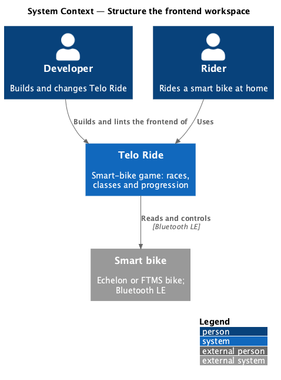
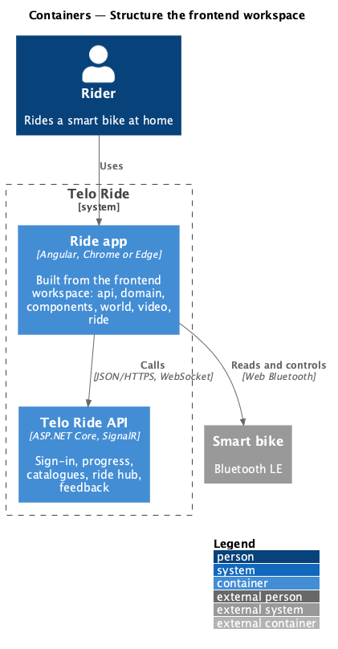
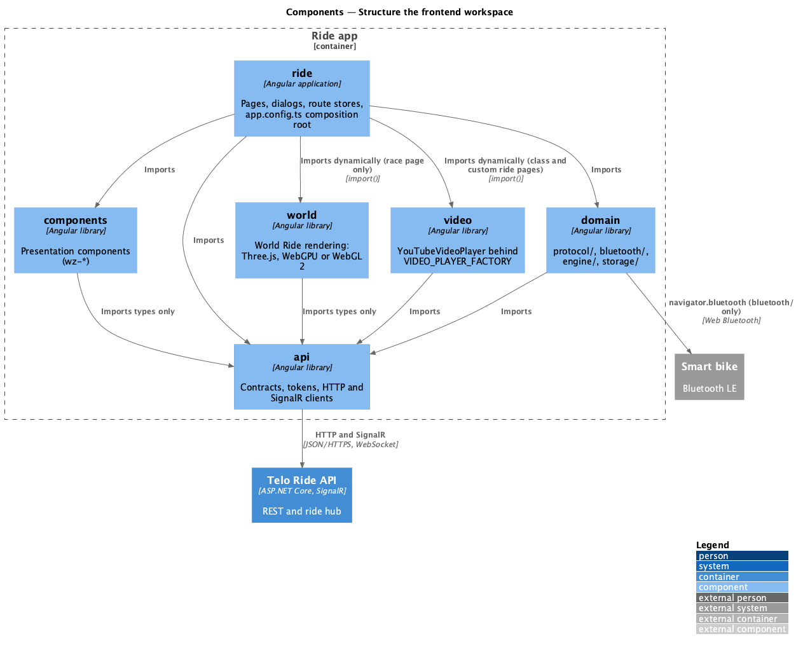
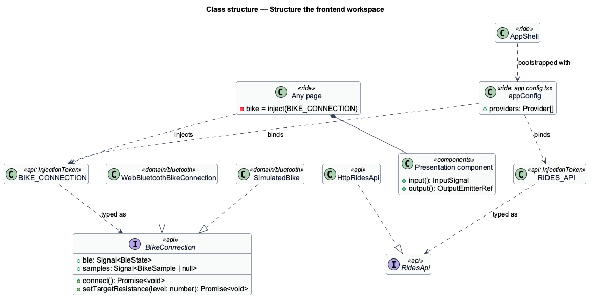
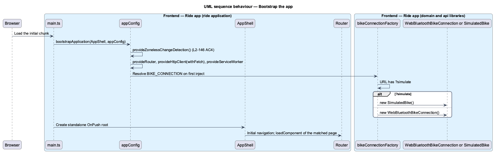
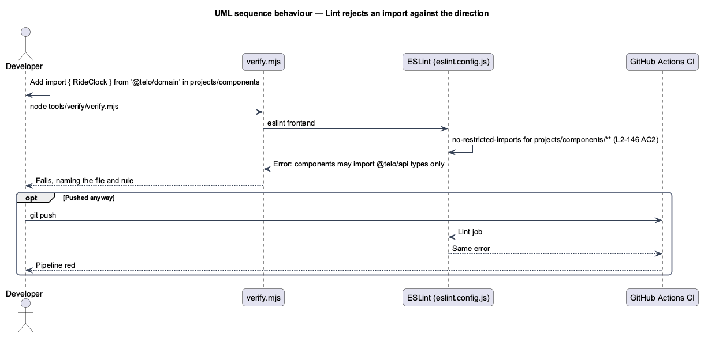

# Structure the frontend workspace

## Overview

The Ride app is most of Telo Ride: every screen, the Bluetooth link to the bike, the bike
protocol, the workout engine and the ride sessions. Code of that size stays understandable only
when each part has one home and the parts depend on each other in one direction. This feature
defines the Angular workspace that gives each part its home and the lint rules that hold the
direction.

- **workspace** — one Angular CLI project root (`frontend/angular.json`) holding several projects
- **library** — workspace project compiled into the application from source, not published
- **composition root** — the one place that binds every injection token to its implementation: `ride`'s `app.config.ts`
- **dependency direction** — rule that names which project may import which
- **zoneless** — Angular change detection driven by signals, without Zone.js

The feature belongs to the platform subsystem. It is a frontend-only slice that every other
frontend feature builds on. ADR 0013 describes the earlier three-project workspace that this design
extends with the `domain` library; ADR 0024 records the Telo Ride workspace.

## Description

- **`frontend/angular.json`** — workspace with six projects under `projects/`: libraries `api`,
  `domain`, `components`, `world` and `video`, and application `ride`. `L2-146` AC1 names the
  first four projects. `world` and `video` are further libraries of the kind `AGENTS.md` allows
  when a concern earns its own: `world` is introduced by `race/render-the-race-world`, `video` by
  `classes/start-a-class`.
- **Path aliases** — `frontend/tsconfig.json` maps `@telo/api`, `@telo/domain`,
  `@telo/components`, `@telo/world` and `@telo/video` to each library's `src/public-api.ts`. The alias names are introduced here.
- **`api`** — contracts (TypeScript interfaces), DTO types, injection tokens, and the HTTP and
  SignalR clients (`HttpAuthApi`, `HttpRidesApi`, `SignalRRideHubClient`). It imports nothing in
  the workspace.
- **`domain`** — the bike and its rules: `protocol/` (`EchelonProtocol`, `FtmsProtocol`),
  `bluetooth/` (`WebBluetoothBikeConnection`, `SimulatedBike`), `engine/` (`WorkoutEngine`,
  `RideClock`, `ResistanceController`, `PowerModel`) and `storage/` (`RideOutbox`,
  `SettingsStore`). It imports `api` only.
- **`components`** — presentation components named by design-system block. It imports `api` for
  types only (`import type`).
- **`world`** — World Ride rendering (Three.js, WebGPU with WebGL 2 fallback). It imports `api`
  for types only. `ride` imports it only with dynamic `import()` from the race page, so it never
  enters the initial chunk (`performance/meet-performance-budgets`).
- **`video`** — the YouTube ride-along: `YouTubeVideoPlayer` implements the `VideoPlayer`
  contract behind `VIDEO_PLAYER_FACTORY` from `api`. It imports `api` only. `ride` imports it
  only with dynamic `import()` from the class and custom ride pages.
- **`ride`** — routed pages, dialogs, route-scoped stores and `app.config.ts`. It imports the five
  libraries. No library imports `ride`.
- **Adding a library** — the change that adds a library, as `world` and `video` do, also updates the
  dependency rule in `AGENTS.md` and the ESLint boundaries in `eslint.config.js`.
- **`app.config.ts`** — the composition root. It calls `provideZonelessChangeDetection()`,
  `provideRouter(routes, withComponentInputBinding())`, `provideHttpClient(withFetch(),
  withInterceptors([...]))`, `provideServiceWorker('ngsw-worker.js')`, and binds every token, for
  example `{ provide: BIKE_CONNECTION, useFactory: bikeConnectionFactory }`. The factory returns
  `SimulatedBike` when the URL carries `?simulate`.
- **Built in order** — slice 1.1 lays down the four baseline projects, the app shell, the
  `MainShell` layout route with Home and Page not found, the lint, the budgets, the tokens and the
  fonts. `app.config.ts` then holds only zoneless change detection, the router and the browser
  error listeners; each provider and token binding below arrives with the first slice that needs
  it, as `AGENTS.md` asks.
- **Library `package.json`** — each library keeps a private `package.json` (`@telo/api`,
  `@telo/domain`, `@telo/components`) with `"sideEffects": false`, so the bundler drops unused
  exports of a barrel (ADR 0013).
- **Attribute components** — a presentation component that must sit on a native element the app
  owns (a router link, a button) is an attribute component, written as Angular Material writes
  them: `a[wz-button]`, `a[wz-app-header-link]`. It styles its host as its block or element with
  the mock's BEM class, and the app adds `routerLink` on the same element, so `components` never
  imports the router (ADR 0024).
- **Global styles** — `projects/ride/src/styles/`: `tokens.css` (copied from
  `docs/design-system/tokens/tokens.css` without its `@font-face` rules), `fonts.css` (the
  `@font-face` rules, pointing at `projects/ride/public/fonts/`, bundled and self-hosted per ADR
  0005) and `styles.scss` (reset, focus ring, skip link and utilities). `_page.scss` holds the
  page structure (`container`, `page`, `page__title`, `page__lead`); each page's stylesheet
  `@use`s it, so its rules stay encapsulated in that page.
- **Budgets** — `angular.json`'s production build warns above 264 kB of initial JavaScript and
  CSS and fails above 280 kB; a component stylesheet warns above 6 kB and fails above 10 kB.
  Angular core and the router, which every screen needs, are most of the initial chunk; every
  page is a lazy chunk.
- **Unit tests** — `ng test ride` runs every `*.spec.ts` under `projects/*/src/` with Vitest,
  libraries included. They run locally through `tools/verify/verify.mjs`, never in CI.
- **`frontend/eslint.config.js`** — one flat config for all projects:
  - `no-restricted-imports` per project folder enforces the dependency direction (lint, not a
    test, as ADR 0013 decided).
  - `@typescript-eslint/consistent-type-imports` plus a restriction that allows only
    `import type` from `@telo/api` inside `projects/components/` and `projects/world/`.
  - A rule on `projects/ride/` allows `@telo/world` and `@telo/video` only through `import()`,
    never a static import.
  - A rule on `projects/video/` allows imports from `@telo/api` only.
  - `no-restricted-properties` forbids `navigator.bluetooth` everywhere except
    `projects/domain/src/bluetooth/**`.
  - angular-eslint rules `prefer-on-push-component-change-detection`, `prefer-standalone`,
    `component-selector` (prefix `wz`, kebab-case, on an element or an attribute),
    `use-component-view-encapsulation`, and `component-max-inline-declarations` set to 0 for
    templates and styles; the template rules include angular-eslint's accessibility set and
    forbid inline styles.
- **Prettier** — owns formatting; CI fails when `prettier --check` reports a change.

## Requirements

| L2 ID | Refines (L1) | Requirement |
|-------|--------------|-------------|
| `L2-146` AC1 | `L1-024` | `frontend/` shall build as one Angular workspace with the libraries `api`, `domain` and `components` and the application `ride`. |
| `L2-146` AC2 | `L1-024` | Lint shall fail on any import outside these: `ride` imports `components`, `api` and `domain`; `domain` imports `api`; `components` imports `api` types only; `api` imports nothing in the workspace. |
| `L2-146` AC3 | `L1-024` | Code that uses `navigator.bluetooth` shall live in `domain`'s `bluetooth/` folder only. |
| `L2-146` AC4 | `L1-024` | Components shall be standalone, use signals and `OnPush`, and the app shall run zoneless. |

## Diagrams

### System context

A developer builds Telo Ride; the workspace is the shape of its frontend.

### Containers

The workspace produces the Ride app, which talks to the bike and to the Telo Ride API.

### Components

Inside the Ride app, the six projects depend in one direction: `ride` on all five libraries
(`world` and `video` through dynamic imports), `domain` and `video` on `api`, `components` and
`world` on `api` types.

### Class structure

`appConfig` binds tokens declared in `api` to implementations in `domain` and `api`; pages inject
tokens, not implementations.

### Behaviour — bootstrap the app

`main.ts` bootstraps `AppShell` with `appConfig`, which sets up zoneless change detection and binds
every token (`L2-146` AC4).

### Behaviour — lint rejects an import against the direction

A `components` file that imports a `domain` service fails lint locally and in CI (`L2-146` AC2).

