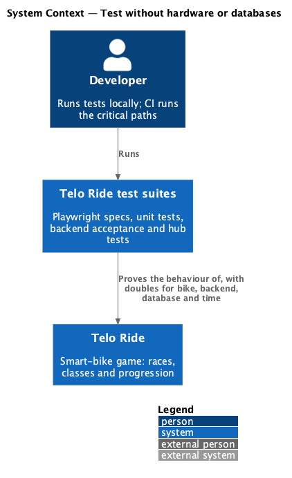
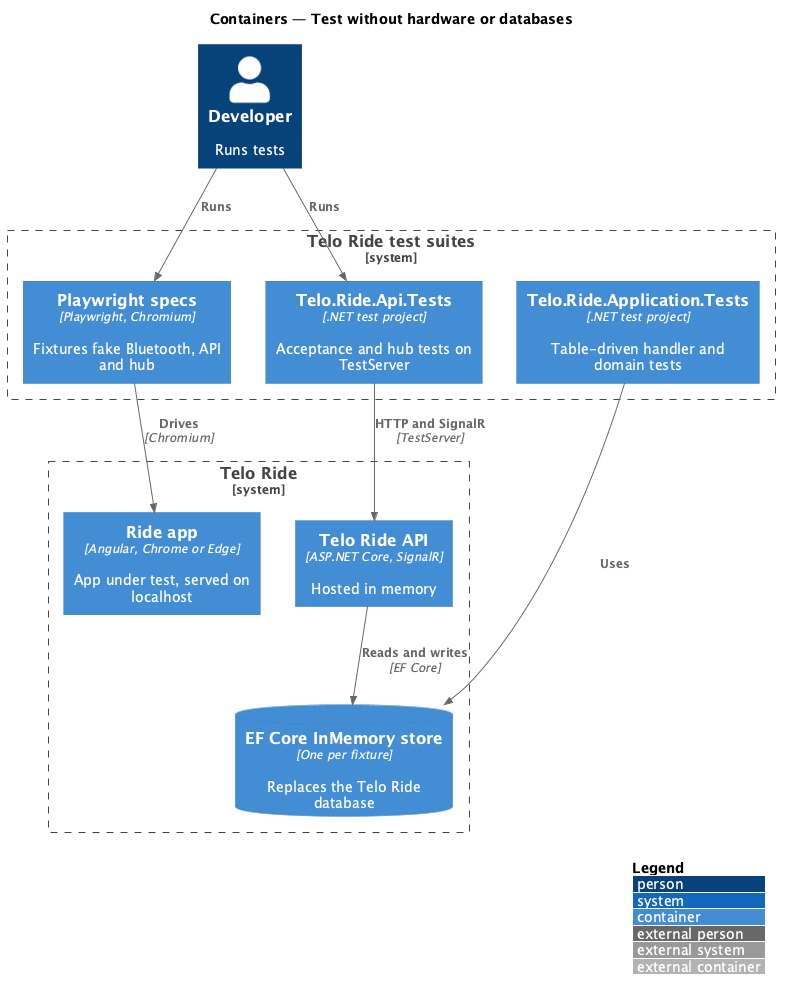
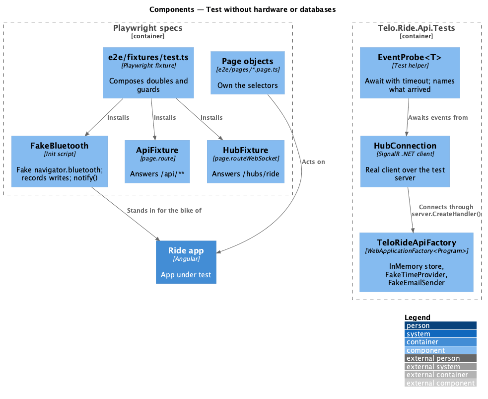
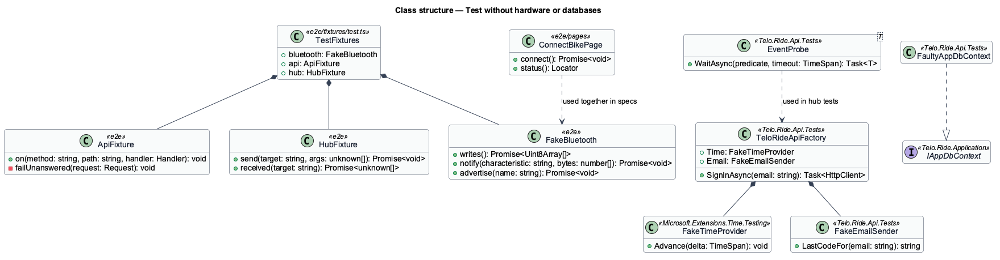
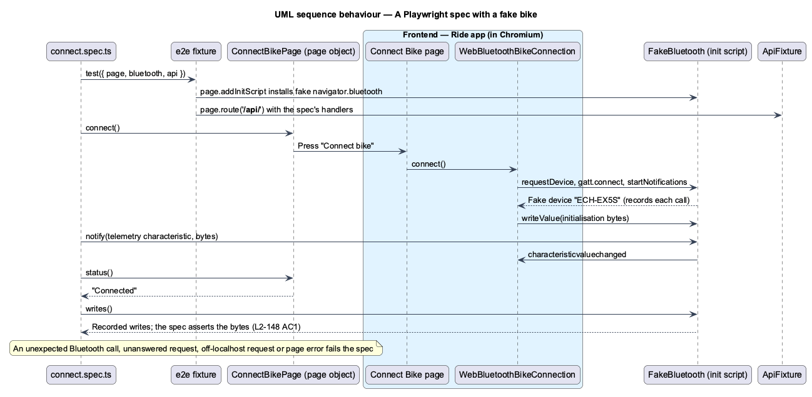
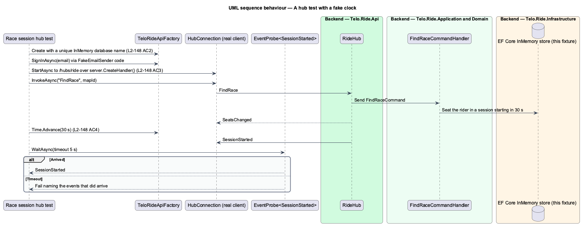

# Test without hardware or databases

## Overview

Telo Ride's behaviour depends on a smart bike, a browser's Bluetooth stack, a backend, a database
and the passage of time. Tests that used any of those for real would be slow, flaky and impossible
to run in CI. This feature defines the test doubles and fixtures that let every behaviour be
proven with none of them: a fake Bluetooth stack in the browser, fixtures that answer API and hub
calls, an in-memory database per backend fixture, and fake clocks.

- **acceptance test** — test that proves one slice's behaviour from the outside: Playwright through the UI, or HTTP through the API
- **fixture** — reusable setup a test receives, such as a page with a fake bike installed
- **page object** — class that owns one screen's selectors and actions, so tests hold no selectors
- **fake clock** — time source a test advances by hand
- **test server** — ASP.NET Core `TestServer` hosting the API in memory

The feature belongs to the platform subsystem and spans both frontend and backend test projects.
Hardware smoke tests are run by a person and are outside this slice.

## Description

### Frontend

- **`e2e/fixtures/test.ts`** — extends Playwright's `test` with the fixtures below. Specs import
  `test` and `expect` from it.
- **`FakeBluetooth`** (`e2e/fixtures/fake-bluetooth.ts`) — fixture that installs a fake
  `navigator.bluetooth` with `page.addInitScript` before the app loads. It implements
  `requestDevice`, `getDevices`, GATT connect, services, characteristics, `writeValue` (with and
  without response) and notifications. Until a spec calls `offer(bike)` with the device's name and
  its services and characteristics, every call is unexpected: it rejects in the page and fails the
  spec. It records every write (`writes()`, as upper-case hex) and exposes
  `notify(characteristic, bytes)` to push a notification on demand.
- **`ApiFixture`** (`e2e/fixtures/api.ts`) — routes every localhost request under `/api/` with
  `page.route` to the answers a spec declares (`answer(method, path, body or handler)`). A request
  no answer matches gets 501 and fails the spec.
- **`HubFixture`** (`e2e/fixtures/hub.ts`) — answers `/hubs/ride/negotiate` with `page.route` and
  the WebSocket with `page.routeWebSocket`, and speaks the SignalR JSON protocol (handshake,
  invocation, completion, ping), so a spec can `send('StandingsUpdated', …)`, read
  `invocations('ReportProgress')` and `answer` a method that expects a result. A spec that has not
  called `open()` gets no hub: a connection attempt is unanswered and fails the spec.
- **Guards** — the fixture fails the spec on a `pageerror`, an unexpected Bluetooth call, an
  unanswered request or any request to a host other than localhost.
- **Page objects** — `e2e/pages/<screen>.page.ts`, one per screen or dialog, using the mocks' BEM
  classes and roles as locators.
  `e2e/pages/app-calls.ts` (`AppCalls`) makes, in the page, the Bluetooth, HTTP and hub calls the
  app will make, so `e2e/harness.spec.ts` proves each double before the app's own clients exist
  (slices 2.3, 9.1 and 14.1).
- **Clock** — specs that depend on time call `page.clock.install()` and advance it.
- **Builds** — the `chromium` project runs every spec against the production build; the
  `development` project serves the development build on the next port and runs
  `*.development.spec.ts`, for what only a development build does (`?simulate`, L2-024).
- **Unit tests** — run with the Angular CLI unit-test builder on Vitest over jsdom (both already
  dev dependencies), from `npm test`; time-driven rules use Vitest's fake timers and the
  `MONOTONIC_TIME` token bound to a fake.

### Backend

- **`Telo.Ride.Api.Tests`** — acceptance tests through the API and hub tests. `TeloRideApiFactory`
  extends `WebApplicationFactory<Program>`. It replaces the database with EF Core InMemory under a
  database name unique to the fixture and registers `FakeTimeProvider` as `TimeProvider` (the API
  registers `TimeProvider.System`; code reads time only through it). A fixture that injects a
  fault subclasses it and overrides `ConfigureServices`. `FakeEmailSender`, which captures sent
  codes so a test can sign in through the API, joins it with `IEmailSender` in slice 9.1; until
  then `SignedInProbeApi` signs every request in.
- **`FaultyAppDbContext`** — test `IAppDbContext` wrapper that throws on `SaveChangesAsync` to
  inject database faults; it arrives with `SaveChangesAsync`, in the first slice that saves.
  Until then `UnreachableDatabaseApi` injects the one fault there is, an unreachable database.
- **Hub tests** — a real `HubConnection` built with `HubConnectionBuilder` connects to
  `/hubs/ride` on the test server through `server.CreateHandler()` (long polling) and the
  session cookie (the signed-in test scheme until slice 9.2). `RideHub` exists from this slice,
  with no methods yet, so the first hub test proves a connection without a session is refused at
  negotiation (L2-127 AC1) and one with a session connects.
- **`EventProbe<T>`** — helper that awaits an event (a hub message, a finished span) with a
  timeout and, on timeout, fails with the list of events that did arrive. No test calls
  `Task.Delay` or `Thread.Sleep`.
- **`Telo.Ride.Application.Tests`** — direct tests of handlers and domain types for rules with a
  table of cases, one case per row; created by the first slice with such a rule.
- **Test framework** — xUnit v3 on the Microsoft Testing Platform (`backend/global.json`), run by
  `dotnet test --solution Telo.Ride.slnx`.

## Requirements

| L2 ID | Refines (L1) | Requirement |
|-------|--------------|-------------|
| `L2-148` AC1 | `L1-024` | A Playwright spec shall run with a fixture that installs a fake `navigator.bluetooth`, records every write and pushes notifications on demand; API and hub requests shall be answered by fixtures, and any unexpected call shall fail the spec. |
| `L2-148` AC2 | `L1-024` | A backend test shall use EF Core InMemory, one store per fixture, and never a real database or file. |
| `L2-148` AC3 | `L1-024` | A hub test shall connect a real SignalR client to the in-memory test server. |
| `L2-148` AC4 | `L1-024` | A time-driven rule (keepalive, retries, lobby clock, sessions every 15 minutes, code expiry) shall be tested by advancing a fake clock and shall never sleep. |

## Diagrams

### System context

A developer runs the tests; the real bike, backend and database are replaced by doubles.

### Containers

Playwright drives the Ride app with fixtures in place of the bike and the API; the API test host
runs the API in memory over EF Core InMemory.

### Components

`FakeBluetooth`, `ApiFixture` and `HubFixture` surround the app under test; `TeloRideApiFactory`
replaces the database, the clock and the email sender for backend tests.

### Class structure

The Playwright fixture composes the three doubles and the page objects; `TeloRideApiFactory`
composes the in-memory store, `FakeTimeProvider` and `FakeEmailSender`.

### Behaviour — a Playwright spec with a fake bike

The spec connects to the fake bike, pushes a notification, and asserts the readout and the
recorded write, through page objects (`L2-148` AC1).

### Behaviour — a hub test with a fake clock

A real SignalR client joins a session on the test server; the test advances `FakeTimeProvider`
and awaits the event with `EventProbe` (`L2-148` AC3, AC4).

