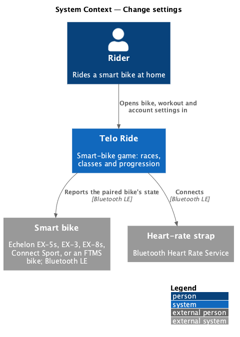
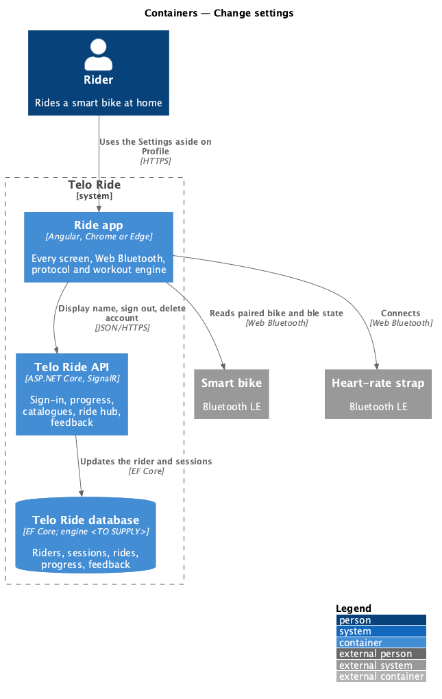
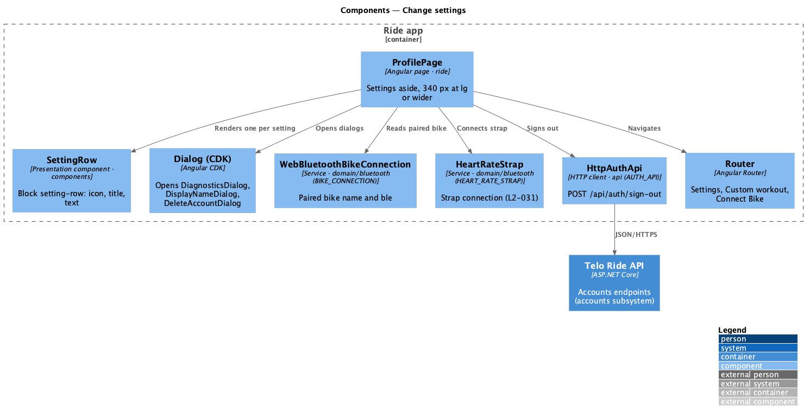
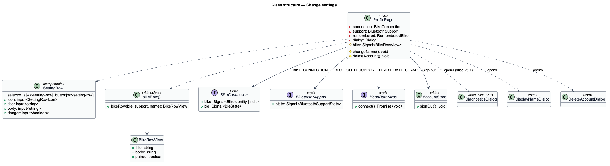
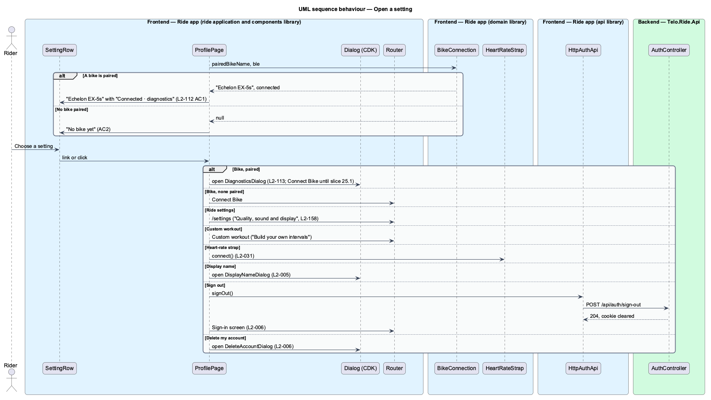

# Change settings

## Overview

Profile carries a settings aside: the short list of things a rider changes between rides. It
gives the rider one place to reach the bike's diagnostics, open the ride settings, build a
custom workout, connect a heart-rate strap, change their display name, sign out or delete their
account (L1-017).

- **setting row** — one entry in the aside with an icon, a title and a line of text, which opens
  a screen or a dialog
- **paired bike** — bike this browser has paired and remembers (`bike/connect-a-bike`, L2-015)
- **diagnostics** — dialog showing the state of Bluetooth, the bike and the app
  (`diagnostics/inspect-diagnostics`, L2-113)

Each row hands off to the feature that owns its behaviour; this feature owns the list and its
routing. The rows for the heart-rate strap, the display name, "Sign out" and "Delete my account"
have no mock yet (mock gap for L2-112 AC3 in `docs/specs/L2.md`); they shall get one before they
are built.

## Description

- **`ProfilePage`** — the Profile page (see `show-the-profile`). It holds the settings aside:
  each row is a `SettingRow` on a link (`routerLink`) or a button (a dialog or Sign out) in the
  page's template, and only the bike row's words change, from `bikeRow()`. No row edits inline:
  each opens a CDK Dialog or navigates.
- **`SettingRow`** — presentation component (`wz-setting-row`, block `setting-row`) with an icon,
  a title and a text, put on the native `<a>` or `<button>` so it keeps its role, with a touch
  target of at least 44 × 44 px.
- **`bikeRow()`** — pure helper in `ride` with unit tests for the bike row's title and text. The
  rows, in order:
  - the bike: the paired bike's name with "Connected · diagnostics", or "No bike yet";
  - "Ride settings" with "Quality, sound and display";
  - "Custom workout" with "Build your own intervals";
  - the heart-rate strap (L2-031);
  - the display name (L2-005);
  - "Sign out" and "Delete my account" (L2-006).

  When the paired bike is not connected, the row reads "Not connected · diagnostics", or, where
  the browser stops Bluetooth, the bike status's words for it ("Bluetooth is off · diagnostics",
  from `bikeStatus()` in `domain`). With no bike paired, the row's text is "Pair your bike".
- **Hand-offs** — the bike row opens `DiagnosticsDialog` when a bike is paired and Connect Bike
  when none is. "Ride settings" navigates to `/settings` (`settings/open-and-keep-settings`).
  "Custom workout" navigates to the custom workout setup (`/profile/custom`). Until slice 25.1
  builds `DiagnosticsDialog`, the bike row goes to Connect Bike when a bike is paired too, and
  until slices 20.1 and 21.1 add `/settings` and `/profile/custom`, those rows open Page not
  found (slice 13.3). The strap row calls
  `HEART_RATE_STRAP.connect()`. The display name row opens `DisplayNameDialog`. "Sign out"
  calls `AUTH_API.signOut()` (`POST /api/auth/sign-out`) and opens the sign-in screen. "Delete
  my account" opens `DeleteAccountDialog`. Each dialog and endpoint is specified by its owning
  feature.
- **`BikeConnection`** — contract and `BIKE_CONNECTION` token in `api`; the page reads the
  paired bike's name and `ble` from it. Only `domain/bluetooth` touches `navigator.bluetooth`.

## Requirements

| L2 ID | Refines (L1) | Requirement |
|-------|--------------|-------------|
| `L2-112` | `L1-017` | "Settings" shall list "Echelon EX-5s" with "Connected · diagnostics", which opens Diagnostics (L2-113); "Ride settings" with "Quality, sound and display", which opens Settings (L2-158); and "Custom workout" with "Build your own intervals", which opens Custom workout. |
| `L2-112` (AC2) | `L1-017` | With no bike paired, the bike row shall read "No bike yet" and go to Connect Bike. |
| `L2-112` (AC3) | `L1-017` | Settings shall also offer the heart-rate strap (L2-031), the display name (L2-005), "Sign out" and "Delete my account" (L2-006). |

## Diagrams

### System context

The rider opens bike, workout and account settings in Telo Ride. Telo Ride reads the paired
bike's state and connects a heart-rate strap over Bluetooth LE.

### Containers

The Ride app reaches the bike and the strap over Web Bluetooth and calls the Telo Ride API for
the account actions.

### Components

`ProfilePage` renders one `SettingRow` per setting and dispatches each choice to a CDK dialog, the
router, the strap service or the auth client.

### Class structure

`bikeRow()` builds the bike row's words from the paired bike, `ble` and the browser's support. The page depends on
the `BikeConnection`, `HeartRateStrap` and `AuthApi` contracts through their tokens.

### Behaviour — open a setting

The bike row reflects whether a bike is paired (L2-112 AC1, AC2). Each choice opens its dialog or
screen, or signs the rider out.

