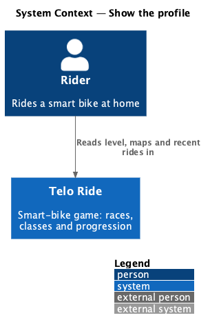
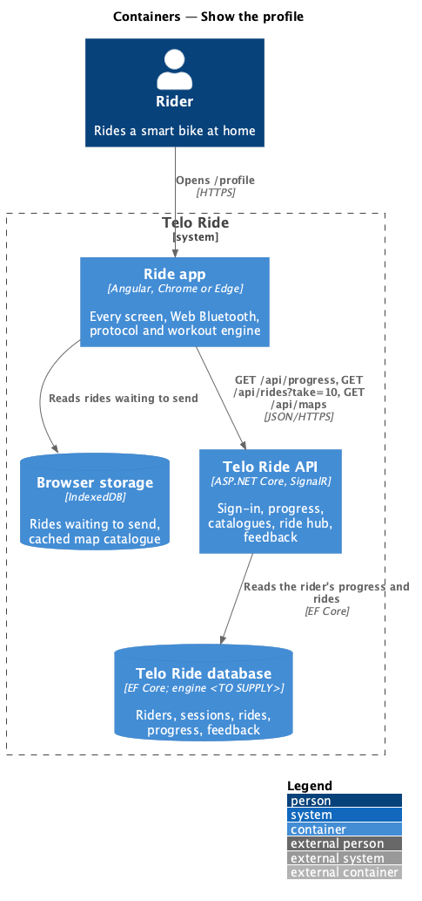
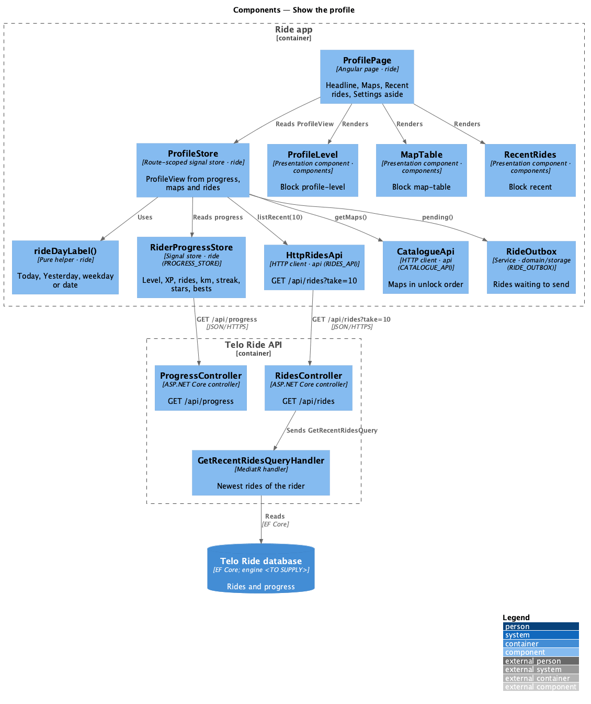
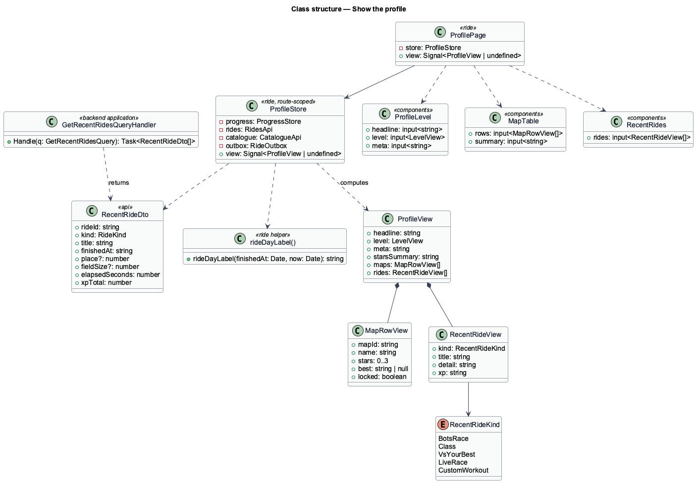
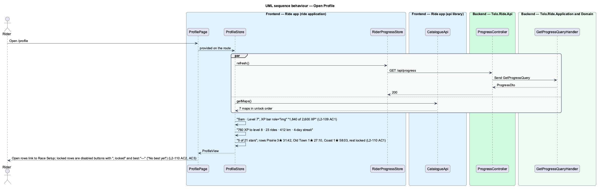
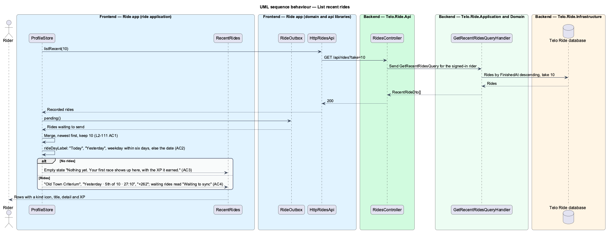

# Show the profile

## Overview

Profile, at `/profile`, is the rider's record in Telo Ride. It gathers in one place what the
progression has built: the rider's level and XP, the stars and best time on every map, and the
most recent rides with the XP each earned (L1-017). A settings aside sits beside it
(`change-settings`).

- **headline** — line naming the rider and their level, "Sam · Level 7", with the XP bar
- **best time** — rider's fastest finish on a map, in any mode
- **recent rides** — the 10 most recent finished rides, newest first
- **ride waiting to sync** — finished ride kept on the device until the backend records it
  (L2-135)

Every progress value on Profile comes from the backend (L2-044). Rides still waiting on the
device join the list with "Waiting to sync" in place of their XP, so a ride finished offline is
never missing from the rider's history.

## Description

- **`ProfilePage`** — routed page in the `ride` application (`wz-profile-page`) at `/profile`,
  a child of `MainShell` loaded with `loadComponent`. It renders the headline, "Maps", "Recent
  rides" and the settings aside. At lg (≥ 1024 px) or wider it is two columns with a 340 px
  settings aside.
- **`ProfileStore`** — signal store provided on the Profile route. It reads `PROGRESS_STORE`,
  `CATALOGUE_API`, `RIDES_API` and `RIDE_OUTBOX`, and computes one `ProfileView`.
- **`ProfileLevel`** — presentation component (`wz-profile-level`, block `profile-level`). It
  shows "{name} · Level {n}" with `LevelBadge` and an XP bar with `role="img"` and the label
  "1,840 of 2,600 XP". Below it reads "{x} XP to level {n+1} · {r} rides · {km} km · {s}-day
  streak". The rides and kilometres are `ProgressDto`'s `rideCount` and `distanceKm`: the
  rider's recorded rides, and the kilometres they covered to the nearest whole (slice 13.3).
- **`MapTable`** — presentation component (`wz-map-table`, block `map-table`). It shows "{n} of
  21 stars" over a table of every map in unlock order with visually hidden headers Map, Stars and
  Best. An open map's row links to Race Setup for it. A locked map's row is a disabled button
  with a lock and the hidden text ", locked"; its best reads "—" with the hidden text "No best
  yet".
- **`RecentRides`** — presentation component (block `recent`). Each row has an icon for its kind
  ("bots race", "class", "vs your best", "live race", "custom workout"), a title, a detail and its XP. With
  no rides it shows the empty state "Nothing yet. Your first race shows up here, with the XP it
  earned."
- **`rideDayLabel()`** — pure helper in `ride` with unit tests. It returns "Today", "Yesterday",
  the weekday for a ride within the last six days, or the date, in the rider's locale and time
  zone.
- **`RidesApi.listRecent(take)`** — calls `GET /api/rides?take=10`. **`GetRecentRidesQuery`**
  and **`GetRecentRidesQueryHandler`** return the signed-in rider's rides by finish time,
  newest first, as `RecentRideDto` (L2-128).
- **`RideOutbox.pending()`** — returns the rides waiting to send. The store merges them with the
  recorded rides by ride id, sorts newest first and keeps 10.

**Slices.** Slice 13.3 builds the headline (`ProfileLevel` with the XP bar, rides, kilometres and
streak), the two-column layout and the settings rows of `change-settings`. "Maps" (L2-110) and
"Recent rides" (L2-111), with `ProfileStore`, `RIDES_API` and `RIDE_OUTBOX`, are not named by any
slice in `docs/detailed-journeys.md` yet; until one takes them, Profile shows the headline and
Settings, and the page reads `PROGRESS_STORE` directly.

The number of recent rides is 10, the value L2-111 proposes; the mocks show four rows at every
stage (open question 11 in `docs/specs/L2.md`).

## Requirements

| L2 ID | Refines (L1) | Requirement |
|-------|--------------|-------------|
| `L2-109` | `L1-017` | For the mid rider, Profile shall read "Sam · Level 7" with the level badge and an XP bar (`role="img"`, "1,840 of 2,600 XP"), and below it "760 XP to level 8 · 23 rides · 412 km · 4-day streak". |
| `L2-109` (AC2–AC3) | `L1-017` | For the new rider, Profile shall read "Sam · Level 1" and "400 XP to level 2 · 0 rides · 0 km · 0-day streak"; at lg or wider it shall be two columns with a 340 px settings aside. |
| `L2-110` | `L1-017` | For the mid rider, "Maps" shall read "5 of 21 stars" over a table of every map (hidden headers Map, Stars, Best): Prairie 3★ 31:42, Old Town 1★ 27:10 and Coast 1★ 58:03 open, the rest locked. |
| `L2-110` (AC2–AC3) | `L1-017` | An open map's row shall link to Race Setup for it; a locked map's row shall be a disabled button with a lock and the hidden text ", locked", and its best shall read "—" with the hidden text "No best yet". |
| `L2-111` | `L1-017` | "Recent rides" shall list the 10 most recent rides, newest first, each with an icon for its kind, a title, a detail and its XP, for example "Old Town Criterium", "Yesterday · 5th of 10 · 27:10", "+262". |
| `L2-111` (AC2–AC4) | `L1-017` | A ride's day shall read "Today", "Yesterday", the weekday within the last six days, or the date; with no rides the section shall read "Nothing yet. Your first race shows up here, with the XP it earned."; a ride waiting to be sent (L2-135) shall show "Waiting to sync" as its XP. |

## Diagrams

### System context

The rider reads their level, maps and recent rides in Telo Ride. No external system takes part.

### Containers

The Ride app reads progress, recent rides and the map catalogue from the Telo Ride API, and reads
rides waiting to send from browser storage.

### Components

`ProfileStore` joins four sources into one `ProfileView` that `ProfilePage` renders through
`ProfileLevel`, `MapTable` and `RecentRides`. On the backend, `GetRecentRidesQueryHandler` serves
the recent rides.

### Class structure

`ProfileView` composes map rows and recent-ride rows; the store formats each ride's detail with
`rideDayLabel()`.

### Behaviour — open Profile

The store refreshes progress and reads the maps in parallel, then formats the headline (L2-109)
and the map table (L2-110).

### Behaviour — list recent rides

Recorded rides from the backend merge with rides waiting on the device. Waiting rides show
"Waiting to sync"; with none at all, the empty state shows (L2-111).

