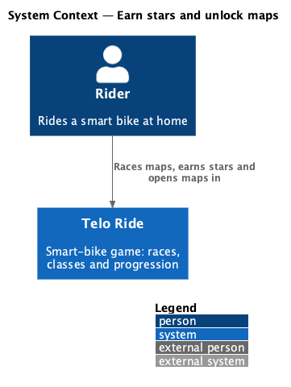
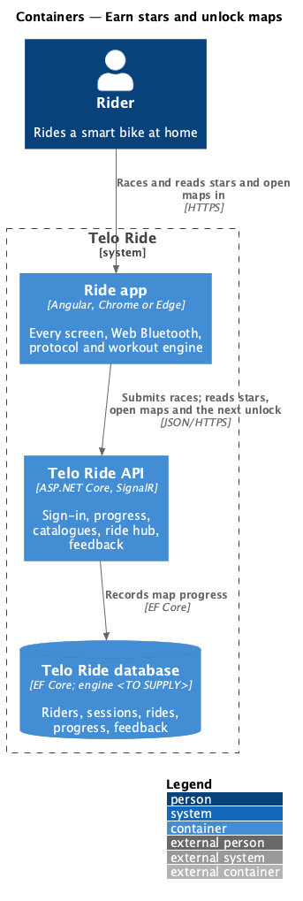
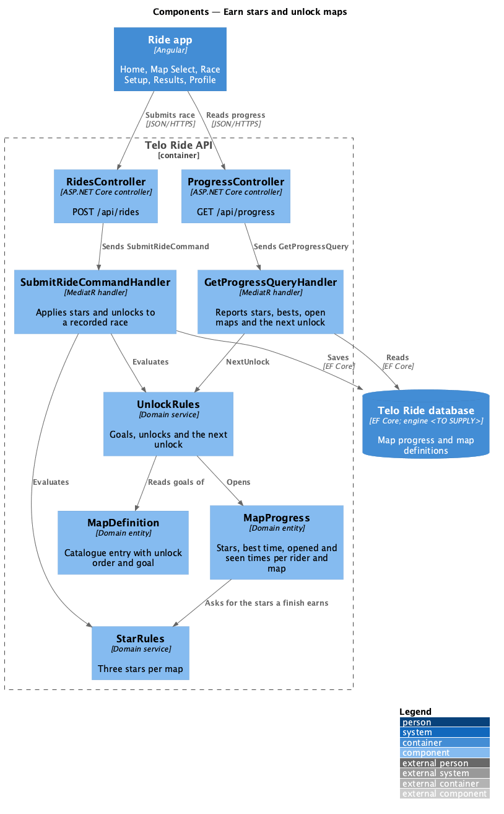
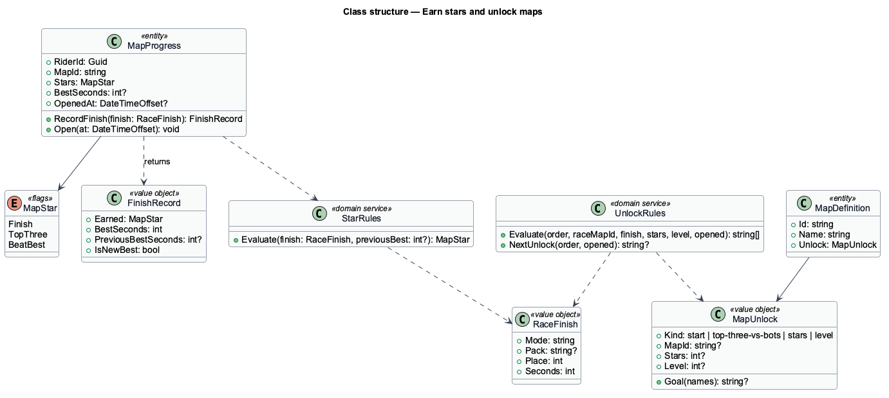
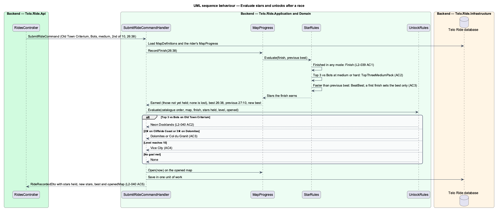
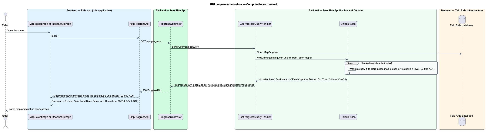

# Earn stars and unlock maps

## Overview

Telo Ride's Race door offers seven maps in a fixed unlock order. Two are open on a new account;
each of the other five opens when the rider meets one goal. Stars give each map three targets to
chase after it opens. Together they form the map half of the progression (L1-008).

- **star** — award earned once on a map and never lost; each map has three
- **unlock order** — fixed sequence of the seven maps: Prairie Paceline, Old Town Criterium,
  Cliffside Coast, Neon Docklands, Dolomites, Vice City, Col du Granit
- **unlock goal** — single condition that opens a locked map: a top-3 finish in a bots race on a
  named map, a number of stars on a named map, or a rider level
- **prerequisite map** — map named by a top-3 or star goal
- **next unlock** — first locked map in unlock order whose goal the rider can work on now
- **best time** — rider's fastest finish on a map, in any mode

The three stars on every map are "Finish the race", "Top 3 against the medium pack" and "Beat
your best time". Classes and custom workouts earn no stars. The backend evaluates both stars and
unlocks when it records a race (L2-044), and computes the next unlock for every screen that shows
it, so Home, Map Select and Race Setup always agree (L2-041 AC4).

## Description

The slice is backend domain logic invoked from two handlers.

- **`MapDefinition`** — catalogue entity in `Telo.Ride.Domain` with the map's id, name and
  `Unlock`, in unlock order. The catalogue is data served by `GET /api/maps` (`race/browse-maps`),
  so a catalogue change needs no app code (L2-045 AC3). The goals are:

  | Map | Goal |
  |-----|------|
  | Prairie Paceline | open at start |
  | Old Town Criterium | open at start |
  | Cliffside Coast | `TopThreeVsBots` on Prairie Paceline |
  | Neon Docklands | `TopThreeVsBots` on Old Town Criterium |
  | Dolomites | `StarsOn` Cliffside Coast, 2 |
  | Vice City | `RiderLevel` 10 |
  | Col du Granit | `StarsOn` Dolomites, 3 |

- **`MapUnlock`** — value object with its kind (`start`, `top-three-vs-bots`, `stars`, `level`),
  the map it names, the stars and the level. `Goal(names)` writes the one goal text a locked map
  shows anywhere: "Finish top 3 vs Bots on {map}", "Earn {n}★ on {map}" or "Reach rider level
  {n}" (L2-040 AC6); `GET /api/maps` serves it as each map's `unlockGoal`.
- **`MapProgress`** — entity per rider and map holding the stars held (`MapStar` flags, never
  lost), the best (`BestSeconds`) and `OpenedAt`, set when a ride opens the map (`Open(at)`).
  `RecordFinish(finish)` adds the stars `StarRules` gives that the rider does not hold and
  returns a `FinishRecord` with the stars earned, the best, the previous best and whether the
  finish is a new best; a first finish sets the best. The recorded ride keeps the stars, best and
  opened map it answered with, so a repeat answers the same. `UnlockSeenAt`, for Home's banner,
  comes with `home/choose-the-next-ride` (slice 13.2).
- **`RaceFinish`** — value object with the race mode (solo, bots, online), the pack strength for
  a bots race, the place and the finish time in seconds.
- **`StarRules`** — domain service. `Evaluate(finish, previousBest)` returns the stars the
  finish earns: `Finish` for any finished race; `TopThree` for places 1 to 3 in a bots race at
  medium or hard; `BeatBest` for a finish faster than the previous best, never on a first finish.
- **`UnlockRules`** — domain service.
  - `Evaluate(order, raceMapId, finish, stars, level, opened)` returns the maps a recorded ride
    opens, in unlock order: a locked map not yet opened whose goal the ride meets (a top-3 finish
    in this bots race at any pack, the stars now held on the named map, or the rider's level
    after the ride, so a class can open Vice City).
  - `NextUnlock(order, opened)` returns the first locked map in unlock order whose prerequisite
    map is open or whose goal is a level (L2-041 AC1), or none once every map is open.
- **`SubmitRideCommandHandler`** — records the finish, opens any map, saves in one unit of work
  and returns the stars held, the new stars, the best, the previous best and the first map opened
  in `RideRecordedDto` (see `keep-progress-on-the-backend`).
- **`GetProgressQueryHandler`** — answers `GET /api/progress` with the level, XP and streak and,
  from the rider's map progress, the open maps (those open from the start and those opened), the
  next unlock, and the stars and best on each map ridden (`openMapIds`, `nextUnlockId`, `stars`,
  `bestTimeSeconds`).
- **`HttpProgressApi`** — the Ride app's `PROGRESS_API` client, bound on the Map Select, Race
  Setup and race routes in place of the new-rider stand-in. One `GET /api/progress` gives the
  rider's level and maps; the screens join it with the catalogue, so Map Select and Race Setup
  show the same next unlock and goal (L2-041 AC4). Home's Next ride card reads it with slice 13.2.

The total of stars is out of 21: 3 stars on each of 7 maps. The top-3 unlock goal accepts any
pack strength, while the second star needs medium or hard, as the requirements state.

## Requirements

| L2 ID | Refines (L1) | Requirement |
|-------|--------------|-------------|
| `L2-039` | `L1-008` | Each map shall have three stars, and an earned star shall never be lost; a finished race on a map in any mode shall earn the first star ("Finish the race"). |
| `L2-039` (AC2–AC3) | `L1-008` | A top-3 finish in a bots race at medium or hard shall earn the second star ("Top 3 against the medium pack"); a finish faster than the previous best on that map shall earn the third star ("Beat your best time"), and a first finish shall set the best without earning it. |
| `L2-039` (AC4–AC5) | `L1-008` | A class or a custom workout shall earn no stars; with 7 maps the star total shall be out of 21. |
| `L2-040` | `L1-008` | A new account shall have Prairie Paceline and Old Town Criterium open and the rest locked. |
| `L2-040` (AC2–AC4) | `L1-008` | A top-3 finish in a bots race on Prairie Paceline shall open Cliffside Coast, and on Old Town Criterium shall open Neon Docklands; 2★ on Cliffside Coast shall open Dolomites; 3★ on Dolomites shall open Col du Granit; reaching level 10 shall open Vice City. |
| `L2-040` (AC5–AC6) | `L1-008` | A ride's result shall name any map it opened for Home (L2-036) and Results (L2-076); a locked map shall show its one goal: "Finish top 3 vs Bots on {map}", "Earn {n}★ on {map}" or "Reach rider level {n}". |
| `L2-041` | `L1-008` | The next unlock shall be the first locked map in unlock order whose goal the rider can work on now: its prerequisite map is open, or its goal is a level. |
| `L2-041` (AC2–AC4) | `L1-008` | The mid rider's next unlock shall be Neon Docklands by "Finish top 3 vs Bots on Old Town Criterium"; the veteran's shall be Col du Granit by "Earn 3★ on Dolomites"; Home, Map Select and Race Setup shall show the same map and goal. |

## Diagrams

### System context

The rider races maps in Telo Ride, earns stars there and opens further maps. No external system
takes part.

### Containers

The Ride app submits races to the Telo Ride API and reads the resulting stars, open maps and next
unlock; the API keeps map progress in the Telo Ride database.

### Components

Two handlers share the domain rules: `SubmitRideCommandHandler` applies `StarRules` and
`UnlockRules` to a recorded race; `GetProgressQueryHandler` asks `UnlockRules` for the next
unlock.

### Class structure

Each `MapDefinition` holds one `MapUnlock`. `MapProgress` holds the stars, the best time and
when the map opened per rider and map; `UnlockRules` gives the maps a ride opens and the next
unlock.

### Behaviour — evaluate stars and unlocks after a race

The handler records the finish, awards each new star of L2-039 and opens the map whose goal the
race met (L2-040), all in one unit of work.

### Behaviour — compute the next unlock

Every screen that shows the next unlock reads it from the same progress query and its goal from
the catalogue, so the map and goal match across Map Select and Race Setup, and Home from slice
13.2 (L2-041 AC4).

