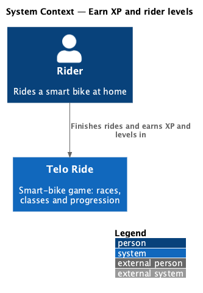
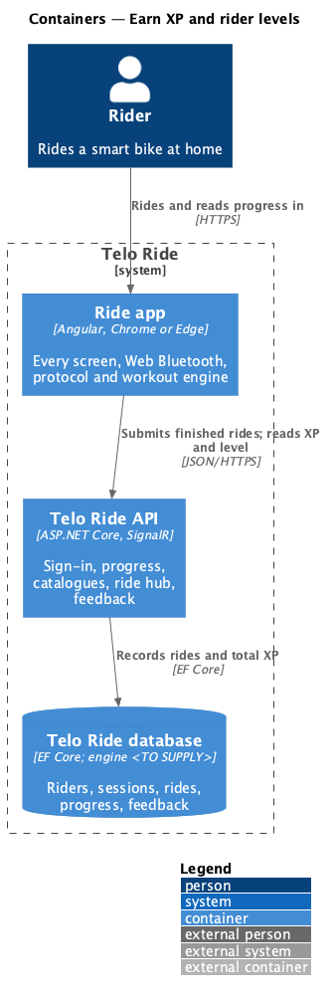
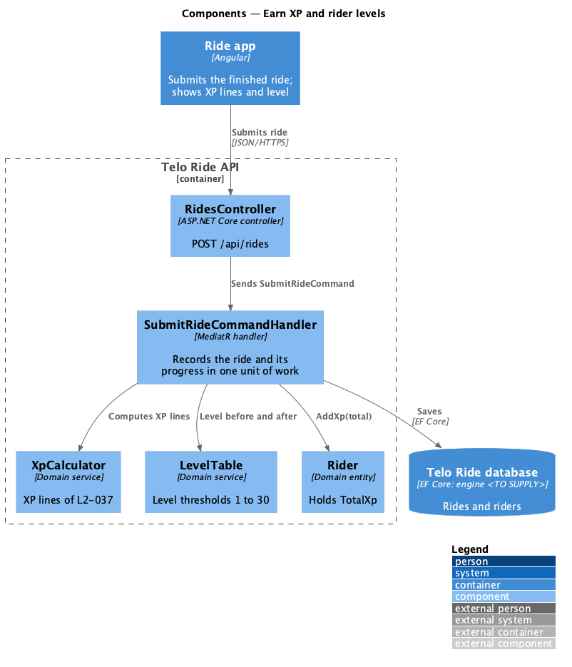
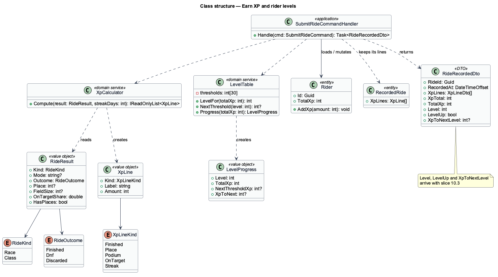
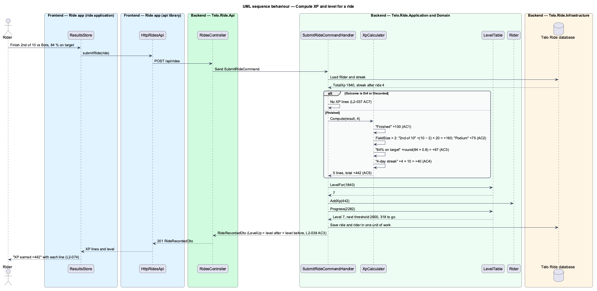
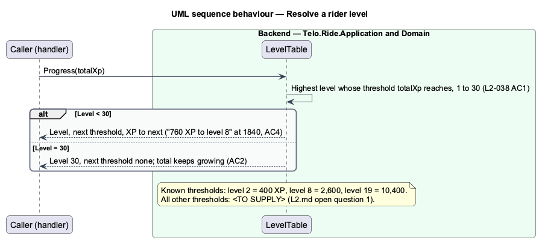

# Earn XP and rider levels

## Overview

Telo Ride rewards every finished ride with experience points and turns the running total into a
rank. Both feed the single progression that the Race and Classes doors share (L1-008).

- **XP** — experience points; a whole number of points a finished ride earns, itemised as lines
- **XP line** — one labelled reason for XP with its amount, such as "Finished" +100
- **total XP** — sum of every XP line the rider has earned; it never decreases
- **rider level** — rank from 1 to 30; the highest level whose threshold the total XP reaches
- **on-target share** — percentage of running seconds in which the rider's power was within 10 %
  of the target power
- **field** — number of riders, people and bots, in a ride with places

The backend computes XP from the result it records (L2-125), so a browser cannot award itself
XP (L2-044). The Ride app only shows what the backend returns: the XP lines on Results (L2-074),
the level and XP in the header (L2-032), and "{n} XP to level {n+1}" on Profile (L2-109).

## Description

The slice lives almost entirely in the backend domain. It is invoked by the ride submission of
`keep-progress-on-the-backend`.

- **`RideResult`** — value object in `Telo.Ride.Domain`. It carries the ride's `RideKind`
  (`Race` or `Class`, as `RecordedRide` keeps it) and race mode (`solo` or `bots`), its
  `RideOutcome` (`Finished`, `Dnf`, `Discarded`), the place and field size, and the on-target
  share. `HasPlaces` is true for a bots race; riders-online races, group classes and custom
  workouts join the kinds and modes with the slices that build them. The app sends the on-target
  share with the ride (`onTargetShare`, 0 to 1): its `RideRecorder` counts each running second
  whose power is within 10 % of the target power (`PowerModel.onTarget`). Until a ride that
  does not finish is submitted, every recorded ride is `Finished`. For a riders-online race or group class the place comes from
  the multiplayer service's record (L2-125); for other rides it comes from the submitted ride
  after the plausibility checks of L2-125 AC2.
- **`XpCalculator`** — domain service. `Compute(result, streakDays)` returns the XP lines in a
  fixed order:
  1. "Finished" +100 for any finished ride.
  2. "{place} of {field}" +(field − place) × 20, only when the field has more than 2 riders.
  3. "Podium" +75 for places 1 to 3, under the same condition.
  4. "{p}% on target" +round(p × 0.8).
  5. "{n}-day streak" +n × 10, when n > 0.

  A solo race, a solo class and a custom workout have no place or podium line. A ride that ends
  as DNF or is discarded earns no lines. `streakDays` is the streak after the ride is recorded,
  so the XP line and the header agree (L2-042 AC4); until the streak is kept (slice 10.4) it is
  0. "{p}% on target" uses p, the share as a whole percentage, and +round(p × 0.8).
- **`XpLine`** and **`XpLineKind`** — value object and enumeration for one line.
- **`LevelTable`** — domain service holding 30 thresholds. `LevelFor(totalXp)` returns the
  highest level reached; `Progress(totalXp)` returns a `LevelProgress` with the level, the next
  threshold and the XP to it. At level 30 the next threshold is `null` and the level stays 30.
  Three thresholds are known: level 2 needs 400 XP, level 8 needs 2,600 and level 19 needs
  10,400. The rest are provisional until open question 1 in `docs/specs/L2.md` is settled. They
  keep the mocks' riders where the mocks draw them (the mid rider at level 7 with 1,840 XP, the
  veteran at level 18 with 9,120), so level 7 needs no more than 1,840 and level 18 no more than
  9,120:

  | Level | XP | Level | XP | Level | XP |
  |---|---|---|---|---|---|
  | 1 | 0 | 11 | 4,400 | 21 | 12,400 |
  | 2 | 400 | 12 | 5,000 | 22 | 13,400 |
  | 3 | 650 | 13 | 5,600 | 23 | 14,400 |
  | 4 | 900 | 14 | 6,200 | 24 | 15,400 |
  | 5 | 1,150 | 15 | 6,800 | 25 | 16,400 |
  | 6 | 1,450 | 16 | 7,400 | 26 | 17,400 |
  | 7 | 1,800 | 17 | 8,000 | 27 | 18,400 |
  | 8 | 2,600 | 18 | 8,600 | 28 | 19,400 |
  | 9 | 3,200 | 19 | 10,400 | 29 | 20,400 |
  | 10 | 3,800 | 20 | 11,400 | 30 | 21,400 |

  The table is data in the domain project, so a change needs no app code.
- **`Rider`** — entity whose `AddXp(amount)` raises `TotalXp`.
- **`RecordedRide`** — keeps its XP lines with it, so a repeat of the ride id answers with the
  same lines and adds nothing to the rider (L2-125 AC3).
- **`SubmitRideCommandHandler`** — MediatR handler (see `keep-progress-on-the-backend`). It
  calls `XpCalculator`, adds the total to the rider, compares `LevelTable.LevelFor` before and
  after, and returns `RideRecordedDto` with the lines, the total, the new level, `LevelUp` and
  the XP to the next level. Slice 10.2 returns the lines, the ride's total and the rider's new
  total XP; slice 10.3 adds `level`, `levelUp`, `nextLevelXp` (the next level's threshold) and
  `xpToNextLevel`, both `null` at level 30. They follow from the total the ride keeps, so a
  repeat of the ride id answers the same. Results shows them with journey 11 (L2-038 AC3).
- **`GetProgressQuery`** — MediatR query behind `GET /api/progress` (see
  `home/show-the-app-header`). It answers the rider's `ProgressDto`: `level`, `totalXp` and
  `nextLevelXp` from `LevelTable.Progress`, and `streakDays`, 0 until slice 10.4 keeps it; the
  maps join it with the slices that unlock them.

Unit tests cover `XpCalculator` with one case per criterion of L2-037, including the worked
example of AC5, and `LevelTable` with one case per row of its table and the cap at level 30.

## Requirements

| L2 ID | Refines (L1) | Requirement |
|-------|--------------|-------------|
| `L2-037` | `L1-008` | The backend shall compute XP from the result it records (L2-125); any finished ride shall get "Finished" +100. |
| `L2-037` (AC2) | `L1-008` | In a field of more than 2 riders, a ride shall get "{place} of {field}" +(field − place) × 20, and a podium place (1 to 3) shall also get "Podium" +75. |
| `L2-037` (AC3–AC4) | `L1-008` | A ride shall get "{p}% on target" +round(p × 0.8) for the share of running seconds its power was within 10 % of target power, and "{n}-day streak" +n × 10 for a streak of n > 0 days. |
| `L2-037` (AC5) | `L1-008` | 2nd of 10 against bots, 84 % on target and a 4-day streak shall give the lines +100, +160, +75, +67 and +40, a total of +442. |
| `L2-037` (AC6–AC7) | `L1-008` | A solo race, a solo class or a custom workout shall have no place or podium line; a ride that ends as DNF or is discarded shall earn no XP. |
| `L2-038` | `L1-008` | A rider's level shall be the highest level from 1 to 30 whose threshold the total XP reaches; level 2 needs 400 XP, level 8 needs 2,600 and level 19 needs 10,400. |
| `L2-038` (AC2–AC4) | `L1-008` | At level 30 the total shall grow and the level shall stay 30; a ride that takes the total past a threshold shall show the new level with the XP; the mid rider's XP to the next level shall read "760 XP to level 8". |

## Diagrams

### System context

The rider finishes rides in Telo Ride and earns XP and levels there. No external system takes
part.

### Containers

The Ride app submits each finished ride to the Telo Ride API, which computes XP and the level and
records them in the Telo Ride database.

### Components

`SubmitRideCommandHandler` uses `XpCalculator` for the lines and `LevelTable` for the level
before and after, then raises the rider's total XP.

### Class structure

`XpCalculator` reads a `RideResult` and creates `XpLine` values; `LevelTable` creates
`LevelProgress` values. The handler returns both in `RideRecordedDto`.

### Behaviour — compute XP and level for a ride

The worked example of L2-037 AC5 runs through the calculator line by line; a DNF or discarded
ride takes the alternate branch and earns nothing.

### Behaviour — resolve a rider level

`LevelTable` resolves the level, the next threshold and the XP to go, and caps the level at 30
while the total keeps growing.

